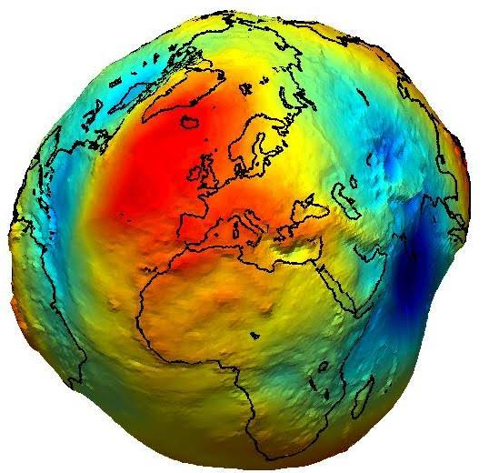
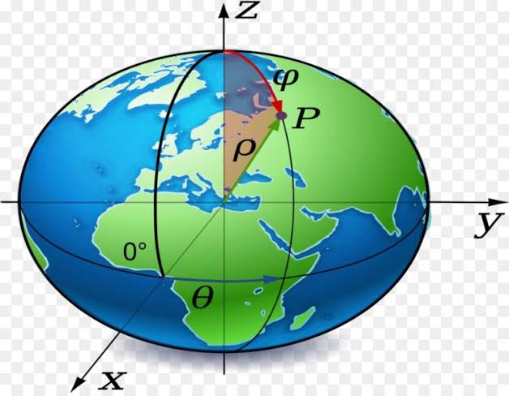
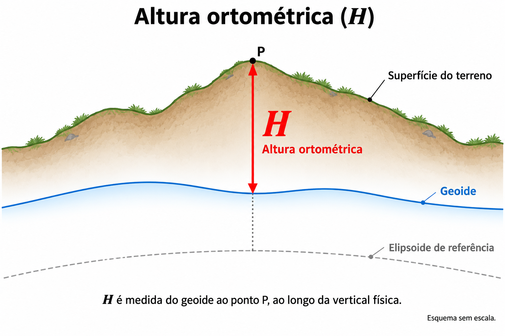
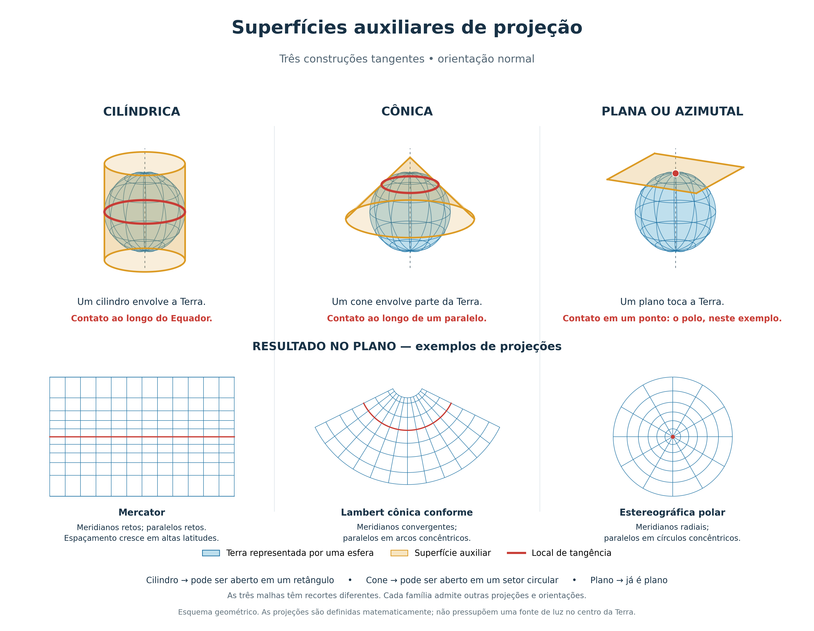
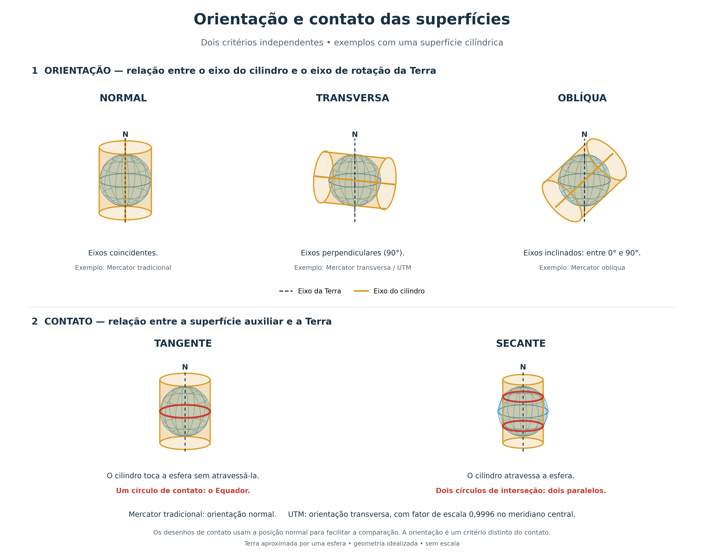
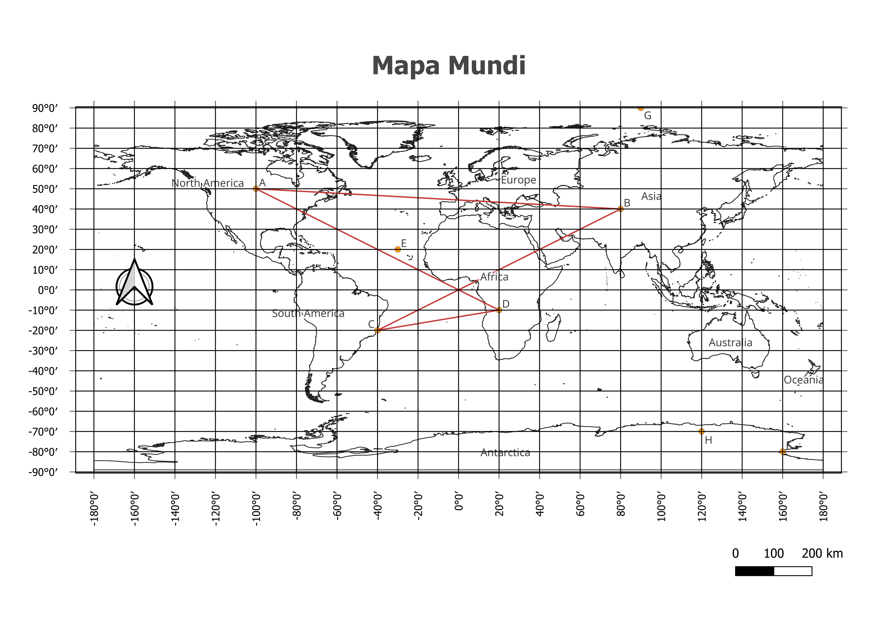
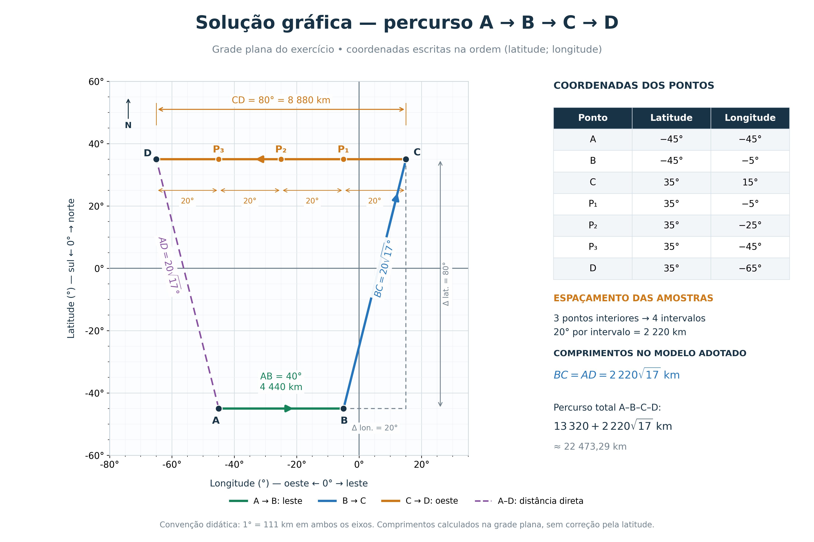
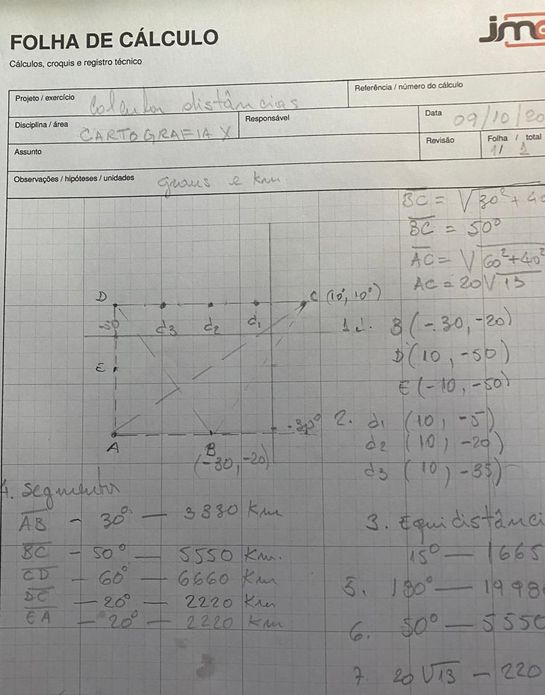

# Notas de Cartografia
## 1. Superfícies da Terra

Para representar a Terra, precisamos distinguir sua superfície física dos modelos usados para calcular posições e produzir mapas.

### 1.1 Superfície física ou topográfica

É a superfície com suas irregularidades reais: montanhas, vales, planícies e fundo oceânico. O relevo é muito complexo para servir diretamente como base matemática simples dos cálculos cartográficos.

Um modelo digital de elevação representa valores de altitude dessa superfície em uma malha. Em Oceanografia, uma representação batimétrica descreve o relevo submerso, com profundidades vinculadas a uma referência vertical especificada.

### 1.2 Geoide

É uma **superfície equipotencial do campo da gravidade terrestre**, próxima do nível médio dos mares em repouso e prolongada idealmente sob os continentes.

“Equipotencial” significa que o potencial da gravidade tem o mesmo valor em todos os seus pontos. A direção da gravidade é perpendicular a essa superfície. Por isso, o geoide se relaciona à vertical física, indicada idealmente pelo fio de prumo.

  

Ele apresenta ondulações em relação ao elipsoide, associadas à distribuição de massas e ao campo de gravidade. **Essas ondulações não reproduzem diretamente o relevo:** uma montanha não produz uma montanha equivalente no geoide.

O nível instantâneo do mar também não é o geoide: ondas, marés, pressão atmosférica e circulação oceânica alteram a superfície observada.

### 1.3 Elipsoide de revolução

É uma superfície matemática regular obtida pela rotação de uma elipse em torno de seu eixo menor. Aproxima o achatamento da Terra nos polos e permite cálculos de coordenadas e distâncias.

Seus parâmetros básicos são o semieixo maior $a$, equatorial, e o semieixo menor $b$, polar. O achatamento é:

$$
f=\frac{a-b}{a}
$$

Como $a>b$, a Terra é modelada como um elipsoide oblato. O elipsoide **GRS80** é utilizado pelo SIRGAS2000.

 

### 1.4 Esfera

É uma simplificação útil para explicações e cálculos aproximados. Neste material, quando adotarmos a Terra esférica, usaremos:

$$
R\approx 6\,371\ \text{km}
$$

A esfera facilita os cálculos, mas não representa o achatamento terrestre. Para trabalhos de maior precisão, utilizam-se modelos elipsoidais.

### 1.5 Comparação essencial

| Superfície | Característica | Uso principal |
|---|---|---|
| Física/topográfica | Relevo real e irregular | Descrição do terreno e do fundo oceânico |
| Geoide | Equipotencial da gravidade | Referência conceitual para altitudes ortométricas |
| Elipsoide | Modelo matemático regular | Posicionamento geodésico e cálculos |
| Esfera | Modelo simplificado | Aproximações e explicações iniciais |

### 1.6 Altitudes: cuidado com a referência

No modelo clássico que relaciona o elipsoide ao geoide:

$$
h\approx H+N
$$

- $h$: altitude elipsoidal, referida ao elipsoide;
- $H$: altitude **ortométrica**, referida ao geoide; que é distância vertical medida ao longo da linha de prumo entre um ponto na superfície terrestre e o geóide (superfície equipotencial que se aproxima do nível médio do mar)
- $N$: ondulação geoidal, separação entre geoide e elipsoide, com sinal.

**Exemplo:** se $h=50\ \text{m}$ e $N=-5\ \text{m}$:

$$
H\approx h-N=50-(-5)=55\ \text{m}
$$

Essa relação explica por que a altitude obtida por GNSS não é automaticamente uma altitude referida ao nível do mar. **Observação sobre o Brasil:** o IBGE trabalha com altitudes normais na rede altimétrica; nesse caso, entram o quase-geoide e a anomalia de altitude. Não se deve tratar altitude normal e ortométrica como sinônimos.

**Para responder na prova:** geoide é uma superfície física definida pela gravidade; elipsoide é uma superfície matemática usada para modelar a Terra.

## 2. Sistemas de coordenadas

Um sistema de coordenadas permite expressar numericamente uma posição. Para localizar um ponto sem ambiguidade, também precisamos conhecer seu **sistema de referência** e suas unidades.

### 2.1 Coordenadas geográficas: latitude e longitude

**Latitude ($\varphi$)** indica a posição ao norte ou ao sul do Equador. Na definição geodésica, é o ângulo entre a normal ao elipsoide no ponto e o plano equatorial.

- Varia de $0^\circ$ a $90^\circ$ norte ou sul.
- Na notação com sinais: norte positivo; sul negativo.
- O Equador tem latitude $0^\circ$.
- Os paralelos são linhas de mesma latitude.

**Longitude ($\lambda$)** indica a posição a leste ou oeste do meridiano de origem, convencionalmente Greenwich. É o ângulo entre o plano do meridiano local e o plano do meridiano de referência.

- É frequentemente expressa entre $-180^\circ$ e $+180^\circ$.
- Na notação com sinais: leste positivo; oeste negativo.
- Meridianos são linhas de mesma longitude e convergem nos polos.

> Latitude e longitude são **ângulos**. Sua unidade é grau, minuto ou segundo angular; a distância correspondente depende da direção e da posição na Terra.

**Exemplo hipotético próximo ao litoral fluminense:** latitude $-22^\circ$ e longitude $-41^\circ$ correspondem a $22^\circ\text{ S}$ e $41^\circ\text{ W}$.

### 2.2 Paralelos e meridianos

| Elemento | Coordenada associada | Propriedade |
|---|---|---|
| Paralelo | Latitude | Círculo paralelo ao Equador; seu comprimento diminui em direção aos polos |
| Meridiano | Longitude | Semicírculo que liga os polos |
| Equador | Latitude zero | Maior paralelo |
| Greenwich | Longitude zero | Meridiano de origem das longitudes |

Na esfera, o Equador é um círculo máximo. Um meridiano com seu antimeridiano também forma um círculo máximo. Os demais paralelos são círculos menores.

### 2.3 Graus, minutos e segundos

$$
1^\circ=60'\qquad\text{e}\qquad1'=60''
$$

Para converter o valor absoluto de uma coordenada de graus, minutos e segundos para graus decimais:

$$
\theta_{\text{decimal}}=G+\frac{M}{60}+\frac{S}{3600}
$$

Depois aplique o sinal do hemisfério ao **resultado inteiro**.

**Exemplo:** converter $22^\circ30'36''\text{ S}$:

$$
22+\frac{30}{60}+\frac{36}{3600}=22+0{,}5+0{,}01=22{,}51
$$

$$
\boxed{\varphi=-22{,}51^\circ}
$$

**Conversão inversa:** $-41{,}275^\circ$.

1. A parte inteira do módulo fornece $41^\circ$.
2. $0{,}275\times60=16{,}5$ minutos.
3. A parte inteira fornece $16'$.
4. $0{,}5\times60=30''$.
5. Como a longitude é negativa: $\boxed{41^\circ16'30''\text{ W}}$.

**Erro comum:** $22^\circ30'$ não é $22{,}30^\circ$, pois $30'=0{,}5^\circ$.

### 2.4 Coordenadas planas ou projetadas

Representam posições em um plano cartográfico, frequentemente em metros. No sistema UTM, utilizamos:

- **E:** coordenada leste (*Easting*);
- **N:** coordenada norte (*Northing*).

As coordenadas E e N precisam estar acompanhadas do **fuso, hemisfério e referencial geodésico**. O mesmo par numérico pode ocorrer em fusos diferentes.

| Sistema | Coordenadas usuais | Unidade usual |
|---|---|---|
| Geográfico | Latitude e longitude | Graus |
| Projetado UTM | E e N | Metros |

### 2.5 Referencial geodésico, datum, SRC e EPSG

O referencial geodésico estabelece a base para associar coordenadas à Terra. Em uma explicação introdutória, o datum envolve o elipsoide e sua vinculação ao planeta; referenciais modernos também envolvem realização, época e movimento das estações.

O **SRC — Sistema de Referência de Coordenadas** — reúne as informações que permitem interpretar as coordenadas. Um SRC projetado inclui também a projeção e seus parâmetros.

**EPSG** é um catálogo que atribui códigos a SRCs e outros objetos geodésicos. O código identifica uma definição; ele não é uma unidade nem um tipo de projeção.

| Código | Nome | Tipo |
|---|---|---|
| EPSG:4674 | SIRGAS 2000 | Geográfico, em graus |
| EPSG:31984 | SIRGAS 2000 / UTM zona 24S | Projetado, em metros |
| EPSG:4326 | WGS 84 | Geográfico, em graus |

**SIRGAS2000 não é uma projeção.** Ele pode servir de referência tanto para coordenadas geográficas quanto para coordenadas projetadas em UTM.

## 3. Medidas de distâncias por latitude e longitude

### 3.1 Por que um grau não equivale sempre à mesma distância?

Em uma esfera, um grau de latitude tem comprimento constante, pois é medido ao longo de meridianos de mesmo raio. Um grau de longitude é medido ao longo de paralelos, cujos raios diminuem em direção aos polos.

No elipsoide, o comprimento de um grau de latitude também varia um pouco com a latitude. A aproximação de $111\ \text{km}$ por grau de latitude é adequada para exercícios introdutórios quando a precisão exigida permitir. A seção 11 trata separadamente da convenção de grade plana empregada nas folhas de exercícios .

### 3.2 Distância ao longo de um meridiano

O comprimento de um arco de circunferência é:

$$
d=R\theta
$$

Aqui, $\theta$ deve estar em **radianos**. Como:

$$
\theta_{\text{rad}}=\theta_{\text{graus}}\frac{\pi}{180}
$$

Para dois pontos no mesmo meridiano:

$$
d=R\frac{\pi}{180}|\Delta\varphi|
\approx111{,}2|\Delta\varphi|\ \text{km}
$$

Na última expressão, $\Delta\varphi$ está em graus e foi adotado $R=6\,371\ \text{km}$.

**Exemplo:** A está em $21^\circ30'\text{ S}$ e B em $22^\circ\text{ S}$, ambos no mesmo meridiano.

$$
|\Delta\varphi|=0{,}5^\circ
$$

$$
\boxed{d\approx111{,}2\times0{,}5=55{,}6\ \text{km}}
$$

### 3.3 Distância ao longo de um paralelo

Na esfera, o raio do paralelo de latitude $\varphi$ é $R\cos\varphi$. Assim:

$$
d_{\text{paralelo}}=R\cos\varphi\frac{\pi}{180}|\Delta\lambda|
$$

$$
\boxed{d_{\text{paralelo}}\approx111{,}2\cos\varphi\,|\Delta\lambda|\ \text{km}}
$$

**Exemplo:** dois pontos em $60^\circ\text{ S}$ estão separados por $2^\circ$ de longitude.

$$
d_{\text{paralelo}}\approx111{,}2\times\cos60^\circ\times2
=111{,}2\times0{,}5\times2
$$

$$
\boxed{d_{\text{paralelo}}\approx111{,}2\ \text{km}}
$$

| Latitude | Distância aproximada de $1^\circ$ de longitude |
|---|---:|
| $0^\circ$ | 111,2 km |
| $30^\circ$ | 96,3 km |
| $60^\circ$ | 55,6 km |
| $90^\circ$ | 0 km: os meridianos se encontram no polo |

**Atenção:** esta fórmula calcula o caminho **sobre o paralelo**. Fora do Equador, esse arco geralmente não é o caminho mais curto sobre a esfera entre os pontos.

### 3.4 Minuto de latitude e milha náutica

Uma milha náutica internacional é definida exatamente como:

$$
\boxed{1\ \text{MN}=1\,852\ \text{m}=1{,}852\ \text{km}}
$$

Um minuto de latitude corresponde **aproximadamente** a uma milha náutica. Essa relação é útil em navegação, mas não constitui uma igualdade geométrica exata em todas as latitudes.

**Exemplo:** $12'$ de latitude, ao longo de um meridiano:

$$
d\approx12\ \text{MN}=12\times1{,}852=22{,}224\ \text{km}
$$

Um minuto de **longitude** não corresponde, em geral, a uma milha náutica: sua extensão diminui com a latitude.

### 3.5 Quando latitude e longitude variam ao mesmo tempo

Para pontos próximos, longe das singularidades polares, podemos aproximar os deslocamentos norte–sul e leste–oeste e aplicar Pitágoras:

$$
\Delta y\approx111{,}2\,\Delta\varphi
$$

$$
\Delta x\approx111{,}2\cos\bar\varphi\,\Delta\lambda
$$

$$
\boxed{d\approx\sqrt{(\Delta x)^2+(\Delta y)^2}}
$$

As diferenças angulares são dadas em graus; as distâncias saem em quilômetros. A latitude média é $\bar\varphi=(\varphi_1+\varphi_2)/2$.

**Exemplo:** A: $(-22{,}0^\circ,-41{,}0^\circ)$; B: $(-22{,}1^\circ,-41{,}1^\circ)$, na ordem latitude, longitude.

$$
|\Delta\varphi|=|\Delta\lambda|=0{,}1^\circ;\qquad\bar\varphi=-22{,}05^\circ
$$

$$
|\Delta y|\approx11{,}12\ \text{km};\qquad
|\Delta x|\approx111{,}2\cos22{,}05^\circ\times0{,}1\approx10{,}31\ \text{km}
$$

$$
\boxed{d\approx\sqrt{11{,}12^2+10{,}31^2}\approx15{,}16\ \text{km}}
$$

Essa aproximação não deve ser estendida automaticamente a trajetos longos. Ao cruzar o antimeridiano, também é necessário usar a menor diferença de longitude: entre $179^\circ\text{ E}$ e $179^\circ\text{ W}$, a separação angular menor é $2^\circ$, e não $358^\circ$.

### 3.6 Distância em coordenadas planas

Para dois pontos no mesmo SRC projetado adequado à região:

$$
\boxed{d_{\text{grade}}=\sqrt{(E_2-E_1)^2+(N_2-N_1)^2}}
$$

**Exemplo:** A: E = 300 000 m, N = 7 600 000 m; B: E = 303 000 m, N = 7 604 000 m.

$$
d_{\text{grade}}=\sqrt{3\,000^2+4\,000^2}=5\,000\ \text{m}=5\ \text{km}
$$

O resultado é uma distância **na grade da projeção**. Para precisão geodésica ou de engenharia, podem ser necessárias correções da projeção e da altitude. Não subtraia diretamente coordenadas UTM de fusos diferentes.

### 3.7 Distância no mapa e escala

Na escala $1:M$, medidas nas mesmas unidades obedecem a:

$$
D=M\,d_{\text{mapa}}
$$

**Exemplo:** 4 cm em um mapa na escala 1:25 000:

$$
D=4\times25\,000=100\,000\ \text{cm}=1\,000\ \text{m}=1\ \text{km}
$$

Uma escala 1:10 000 é **maior** que 1:100 000: representa uma área menor com possibilidade de mais detalhes. Se o mapa digital ou impresso for redimensionado, sua escala numérica original deixa de valer; uma escala gráfica redimensionada junto com o mapa preserva a relação visual.

## 4. Sistemas de projeções cartográficas

### 4.1 O que é uma projeção?

É um procedimento matemático que transforma posições de uma superfície curva de referência em posições num plano.

A superfície terrestre curva não pode ser representada integralmente em um plano sem deformações. A escolha da projeção depende da área, da finalidade do mapa e da propriedade que se deseja conservar.

**Deformações possíveis:** áreas, ângulos, formas, distâncias e direções. Uma projeção não conserva todas essas propriedades ao mesmo tempo em toda a sua extensão.

### 4.2 Classificação pela superfície de projeção

| Tipo | Superfície auxiliar | Associação didática comum |
|---|---|---|
| Cilíndrica | Cilindro | Mapas de grande extensão; há variantes normais e transversas |
| Cônica | Cone | Regiões de médias latitudes com extensão leste–oeste |
| Plana ou azimutal | Plano | Regiões em torno de um ponto central, inclusive áreas polares |

Essas superfícies ajudam a visualizar a construção. Muitas projeções são definidas por fórmulas e não correspondem a uma projeção óptica literal.

Quanto à orientação, uma projeção pode ser **normal**, **transversa** ou **oblíqua**. Quanto ao contato geométrico idealizado, pode ser **tangente** ou **secante**. A orientação transversa da UTM deve ser distinguida da orientação normal da Mercator tradicional.

### 4.3 Classificação pela propriedade preservada

| Classe | Conserva | Cuidado |
|---|---|---|
| Conforme | Ângulos locais e formas de feições infinitesimais | Não conserva áreas; grandes regiões podem ter sua forma muito alterada |
| Equivalente | Áreas e suas proporções | Pode deformar ângulos e formas |
| Equidistante | Distâncias em linhas ou relações específicas | Não conserva todas as distâncias entre quaisquer pontos |
| Afilática ou de compromisso | Busca uma combinação útil de deformações | Não é rigorosamente conforme nem equivalente |

**Azimutal** também se associa à preservação de azimutes a partir do centro em construções usuais. Não confunda direção preservada a partir de um ponto com preservação de todas as direções do mapa.

### 4.4 Mercator

A Mercator tradicional é cilíndrica normal e conforme. Nela, as **loxodromias**, linhas de rumo constante, são representadas por retas, o que explica sua importância histórica para a navegação.

Suas deformações de área crescem fortemente em altas latitudes. Os polos não podem ser representados a uma distância finita nessa projeção.

**Loxodromia:** cruza os meridianos com ângulo constante. **Ortodromia:** caminho de menor distância na esfera, ao longo de um círculo máximo. Uma reta na Mercator não corresponde, em geral, à menor distância entre dois pontos.

### 4.5 Sistema UTM

UTM significa **Universal Transversa de Mercator**. Utiliza uma projeção transversa de Mercator, conforme, organizada em fusos para limitar as deformações.

Características fundamentais:

- 60 fusos, cada um com $6^\circ$ de longitude;
- numeração de oeste para leste, começando junto ao antimeridiano de $180^\circ$;
- cada fuso tem seu meridiano central;
- coordenadas E e N expressas em metros;
- aplicação convencional entre aproximadamente $80^\circ\text{ S}$ e $84^\circ\text{ N}$;
- fator de escala no meridiano central: $k_0=0{,}9996$.

O meridiano central recebe **E = 500 000 m**. No hemisfério sul, o Equador recebe **N = 10 000 000 m**; no hemisfério norte, N = 0 m. Essas falsas origens evitam coordenadas negativas no uso habitual de cada fuso.

**A coordenada N não é a distância ao polo Sul.** No hemisfério sul, ela é construída a partir da distância meridiana ao Equador com a falsa origem adotada.

### 4.6 Encontrando o fuso UTM

Para longitudes usuais entre $-180^\circ$ e $180^\circ$, fora das exceções especiais de altas latitudes:

$$
F=\left\lfloor\frac{\lambda+180}{6}\right\rfloor+1
$$

$\lfloor\ \rfloor$ indica arredondamento para baixo. Na convenção de $+180^\circ$, trata-se o limite para manter a numeração até 60.

**Exemplo:** longitude $41^\circ\text{ W}$, isto é, $\lambda=-41^\circ$:

$$
F=\left\lfloor\frac{-41+180}{6}\right\rfloor+1
=\lfloor23{,}166\ldots\rfloor+1=24
$$

O meridiano central pode ser obtido por:

$$
\lambda_0=6F-183
$$

Para o fuso 24:

$$
\boxed{\lambda_0=-39^\circ}
$$

Esse fuso ocupa a faixa de $42^\circ\text{ W}$ a $36^\circ\text{ W}$. Um ponto a $22^\circ\text{ S}$ e $41^\circ\text{ W}$ fica no fuso **24, hemisfério sul**.

### 4.7 Como escolher a projeção em uma questão conceitual

- Comparar áreas de regiões: **procurar uma projeção equivalente.**
- Preservar ângulos locais: **procurar uma projeção conforme.**
- Trabalhar com distâncias a partir de um centro: **considerar uma azimutal equidistante centrada no ponto de interesse.**
- Mapear uma área local dentro de um fuso: **considerar UTM com referencial e hemisfério adequados.**

**Justifique sempre pela finalidade.** Nenhuma projeção é a melhor para todos os mapas.

## 5. Sistemas de Informações Geográficas — SIG

### 5.1 O que é um SIG?

É um sistema que permite reunir, armazenar, consultar, analisar e representar informações vinculadas à localização geográfica.

Ele envolve **dados, programas, equipamentos, pessoas e métodos**. O QGIS é um software usado para operar um SIG; o sistema de trabalho inclui também os dados, os procedimentos e quem os interpreta.

Um mapa é um produto possível do SIG. O SIG também permite responder perguntas, como: quais edificações estão próximas da linha de costa? Que área mudou entre duas datas? Quais estradas atravessam uma zona de risco?

### 5.2 Informação espacial e atributos

Cada feição pode reunir:

- **Geometria:** localização e forma;
- **Atributos:** características descritivas, como nome, tipo, data ou população.

Por exemplo, a geometria de um rio pode ser uma linha; seus atributos podem incluir nome, extensão e classe. A localização e os atributos são relacionados por identificadores dos registros.

### 5.3 Dados vetoriais e matriciais

| Modelo | Estrutura | Exemplos |
|---|---|---|
| Vetorial — ponto | Posição pontual | Estação de coleta, boia, local de referência |
| Vetorial — linha | Sequência de vértices | Estrada, rio, linha de costa |
| Vetorial — polígono | Área delimitada | Município, lago, unidade de conservação |
| Matricial ou raster | Grade de células com valores | Imagem de satélite, elevação, batimetria em grade |

A representação também depende da escala: um rio pode aparecer como linha em um mapa regional e como polígono em um mapa detalhado.

**Resolução espacial do raster:** tamanho da área representada por uma célula. Células menores podem representar mais detalhes, mas não garantem maior exatidão. Reamostrar uma imagem para células menores não cria automaticamente novas informações reais.

### 5.4 Camadas e análises

As informações são organizadas em camadas temáticas, como hidrografia, estradas, limites administrativos, relevo e ocupação urbana.

| Operação | O que faz | Exemplo |
|---|---|---|
| Consulta por atributos | Seleciona por características | Selecionar rios pelo nome |
| Consulta espacial | Seleciona pela posição relativa | Localizar pontos dentro de um município |
| Buffer | Cria uma faixa em torno de feições | Área a até 100 m de uma linha de costa |
| Recorte | Limita dados à área escolhida | Recortar relevo pelo limite municipal |
| Interseção | Combina áreas ou feições coincidentes | Cruzar ocupação urbana e zona de risco |

As análises dependem da qualidade e compatibilidade dos dados. Comparar linhas de costa de datas diferentes, por exemplo, exige considerar resolução, referência espacial, método de extração e condições de aquisição; um deslocamento aparente pode conter erro cartográfico.

### 5.5 SRC da camada e SRC do projeto

O SRC da **camada** descreve suas coordenadas armazenadas. O SRC do **projeto** define como as camadas são apresentadas conjuntamente na tela.

O QGIS pode transformar as camadas durante a visualização. Por isso, uma camada em graus e outra em metros podem aparecer alinhadas, desde que seus SRCs estejam corretamente definidos.

**Atribuir um SRC:** informa como interpretar os números existentes. **Reprojetar:** calcula novas coordenadas em outro SRC. Se os números originais são longitude e latitude, apenas atribuir um SRC UTM não os converte em metros.

Nas medições, verifique o método empregado: o QGIS permite cálculos elipsoidais ou planimétricos, conforme a ferramenta e suas configurações. Um projeto exibido em graus pode medir distâncias em metros por cálculo elipsoidal.

### 5.6 Qualidade e metadados

Antes de usar uma camada, identifique sua fonte, data, escala ou resolução, SRC, método de produção e precisão conhecida. Essas informações são os **metadados**.

Ter muitas casas decimais nas coordenadas não garante boa exatidão. A incerteza depende da aquisição, da referência e do processamento.

## 6. Revisão rápida: diferenças que precisam estar claras

| Não confundir | Diferença essencial |
|---|---|
| Latitude × longitude | Norte–sul em relação ao Equador × leste–oeste em relação a Greenwich |
| Grau × metro | Medida angular × medida de comprimento |
| Geoide × elipsoide | Superfície equipotencial × modelo matemático regular |
| Referencial × projeção | Base geodésica das posições × transformação para o plano |
| SIRGAS2000 × UTM | Referencial geodésico × sistema baseado em projeção transversa de Mercator |
| Conforme × equivalente | Preserva ângulos locais × preserva áreas |
| Equidistante × sem deformação | Preserva distâncias específicas × ausência total de deformação, impossível para um mapa plano de toda a Terra |
| Atribuir SRC × reprojetar | Interpretar coordenadas existentes × calcular novas coordenadas |
| Raster × vetor | Células × pontos, linhas e polígonos |
| Resolução × exatidão | Detalhamento da representação × proximidade do valor de referência |

## 7. Exercícios de revisão

Tente responder antes de consultar o gabarito.

1. Explique as diferenças entre superfície física, geoide e elipsoide.
2. Por que o nível instantâneo do mar não coincide necessariamente com o geoide?
3. Converta $23^\circ15'30''\text{ S}$ para graus decimais.
4. Converta a longitude $-42{,}625^\circ$ para graus, minutos e segundos.
5. Dois pontos no mesmo meridiano estão em $20^\circ10'\text{ S}$ e $20^\circ40'\text{ S}$. Estime sua distância com $111{,}2\ \text{km}$ por grau.
6. Dois pontos a $60^\circ\text{ N}$ diferem em $3^\circ$ de longitude. Calcule o arco sobre o paralelo.
7. Uma diferença de $15'$ de latitude equivale aproximadamente a quantas milhas náuticas e quantos quilômetros?
8. Em um mesmo SRC UTM adequado, $\Delta E=6\,000\ \text{m}$ e $\Delta N=8\,000\ \text{m}$. Qual a distância na grade?
9. Um trecho mede 6 cm em um mapa na escala 1:50 000. Qual a distância correspondente?
10. Por que uma projeção conforme pode representar áreas muito deformadas?
11. Uma projeção equidistante conserva qualquer distância entre dois pontos? Explique.
12. Determine o fuso UTM e o meridiano central para longitude $40^\circ\text{ W}$. Se a latitude é $22^\circ\text{ S}$, qual é o hemisfério?
13. Por que informar apenas E e N não identifica completamente uma posição UTM?
14. Qual é a diferença entre SIRGAS2000 e UTM?
15. Dê um exemplo de dado vetorial pontual, linear, poligonal e um raster na Oceanografia.
16. Uma camada de coordenadas em graus ficou fora do lugar após receber um SRC UTM. Qual pode ter sido o erro?
17. Por que reduzir o tamanho das células de um raster não garante maior exatidão?
18. Para identificar edificações a até 100 m de uma linha de costa, que operações de SIG você poderia usar?

## 8. Gabarito comentado

**1.** A superfície física corresponde ao relevo real. O geoide é uma superfície equipotencial da gravidade, próxima do nível médio dos mares em repouso. O elipsoide é um modelo matemático regular para posicionamento e cálculos.

**2.** Porque a superfície observada sofre efeitos de ondas, marés, pressão atmosférica e circulação; não é uma superfície de equilíbrio gravitacional ideal.

**3.** $-(23+15/60+30/3600)\approx\boxed{-23{,}258333^\circ}$.

**4.** $0{,}625\times60=37{,}5'$; $0{,}5\times60=30''$. Resultado: $\boxed{42^\circ37'30''\text{ W}}$.

**5.** A diferença é $30'=0{,}5^\circ$. Assim, $d\approx111{,}2\times0{,}5=\boxed{55{,}6\ \text{km}}$.

**6.** $d\approx111{,}2\cos60^\circ\times3=\boxed{166{,}8\ \text{km}}$. É o arco sobre o paralelo.

**7.** Aproximadamente $\boxed{15\ \text{MN}}$; convertendo as milhas: $15\times1{,}852=\boxed{27{,}78\ \text{km}}$.

**8.** $\sqrt{6\,000^2+8\,000^2}=\boxed{10\,000\ \text{m}=10\ \text{km}}$.

**9.** $6\times50\,000=300\,000\ \text{cm}=\boxed{3\ \text{km}}$.

**10.** A conformidade preserva ângulos locais; ela não exige conservação das áreas. A ampliação de escala pode variar muito entre regiões.

**11.** Não. Conserva distâncias em determinadas linhas ou relações, conforme a definição da projeção.

**12.** $F=\lfloor140/6\rfloor+1=24$; $\lambda_0=6\times24-183=-39^\circ$. Resultado: $\boxed{\text{fuso 24, hemisfério sul; meridiano central }39^\circ\text{ W}}$.

**13.** Porque os valores se repetem entre fusos e referenciais. É preciso conhecer o fuso, o hemisfério e o referencial geodésico.

**14.** SIRGAS2000 é um referencial geodésico. UTM é um sistema de coordenadas projetadas organizado em fusos, baseado na projeção transversa de Mercator.

**15.** Ponto: boia; linha: transecto; polígono: área de amostragem; raster: batimetria em grade.

**16.** Pode ter sido atribuído um novo SRC sem reprojetar. Os valores angulares passaram a ser interpretados como coordenadas métricas. É necessário identificar corretamente o SRC original e então transformar as coordenadas.

**17.** Porque a reamostragem pode apenas interpolar os valores existentes. Ela não melhora automaticamente a qualidade do levantamento original.

**18.** Criar um buffer de 100 m em torno da linha e selecionar as edificações que o interceptam, usando referências e métodos de distância adequados. Se o interesse for apenas o lado terrestre, restringir a faixa à área em terra.

  

| Ponto | Lat. | Lon. | Trecho | Distância (km) | Δ Lon. (°) | Δ Lat. (°) |
|:-----:|-----:|-----:|:------:|---------------:|-----------:|-----------:|
| A     |   50 | -100 | **A–B** |      20 010,81 |        180 |         10 |
| B     |   40 |   80 | **B–C** |      14 892,21 |        120 |         60 |
| C     |  -20 |  -40 | **C–D** |       6 751,87 |         60 |         10 |
| D     |  -10 |   20 | **D–A** |      14 892,21 |        120 |         60 |
| **Total** | | | | **56 547,10** | | |

$$
D_{\text{km}}=111\sqrt{(\Delta\lambda)^2+(\Delta\varphi)^2}
$$

Plote os pontos no mapa acima.

| Ponto | Lat. | Lon. | 
|:-----:|-----:|-----:|
| E     |   30° |  -30° |
| F     |  -80° |  160° |
| G     |   90° |   90° |
| H     |  -75° |  135° |

## 9. Folha de fórmulas

| Finalidade | Expressão | Condição/unidade |
|---|---|---|
| GMS para decimal | $G+M/60+S/3600$ | Aplicar depois o sinal ao conjunto |
| Graus para radianos | $\theta_{\text{rad}}=\theta_{\text{graus}}\pi/180$ | Necessário em $d=R\theta$ |
| Arco de meridiano | $d\approx111{,}2$|$\Delta\varphi$| | Diferença em graus; resultado em km |
| Arco de paralelo | $d\approx111{,}2\cos\varphi$|$\Delta\lambda$| | Diferença em graus; resultado em km |
| Distância local aproximada | $d\approx111{,}2\sqrt{(\Delta\varphi)^2+(\cos\bar\varphi\,\Delta\lambda)^2}$ | Pontos próximos; graus e km |
| Distância na grade | $d=\sqrt{(\Delta E)^2+(\Delta N)^2}$ | Mesmo SRC projetado adequado |
| Escala | $D=M\,d_{\text{mapa}}$ | Distâncias na mesma unidade |
| Fuso UTM | $F=\lfloor(\lambda+180)/6\rfloor+1$ | Longitude leste positiva; observar limites e exceções |
| Meridiano central UTM | $\lambda_0=6F-183$ | Resultado em graus |
| Relação clássica de altitudes | $h\approx H+N$ | $H$ ortométrica; $N$ ondulação geoidal |

> **Calculadora:** nas expressões com latitude em graus, use o modo angular DEG ao calcular o cosseno. Se trabalhar em radianos, converta os ângulos e mantenha a formulação coerente.

## 10. Checklist antes da prova

- [x] Sei distinguir geoide, elipsoide, esfera e superfície física.

  - **Geoide:** superfície equipotencial do campo da gravidade terrestre, próxima do nível médio dos mares em repouso e prolongada idealmente sob os continentes.
  - **Elipsoide de revolução:** modelo matemático que representa o achatamento da Terra nos polos, aproximando sua forma global melhor que uma esfera.
  - **Esfera:** modelo simplificado, útil para explicações didáticas e cálculos aproximados.
  - **Superfície física ou topográfica:** superfície real da Terra, com suas irregularidades de relevo.

- [x] Sei explicar latitude e longitude e aplicar seus sinais.

  - **Latitude geodésica:** ângulo entre a normal ao elipsoide no ponto considerado e o plano do Equador. Varia de −90° a +90°. É positiva ao norte e negativa ao sul.
  - **Longitude:** ângulo entre o plano do meridiano local e o plano do meridiano de Greenwich. Varia de −180° a +180°. É positiva a leste e negativa a oeste.

- [x] Sei converter GMS e graus decimais nos dois sentidos.

  **De graus, minutos e segundos para graus decimais:**

  $$
  |\theta_d|=G+\frac{M}{60}+\frac{S}{3600}
  $$

  Calculo primeiro o módulo e depois aplico o sinal ao resultado inteiro: negativo para sul ou oeste; positivo para norte ou leste.

  **De graus decimais para graus, minutos e segundos:**

  1. Trabalho com o módulo da coordenada.
  2. A parte inteira fornece os graus.
  3. Multiplico a parte decimal por 60; a parte inteira do resultado fornece os minutos.
  4. Multiplico a parte decimal restante por 60; o resultado fornece os segundos.
  5. Recupero o hemisfério pelo sinal original.

  **Exemplo:** latitude −22,625° corresponde a 22°37′30″ S.

- [ ] Sei quando usar e quando não usar o cosseno da latitude.

  - Na aproximação esférica, uso o cosseno da latitude para calcular a distância ao longo de um paralelo a partir da diferença de longitude:

    $$
    d_{\text{paralelo}}\approx111{,}2\cos\varphi\,|\Delta\lambda|
    $$

  - Para calcular a distância ao longo de um meridiano, não uso esse fator:

    $$
    d_{\text{meridiano}}\approx111{,}2\,|\Delta\varphi|
    $$

  - Nessas expressões, as diferenças angulares estão em graus e as distâncias saem em quilômetros.
  - Nos exercícios de grade plana que estamos treinando, foi adotada separadamente a convenção simplificada de **1° = 111 km nos dois eixos**.

- [ ] Sei diferenciar arco de paralelo de caminho mínimo.

  - **Arco de paralelo:** trecho de uma linha de latitude constante. Fora do Equador, geralmente não corresponde ao caminho mínimo entre os pontos.
  - **Caminho mínimo na esfera:** menor arco de círculo máximo entre os pontos.
  - **Caminho mínimo no elipsoide:** geodésica de menor comprimento entre os pontos; não é, em geral, um arco de circunferência.

- [x] Sei converter milhas náuticas para quilômetros.

  $$
  1\ \text{MN}=1852\ \text{m}=1{,}852\ \text{km}
  $$

  - Para converter milhas náuticas em quilômetros, multiplico por 1,852.
  - Para converter quilômetros em milhas náuticas, divido por 1,852.

- [x] Sei calcular distâncias na grade e pela escala.

  **Na grade plana:**

  $$
  d=\sqrt{(\Delta E)^2+(\Delta N)^2}
  $$

  As coordenadas devem pertencer ao mesmo SRC projetado adequado à região.

  **Pela escala 1:M:**

  $$
  D=M\,d_{\text{mapa}}
  $$

  A distância no mapa e a distância correspondente devem ser expressas na mesma unidade antes da conversão final.

- [x] Sei distinguir projeções conformes, equivalentes e equidistantes.

  <ul>
    <li>con<strong>FORME</strong> → <strong>FORMA</strong> — preserva ângulos e formas locais.</li>
    <li>equiv<strong>AL</strong>ente → <strong>ALqueire</strong> → <strong>ÁREA</strong> — preserva áreas e suas proporções; alqueire é uma medida de área.</li>
    <li>equi<strong>DISTANTE</strong> → <strong>DISTÂNCIA</strong> — preserva distâncias em determinadas linhas ou relações específicas da projeção.</li>
  </ul>

- [x] Sei explicar o funcionamento básico da UTM e encontrar um fuso.

  **UTM — Universal Transversa de Mercator** — é um sistema de coordenadas projetadas baseado na projeção transversa de Mercator, que é conforme.

  - Utiliza coordenadas **E — Easting** e **N — Northing**, expressas em metros.
  - Divide a Terra em **60 fusos**, cada um com **6° de longitude**, para limitar as deformações.
  - Uma posição UTM deve informar **E, N, fuso, hemisfério e referencial geodésico**.

  Para encontrar o fuso a partir da longitude:

  $$
  F=\left\lfloor\frac{\lambda+180}{6}\right\rfloor+1
  $$

  A longitude é positiva a leste e negativa a oeste. Os símbolos de piso indicam arredondamento para baixo.

  **Exemplo:** para longitude −43°:

  $$
  F=\left\lfloor\frac{-43+180}{6}\right\rfloor+1
  =22+1=23
  $$

  A fórmula exige atenção aos limites dos fusos e às exceções especiais de altas latitudes.

- [x] Sei distinguir referencial, projeção e código EPSG.

  - **Referencial geodésico:** estabelece a base para expressar posições em relação à Terra, incluindo origem, orientação e escala.
  - **Projeção cartográfica:** transformação matemática da superfície curva de referência para um plano. Essa representação necessariamente apresenta deformações.
  - **Código EPSG:** identificador de uma definição em um catálogo de sistemas de referência e outros objetos geodésicos.

  **Exemplo:** EPSG:31983 identifica o SRC **SIRGAS 2000 / UTM zona 23S**.

- [x] Sei distinguir raster, vetor, geometria e atributos.

  - **Raster ou matricial:** grade de células que armazenam valores, como cores, altitudes, profundidades ou temperaturas. Um GeoTIFF é um exemplo de formato usado para dados raster.
  - **Vetor:** representação de feições por pontos, linhas e polígonos. GeoPackage e Shapefile são exemplos de formatos utilizados para dados vetoriais.
  - **Geometria:** localização, forma e dimensões de uma feição.
  - **Atributos:** informações descritivas associadas à feição, como nome, tipo, data ou população.

- [x] Sei explicar a diferença entre atribuir SRC e reprojetar.

  - **SRC — Sistema de Referência de Coordenadas:** conjunto de definições que permite relacionar coordenadas a posições na Terra.
  - **Atribuir SRC:** informar como interpretar as coordenadas existentes, sem recalcular seus valores.
  - **Reprojetar:** calcular novas coordenadas em outro SRC.

  **Exemplo:** atribuir um SRC UTM a valores armazenados como latitude e longitude não os converte em metros. É necessário identificar corretamente o SRC original e realizar a transformação.

## 11. Problemas de percurso: pontos, deslocamentos e distâncias

Esta seção foi acrescentada a partir das duas imagens enviadas: a folha de exercício da UERJ e sua resolução do exercício de treino cujo enunciado foi elaborado anteriormente por mim.

### 11.1 A convenção de cálculo destes exercícios

A resolução apresentada nas fotos trabalha com uma **grade plana de latitude e longitude**, adotando:

$
1^\circ\longleftrightarrow111\ \text{km}
$

Nessa convenção, os dois eixos recebem o mesmo fator e as diagonais são calculadas por Pitágoras. Vamos usá-la nesta seção para reproduzir o método de treino.

**O fator constante nos dois eixos é uma simplificação didática.** Na superfície terrestre, a distância por grau de longitude depende da latitude. Assim, as “distâncias em graus” abaixo são comprimentos na grade angular do exercício, não necessariamente ângulos centrais nem distâncias geodésicas. O enunciado fotografado não explicita essa convenção; ela foi inferida das contas apresentadas. Se a prova especificar outro modelo, siga a hipótese informada.

### 11.2 Como transformar o enunciado em coordenadas

Nesta seção, os pares estão na ordem:

$
P=(\text{latitude};\ \text{longitude})=(\varphi;\lambda)
$

No desenho, coloque longitude no eixo horizontal e latitude no vertical. Assim, embora a latitude seja escrita primeiro no par, ela é representada no eixo vertical.

| Deslocamento | Coordenada alterada | Operação |
|---|---|---|
| Norte | Latitude | Somar |
| Sul | Latitude | Subtrair |
| Leste | Longitude | Somar |
| Oeste | Longitude | Subtrair |

**Não troque o sinal por estar em um hemisfério negativo.** Mover-se para leste sempre aumenta a longitude: de $-45^\circ$ para $-5^\circ$, por exemplo. Mover-se para oeste sempre diminui a longitude.

Se o deslocamento é dado em quilômetros, converta primeiro:

$
\delta=\frac{d_{\text{km}}}{111}
$

Com $\delta$ em graus da grade:

$
\begin{aligned}
\text{Norte: }&(\varphi;\lambda)\to(\varphi+\delta;\lambda)\\
\text{Sul: }&(\varphi;\lambda)\to(\varphi-\delta;\lambda)\\
\text{Leste: }&(\varphi;\lambda)\to(\varphi;\lambda+\delta)\\
\text{Oeste: }&(\varphi;\lambda)\to(\varphi;\lambda-\delta)
\end{aligned}
$

### 11.3 Distância de um trecho, percurso total e distância direta

São três perguntas diferentes:

- **Trecho:** distância entre dois pontos consecutivos do percurso.
- **Percurso total:** soma dos comprimentos de todos os trechos efetivamente percorridos.
- **Distância direta:** ligação entre os pontos indicados, independentemente do percurso intermediário.

Na grade simplificada:

$
d_{\text{grade},^\circ}=\sqrt{(\varphi_2-\varphi_1)^2+(\lambda_2-\lambda_1)^2}
$

$
d_{\text{km}}=111\,d_{\text{grade},^\circ}
$

Use Pitágoras quando as duas coordenadas mudarem. Quando somente uma variar, a distância na grade será o módulo dessa variação.

### 11.4 Pontos intermediários equidistantes

**Três pontos novos entre duas extremidades produzem quatro intervalos.**

De modo geral, $n$ pontos interiores igualmente espaçados entre P e Q produzem $n+1$ intervalos iguais:

$
s=\frac{PQ}{n+1}
$

As coordenadas do ponto intermediário de índice $i$, contando a partir de P, são:

$
P_i=\left(
\varphi_P+\frac{i}{n+1}(\varphi_Q-\varphi_P);
\lambda_P+\frac{i}{n+1}(\lambda_Q-\lambda_P)
\right)
$

Para três pontos, use $i=1,2,3$ e denominador 4. Essa interpolação vale para segmentos retos na grade adotada.

### 11.5 Exercício de Cartografia — Sistema de Coordenadas

Você inicia uma campanha de campo partindo do ponto **A (−45°; −45°)** e segue, em linha reta para **leste**, para o ponto **B**, distante **4 440 km**.

A partir do ponto B, você segue para o ponto **C (35°; 15°)** e, deste, desloca-se para o ponto **D**, a **8 880 km a oeste de C**, em linha reta.

No deslocamento entre os pontos C e D, você registra **3 (três) novos pontos de amostragem**, todos equidistantes.

## Questões

Com base nas informações acima, determine:

a) Quais as coordenadas geográficas do ponto B?

b) Quais as coordenadas geográficas do ponto D?

c) Quais as coordenadas geográficas dos novos 3 (três) pontos registrados?

d) Qual a equidistância entre os novos 3 (três) pontos registrados?

e) Qual a distância total percorrida, em km?

f) Qual a distância total percorrida, em graus?

g) Qual a distância, em linha reta, entre os pontos A e D?

**Dados da folha:** saída de $A=(-45^\circ;-45^\circ)$; deslocamento de 4 440 km para leste até B; em seguida, viagem até $C=(35^\circ;15^\circ)$; depois, deslocamento de 8 880 km para oeste até D. Entre C e D são registrados três pontos novos, igualmente espaçados.

#### Solução Gráfica

  

#### a) Coordenadas de B

$
AB=\frac{4\,440}{111}=40^\circ
$

O deslocamento é para leste, portanto a latitude permanece $-45^\circ$ e a longitude aumenta:

$
\lambda_B=-45^\circ+40^\circ=-5^\circ
$

$
\boxed{B=(-45^\circ;-5^\circ)}
$

Esse resultado coincide com sua anotação na folha.

#### b) Coordenadas de D

$
CD=\frac{8\,880}{111}=80^\circ
$

A partida deste trecho é **C**, cuja latitude é $35^\circ$ e cuja longitude é $15^\circ$. Para oeste, subtraímos da longitude:

$
\lambda_D=15^\circ-80^\circ=-65^\circ
$

$
\boxed{D=(35^\circ;-65^\circ)}
$

A latitude de D é a mesma de C. A anotação junto ao item b da primeira foto precisa ser corrigida para esse par.

#### c) Coordenadas dos três pontos intermediários

Os 80° são divididos em quatro intervalos:

$
s=\frac{80^\circ}{4}=20^\circ
$

Partindo de C e seguindo para oeste, subtraímos $20^\circ$ de longitude a cada intervalo.

| Ponto | Latitude | Longitude |
|---|---:|---:|
| C | $35^\circ$ | $15^\circ$ |
| $P_1$ | $35^\circ$ | $-5^\circ$ |
| $P_2$ | $35^\circ$ | $-25^\circ$ |
| $P_3$ | $35^\circ$ | $-45^\circ$ |
| D | $35^\circ$ | $-65^\circ$ |

Logo:

$
\boxed{P_1=(35^\circ;-5^\circ),\quad
P_2=(35^\circ;-25^\circ),\quad
P_3=(35^\circ;-45^\circ)}
$

#### d) Equidistância

$
\boxed{s=20^\circ=20\times111=2\,220\ \text{km}}
$

Esse espaçamento vale entre pontos consecutivos, incluindo C e D na sequência.

#### e) Distância total percorrida em quilômetros

O percurso é A–B–C–D. Os pontos de amostragem estão sobre CD e **não acrescentam um novo comprimento** ao percurso.

Para BC:

$$
\Delta\varphi=35-(-45)=80^\circ
$$

$$
\Delta\lambda=15-(-5)=20^\circ
$$

$$
BC=\sqrt{80^2+20^2}
=\sqrt{6\,800}
=\boxed{20\sqrt{17}{}^\circ}
$$

Convertendo:

$
BC=111\times20\sqrt{17}
=\boxed{2\,220\sqrt{17}\ \text{km}}
$

O total é:

$
L=AB+BC+CD
$

$
\boxed{L=4\,440+2\,220\sqrt{17}+8\,880
=13\,320+2\,220\sqrt{17}\ \text{km}}
$

Como referência numérica:

$
\boxed{L\approx22\,473{,}29\ \text{km}}
$

Sem calculadora, deixe a expressão exata com a raiz.

#### f) Distância total na grade, em graus

$$
L_{^\circ}=40+20\sqrt{17}+80
$$

$$
\boxed{L_{^\circ}=120+20\sqrt{17}\ \text{graus da grade}}
$$

Aproximadamente $202{,}46^\circ$. Escrever apenas $202^\circ$ elimina parte do resultado; sem calculadora, prefira a forma exata.

#### g) Distância direta entre A e D

Use as coordenadas dos pontos inicial e final:

$$
A=(-45^\circ;-45^\circ),\qquad D=(35^\circ;-65^\circ)
$$

$$
\Delta\varphi=35-(-45)=80^\circ
$$

$$
\Delta\lambda=-65-(-45)=-20^\circ
$$

$$
AD=\sqrt{80^2+(-20)^2}
=\boxed{20\sqrt{17}{}^\circ}
$$

$$
\boxed{AD=2\,220\sqrt{17}\ \text{km}\approx9\,153{,}29\ \text{km}}
$$

Nesse exercício, AD e BC têm o mesmo comprimento na grade: ambos têm componentes de módulos 80° e 20°. O sinal de uma componente indica direção; seu quadrado contribui positivamente para o comprimento.

#### Resumo das respostas

| Item | Resultado no modelo simplificado |
|---|---|
| a | $B=(-45^\circ;-5^\circ)$ |
| b | $D=(35^\circ;-65^\circ)$ |
| c | $(35^\circ;-5^\circ)$; $(35^\circ;-25^\circ)$; $(35^\circ;-45^\circ)$ |
| d | $20^\circ=2\,220\ \text{km}$ |
| e | $13\,320+2\,220\sqrt{17}\ \text{km}$ |
| f | $120+20\sqrt{17}$ graus da grade |
| g | $20\sqrt{17}$ graus da grade; $2\,220\sqrt{17}\ \text{km}$ |

### 11.6 Exercício.

| Ponto | Coordenadas $(\varphi;\lambda)$ |
|---|---|
| A | $(-30^\circ;-50^\circ)$ |
| B | $(-30^\circ;-20^\circ)$ |
| C | $(10^\circ;10^\circ)$ |
| D | $(10^\circ;-50^\circ)$ |
| E | $(-10^\circ;-50^\circ)$ |

**Diagonal BC:**

$
BC=\sqrt{[10-(-30)]^2+[10-(-20)]^2}
=\sqrt{40^2+30^2}=50^\circ
$

$
\boxed{BC=5\,550\ \text{km}}
$

**Três pontos interiores de C até D:**

$
s=\frac{60^\circ}{4}=15^\circ=1\,665\ \text{km}
$

$
\boxed{P_1=(10^\circ;-5^\circ),\quad
P_2=(10^\circ;-20^\circ),\quad
P_3=(10^\circ;-35^\circ)}
$

**Percurso fechado A–B–C–D–E–A:**

| Trecho | Comprimento na grade | Comprimento em km |
|---|---:|---:|
| AB | $30^\circ$ | 3 330 |
| BC | $50^\circ$ | 5 550 |
| CD | $60^\circ$ | 6 660 |
| DE | $20^\circ$ | 2 220 |
| EA | $20^\circ$ | 2 220 |
| **Total** | **$180^\circ$** | **19 980** |

**Diagonal AC:**

$$
\begin{aligned}
AC &= \sqrt{40^2+60^2} \\
   &= \sqrt{5200} \\
   &= 20\sqrt{13}{}^\circ
\end{aligned}
$$

$$
\boxed{AC=2\,220\sqrt{13}\ \text{km}}
$$

Essas contas coincidem com os resultados registrados na segunda foto, dentro da convenção simplificada. Como o percurso retorna a A, o deslocamento resultante da viagem completa é zero, embora a distância percorrida seja 19 980 km.

### 11.7 Simplificação de raízes sem calculadora

Procure um quadrado perfeito que seja fator do radicando:

$
\sqrt{6\,800}=\sqrt{400\times17}=20\sqrt{17}
$

$
\sqrt{5\,200}=\sqrt{400\times13}=20\sqrt{13}
$

**Cuidado:** $\sqrt{a^2+b^2}$ não é igual a $a+b$. Para 30 e 40, a hipotenusa é 50, e não 70.

Se o resultado de um trecho for $20\sqrt{17}$ graus da grade, a conversão fica:

$
111\times20\sqrt{17}=2\,220\sqrt{17}\ \text{km}
$

Não é necessário calcular a raiz para fornecer um resultado exato.

### 11.8 Novos exercícios para treinar

**Convenções dos três exercícios:** pares na ordem latitude; longitude, grade plana com o mesmo fator nos dois eixos e $1^\circ=111$ km. Os pontos intermediários dividem todo o trecho em intervalos iguais. Deixe raízes na forma exata.

#### Treino 1 — diagonal com resultado inteiro

Saia de $A=(-20^\circ;-40^\circ)$ e percorra 2 220 km para leste até B. De B, siga diretamente até $C=(10^\circ;20^\circ)$. Depois, percorra 6 660 km para oeste até D e registre três pontos interiores igualmente espaçados entre C e D.

Determine B, D, os três pontos interiores, a equidistância, o percurso total A–B–C–D e a distância direta AD, em graus da grade e quilômetros.

#### Treino 2 — resultado com raiz

Saia de $A=(-25^\circ;-60^\circ)$ e percorra 3 330 km para leste até B. Siga diretamente de B até $C=(15^\circ;0^\circ)$. De C, percorra 8 880 km para oeste até D, registrando três pontos interiores igualmente espaçados.

Determine as mesmas grandezas do Treino 1.

#### Treino 3 — cruzando os eixos e dividindo uma diagonal

Saia de $A=(10^\circ;20^\circ)$ e percorra 2 220 km para sul até B. Depois, percorra 5 550 km para oeste até C. Siga diretamente de C até $D=(30^\circ;0^\circ)$, registrando três pontos interiores igualmente espaçados nesse trecho diagonal.

Determine B, C, os três pontos interiores de CD, sua equidistância, o percurso total A–B–C–D e a distância direta AD.

### 11.9 Gabarito dos novos treinos

#### Treino 1

- $B=(-20^\circ;-20^\circ)$.
- $D=(10^\circ;-40^\circ)$.
- Pontos interiores: $(10^\circ;5^\circ)$, $(10^\circ;-10^\circ)$ e $(10^\circ;-25^\circ)$.
- Equidistância: $15^\circ=1\,665$ km.
- $BC=\sqrt{30^2+40^2}=50^\circ=5\,550$ km.
- Percurso: $20+50+60=\boxed{130^\circ=14\,430\ \text{km}}$.
- Distância direta: A e D têm a mesma longitude; $\boxed{AD=30^\circ=3\,330\ \text{km}}$.

#### Treino 2

- $B=(-25^\circ;-30^\circ)$.
- $D=(15^\circ;-80^\circ)$.
- Pontos interiores: $(15^\circ;-20^\circ)$, $(15^\circ;-40^\circ)$ e $(15^\circ;-60^\circ)$.
- Equidistância: $20^\circ=2\,220$ km.
- $BC=\sqrt{40^2+30^2}=50^\circ=5\,550$ km.
- Percurso: $30+50+80=\boxed{160^\circ=17\,760\ \text{km}}$.
- $AD=\sqrt{40^2+(-20)^2}=\sqrt{2\,000}=20\sqrt5$ graus da grade.
- Distância direta: $\boxed{AD=2\,220\sqrt5\ \text{km}}$.

#### Treino 3

- $B=(-10^\circ;20^\circ)$.
- $C=(-10^\circ;-30^\circ)$.
- De C a D, a latitude aumenta 40° e a longitude aumenta 30°. Cada quarto do segmento acrescenta 10° de latitude e 7,5° de longitude.
- Pontos interiores: $(0^\circ;-22{,}5^\circ)$, $(10^\circ;-15^\circ)$ e $(20^\circ;-7{,}5^\circ)$.
- $CD=\sqrt{40^2+30^2}=50^\circ=5\,550$ km.
- Equidistância: $50^\circ/4=\boxed{12{,}5^\circ=1\,387{,}5\ \text{km}}$.
- Percurso: $20+50+50=\boxed{120^\circ=13\,320\ \text{km}}$.
- $AD=\sqrt{(30-10)^2+(0-20)^2}=20\sqrt2$ graus da grade.
- Distância direta: $\boxed{AD=2\,220\sqrt2\ \text{km}}$.

### 11.10 Roteiro para a prova

1. Escreva a ordem das coordenadas e a convenção de conversão.
2. Faça um croqui com norte para cima e leste para a direita.
3. Converta os deslocamentos de quilômetros para graus da grade.
4. Atualize apenas a coordenada afetada pelo sentido do movimento.
5. Organize uma tabela com todos os pontos.
6. Conte os intervalos antes de dividir um trecho: três pontos interiores significam quatro intervalos.
7. Calcule cada trecho; nas diagonais, use as diferenças de coordenadas.
8. Para o percurso total, some todos os trechos percorridos.
9. Para a distância direta, compare somente os dois pontos pedidos.
10. Simplifique as raízes e indique as unidades.

## Referências para consulta

Os conceitos e cálculos foram apresentados em linguagem didática. A seção 11.5 resolve o exercício da UERJ enviado em fotografia; a seção 11.6 confere o treino anterior elaborado por mim, a partir da folha resolvida pelo estudante. Os demais exercícios são autorais. As referências abaixo permitem aprofundar as definições e os cuidados de uso.

1. **IBGE. Noções básicas de cartografia.** Manual introdutório: [acesso à publicação](https://loja.ibge.gov.br/cartografia/nocoes-basicas-de-cartografia-1999-manuais-tecnicos-em-geociencias-n-8.html).
2. **IBGE. Atlas Geográfico Escolar — Coordenadas geográficas.** [Latitude e longitude](https://atlasescolar.ibge.gov.br/cartografia/21730-coordenadas-geograficas.html).
3. **IBGE. Resolução do Presidente nº 1/2005.** Definição do SIRGAS2000 e do elipsoide GRS80: [PDF](https://geoftp.ibge.gov.br/metodos_e_outros_documentos_de_referencia/normas/rpr_01_25fev2005.pdf).
4. **IBGE. Glossário do Anuário Estatístico do Brasil, 2023.** Conceitos de geoide e referências de altitude: [glossário](https://anuario.ibge.gov.br/2023/glossario-2023.html).
5. **USGS. What is a geographic information system (GIS)?** [Definição de SIG](https://www.usgs.gov/faqs/what-a-geographic-information-system-gis).
6. **QGIS. Working with Projections.** SRC de camada e projeto, atribuição e transformação: [documentação](https://docs.qgis.org/3.44/en/docs/user_manual/working_with_projections/working_with_projections.html).
7. **QGIS. 2D Map View — Measuring.** Métodos de medição: [documentação](https://doc.qgis.org/3.44/en/docs/user_manual/map_views/map_view.html).

**Escopo:** o quadro delimita temas gerais. A profundidade e a nomenclatura exigidas pelo professor devem ser conferidas nas aulas; este material não pressupõe uma lista específica de questões da prova.
