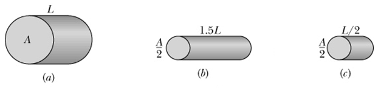

### Disciplina: Física VII
## Lista de exercícios N- 05
Tópico: Corrente e resistência

### Questões 1-10. Indique se as afirmações são falsas ou verdadeiras. Justifique.
1. A corrente é uma grandeza vetorial.  
Falso - A corrente elétrica não pode ser operada como um vetor. Por exemplo: a soma de duas correntes é algébrica e mão vetorial.

2. A corrente contínua constante é toda corrente que muda periodicamente de intensidade e sentido.
Falso - a corrente contínua constante não varia intensidade ou sentido.

3. A seta da corrente é desenhada no sentido oposto em que portadores de carga negativos se moveriam, mesmo que os portadores de carga sejam negativos e se movam no sentido oposto.
Verdadeiro, o sentido convencional é do polo positivo para o negativo, mas o sentido real é o oposto.

4. Em um condutor percorrido por corrente elétrica em regime estacionário, a intensidade da corrente elétrica é diferente em cada seção transversal do condutor.
Falso - A corrente é constante na seção transversal e invariável no intervalo de tempo.

5. A densidade de corrente pode ser representada por linhas de corrente cujo espaçamento é proporcional à densidade de corrente.
Verdadeiro - a relação é diretamente proporcional.

6. O sentido da corrente elétrica é oposto ao sentido do campo elétrico no interior de um condutor.
Falso — a corrente elétrica convencional tem o mesmo sentido do campo elétrico no interior do condutor.

7. A Lei de Ohm estabelece que a resistência não varia em um circuito.
Verdadeiro - a resistência é constante $V=R\cdot I$.

8. A resistência é uma propriedade de um material; e a resistividade é uma propriedade de um componente.
Falso - A resistividade é do material e a resistência é do componente.

9. A potência P, ou taxa de transferência de energia, de um resistor é inversamente proporcional a corrente que conduz quando está submetido a uma diferença de potencial.

10- Em um resistor, parte da energia elétrica é transformada em energia mecânica.
Falso - No resistor parte da energia é convertida em energia térmica.

Questões 11-16. Resolver os exercícios propostos.

11- A figura a seguir mostra três condutores cilíndricos de cobre com os respectivos valores de L e A. Coloque os condutores na ordem da corrente que os atravessa quando a mesma ddp é aplicada em suas extremidades, começando pela maior.

A resistência pode ser expressa por:

$$
R =\rho \frac{L}{A}
$$

Ordem crescente da corrente.

$ a \lt c \lt b$

12. Um fio de cobre, de área de seção transversal 8,0 x10-3 cm2, é percorrido por uma corrente elétrica de 2,0 A. Determine a velocidade média dos elétrons que constituem a corrente elétrica, sabendo que exitem 8,4 x 1022 elétrons livres por cm3.

$$
A = 8\times 10^{-3}\\
I = 2A\\
I = n e A v_d \therefore
$$

$$
v_d=\frac{I}{neA} = \frac{2}{8,4\times 10^{22}\cdot 1,6\times 10^{-19}\cdot 8\times 10^{-3}} = 1,86\times 10^{-2}
$$

13. Um fio condutor de 2,0 m de comprimento possui área de seção transversal de 1,0 mm² e está submetido a uma diferença de potencial de 12 V. Durante um intervalo de 3,0 s, uma carga elétrica de 6,0 C atravessa uma seção transversal do fio. Sabendo que a densidade de elétrons livres no material é n = 5,0×1028 elétrons/m3, e que o módulo da carga do elétron é e = 1,6×10−19 C. Determine:

a) A intensidade da corrente elétrica que percorre o fio. 

$$
I = \frac{\Delta Q}{\Delta t }= \frac{6}{3} = 2A
$$

b) A resistência elétrica do fio.
$$
V = R\cdot I\\
R = \frac{V}{I}
$$
$$
R = \frac{12}{2}=6\Omega
$$
c) A resistividade elétrica do material. 

$$
\rho = \frac{RA}{L} = \frac{6 \times 10^{-6}}{2} = 2 \Omega\cdot m
$$

d) A condutividade elétrica do material.
$$
\sigma = \frac{1}{\rho} = 0,5 \;\Omega^{-1}\,m^{-1}
$$

e) A densidade de corrente elétrica no fio. 

$$
j = \frac{I}{A}= \frac{2}{1\times 10^{-6}} = 2\times 10^6
$$

f) A velocidade de deriva dos elétrons.

$$
v_d = \frac{J}{n\cdot e} = \frac{2\times 10^6}{5\times 10^{28}\cdot 1,6\times 10^{-19}}=2,5\times 10^{-4}
$$

14. Um fio apresenta resistência elétrica inicial de 8,0 Ω. Ele é esticado até que seu comprimento final seja duas vezes maior que o comprimento inicial. Considerando que a resistividade e a densidade do material permanecem constantes, determine a nova resistência elétrica do fio.

O volume do fio é constante, então pela área do cilindro:

O volume de um cilindro é dado por $V = L \cdot A$. Como o volume é constante:
* Se o comprimento duplica ($2L$), a área **inteira** precisa ser dividida por 2 ($\frac{A}{2}$) para que o produto continue igual: $(2L) \cdot (\frac{A}{2}) = L \cdot A$.
* Quem diminui por 4 é o raio elevado ao quadrado ($r^2$), mas a área em si só cai pela metade!

1. **Estado Inicial ($R_1 = 8,0 \;\Omega$):**
   $$R_1 = \rho \frac{L}{A} = 8$$

2. **Estado Final ($R_2$):**
   O novo comprimento é $2L$ e a nova área é $\frac{A}{2}$.
   $$R_2 = \rho \frac{2L}{\frac{A}{2}}$$

3. **Consolidando a fração:**
   Quando dividimos por uma fração, multiplicamos pelo inverso dela:
   $$R_2 = \rho \cdot 2L \cdot \frac{2}{A} = 4 \cdot \left(\rho \frac{L}{A}\right)$$

Como sabemos que $\rho \frac{L}{A} = 8$:
$$R_2 = 4 \cdot 8 = 32 \;\Omega$$

A nova resistência elétrica do fio será de **$32 \;\Omega$** 

15- Uma lâmpada de 100 W é ligada em uma tomada-padrão de 120 V.  

a) Qual o custo mensal para deixar a luz acesa continuamente? Suponha que a energia elétrica custe, com impostos, R$1,17 /kW.h 

$$
P = 100\cdot 10^{-3} = 0,1 Kw
$$

tempo em horas

$$
24\cdot 30 = 720 h
$$

Energia gasta:

$$
E = 720 \cdot 0,1 = 72
$$

Custo:

$$
\text{Custo} = \mathrm{72 kWh \cdot 1,17\; R\$/kWh = \boxed{R\$\;84,24}}   
$$

b) qual a resistência da lâmpada? 

$$
P = VI\\
100 = 120\cdot I\\
I = 0,8333A
$$

$$
P= RI^2\\
\\
R = \frac{100}{0,6944} = 144 \Omega
$$
c) Qual a corrente na lâmpada? 

$$
P = VI\\
100 = 120\cdot I\\
I = 0,8333A
$$

d) A resistência é diferente quando a lâmpada é desligada? 
 Depende do tipo de lâmpada. Os cálculos foram feitos para uma lâmpada incandescente, que pode ter variação da resistência do filamento em função da temperatura.
 
Nas lâmpadas incandescentes (de filamento de tungstênio), a resistência com ela desligada (fria) é cerca de 10 a 15 vezes menor do que quando ela está ligada (quente). Isso acontece porque o tungstênio é um metal e, nos metais, a resistência aumenta conforme a temperatura sobe.

16- Um resistor de resistência elétrica 121 Ω tem dissipação nominal de 100 W. Calcule:

a) a máxima ddp à qual ele poderá ser ligado;  
$$
P= RI^2\\
\\
I = \sqrt{\frac{P}{R}}=\sqrt{\frac{100}{121}}= 0,909\;A
$$

$$
P = VI\\
100 = V\cdot 0,909\\
V = \frac{100}{0,909} 110V
$$

b) a máxima corrente que pode percorrê-lo.   

$$

I = \sqrt{\frac{P}{R}}=\sqrt{\frac{100}{121}}= 0,909\;A
$$