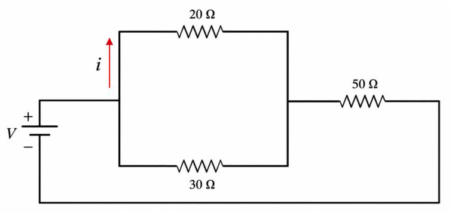
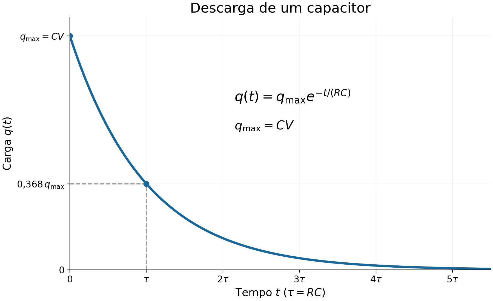

Disciplina: Física VII  

Lista de exercícios N- 06

Tópico: Circuitos elétricos

Questões 1-10. Indique se as afirmações são falsas ou verdadeiras. Justifique.
1.  Em uma associação de resistores em série, a corrente elétrica é a mesma em todos os resistores, mesmo que eles tenham resistências diferentes.

**Verdadeiro, a corrente é a mesma para todos os resistores, o que varia é a ddp.**

2. Ao acrescentar um resistor em série a um circuito, a resistência equivalente diminui, pois a corrente passa a ter mais caminhos disponíveis.

**Falso, ao colocar mais um resistor, a resistência do conjunto aumenta também.**

3. Em uma associação em paralelo, todos os resistores estão submetidos à mesma diferença de potencial.  

**Verdadeiro, o que varia nesse caso são as correntes através dos resistores.**

4. Ao adicionar um novo resistor em paralelo, a resistência equivalente do circuito aumenta, pois há mais resistência conectada ao sistema.

**Não há como afirmar isso, a resistência equivalente é calculada pelo inverso so resultado da média harmônica das resistências.**

5. Dois resistores idênticos ligados em paralelo apresentam uma resistência equivalente menor do que a resistência de apenas um deles.

**Verdadeiro, pela mesma razão do item anterior. A resistência equivalente é calculada pelo inverso so resultado da média harmônica das resistências.**

6. Para medir a corrente elétrica que atravessa um resistor, o amperímetro deve ser conectado em paralelo com o resistor, pois assim recebe a mesma corrente.

**Falso, para medir corrente o amperímetro precisa se conectado em série com o resistor.**

7- Um voltímetro ideal possui resistência interna muito alta e deve ser conectado em paralelo ao resistor cuja diferença de potencial se deseja medir.

**Verdadeiro. Para medir ddp, o voltímetro é conectado em paralelo.**

8. Após um longo intervalo de tempo, um capacitor completamente carregado continua permitindo a passagem de uma corrente constante pelo circuito.

**Falso, depois de um longo tempo, a corrente diminui porque as placas não admitem mais carga.**

9. Em um circuito elétrico, se aumentarmos o valor da resistência R, mantendo a capacitância C constante, o capacitor descarregará mais rapidamente.
**Com uma resistência maior o capacitor levará mais tempo para descarregar**

10.  Em um circuito RC, tanto na carga quanto na descarga do capacitor, a corrente elétrica aumenta com o tempo.

**Falso, na cargam a corrente diminui com o passar do tempo e na descarga também**

### Questões 11-16. Resolver os exercícios propostos.
1. Um resistor de 5 Ω e um resistor de 20 Ω são associados em série e à associação aplica-se uma ddp de 100 V.

a) Qual a resistência equivalente da associação?
$$
R_e = R_1 + R_2 = 5 + 20 = 25\Omega
$$

b) Qual a intensidade de corrente na associação?

$$
V = RI \;\therefore \;I=\frac{V}{R}=\frac{100}{25}=4A
$$

c) Qual a dpp em cada resistor associado?

$$
V_1 = R_1 \cdot I = 5\cdot 4 = 20V
$$

$$
V_2 = R_2 \cdot I = 20\cdot 4 = 80V
$$

2. Um resistor de 5 Ω e um resistor de 20 Ω são associados em paralelo e à associação aplica-se uma ddp de 100 V.

a) Qual a resistência equivalente da associação?

$$
\begin{aligned}
\frac{1}{R_t}&=\frac{1}{R_1}+\frac{1}{R_2}\\[12pt]
\frac{1}{R_t}&=\frac{1}{5}+\frac{1}{20} \;\therefore R_t = 4
\end{aligned}
$$

b) Qual a intensidade de corrente em cada resistor?

$$
\begin{aligned}
V = RI\\[12pt]
I_1 = \frac{V}{R_1}= \frac{100}{5}=20A\\[12pt]
I_2 = \frac{V}{R_2}= \frac{100}{20}=5A
\end{aligned}
$$

c) Qual a intensidade de corrente na associação?

$$
\begin{aligned}
V = RI\\[12pt]
I_t = \frac{V}{R}= \frac{100}{4}= 25A
\end{aligned}
$$

3. Qual é a resistência equivalente da associação a seguir:

Em Paralelo:
$$
\begin{aligned}
\frac{1}{R_t}= \frac{1}{20}+\frac{1}{30} =  12\Omega
\end{aligned}
$$

Em Série:

$$
\begin{aligned}
R_t= 12+50 =  62\Omega
\end{aligned}
$$

4. Um capacitor de capacitância C=45 μF é ligado em série a um resistor de R=100 kΩ e a uma bateria ideal de força eletromotriz ε=12V. Inicialmente, o capacitor encontra-se completamente descarregado. No instante t=0, a chave do circuito é fechada e o capacitor começa a ser carregado.

Desprezando a resistência interna da bateria:

a) Calcule a constante de tempo τ do circuito.

$$
\begin{aligned}
\tau = R\cdot C = 100000 \cdot 45\times 10^{-6}\\[12pt]
\tau = 4,5 s
\end{aligned}
$$

b) Determine a diferença de potencial no capacitor no instante t = τ.

no carregamento, $ddp_c$ é 63% de 12V = 7,56V

c) Calcule a carga armazenada no capacitor nesse mesmo instante.
$$
\begin{aligned}
q &= V\cdot C = 12 \cdot 45\times 10^{-6}\cdot 0,63\\[12pt]
q &= 3,40\times 10^{-4}\;\text{C}
\end{aligned}
$$
d) Determine a diferença de potencial no resistor no instante t = τ.

$$
\begin{aligned}
ddp_{\tau}&= 12 - 7,56\\[12pt]
   ddp_{\tau}&= 12 - 7,56 = 4,4\text{V}

\end{aligned}
$$

e) Qual será a carga máxima armazenada pelo capacitor após um tempo suficientemente longo?

$$
\begin{aligned}
q_{max} &= V\cdot C = 12 \cdot 45\times 10^{-6}\\[12pt]
q_{max} &= 5,4\times 10^{-4}\;\text{C}
\end{aligned}
$$

5. Um capacitor de capacitância C=10 μF é inicialmente carregado por uma bateria ideal de força eletromotriz ε =12 V. Após atingir a carga máxima, a bateria é desconectada e o capacitor passa a descarregar através de um resistor de resistência de R=100 kΩ .Desprezando quaisquer outras resistências do circuito:

a) Calcule a constante de tempo τ do circuito.

$$
\begin{aligned}
\tau = R\cdot C = 100000 \cdot 45\times 10^{-6}\\[12pt]
\tau = 1 s
\end{aligned}
$$
b) Determine a diferença de potencial no capacitor no instante t = τ.

no descarregamento, $ddp_c$ é 37% de 12V = 4,44V

c) Calcule a carga armazenada no capacitor nesse mesmo instante.

$$
\begin{aligned}
q &= V\cdot C = 12 \cdot 10\times 10^{-6}\cdot 0,37\\[12pt]
q &= 4,4\times 10^{-5}\;\text{C}
\end{aligned}
$$

d) Determine a corrente elétrica no circuito no instante t = τ.

$$
\begin{aligned}
I = \frac{V}{R} \\[12pt]
I = \frac{12}{100.000}= 1,2\times 10^{-4}A
\end{aligned}
$$

e) Determine a carga armazenada no capacitor após um tempo suficientemente longo.

$$
q_{max} = V\cdot C = 12 \cdot 10\times 10^{-6} = 1,2\times 10^{-4}\;\text{C}
$$

6. Um capacitor inicialmente descarregado, de capacitância C, é conectado em série a um resistor R e a uma bateria de força eletromotriz ℇ. Após o fechamento da chave, a carga no capacitor varia com o tempo de acordo com
a) Determine a carga armazenada no capacitor no instante inicial, t=0.

Se está descarregado. em t=0 a carga é 0C

b) Determine o valor da carga no limite t=∞.

$$
\begin{aligned}
q_{\infty}= V\cdot C
\end{aligned}
$$

c) Determine a carga no instante correspondente a uma constante de tempo, τ = RC.

$$
\begin{aligned}
q= \epsilon \cdot 0,63\;C = q = C\epsilon\cdot 63\%
\end{aligned}
$$

Expresse o resultado como uma porcentagem da carga máxima qmax = Cℇ.

d) Utilizando os resultados dos itens anteriores, esboce o gráfico de q(t) em função do tempo, indicando claramente:
e a carga máxima qmax = Cℇ

