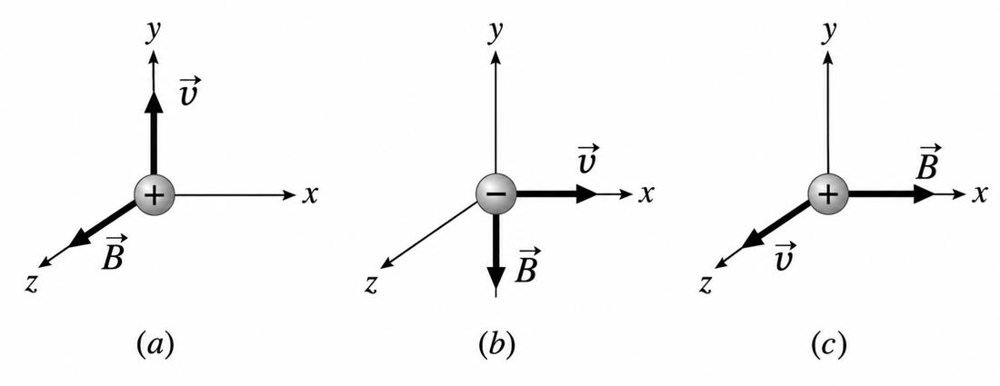

Disciplina: Física VII
Lista de exercícios N. 07
Tópico: Campo magnético

## Questões 1-10. Indique se as afirmações são falsas ou verdadeiras. Justifique.

1. Em um ímã polos opostos se repelem, enquanto polos iguais se atraem.
**Falso, ao contrário os polos opostos se atraem e os iguais se repelem**

2. Campo magnético uniforme é aquele em que o campo magnético é diferente em todos os pontos do espaço, tanto em módulo como em direção e sentido.
**Falso, o campo magnético uniforme é igual em todos os pontos do espaço em módulo, direção e sentido**

2. A unidade de medida do campo magnético no SI é o Tesla (T).
Verdadeiro, Tesla é a unidade de medida para a densidade de fluxo magnético ou indução magnética.

3. Uma carga elétrica em movimento dentro de um campo magnético pode sofrer uma força magnética.

4. Dois resistores idênticos ligados em paralelo apresentam uma resistência equivalente menor do que a resistência de apenas um deles.
Falso, se os dois são idênticos, o resultado não pode ser menor que apenas um deles.

Ex.
dois resistores de 2 $\Omega$
$$
\frac{1}{R_t}=\frac{1}{2}+\frac{1}{2}\\[12pt]
R_t=1
$$
Obviamente $R_t \lt 2$ mas não é menor que 1 deles.

5. Uma carga elétrica em repouso sofre força magnética sempre que estiver em uma região onde exista campo magnético.

**Verdadeiro, uma carga elétrica sofre uma força quando está em um campo magnético**

6. Mantendo a corrente constante, aumentar o número de espiras por unidade de comprimento de um solenoide diminui o campo magnético em seu interior.
**Falso, um maior número de espiras aumenta o campo magnético**

7. A Lei de Ampère é particularmente útil para determinar o campo magnético em situações que apresentam alta simetria, como fios retilíneos longos e solenoides ideais.

**A Lei de Ampère é a lei da física que relaciona a circulação de um campo magnético ao longo de um caminho fechado com a corrente elétrica que passa por dentro desse caminho.**

8. A Lei de Biot.Savart é particularmente útil para determinar o campo magnético em situações que apresentam alta simetria, como fios retilíneos longos e solenoides ideais.

**A Lei de Biot-Savart é uma equação fundamental do eletromagnetismo que permite calcular o campo magnético gerado por uma corrente elétrica estacionária ou por uma carga em movimento.**

9. Uma corrente elétrica percorrendo um fio produz um campo magnético ao redor desse fio.

**Verdadeiro, Quando as cargas elétricas se movimentam pelo condutor, elas geram um campo magnético circular ao redor do fio.**

10. Quanto mais distante estamos de um elemento de corrente, maior é o campo magnético produzido por ele.

**Falso, se aumentar a distância diminui o campo magnético.**

## Questões 11-15. Resolver os exercícios propostos.
11. Um solenoide está constituído por 800 espiras por metro. Calcule a intensidade do vetor indução magnética originado na região central pela passagem da corrente elétrica de intensidade i:0,5A.

$$
B=\mu_0\mu_r\,n\,i
$$ 

Com 
$$
n=800 \text{e} i= 0{,}5
$$

12. Um fio retilíneo longo é percorrido por uma corrente elétrica de 3 A. Utilizando a lei de Ampère, determine a intensidade do vetor indução magnética a uma distância de 3 m do fio. Considere que a permeabilidade magnética no vácuo.

13. Um fio de cobre reto e extenso é percorrido por úma corrente elétrica de intensidade i = 1,5 A. Calcule a intensidade do vetor indução magnética originado num ponto à distância r = 0,25 m do fio.

14. A figura mostra 2 situações nas quais uma partícula carregada com velocidade é submetida a um campo magnético. Qual é a direção e sentido da força magnética a que a partícula é submetida em cada situação?

15. A figura mostra 3 situações nas quais uma partícula carregada com velocidade é submetida a um campo magnético. Qual é a direção e sentido da força magnética a que a partícula é submetida em cada situação?
