# Exercícios anteriores de Geologia

Estes materiais vieram em `geo_iii.zip`. A ficha do ciclo das rochas está em branco. As apresentações regionais são trabalhos anteriores do autor: seus nomes de falhas, idades, medidas e referências ainda precisam ser conferidos. O texto a seguir é uma transcrição dos slides, com os seus registros originais, e não uma revisão científica aprovada.

## Exercício 1 — Ciclo das rochas

Professora indicada na ficha: Renata M. A. Gama. A ficha pede o preenchimento das lacunas com os processos e produtos fornecidos.

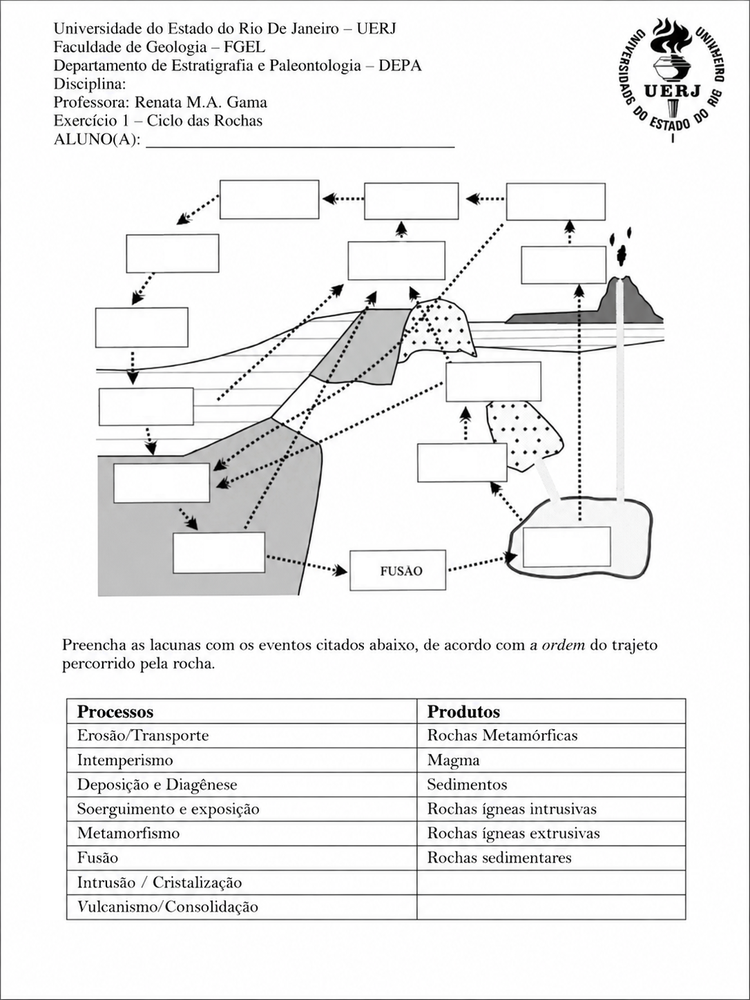

**Processos indicados:** erosão/transporte; intemperismo; deposição e diagênese; soerguimento e exposição; metamorfismo; fusão; intrusão/cristalização; vulcanismo/consolidação.

**Produtos indicados:** rochas metamórficas; magma; sedimentos; rochas ígneas intrusivas; rochas ígneas extrusivas; rochas sedimentares.

A versão redesenhada em LaTeX foi preservada em `originais/geo_iii`. A explicação do ciclo está no capítulo 3 do caderno.

## Falhas do Recôncavo — transcrição do trabalho anterior

Arquivo de origem: `Jose_Mauro_Exercício_4_Falhas_Geológicas_Recôncavo.pptx`. As figuras foram extraídas dos slides sem alteração.

### Slide 1

Falhas Geológicas no Recôncavo Baiano.Jose Mauro X. Elsas

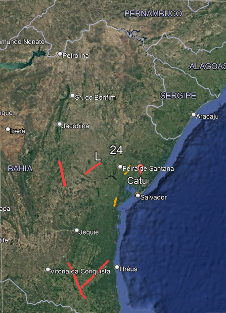

### Slide 2

Um breve histórico.

A Bacia do Recôncavo faz parte do grande Rifte Recôncavo-Tucano-Jatobá que com tem origem na ruptura de Gondwana ocidental e que sofreram as tensões que criaram o Oceano Atlântico Sul.

- Fase Pré-Rifte (Neojurássico ao Eocretáceo Inferior). O estabelecimento do rifte ocorreu por volta de 144 Ma (Berriasiano) e durou 24 milhões de anos.

• Tectônica e Subsidência: É um sistema de falhas normais (N30º-40ºE).

• Rochas Geradoras: folhelhos escuros e anóxicos, que incluem as principais rochas geradoras da bacia.

• Deposição: A bacia foi preenchida por um sistema flúvio-deltaico-lacustre.

- Fase Pós-Rifte (Aptiano em diante).

### Slide 3

Um breve histórico.

Uma discordância angular (break up unconformity) separa a sequência rifte dos depósitos pós-rifte.

• Deposição: A principal unidade pós-rifte é  depositada em uma depressão, marcando a fase de subsidência.

• Eventos Finais: No Cenozóico, ocorreram soerguimentos e erosão significativos,

O Recôncavo possui um sistema petrolífero muito eficiente. A exploração econômica a partir de descoberta pioneira de óleo em Lobato, em 1939. Desde então, mais de 5.000 poços foram perfurados, resultando na descoberta de cerca de 80 campos de óleo e gás. Conhecida como “bacia-escola“ para geólogos.

### Slide 4

Falha de Salvador.

• Subsidência e Deposição: A espessura sedimentar total acumulada durante esta fase excede os 6 km .

◦ O início desta fase (Rio da Serra Inferior) é marcado pela deposição dos folhelhos escuros do Membro Tauá (Formação Candeias) em uma depressão onde a taxa de subsidência superou a taxa de sedimentação. Estes folhelhos, juntamente com os folhelhos do Membro Gomo, incluem as principais rochas geradoras (folhelhos lacustres cinza-escuros, anóxicos) da Bacia do Recôncavo.

FALHA DE SALVADOR

TIPO_ESTRU: Falha extensional (normal)

NOME_ESTRU: FALHA DE SALVADOR

SENTIDO_DE: BLOCO BAIXO A NW

ANG_NORTE: 34

MERGULHO: 0

DESLOC: 0

IDADE_DESL: 0

SENTIDO: NW

REGIME_TEC: Extensional

RUMO: NW

ORIGEM: São Francisco

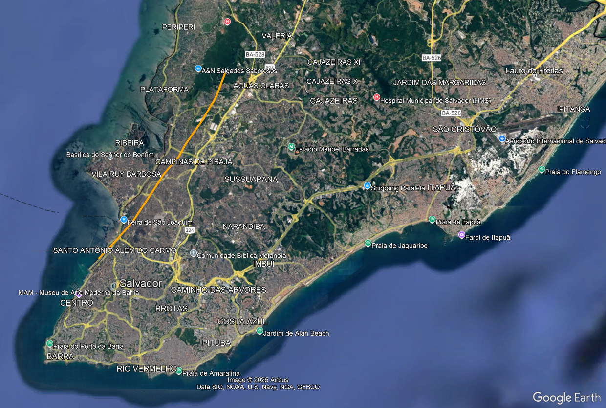

### Slide 5

Falha de extensional próxima a Feira de Santana

A falha extensional normal próxima à região de Feira de Santana, especificamente na BR-101, km 149  é classificada como uma falha de crescimento, de formação arenítica. Esta falha possui uma direção NE-SW, com mergulho variando de 70º a 63º. Apresenta espessamento das camadas no bloco baixo, onde a espessura de uma camada-chave de arenito aumenta de 0,2 m para 2,7 m à medida que se aproxima do plano da falha, indicando que o movimento extensional foi contemporâneo à sedimentação. O rejeito medido nesta estrutura é de 7,5 metros.

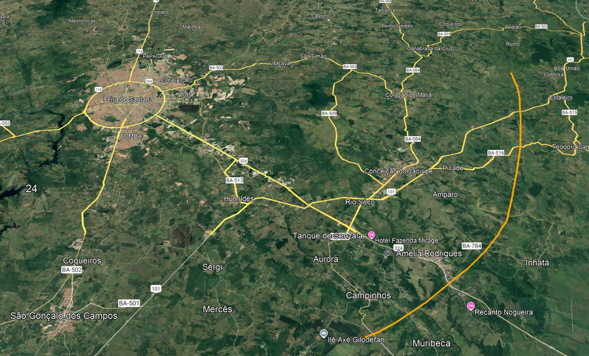

### Slide 6

Falha extensional de Maragogipe.

A Falha de Maragogipe é um limite geológico da Bacia do Recôncavo, localizada no estado da Bahia, que separa a bacia do cráton para oeste. Atuando como um dos limites estruturais da bacia, que é um meio-gráben com orientação NE-SW, a Falha de Maragogipe representa uma falha de borda a oeste da bacia.

Localização: Define o limite oeste da Bacia do Recôncavo.

Orientação: Apresenta uma orientação geral de aproximadamente 10º ao norte (N10º).

Função: Funciona como um limite de borda da bacia sedimentar do Recôncavo, que é caracterizada como um meio-gráben.

Fonte: ASPECTOS HIDROGEOLÓGICOS DA PORÇÃO LESTE

DA BACIA DO RECÔNCAVO NORTE - BAHIA

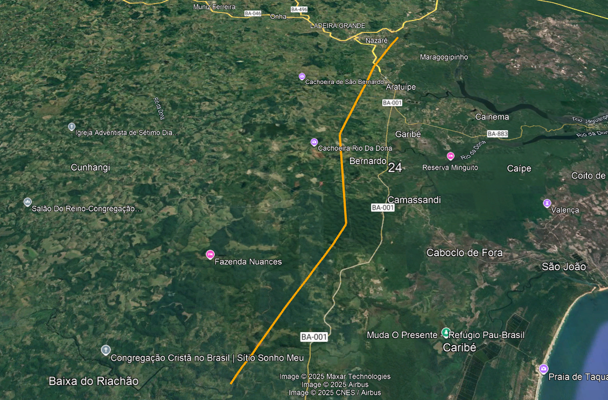

### Slide 7

Falhas transcorrentes de Itororó e de Itabuna.

As zonas de cisalhamento transcorrente de Itabuna–Itaju do Colônia (predominantemente dextral, ~108 km) e de Itororó (predominantemente sinistral, ~116 km) são estruturas lineares de grande extensão no sul da Bahia que acomodam deslocamentos laterais no embasamento cristalino. Essas zonas segmentam blocos, reativam descontinuidades pré-existentes e condicionam lineamentos e drenagens regionais; sua atuação em diferentes episódios tectônicos ajudou a organizar o arcabouço estrutural que influencia, ao norte, a borda e a compartimentação do Recôncavo.

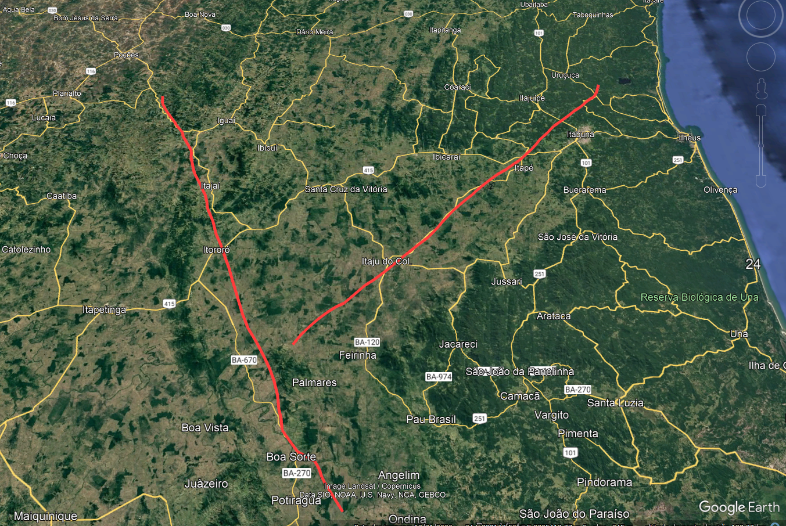

### Slide 8

MAGNAVITA, Luciano Portugal; SILVA, Roberto Rosa da; SANCHES, Christóvam Penteado.

Guia de Campo da Bacia do Recôncavo, NE do Brasil. In: ROTEIROS GEOLÓGICOS. [S.l.: s.n., s.d.], p.-74.

GOOGLE. Google Earth Pro. Versão 7.3.6.1044 [S.l.]: Google LLC, 2024.

Disponível em: https://www.google.com7.3/earth/versions/. Acesso em: 08 out. 2025.

Referências.

## Falhas do Rio de Janeiro — transcrição do trabalho anterior

Arquivo de origem: `Exercício_ 5_ Falhas_geologicas_do_Rio_de_Janeiro_Jose_Mauro_Elsas.pptm`. As figuras foram extraídas dos slides sem alteração.

### Slide 1

Falhas Geológicas

no Estado do Rio de Janeiro

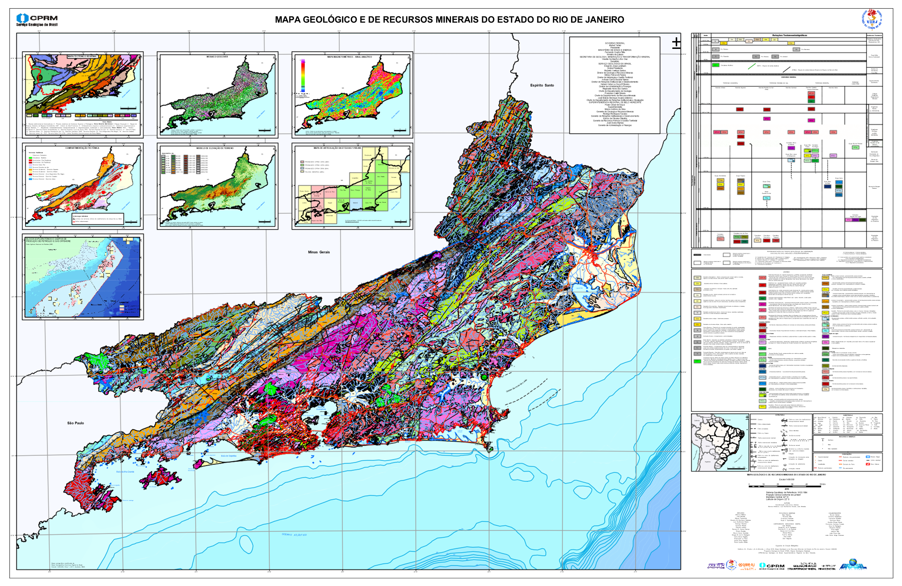

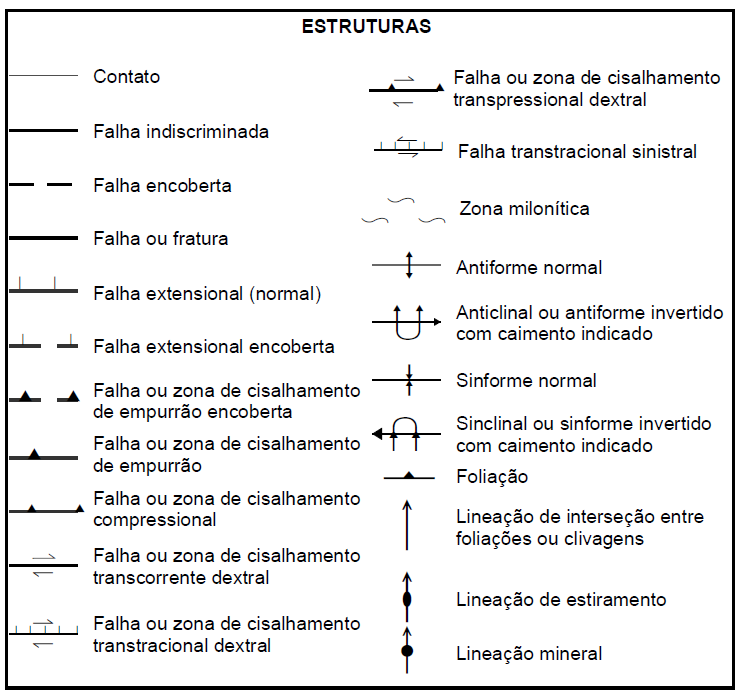

### Slide 2

Mapa Geológico do rio de Janeiro

Falha Tipo

Comp.

Az.

Cor

Normal

78 km

126°

Transcorrente

120km

79°

Reversa

83 km

59°

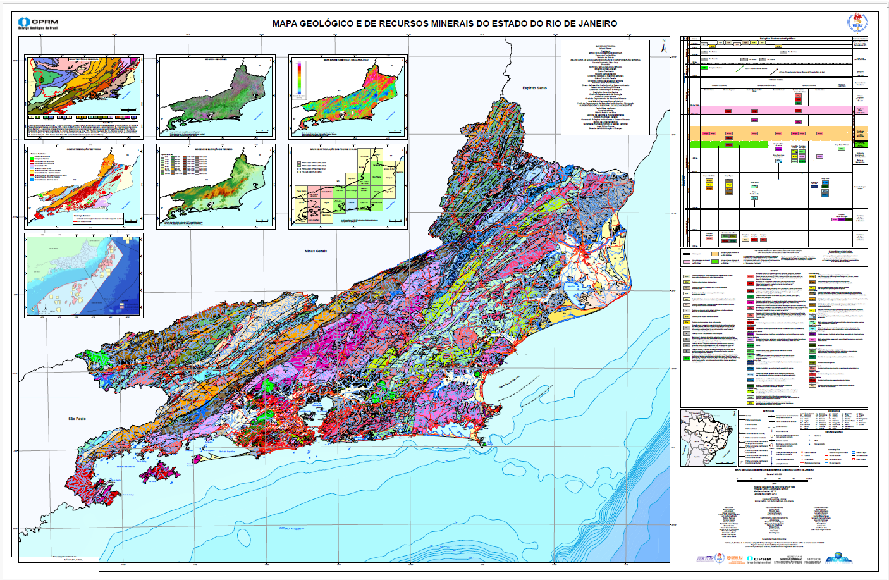

### Slide 3

Falha Normal.

Falha normal  de ~78,6 km de extensão,  falha normal lístrica (falha lístrica é um tipo especial de falha normal curvada, na qual o plano de falha não é retilíneo, mas encurva-se progressivamente com a profundidade, tornando-se quase horizontal.) típica da margem rifteada sudeste (RJ). Regime extensional com abatimento do bloco baixo em direção ao SE, gerando espessamento. Com lineamentos/vales alinhados à Serra do Mar–litoral.

Fonte: Mapa Geológico e de Recursos Minerais do Estado do Rio de Janeiro

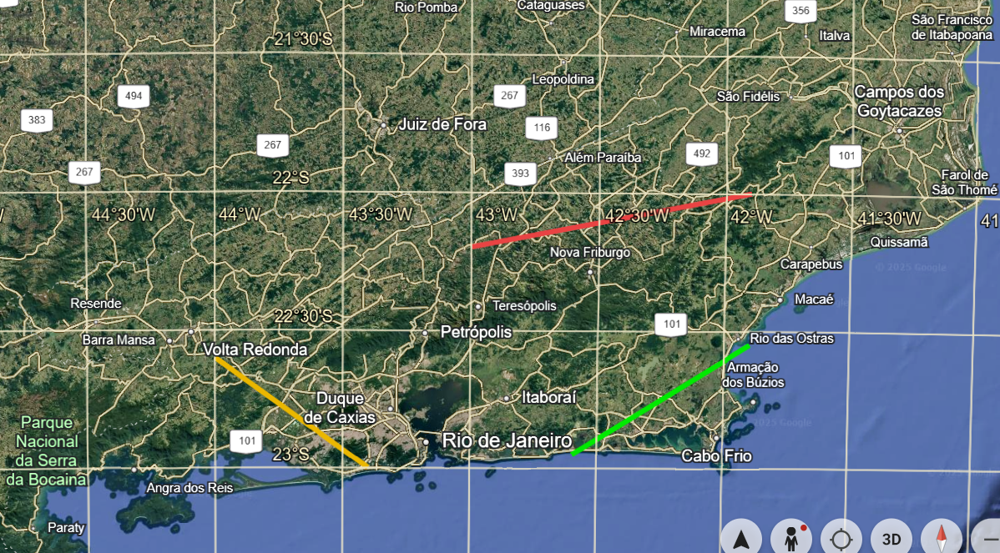

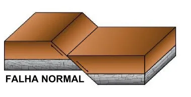

### Slide 4

Falha normal.

Esse mapa identifica e caracteriza as principais estruturas tectônicas do estado, incluindo falhas normais associadas à margem rifteada (Margem rifteada é o limite continental passivo resultante de um rifte tectônico extensional que evoluiu até a formação de crosta oceânica.) do sudeste brasileiro, formadas durante a abertura do Atlântico Sul e a evolução dos sistemas de rifte do Cretáceo Inferior.

Rifte é uma estrutura tectônica extensional onde a crosta litosférica está sendo esticada e afinada, provocando fraturas, falhamentos e afundamento de blocos crustais.

Essas falhas são expressivas no relevo costeiro e serrano (por exemplo, nas faixas estruturais da Serra do Mar e Região dos Lagos), com direções predominantes NE–SW e E–W, indicando regime extensional e controle de lineamentos topográficos.

### Slide 5

Falha reversa

Essa falha representa de forma bastante fiel o comportamento das falhas compressivas em geral que ocorrem na porção serrana central do estado do RJ, especialmente na faixa entre Magé, Tanguá, Santo Aleixo e Cachoeiras de Macacu.

A seguir, está a descrição técnica compatível com a estrutura real que ela simboliza, baseada na cartografia e literatura geológica regional da CPRM e UFRJ:

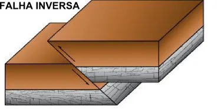

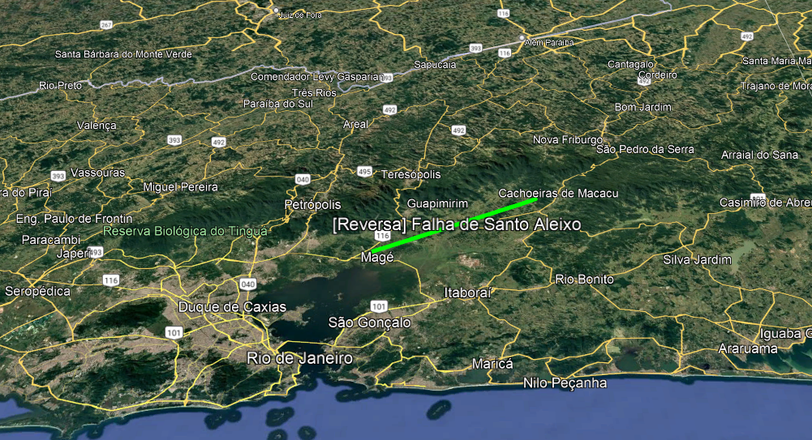

### Slide 6

Falha reversa.

A Falha de Santo Aleixo é uma estrutura reversa a oblíqua localizada na porção serrana do centro-sul fluminense, cortando gnaisses e granitos do Cinturão Ribeira. Seu traçado segue aproximadamente a direção NE–SW, mergulhando para NW, e está associado a zonas de cisalhamento dúctil e rúptil, com forte milonitização (que é o processo geológico de formação de milonitos, que são rochas metamórficas de grão fino, criadas pelo esmagamento e deformação de rochas pré-existentes em zonas de cisalhamento) e dobramentos de arrasto nas rochas encaixantes.

É uma falha compressiva reativação pós-rifte, vinculada à inversão tectônica com direção predominante: NE–SW, mergulho de moderado a alto para NW.As

### Slide 7

Falha reversa.

As rochas afetadas são gnaisses bandados, milonitos e granitóides do embasamento pré-cambriano.

Há um alinhamento topográfico serrano e escarpas abruptas próximas a Magé e Tanguá com  bandas de cisalhamento, estrias de movimento inverso e dobras de arrasto.

Essa falha faz parte do Sistema de Falhas da Serra do Mar, um conjunto de estruturas compressivas e transcorrentes reativadas a partir de antigas zonas de cisalhamento neoproterozoicas (entre há 1 Bilhão de anos e 541 milhões de anos, aproximadamente) do Cinturão Ribeira.

### Slide 8

Falha transcorrente.

A Zona de Falha de Cabo Frio é uma estrutura transcorrente dextral (movimentação lateral direita), localizada no setor leste do estado do Rio de Janeiro. Vai de Saquarema a Rio das Ostras e Búzios, paralelamente à costa fluminense.Ela atua como um limite crustal importante entre diferentes blocos litoestruturais e influencia fortemente a comparti-mentação tectônica e sedimentar da margem continental brasileira, em especial a Bacia de Campos.

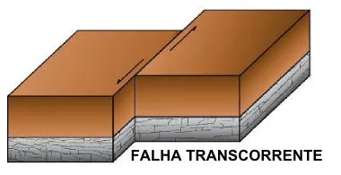

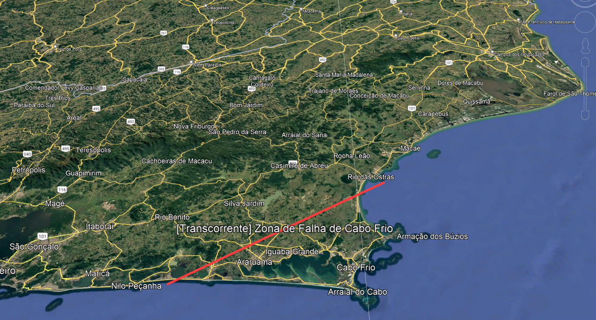

### Slide 9

Falha transcorrente.

Falha transcorrente dextral, localmente oblíqua (com componente compressiva) na direção E–W a ENE–WSW e com extensão de cerca de 120 km. Presença de Gnaisses do embasamento pré-cambriano, sedimentos cretácicos e terciários das bacias de Campos e Santos. Apresenta alinhamento topográfico retilíneo, vales controlados estruturalmente e lineamentos submarinos.

A falha imita a extremidade oriental da Bacia de Campos e se conecta a outras zonas transcorrentes regionais (como a de Vitória e a de Santos). A ZFCF se originou como uma zona de cisalhamento neoproterozoica, posteriormente reativada durante o rifteamento do Atlântico Sul (Cretáceo Inferior).Durante o Cretáceo Superior e Paleógeno, a reativação em regime transcorrente dextral gerou deformações oblíquas e compressivas, afetando tanto a crosta continental quanto a margem oceânica adjacente.Esses movimentos influenciaram diretamente a gênese e a morfologia da Bacia de Campos, bem como o alinhamento das plataformas de Cabo Frio e de São Tomé.

### Slide 10

Referências

HEILBRON, M. et al. Mapa geológico e de recursos minerais do estado do Rio de Janeiro. Escala 1:400.000. Brasília: CPRM – Serviço Geológico do Brasil, 2016. (Programa Geologia do Brasil – PGB).

MOHRIAK, W. U.; SZATMARI, P.; ANJOS, S. M. C. dos. Tectônica e evolução das bacias marginais brasileiras. In: SZATMARI, P.; MOHRIAK, W. U. (Orgs.). Bacias sedimentares brasileiras. Rio de Janeiro: PETROBRAS, 2008. p. 87–142.

VIEIRA, V. S.; HEILBRON, M.; VALERIANO, C. M.; FIGUEIREDO, A. M. F. Reativações tectônicas na Zona de Falha de Cabo Frio, RJ. Revista Brasileira de Geociências, v. 45, n. 3, p. 331–348, 2015.

VALERIANO, C. M.; HEILBRON, M.; ALMEIDA, J. C. H. Geologia e evolução tectônica do Cinturão Ribeira na região serrana do Rio de Janeiro. Revista Brasileira de Geociências, v. 34, n. 4, p. 463–476, 2004.

ALMEIDA, J. C. H.; HEILBRON, M. Reativações tectônicas e falhas compressivas no segmento central da Serra do Mar (RJ). Anais da Academia Brasileira de Ciências, v. 85, n. 2, p. 527–540, 2013.
