# Glossário de Geologia — consulta alfabética

**José Mauro Xavier Elsas — Oceanografia / UERJ**  
**Versão em Markdown — 1 de outubro de 2026**

Conversão dos 37 verbetes do arquivo `Glossario_Geologia_UERJ.tex`. Os termos associados, explicações, tabelas e diagramas foram preservados. A repetição de alguns conceitos em relação ao caderno principal é intencional: este arquivo serve para consulta por termo.

O escopo do original é a terminologia estudada nos três primeiros períodos de Oceanografia. A bibliografia própria do glossário foi recuperada no ZIP `geo_iii.zip` e reunida em `Referencias.md`. O mapa de fontes por verbete foi preservado como proposta de vinculação, sem presumir que as citações já estavam inseridas nos verbetes. A revisão científica integral ainda está pendente. Extrair o ZIP para manter as imagens disponíveis.

## Afloramento

**Afloramento** é uma exposição de rocha ou de sedimento consolidado na superfície terrestre, permitindo sua observação direta. Pode ser natural, como em falésias, margens de rios, encostas e leitos rochosos, ou artificial, como em cortes de estrada, pedreiras, túneis e escavações.

Grande parte do substrato rochoso encontra-se coberta por solo, vegetação, depósitos recentes ou água. Por isso, os afloramentos funcionam como “janelas” que permitem reconhecer as unidades geológicas e interpretar sua distribuição em subsuperfície.

Em um afloramento podem ser descritos:

- tipo, composição e textura da rocha;

- espessura, geometria e orientação das camadas;

- contatos entre unidades;

- dobras, falhas, juntas e fraturas;

- fósseis e estruturas sedimentares;

- intensidade e produtos do intemperismo.

A interpretação deve considerar que um afloramento mostra apenas uma parte da unidade geológica. A continuidade das camadas entre exposições separadas é estabelecida por correlação de campo, mapas, perfis, sondagens e métodos geofísicos.

**Relação entre os termos:** afloramento é a porção observável de uma unidade geológica; formação ou corpo rochoso é a unidade tridimensional que pode continuar além da área exposta.

*Ver também:* camada, contato geológico, formação, perfil geológico, trabalho de campo, intemperismo.

## Ambiente sedimentar e fácies

**Ambiente sedimentar** é o conjunto de condições físicas, químicas e biológicas sob as quais ocorre a produção, o transporte e a deposição de sedimentos. Cada ambiente apresenta combinações características de energia, profundidade, salinidade, relevo, organismos, agentes de transporte e disponibilidade de material.

Ao nível introdutório, os ambientes podem ser organizados em três grandes grupos:

- **continentais**: rios, leques aluviais, lagos, desertos, geleiras e encostas;

- **transicionais**: deltas, estuários, praias, planícies de maré, lagunas e sistemas costeiros;

- **marinhos**: plataforma continental, talude, sopé continental, planícies abissais e ambientes recifais.

**Fácies sedimentar** é um corpo de sedimento ou rocha reconhecido por um conjunto de características, como composição, granulometria, estruturas sedimentares, fósseis, geometria e cor. Essas características permitem interpretar o processo e o ambiente em que o material foi depositado.

Uma mesma bacia pode conter várias fácies lateralmente associadas. A mudança vertical de fácies também pode registrar migração de ambientes, variações do nível do mar, alterações no aporte sedimentar ou movimentos tectônicos.

**Relação entre os termos:** ambiente sedimentar é o conjunto de condições e processos de deposição; fácies é o conjunto de características preservadas no sedimento ou na rocha que permite interpretar esse ambiente.

*Ver também:* bacia sedimentar, deposição, estrutura sedimentar, granulometria, transgressão, regressão, estratigrafia.

## Areia e arenito

**Areia** é um sedimento clástico inconsolidado, isto é, um material desagregado formado por grãos. Em geral, esses grãos resultam do intemperismo, da erosão, do transporte e da deposição de materiais provenientes de rochas preexistentes. Na escala granulométrica mais usada em sedimentologia, a fração areia situa-se aproximadamente entre 0.0625 mm e 2 mm.

A composição da areia depende da rocha de origem e do ambiente sedimentar. O quartzo é frequente por apresentar elevada resistência física e química, mas uma areia também pode conter feldspatos, fragmentos de rocha, minerais pesados, carbonatos ou partículas biogênicas.

**Arenito** é uma rocha sedimentar clástica formada predominantemente por grãos do tamanho areia. Forma-se quando o sedimento arenoso sofre soterramento, compactação e cimentação, processos que fazem parte da diagênese.

**Relação entre os termos:** areia é o sedimento inconsolidado; arenito é a rocha consolidada formada principalmente pela litificação desse sedimento.

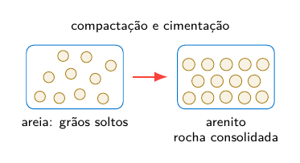

*Ver também:* sedimento, rocha sedimentar, diagênese, compactação, cimentação, granulometria.

## Bacia sedimentar

**Bacia sedimentar** é uma região da crosta terrestre na qual a subsidência cria **espaço de acomodação** para a acumulação de sedimentos durante determinado intervalo de tempo geológico. Com o soterramento progressivo, esses sedimentos podem sofrer diagênese e transformar-se em rochas sedimentares.

Uma bacia não precisa corresponder, atualmente, a uma depressão visível no relevo. O termo descreve principalmente uma região de acumulação e preservação de sedimentos cuja origem e evolução estão relacionadas à dinâmica da crosta.

Entre os elementos usados para descrever uma bacia sedimentar estão:

- **subsidência**: movimento de rebaixamento da crosta ou do fundo da bacia;

- **espaço de acomodação**: volume disponível para receber e preservar sedimentos;

- **área-fonte**: região de onde provêm os materiais sedimentares;

- **aporte sedimentar**: quantidade e tipo de sedimento fornecido à bacia;

- **borda da bacia**: setor periférico, geralmente mais próximo das áreas-fonte;

- **depocentro**: região em que se concentra a maior espessura de sedimentos;

- **preenchimento sedimentar**: conjunto de camadas acumuladas ao longo da evolução da bacia.

A formação e a geometria das bacias dependem do contexto tectônico. Entre os tipos mais comuns estão as **bacias de rifte**, associadas à distensão da crosta; as **bacias de margem passiva**, desenvolvidas após a abertura de oceanos; as **bacias intracratônicas**, situadas no interior de continentes; e as **bacias de antepaís**, formadas próximas a cadeias de montanhas em desenvolvimento.

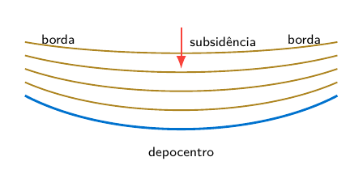

Esquema simplificado de uma bacia sedimentar: as camadas tendem a apresentar maior espessura próximo ao depocentro.

**Relação entre os termos:** a subsidência cria espaço de acomodação; o aporte sedimentar preenche esse espaço; o soterramento favorece a preservação dos sedimentos e sua transformação em rochas sedimentares.

*Ver também:* subsidência, sedimento, estrato, área-fonte, depocentro, diagênese, tectônica.

## Brongniart, Alexandre

**Alexandre Brongniart (1770–1847)**

Geólogo e naturalista francês que teve papel importante no desenvolvimento da estratigrafia e da geologia histórica. Em colaboração com Georges Cuvier, estudou os terrenos sedimentares da **Bacia de Paris**, comparando a posição das camadas, sua composição e seus fósseis característicos.

Brongniart reconheceu a alternância de depósitos marinhos, continentais e de água doce. Esse trabalho mostrou que uma sucessão de estratos pode registrar mudanças ambientais ocorridas ao longo do tempo geológico e que camadas separadas espacialmente podem ser comparadas por suas relações estratigráficas e por seu conteúdo fossilífero.

Sua contribuição está ligada principalmente à **estratigrafia** e à interpretação histórica das bacias sedimentares. O estudo anatômico de vertebrados fósseis e a demonstração da extinção estão mais diretamente associados ao trabalho de Cuvier.

*Ver também:* Bacia de Paris, estratigrafia, fóssil, correlação, Cuvier, bioestratigrafia.

## Catastrofismo

**Catastrofismo** é uma interpretação histórica segundo a qual mudanças importantes observadas no registro geológico e paleontológico teriam sido produzidas principalmente por acontecimentos súbitos e de grande magnitude. O termo é associado especialmente a Georges Cuvier, que relacionou mudanças abruptas entre faunas fósseis a grandes perturbações naturais.

No século XIX, o catastrofismo foi frequentemente contraposto ao **uniformitarismo**, que enfatizava a ação contínua de processos geológicos observáveis no presente. Essa oposição, porém, não deve ser entendida de forma absoluta.

A Geologia atual reconhece que a história da Terra resulta da combinação de:

- processos graduais e recorrentes, como intemperismo, erosão, sedimentação e movimentação das placas tectônicas;

- eventos relativamente rápidos, como terremotos, erupções vulcânicas, grandes deslizamentos, tsunamis e impactos de corpos extraterrestres;

- acontecimentos raros de escala global ou regional, capazes de produzir mudanças ambientais intensas e extinções em massa.

Assim, reconhecer eventos catastróficos não significa adotar integralmente o catastrofismo histórico. Esses eventos são estudados com base nas mesmas leis físicas, químicas e biológicas usadas para interpretar os processos graduais.

**Relação entre os termos:** o catastrofismo histórico enfatizava mudanças súbitas; o uniformitarismo enfatizava a continuidade dos processos; a Geologia moderna reconhece processos graduais e eventos rápidos no mesmo registro geológico.

*Ver também:* Cuvier, uniformitarismo, extinção, tempo geológico, registro geológico.

## Ciclo das rochas

**Ciclo das rochas** é um modelo que relaciona a formação, a transformação e a destruição das rochas por processos internos e externos da Terra. Ele não representa uma sequência única e obrigatória; uma rocha pode seguir diferentes trajetórias conforme as condições geológicas.

- o resfriamento e a cristalização do magma formam **rochas ígneas**;

- o intemperismo, a erosão, o transporte, a deposição e a litificação produzem **rochas sedimentares**;

- o aumento de pressão, temperatura e circulação de fluidos transforma rochas preexistentes em **rochas metamórficas**;

- a fusão parcial pode gerar novo magma;

- soerguimento e erosão podem expor qualquer tipo de rocha à superfície e reiniciar processos sedimentares.

**Relação entre os termos:** o ciclo das rochas integra processos superficiais, como intemperismo e sedimentação, e processos internos, como magmatismo, metamorfismo, deformação e tectônica de placas.

*Ver também:* magma, litificação, metamorfismo, intemperismo, tectônica de placas, rocha ígnea, rocha sedimentar.

## Clastos e materiais vulcanoclásticos

**Clasto** é um fragmento de mineral, rocha, fóssil ou material consolidado incorporado a um sedimento ou a uma rocha fragmentar. Os clastos podem ser produzidos por intemperismo e erosão, por ruptura tectônica, por atividade vulcânica ou por outros processos de fragmentação.

Na descrição de um clasto observam-se principalmente:

- **composição**: mineral ou rocha de que o fragmento é constituído;

- **granulometria**: tamanho do fragmento;

- **arredondamento**: grau de suavização das arestas e dos vértices;

- **esfericidade**: semelhança da forma do clasto com uma esfera;

- **seleção**: uniformidade dos tamanhos presentes no depósito;

- **matriz e cimento**: materiais finos ou precipitados que ocupam os espaços entre os clastos.

**Clasto terrígeno** é produzido pela desagregação e erosão de rochas preexistentes na superfície. Após removido, pode ser transportado por água, vento, gelo ou gravidade e depositado em outro local. Areia quartzosa, fragmentos de feldspato e seixos de rocha são exemplos.

**Epiclasto** é um fragmento gerado pelo intemperismo e pela erosão de uma rocha previamente consolidada. Quando a rocha de origem é vulcânica, o epiclasto conserva composição vulcânica, embora tenha sido produzido e transportado por processos superficiais. Por isso, alguns esquemas amplos incluem esses materiais entre os vulcanoclásticos retrabalhados.

**Vulcanoclástico** é um termo amplo para partículas, depósitos e rochas fragmentares de origem vulcânica ou diretamente associados à atividade vulcânica. Esse conjunto pode incluir materiais formados durante a erupção, fragmentos produzidos pelo movimento e resfriamento de lavas e depósitos vulcânicos posteriormente retrabalhados.

**Piroclasto** é o fragmento produzido diretamente pela fragmentação explosiva do magma ou de rochas durante uma erupção. O depósito é chamado **piroclástico**; quando consolidado, forma uma rocha piroclástica.

A classificação granulométrica introdutória dos piroclastos utiliza:

| **Piroclasto**  | **Tamanho**     | **Observação**                                                        |
|:----------------|:----------------|:----------------------------------------------------------------------|
| Cinza vulcânica | menor que 2 mm  | pode consolidar-se como tufo                                          |
| Lapilli         | 2 mm a 64 mm    | fragmentos de tamanho intermediário                                   |
| Bloco ou bomba  | maior que 64 mm | bloco é ejetado sólido; bomba, ainda plástica ou parcialmente fundida |

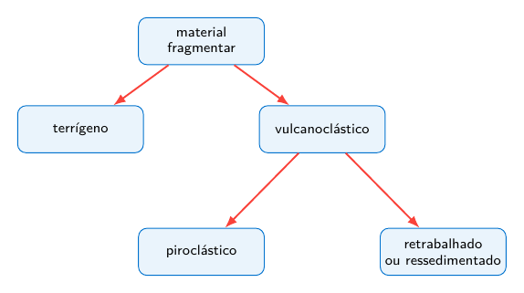

Esquema simplificado: piroclástico é uma categoria definida pela fragmentação eruptiva; vulcanoclástico é um termo mais abrangente.

Um material vulcânico pode ser removido e novamente depositado por correntes, ondas, vento ou movimentos de massa. Nesse caso, sua composição continua vulcânica, mas a textura e as estruturas sedimentares podem registrar o retrabalhamento. Por isso, a classificação deve considerar simultaneamente a origem do fragmento e o processo responsável por sua deposição.

**Relação entre os termos:** clasto é qualquer fragmento constituinte de um depósito ou rocha fragmentar; vulcanoclástico descreve o conjunto de materiais fragmentares ligados ao vulcanismo; piroclástico identifica os fragmentos produzidos diretamente por uma erupção explosiva.

*Ver também:* granulometria, escala de Wentworth, conglomerado, brecha, arenito, cinza vulcânica, lapilli, tufo, sedimentação.

## Cuvier, Georges

**Georges Cuvier (1769–1832)**

Naturalista francês e um dos fundadores da anatomia comparada e da paleontologia de vertebrados. Ao comparar esqueletos de animais atuais e fósseis, Cuvier demonstrou que várias formas encontradas nas rochas não possuíam representantes vivos, fornecendo evidências decisivas da **extinção** de espécies.

Nos estudos da Bacia de Paris, realizados em colaboração com Alexandre Brongniart, relacionou fósseis de vertebrados a diferentes níveis estratigráficos. A sucessão das camadas correspondia também a uma sucessão de faunas, o que fortaleceu o uso dos fósseis como documentos da história da Terra.

Cuvier interpretou muitas mudanças faunísticas como resultado de grandes perturbações naturais, sendo por isso associado ao **catastrofismo**. Embora suas explicações históricas não correspondam integralmente às interpretações atuais, seus trabalhos consolidaram a realidade das extinções e o valor científico dos fósseis.

*Ver também:* extinção, catastrofismo, paleontologia de vertebrados, anatomia comparada, Brongniart, Bacia de Paris.

## Diapiro de sal

**Diapiro de sal** é um corpo de material salino que ascende e deforma as camadas sedimentares sobrejacentes. O processo ocorre porque os evaporitos, especialmente os constituídos por halita, podem apresentar comportamento dúctil ao longo do tempo geológico e fluir quando submetidos ao soterramento e a diferenças de pressão.

A ascensão do sal pode ser favorecida pela diferença de densidade entre o material salino e as rochas sedimentares mais compactadas, pela sobrecarga desigual dos sedimentos e por esforços tectônicos. Esse movimento é parte da chamada **tectônica salina** ou **halocinese**.

Termos associados:

- **evaporito**: rocha sedimentar formada pela precipitação de sais dissolvidos, geralmente em ambientes de forte evaporação;

- **halita**: mineral de composição $\mathrm{NaCl}$, principal constituinte do sal-gema;

- **camada salina**: nível evaporítico originalmente depositado entre outras camadas sedimentares;

- **domo salino**: estrutura aproximadamente dômica produzida pela ascensão do sal e pela deformação das camadas superiores;

- **parede de sal**: corpo salino alongado, com grande desenvolvimento vertical;

- **falhas associadas**: fraturas e deslocamentos que podem surgir nas camadas deformadas ao redor do corpo salino.

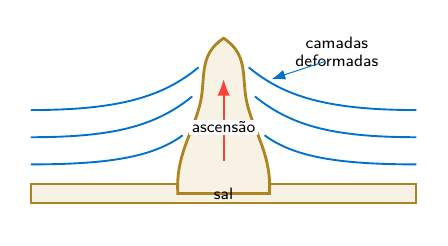

Esquema simplificado da ascensão de um diapiro a partir de uma camada salina soterrada.

O crescimento do diapiro pode dobrar, fraturar ou deslocar as camadas vizinhas. Essas estruturas podem influenciar a circulação de fluidos e formar armadilhas estruturais, mas a presença de um diapiro não implica, por si só, a existência de petróleo ou gás.

**Relação entre os termos:** evaporitos formam a camada salina; o fluxo e a ascensão do sal produzem o diapiro; a deformação das camadas ao redor integra a tectônica salina.

*Ver também:* evaporito, halita, sal-gema, domo salino, tectônica salina, deformação, bacia sedimentar.

## Dobras

**Dobra** é uma curvatura ou flexão de camadas, foliações ou outras superfícies geológicas produzida por deformação. As dobras são comuns em rochas submetidas a esforços compressivos, mas também podem resultar de cisalhamento, fluxo gravitacional ou movimentação do sal.

**Partes de uma dobra**

- **flancos**: porções laterais da dobra;

- **charneira**: região de maior curvatura;

- **eixo da dobra**: linha que acompanha a charneira ao longo da estrutura;

- **plano axial**: plano que contém as linhas de charneira e divide a dobra de forma aproximada;

- **núcleo**: região central da estrutura dobrada.

**Anticlinal** é uma dobra convexa para cima na qual, quando a sequência não está invertida, as camadas mais antigas ocupam o núcleo. **Sinclinal** é uma dobra côncava para cima na qual as camadas mais jovens ocupam o núcleo.

Os termos anticlinal e sinclinal dependem da idade relativa das camadas. Quando essa informação não é conhecida, podem ser usados os termos puramente geométricos **antiforme** e **sinforme**.

**Relação entre os termos:** anticlinal e sinclinal incluem informação sobre a idade das camadas; antiforme e sinforme descrevem somente a geometria da dobra.

*Ver também:* deformação, compressão, falha, camada, foliação, orogênese, estrutura geológica.

## Discordâncias

**Discordância** é uma superfície que separa conjuntos de rochas de idades diferentes e representa um intervalo de tempo não registrado pela sedimentação contínua. Esse intervalo, chamado **hiato**, pode resultar de não deposição, erosão ou da combinação dos dois processos.

Uma discordância não é apenas uma linha entre camadas. Ela registra uma sequência de acontecimentos, que pode incluir deposição, litificação, deformação, soerguimento, erosão, subsidência e nova sedimentação.

**Tipos principais**

- **discordância angular**: as camadas inferiores foram inclinadas ou dobradas e erodidas antes da deposição de camadas mais jovens com orientação diferente;

- **discordância erosiva** ou **desconformidade**: camadas sedimentares aproximadamente paralelas são separadas por uma superfície de erosão;

- **paraconformidade**: as camadas acima e abaixo são aproximadamente paralelas e não há relevo erosivo evidente; o hiato é reconhecido por fósseis, idades ou ausência de parte da sucessão;

- **não conformidade** ou **inconformidade**: rochas sedimentares recobrem uma superfície erodida formada por rochas ígneas ou metamórficas mais antigas.

A terminologia pode variar entre livros e traduções. Por isso, a identificação do tipo deve sempre ser acompanhada pela descrição da geometria e das rochas que estão acima e abaixo da superfície.

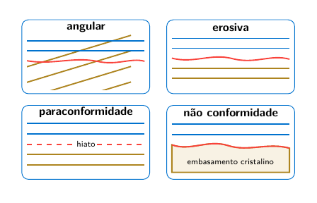

Esquemas simplificados dos principais tipos de discordância. A linha vermelha representa a superfície associada ao hiato.

**Relação entre os termos:** uma discordância representa tempo geológico ausente do registro local; sua geometria permite reconstruir os acontecimentos ocorridos antes da retomada da sedimentação.

*Ver também:* hiato, erosão, estrato, idade relativa, superposição, Hutton, correlação estratigráfica.

## Estruturas sedimentares

**Estruturas sedimentares** são feições produzidas durante ou logo após a deposição dos sedimentos. Elas registram condições de fluxo, direção de transporte, variações de energia, exposição subaérea, ação de organismos e deformações ocorridas antes da litificação completa.

Entre as estruturas mais comuns estão:

- **estratificação**: organização do depósito em camadas;

- **laminação**: divisão em lâminas muito finas;

- **estratificação cruzada**: conjuntos de lâminas inclinadas formados pela migração de dunas, ripples ou barras;

- **marcas onduladas**: cristas e depressões produzidas pela ação de correntes ou ondas;

- **gradação**: variação vertical sistemática do tamanho dos grãos, frequentemente do mais grosso na base para o mais fino no topo;

- **gretas de dessecação**: fraturas poligonais geradas pela retração de lama exposta e ressecada;

- **bioturbação**: perturbação do sedimento pela atividade de organismos.

Algumas estruturas permitem reconhecer o **topo e a base** de uma camada, informação importante quando as rochas foram inclinadas ou dobradas. Outras podem indicar paleocorrentes e ajudar a reconstruir o ambiente deposicional.

**Relação entre os termos:** a textura descreve os constituintes e sua organização; a estrutura sedimentar registra formas e arranjos produzidos principalmente durante ou logo após a deposição.

*Ver também:* camada, laminação, paleocorrente, ambiente sedimentar, fácies, deposição, bioturbação.

## Falha

Falha é uma fratura ou zona de fraturas na qual ocorreu deslocamento relativo entre blocos rochosos. Quando existe fratura sem deslocamento perceptível, emprega-se geralmente o termo **junta** ou **diáclase**, conforme o contexto.

**Plano de falha** é a superfície ao longo da qual ocorre o deslocamento. Quando esse plano é inclinado, distinguem-se:

- **bloco do teto**, também chamado **capa**: bloco situado acima do plano de falha;

- **bloco do muro**, também chamado **lapa**: bloco situado abaixo do plano de falha.

Esses nomes descrevem a posição dos blocos em relação ao plano de falha, não a altitude atual do relevo. Portanto, *teto* não significa necessariamente a parte topograficamente mais alta.

**Rejeito** é a medida do deslocamento relativo. **Estrias de falha** são marcas produzidas pelo atrito e podem indicar a direção do movimento. A zona de falha também pode apresentar rocha triturada, como **brecha de falha**, ou material muito fino, conhecido como **gouge de falha**.

**Tipos principais**

- **Falha normal**: o bloco do teto desce em relação ao bloco do muro. Está associada principalmente a esforços distensivos. Nesse caso, o teto corresponde ao bloco relativamente rebaixado e o muro ao bloco relativamente elevado.

- **Falha reversa**: o bloco do teto sobe em relação ao bloco do muro. Está associada principalmente a esforços compressivos. Quando apresenta baixo ângulo de mergulho, pode ser chamada de **falha de empurrão** ou **cavalgamento**.

- **Falha transcorrente**: o deslocamento predominante é horizontal e paralelo à direção da falha. Pode ser **dextral** ou **direita**, quando o bloco oposto aparenta mover-se para a direita, e **sinistral** ou **esquerda**, quando aparenta mover-se para a esquerda.

- **Falha oblíqua**: combina componentes de deslocamento vertical e horizontal.

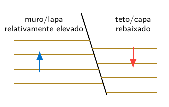

Esquema de uma falha normal: o bloco do teto desce em relação ao bloco do muro.

**Como reconhecer uma falha**

Entre os indícios estão o deslocamento de camadas, a repetição ou ausência de partes de uma sequência estratigráfica, a presença de estrias e superfícies polidas, rochas trituradas, escarpas lineares, drenagens deslocadas e contatos abruptos entre unidades geológicas. Nenhum indício isolado é necessariamente conclusivo; a interpretação deve considerar o conjunto das evidências.

**Relação entre os termos:** normal e reversa são classificadas pelo movimento do bloco do teto em relação ao muro; dextral e sinistral são classificadas pelo deslocamento horizontal aparente do bloco situado do outro lado da falha.

*Ver também:* fratura, junta, diáclase, deformação, tensão, compressão, distensão, cisalhamento.

## Granulometria

**Granulometria** é o estudo e a medição do tamanho das partículas que constituem um sedimento ou uma rocha sedimentar clástica. A distribuição dos tamanhos dos grãos ajuda a descrever o material e a interpretar os processos de transporte, seleção e deposição.

Os limites entre cascalho, areia, silte e argila são definidos por escalas granulométricas. Em sedimentologia, a escala de Udden–Wentworth é uma das mais utilizadas.

**Características relacionadas, mas diferentes**

- **tamanho do grão**: dimensão da partícula, expressa geralmente em milímetros ou micrômetros;

- **seleção granulométrica**: grau de uniformidade dos tamanhos. Um sedimento bem selecionado apresenta pequena variação; um sedimento mal selecionado reúne partículas de tamanhos muito diferentes;

- **arredondamento**: grau de suavização das arestas e dos vértices dos grãos;

- **esfericidade**: proximidade da forma do grão em relação a uma esfera.

Arredondamento e esfericidade descrevem a forma, não o tamanho, e portanto não são medidas granulométricas propriamente ditas.

A análise pode ser feita por **peneiramento** nas frações mais grossas. Para partículas muito finas, podem ser empregados métodos baseados na velocidade de sedimentação, pipetagem, hidrômetro ou difração a laser. Os resultados são normalmente apresentados como porcentagens por classe, histogramas ou curvas granulométricas acumuladas.

A seleção descreve a dispersão dos tamanhos presentes na amostra.

**Relação entre os termos:** granulometria descreve o tamanho e sua distribuição; seleção indica a uniformidade dos tamanhos; arredondamento e esfericidade descrevem a forma dos grãos.

*Ver também:* escala de Wentworth, cascalho, areia, silte, argila, seleção, transporte sedimentar.

## Hutton, James

**James Hutton (1726–1797)**

Naturalista e pensador escocês considerado uma das figuras fundamentais da Geologia moderna. Hutton interpretou a Terra como um sistema dinâmico, no qual erosão, transporte, deposição, soterramento, consolidação e soerguimento se repetem ao longo de intervalos de tempo muito extensos.

Sua leitura das discordâncias geológicas mostrou que uma única paisagem pode registrar sucessivos episódios de formação de rochas, deformação, erosão e nova sedimentação. Essas ideias contribuíram para o conceito de **tempo geológico profundo** e para o desenvolvimento do pensamento uniformitarista.

*Ver também:* tempo geológico, uniformitarismo, discordância, ciclo das rochas.

## Litificação

**Litificação** é a transformação de um sedimento inconsolidado em rocha sedimentar consolidada. O processo ocorre durante o soterramento e integra a **diagênese**, mas os dois termos não são sinônimos: a diagênese inclui também outras alterações físicas, químicas e biológicas posteriores à deposição.

Nas rochas sedimentares clásticas, os mecanismos mais importantes são:

- **compactação**: redução do volume dos poros e aproximação dos grãos devido ao peso das camadas superiores;

- **desidratação**: expulsão de parte da água existente nos poros, especialmente em sedimentos finos;

- **cimentação**: precipitação de minerais nos espaços entre os grãos, unindo-os. Sílica, calcita e óxidos de ferro são exemplos de cimentos;

- **recristalização**: reorganização ou crescimento de cristais durante a diagênese, comum em algumas rochas carbonáticas e químicas.

Exemplos: areia litificada forma arenito; cascalho arredondado forma conglomerado; lama pode formar argilito, siltito, lamito ou folhelho, conforme a granulometria, a composição e a estrutura da rocha.

**Relação entre os termos:** litificação é o resultado da consolidação do sedimento; compactação e cimentação são mecanismos importantes desse processo; diagênese é o conjunto mais amplo de transformações após a deposição.

*Ver também:* diagênese, soterramento, compactação, cimentação, porosidade, sedimento, rocha sedimentar.

## Lyell, Charles

**Charles Lyell (1797–1875)**

Geólogo escocês que sistematizou e divulgou amplamente a interpretação uniformitarista da história da Terra. Sua obra *Principles of Geology*, publicada inicialmente em três volumes entre 1830 e 1833, teve grande influência na consolidação da Geologia como ciência histórica.

Lyell defendeu que os processos observáveis no presente, como erosão, sedimentação, vulcanismo, soerguimento e subsidência, também atuaram no passado e podem ser usados para interpretar o registro geológico. Essa abordagem desenvolveu e popularizou ideias anteriormente formuladas por James Hutton.

O uniformitarismo não significa que todos os processos tenham sempre a mesma velocidade ou intensidade. A Geologia moderna reconhece tanto processos graduais quanto eventos rápidos e de grande magnitude, desde que sua interpretação seja baseada em evidências naturais.

**Relação entre os termos:** Hutton formulou uma visão cíclica e de tempo profundo; Lyell sistematizou, documentou e difundiu o uso dos processos atuais para interpretar o passado geológico.

*Ver também:* Hutton, James, uniformitarismo, atualismo, catastrofismo, tempo geológico.

## Magma e lava

**Magma** é material rochoso parcial ou totalmente fundido existente no interior da Terra. Pode conter uma fase líquida, cristais já formados e gases dissolvidos. Sua composição, temperatura, teor de voláteis e história de resfriamento influenciam os minerais e as rochas que serão produzidos.

**Lava** é o magma que alcança a superfície durante uma erupção. Ao extravasar, perde parte dos gases, resfria rapidamente e pode formar derrames, domos, lavas almofadadas ou depósitos fragmentares, conforme a composição e o ambiente eruptivo.

O magma não é uma camada líquida contínua sob a crosta. Ele é gerado localmente por **fusão parcial**, favorecida principalmente por:

- aumento de temperatura;

- diminuição de pressão, chamada fusão por descompressão;

- entrada de água ou outros voláteis, que reduzem a temperatura de fusão;

- transferência de calor por magmas mais quentes.

**Cristalização fracionada** ocorre quando minerais se formam e são separados progressivamente do líquido magmático, modificando a composição do magma restante. Esse processo está relacionado à série de reação de Bowen.

**Relação entre os termos:** magma é o material fundido em profundidade; lava é o magma extravasado na superfície; rocha ígnea é o produto consolidado do resfriamento e da cristalização.

*Ver também:* fusão parcial, vulcanismo, cristalização, série de Bowen, rocha ígnea, voláteis.

## Minerais e sólidos amorfos

**Mineral** é uma substância sólida natural, geralmente inorgânica, com composição química característica e estrutura interna ordenada. Pequenas variações de composição podem ocorrer dentro de limites definidos para cada espécie mineral.

A organização regular dos átomos constitui a **estrutura cristalina**. Um mineral não precisa apresentar faces externas perfeitas para ser cristalino: mesmo um grão de forma irregular pode possuir ordenação atômica interna.

**Cristal** é um corpo no qual os constituintes estão organizados segundo uma estrutura ordenada. Quando o crescimento ocorre sem impedimentos, essa organização interna pode produzir faces planas e formas geométricas características.

**Sólido amorfo** é um sólido que não apresenta ordenação atômica de longo alcance. Vidros vulcânicos, por exemplo, formam-se quando a lava esfria tão rapidamente que os átomos não conseguem organizar-se em uma estrutura cristalina completa.

Materiais naturais amorfos ou pouco ordenados são frequentemente chamados de **mineraloides**. A opala é um exemplo clássico. A obsidiana, embora seja natural e sólida, é um vidro vulcânico e é classificada como rocha, não como uma espécie mineral.

Representação esquemática: no cristal existe ordem de longo alcance; no sólido amorfo, a disposição não se repete regularmente.

**Relação entre os termos:** mineral é definido, entre outros critérios, por sua estrutura interna ordenada; sólidos naturais amorfos são normalmente tratados como mineraloides ou como constituintes de rochas.

*Ver também:* cristal, estrutura cristalina, mineraloide, opala, obsidiana, rocha, composição química.

## Minerais: cor e traço

**Cor** é a aparência produzida pela interação da luz com o mineral. Ela pode resultar dos elementos essenciais de sua composição, de pequenas impurezas, de defeitos na estrutura cristalina ou de alterações superficiais.

Alguns minerais apresentam cor relativamente característica. Outros, como quartzo, calcita e fluorita, podem ocorrer em várias cores. Por isso, a cor deve ser usada em conjunto com propriedades como brilho, dureza, clivagem, hábito, densidade, magnetismo e traço.

**Traço** é a cor do pó produzido quando o mineral é esfregado sobre uma placa de porcelana não vitrificada. Em muitos minerais metálicos, o traço é mais constante e diagnóstico que a cor externa. A hematita, por exemplo, pode parecer cinza-metálica ou avermelhada, mas apresenta traço vermelho a castanho-avermelhado; a magnetita apresenta traço preto.

**Cores frequentemente observadas**

| **Cor comum**                    | **Exemplos e observações**                                                             |
|:---------------------------------|:---------------------------------------------------------------------------------------|
| Incolor ou branca                | quartzo, calcita, feldspatos e gipsita podem apresentar essas cores                    |
| Cinza ou prateada                | galena, grafita e muscovita apresentam tons cinzentos ou prateados                     |
| Preta ou verde-escura            | magnetita, biotita, anfibólios e alguns piroxênios                                     |
| Vermelha ou castanho-avermelhada | hematita e variedades de coríndon; óxidos de ferro podem colorir outros minerais       |
| Amarela ou amarelo-latão         | enxofre nativo, ouro e pirita, esta última com aspecto metálico                        |
| Verde                            | olivina, malaquita, clorita e algumas variedades de outros minerais                    |
| Azul                             | azurita e sodalita; quartzo e outros minerais também podem apresentar variedades azuis |
| Violeta                          | ametista, variedade violeta de quartzo                                                 |

Os exemplos indicam cores frequentes, não regras absolutas. Superfícies alteradas também podem mascarar a cor original; quando possível, a observação deve ser feita em uma superfície fresca.

**Relação entre os termos:** cor é a aparência da superfície; traço é a cor do pó. A identificação segura depende da combinação de várias propriedades físicas.

*Ver também:* mineral, traço, brilho, dureza, clivagem, hematita, magnetita, quartzo.

## Nichols, organização dos sedimentos

Gary Nichols é autor de uma obra didática amplamente utilizada em sedimentologia e estratigrafia. No contexto das aulas, a expressão **classificação de Nichols** pode ser usada para indicar a organização dos materiais sedimentares apresentada em seu livro.

Não se trata de um código formal universal com regras exclusivas ou de uma classificação mineralógica denominada oficialmente em homenagem ao autor. Trata-se de uma estrutura didática que separa os sedimentos e as rochas sedimentares principalmente segundo sua origem e natureza.

- **sedimentos clásticos terrígenos**: fragmentos derivados do intemperismo e da erosão de áreas continentais ou de rochas preexistentes. São organizados principalmente em cascalho, areia e lama;

- **sedimentos biogênicos**: produzidos pela acumulação de partes de organismos ou pela atividade biológica, como muitos carbonatos, carvões e depósitos silicosos biogênicos;

- **sedimentos químicos**: formados pela precipitação de substâncias dissolvidas, como evaporitos e parte dos carbonatos, fosfatos e depósitos ferríferos;

- **sedimentos vulcanogênicos**: materiais originados direta ou indiretamente da atividade vulcânica, incluindo cinzas, lapilli e fragmentos retrabalhados.

Essa divisão é útil para o estudo introdutório, mas algumas rochas possuem origem mista. Um calcário, por exemplo, pode conter componentes biogênicos, precipitados químicos e material clástico. A classificação final deve considerar textura, composição, estruturas sedimentares e processo de formação.

**Relação entre os termos:** a organização apresentada por Nichols separa grandes grupos pela origem dos materiais, mas a identificação de uma rocha exige também observar sua textura, composição e história deposicional.

*Ver também:* sedimento clástico, biogênico, químico, vulcanogênico, granulometria, rocha sedimentar.

## Registro estratigráfico e tempo geológico

**Tempo geológico** é o intervalo de existência e evolução da Terra, organizado em uma escala cronológica de éons, eras, períodos, épocas e idades. Essa escala é uma construção científica baseada na correlação de rochas, fósseis, eventos geológicos e idades numéricas.

**Registro estratigráfico** é o conjunto de camadas, superfícies, estruturas, fósseis e relações geológicas preservadas nas rochas. Ele constitui a evidência física a partir da qual parte da história da Terra é reconstruída.

O tempo transcorre continuamente, mas seu registro nas rochas é incompleto. Em determinado local podem ocorrer intervalos sem deposição, erosão de camadas já formadas, deformação, metamorfismo ou destruição do material. Um intervalo de tempo não representado por sedimentos ou rochas é chamado de **hiato**. Quando o hiato é marcado por uma superfície que separa unidades de idades diferentes, pode formar uma **discordância**.

A posição relativa das camadas é interpretada por princípios como superposição, relações de corte e sucessão faunística. A escala é calibrada numericamente por métodos radiométricos e por outros marcadores temporais. A correlação permite relacionar registros preservados em diferentes regiões, compensando parcialmente as lacunas locais.

**Relação entre os termos:** tempo geológico é a dimensão cronológica; registro estratigráfico é a parcela física desse tempo que ficou preservada nas rochas.

*Ver também:* estratigrafia, camada, correlação, idade relativa, idade numérica, hiato, discordância, sucessão faunística.

## Rochas biogênicas

**Rocha biogênica** é uma rocha sedimentar cuja formação depende principalmente da produção, acumulação ou transformação de materiais originados por organismos. Esses materiais podem ser conchas, esqueletos, carapaças microscópicas, estruturas construídas por organismos ou matéria orgânica vegetal.

A denominação **bioquímica** é usada quando a atividade dos organismos favorece a precipitação ou a concentração de uma substância mineral. Os limites entre rocha biogênica, bioquímica e química nem sempre são rígidos, pois um mesmo depósito pode reunir restos de organismos, precipitação mineral e material detrítico.

**Principais conjuntos**

- **rochas carbonáticas biogênicas**: formadas por componentes de carbonato de cálcio produzidos por moluscos, corais, algas calcárias, foraminíferos, cocolitóforos e outros organismos;

- **rochas silicosas biogênicas**: originadas pela acumulação de estruturas microscópicas de sílica, como frústulas de diatomáceas e esqueletos de radiolários;

- **rochas de origem orgânica**: formadas pela acumulação e transformação de matéria orgânica, especialmente restos vegetais.

**Exemplos importantes**

- **calcário bioclástico**: calcário constituído predominantemente por fragmentos reconhecíveis de conchas, esqueletos ou outros componentes biológicos;

- **coquina**: calcário muito rico em conchas ou fragmentos de conchas, geralmente com pouco material fino;

- **giz**: calcário muito fino formado principalmente pela acumulação de placas calcárias microscópicas, especialmente cocólitos;

- **calcário recifal**: corpo carbonático construído ou estabilizado pela atividade de organismos recifais;

- **diatomito**: rocha leve e porosa formada principalmente por frústulas silicosas de diatomáceas;

- **radiolarito**: rocha silicosa rica em esqueletos de radiolários;

- **carvão**: rocha rica em carbono formada pela acumulação, soterramento e transformação de matéria vegetal.

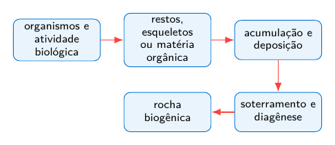

Nem todo calcário é exclusivamente biogênico. Carbonatos também podem precipitar diretamente da água ou conter proporções importantes de lama carbonática e sedimentos terrígenos. A origem deve ser reconhecida pela composição, pela textura, pelos fósseis, pelas estruturas sedimentares e pelo contexto deposicional.

**Relação entre os termos:** organismos produzem ou concentram materiais minerais e orgânicos; esses materiais acumulam-se como sedimento; o soterramento e a diagênese podem transformá-los em rochas biogênicas.

*Ver também:* rocha sedimentar, calcário, bioclasto, fóssil, carbonato, diatomácea, radiolário, carvão, diagênese.

## Rochas ígneas

**Rocha ígnea** é formada pelo resfriamento e pela solidificação de magma ou lava. Sua classificação introdutória considera principalmente o local de cristalização, a textura e a composição mineralógica ou química.

**Quanto ao local de formação**

- **intrusiva ou plutônica**: cristaliza em profundidade, geralmente com resfriamento lento e cristais visíveis; granito, diorito e gabro são exemplos;

- **extrusiva ou vulcânica**: solidifica na superfície ou próximo dela, geralmente com resfriamento rápido; riolito, andesito e basalto são exemplos;

- **subvulcânica ou hipabissal**: cristaliza em níveis rasos, em diques, soleiras e pequenos corpos intrusivos.

**Texturas principais**

- **fanerítica**: cristais visíveis a olho nu;

- **afanítica**: cristais muito pequenos, geralmente não individualizados a olho nu;

- **porfirítica**: cristais maiores, chamados fenocristais, envolvidos por uma matriz mais fina;

- **vítrea**: ausência ou escassez de cristais devido ao resfriamento muito rápido;

- **vesicular**: presença de cavidades deixadas por bolhas de gás;

- **piroclástica**: formada pela consolidação de fragmentos produzidos em erupções explosivas.

Quanto à composição, as rochas podem ser descritas, de modo simplificado, como **félsicas**, **intermediárias**, **máficas** ou **ultramáficas**. Esses termos refletem diferenças na mineralogia, no teor de sílica e na proporção de minerais claros e escuros.

| **Composição** | **Plutônica** | **Vulcânica**      | **Minerais comuns**     |
|:---------------|:--------------|:-------------------|:------------------------|
| Félsica        | granito       | riolito            | quartzo, feldspatos     |
| Intermediária  | diorito       | andesito           | plagioclásio, anfibólio |
| Máfica         | gabro         | basalto            | piroxênio, plagioclásio |
| Ultramáfica    | peridotito    | rara na superfície | olivina, piroxênio      |

**Relação entre os termos:** rochas plutônicas e vulcânicas podem ter composição semelhante, mas apresentam texturas diferentes porque cristalizam em condições distintas de resfriamento.

*Ver também:* magma, lava, textura, série de Bowen, granito, basalto, vulcanismo, intrusão.

## Rochas metamórficas e metamorfismo

**Metamorfismo** é o conjunto de transformações mineralógicas, químicas e texturais que afetam uma rocha no estado sólido em resposta a mudanças de temperatura, pressão, tensão e circulação de fluidos. A rocha original é chamada **protólito**.

O metamorfismo não implica fusão completa. Quando a rocha funde em proporção significativa, inicia-se a formação de magma e o processo passa ao domínio ígneo.

**Tipos introdutórios**

- **metamorfismo regional**: afeta grandes áreas e está associado a soterramento, compressão e formação de cadeias montanhosas;

- **metamorfismo de contato**: ocorre junto a corpos magmáticos, com predomínio do aquecimento;

- **metamorfismo hidrotermal**: resulta da circulação de fluidos quentes que alteram a composição mineralógica;

- **metamorfismo dinâmico**: concentra-se em zonas de falha e cisalhamento.

**Foliação** é a orientação planar de minerais ou a segregação de bandas composicionais produzida pela deformação e recristalização. Ardósia, filito, xisto e gnaisse representam uma sequência didática de aumento de grau metamórfico, embora não sejam etapas obrigatórias para todo protólito.

Rochas **não foliadas**, como mármore e quartzito, podem formar-se quando o protólito é composto principalmente por um único mineral ou quando a tensão dirigida não produz orientação mineral evidente.

**Relação entre os termos:** o protólito fornece a composição inicial; pressão, temperatura, tensão e fluidos controlam as transformações; a rocha metamórfica é o produto recristalizado no estado sólido.

*Ver também:* protólito, foliação, recristalização, grau metamórfico, mármore, quartzito, xisto, gnaisse.

## Rochas sedimentares: tipos principais

**Rocha sedimentar** é uma rocha formada pela acumulação de sedimentos e por sua posterior litificação, ou pela precipitação e consolidação de materiais químicos ou biogênicos. As classificações variam conforme o critério adotado, mas no nível introdutório podem ser reconhecidos quatro grandes conjuntos.

**1. Rochas clásticas ou detríticas**

São constituídas por fragmentos, chamados **clastos**, provenientes de minerais, rochas ou materiais preexistentes. Nas rochas siliciclásticas, a classificação básica utiliza principalmente o tamanho dos grãos:

- **conglomerado**: formado predominantemente por clastos maiores que 2 mm e arredondados;

- **brecha sedimentar**: formada predominantemente por clastos maiores que 2 mm e angulosos;

- **arenito**: formado principalmente por grãos de areia, entre aproximadamente 0.0625 mm e 2 mm;

- **siltito**: constituído principalmente por grãos do tamanho silte, entre aproximadamente 0.0039 mm e 0.0625 mm;

- **argilito**: rocha muito fina, rica em partículas do tamanho argila;

- **lamito**: rocha composta por proporções variáveis de silte e argila;

- **folhelho**: rocha fina que apresenta **fissilidade**, isto é, tendência a dividir-se em lâminas aproximadamente paralelas à estratificação.

**2. Rochas químicas**

Formam-se principalmente pela precipitação de substâncias dissolvidas na água. Incluem os **evaporitos**, como sal-gema e gipsita, além de parte dos calcários, dolomitos, sílex, fosforitos e formações ferríferas sedimentares.

**3. Rochas biogênicas ou bioquímicas**

Resultam da acumulação de restos de organismos ou da precipitação favorecida pela atividade biológica. Incluem calcários bioclásticos, giz, diatomito, radiolarito e carvão. A distinção entre químico e biogênico pode ser gradual, especialmente nas rochas carbonáticas e silicosas.

**4. Rochas e depósitos vulcanoclásticos**

São formados por fragmentos produzidos por atividade vulcânica ou pelo retrabalhamento desses materiais. Cinzas consolidadas podem formar **tufo**; fragmentos maiores podem originar tufos de lapilli e brechas vulcanoclásticas. Dependendo do processo de formação, esses materiais também são estudados no contexto das rochas ígneas.

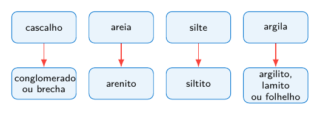

**Relação entre os termos:** a classificação das rochas clásticas começa pela granulometria dos clastos; rochas químicas e biogênicas são reconhecidas principalmente pela composição e pelo processo de formação; materiais vulcanoclásticos dependem da origem e do retrabalhamento dos fragmentos vulcânicos.

*Ver também:* litificação, granulometria, conglomerado, brecha, arenito, siltito, argilito, folhelho, calcário, evaporito, carvão, tufo.

## Sedimentação e formação das rochas sedimentares

**Sedimento** é o material particulado ou precipitado que pode ser transportado, depositado e acumulado na superfície terrestre ou no fundo de corpos d’água. Sua origem pode ser clástica, química ou biogênica.

A formação de uma rocha sedimentar pode ser compreendida como uma sequência de processos relacionados:

- **intemperismo**: desagregação e alteração das rochas no local em que se encontram. Pode ser físico, químico ou biológico;

- **erosão**: remoção e mobilização dos materiais produzidos ou enfraquecidos pelo intemperismo;

- **transporte**: deslocamento dos sedimentos pela água, pelo vento, pelo gelo ou pela gravidade;

- **deposição**: acumulação do material quando o agente de transporte perde capacidade de carregá-lo ou quando ocorre precipitação química ou produção biogênica;

- **sedimentação**: processo de deposição e acumulação de sedimentos em determinado ambiente;

- **soterramento**: recobrimento progressivo dos sedimentos por novas camadas;

- **diagênese**: conjunto de transformações físicas, químicas e biológicas que ocorrem após a deposição, em condições anteriores ao metamorfismo;

- **litificação**: transformação do sedimento inconsolidado em rocha sedimentar. Nas rochas clásticas, ocorre principalmente por compactação e cimentação.

Durante o transporte, os grãos podem sofrer abrasão, tornar-se mais arredondados e ser separados conforme tamanho, forma ou densidade. Esse processo de separação é chamado **seleção sedimentar**. A intensidade dessas modificações depende da distância percorrida, do agente de transporte, da energia do ambiente e da resistência dos minerais.

Exemplos de relações entre sedimentos e rochas sedimentares clásticas:

- areia $\rightarrow$ arenito;

- silte $\rightarrow$ siltito;

- lama rica em argila $\rightarrow$ argilito ou, quando apresenta fissilidade, folhelho;

- cascalho com fragmentos arredondados $\rightarrow$ conglomerado;

- cascalho com fragmentos angulosos $\rightarrow$ brecha sedimentar.

**Relação entre os termos:** o intemperismo produz ou altera materiais; a erosão os remove; o transporte os desloca; a deposição os acumula; o soterramento e a diagênese podem transformá-los em rochas sedimentares.

*Ver também:* sedimento, intemperismo, erosão, transporte, deposição, soterramento, diagênese, compactação, cimentação, litificação.

## Série de reação de Bowen

A **série de reação de Bowen** é um modelo que representa a sequência geral de cristalização dos principais minerais silicáticos durante o resfriamento de um magma, especialmente de composição basáltica. Foi desenvolvida a partir dos estudos experimentais de Norman L. Bowen no início do século XX.

O modelo possui dois ramos principais:

- **série descontínua**: com a diminuição da temperatura, minerais ferromagnesianos apresentam a sequência geral olivina, piroxênio, anfibólio e biotita. Cada mineral possui um intervalo de estabilidade e pode reagir com o líquido magmático remanescente;

- **série contínua**: o plagioclásio permanece como o mesmo grupo mineral, mas sua composição evolui gradualmente de termos ricos em cálcio para termos ricos em sódio.

Em temperaturas mais baixas cristalizam, de modo geral, feldspato potássico, muscovita e quartzo.

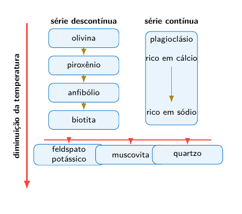

Esquema simplificado. A sequência real depende da composição do magma, da pressão, da presença de voláteis e da possibilidade de reação entre cristais e líquido.

A série não deve ser entendida como uma regra rígida para todos os magmas. A cristalização fracionada, a mistura de magmas, a assimilação de rochas encaixantes e as condições de pressão e água podem modificar a associação mineral formada.

**Relação entre os termos:** minerais que cristalizam em temperaturas mais altas tendem a ser menos estáveis nas condições da superfície; a série de Bowen também ajuda a compreender tendências de diferenciação magmática e intemperismo.

*Ver também:* magma, cristalização, rocha ígnea, olivina, piroxênio, anfibólio, feldspato, quartzo.

## Siccar Point

**Siccar Point** é um afloramento costeiro da Escócia famoso por apresentar uma discordância angular reconhecida por James Hutton em 1788. No local, camadas quase verticais de arenitos grauváquicos, siltitos e lamitos do Siluriano são recobertas de forma discordante por brechas e arenitos avermelhados mais jovens do *Old Red Sandstone*, depositados com inclinação muito menor.

A geometria observada exige uma longa sucessão de acontecimentos:

1.  deposição e litificação dos sedimentos silurianos;

2.  deformação, dobramento e basculamento das camadas antigas;

3.  soerguimento e erosão, que truncaram essas camadas;

4.  nova deposição de sedimentos continentais sobre a superfície erosiva;

5.  novo soerguimento e erosão, expondo a discordância atual.

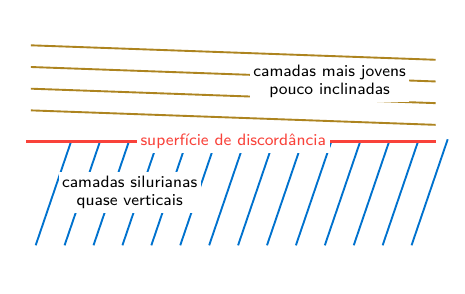

Siccar Point forneceu uma demonstração visual do **tempo profundo**: cada etapa exigiu tempo para ocorrer, e a superfície de discordância representa um intervalo não preservado diretamente como camada sedimentar.

**Relação entre os termos:** Siccar Point relaciona afloramento, discordância angular, ciclos de deposição e erosão e a interpretação do tempo geológico profundo.

*Ver também:* Hutton, James, discordância angular, afloramento, registro estratigráfico, tempo geológico.

## Silício, sílica e silicatos

**Silício**, símbolo químico Si, é um elemento químico. Na natureza, normalmente ocorre combinado com oxigênio e outros elementos, e não como substância elementar isolada.

**Sílica**, de fórmula química $\mathrm{SiO_2}$, é um composto de silício e oxigênio. O quartzo é a forma mineral mais comum de sílica, embora existam outras formas naturais.

**Silicato** não designa um único mineral. É o nome de uma grande classe de minerais cuja estrutura contém silício e oxigênio, organizados fundamentalmente em tetraedros $\mathrm{SiO_4}$. Entre os minerais silicáticos mais importantes estão feldspatos, micas, olivinas, piroxênios, anfibólios e minerais de argila.

**Rocha silicática** ou **rocha silicatada** é constituída predominantemente por minerais silicáticos. Granito, basalto, gabro e gnaisse são exemplos. A expressão **rocha rica em sílica** refere-se ao teor de $\mathrm{SiO_2}$, enquanto **rocha silicosa** costuma indicar material formado principalmente por sílica, como o sílex.

**Relação entre os termos:** silício é o elemento químico; sílica é o composto $\mathrm{SiO_2}$; silicatos são uma classe de minerais; rochas silicáticas são agregados constituídos predominantemente por minerais silicáticos.

*Ver também:* quartzo, feldspato, mineral, rocha ígnea, composição química.

## Sismos e sismologia

**Sismo**, **terremoto** ou **abalo sísmico** é a vibração do terreno produzida pela liberação súbita de energia no interior da Terra. A causa mais comum é a ruptura ou o deslocamento rápido ao longo de uma falha, quando a tensão acumulada nas rochas supera sua resistência.

Também podem ocorrer sismos associados à atividade vulcânica, ao colapso de cavidades, a grandes movimentos de massa ou a atividades humanas. Entretanto, os sismos tectônicos são os mais importantes para o estudo da dinâmica das placas e das grandes estruturas da crosta.

**Sismologia** é o ramo da Geofísica que estuda os sismos, a propagação das ondas sísmicas e a estrutura interna da Terra. As ondas registradas permitem localizar a fonte do sismo, estimar sua magnitude e investigar as propriedades dos materiais atravessados.

**Partes e registros de um sismo**

- **hipocentro** ou **foco**: ponto no interior da Terra onde se inicia a ruptura e a liberação de energia;

- **epicentro**: ponto da superfície situado verticalmente acima do hipocentro;

- **sismômetro**: sensor que detecta e mede o movimento do terreno;

- **sismógrafo**: conjunto instrumental usado para detectar e registrar os movimentos sísmicos;

- **sismograma**: registro produzido pelo instrumento, no qual aparecem as chegadas das diferentes ondas.

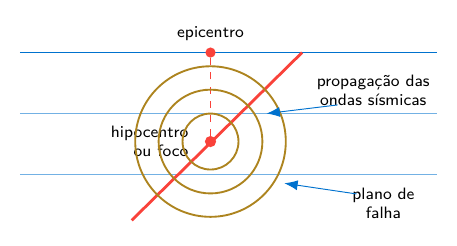

Relação geométrica entre hipocentro, epicentro, falha e propagação das ondas.

**Ondas sísmicas principais**

- **ondas P**: ondas de compressão e dilatação; são as mais rápidas e propagam-se por sólidos, líquidos e gases;

- **ondas S**: ondas de cisalhamento; são mais lentas que as ondas P e não se propagam em líquidos;

- **ondas superficiais**: propagam-se próximas à superfície e frequentemente produzem movimentos de grande amplitude e muitos dos danos observados.

**Magnitude** é uma medida instrumental do tamanho do sismo e relaciona-se à energia liberada. Para sismos importantes, utiliza-se amplamente a magnitude de momento, indicada por $M_w$. A expressão “escala Richter” refere-se originalmente a uma escala de magnitude local e não designa todas as medidas modernas de magnitude.

**Intensidade sísmica** descreve os efeitos e danos observados em determinado lugar. Portanto, um mesmo sismo possui uma magnitude, mas pode apresentar diferentes intensidades conforme a distância ao epicentro, a profundidade do foco, o tipo de terreno e a vulnerabilidade das construções.

Um sismo submarino pode gerar um **tsunami** quando provoca deslocamento significativo e rápido do fundo marinho e da coluna d’água. Nem todo sismo oceânico produz tsunami: o mecanismo da falha, a profundidade e a deformação vertical do fundo são fatores decisivos.

**Relação entre os termos:** a ruptura começa no hipocentro; o epicentro é sua projeção na superfície; a energia propaga-se por ondas sísmicas; o sismômetro registra o movimento; magnitude mede o tamanho do evento e intensidade descreve seus efeitos locais.

*Ver também:* falha, placas tectônicas, ondas P, ondas S, epicentro, hipocentro, magnitude, intensidade, tsunami, Geofísica.

## Smith, William

**William Smith (1769–1839)**

Agrimensor e engenheiro inglês que teve papel fundamental no desenvolvimento da estratigrafia e da cartografia geológica. Durante trabalhos em canais, minas, pedreiras e cortes de terreno, Smith observou que determinados conjuntos de fósseis apareciam repetidamente em certas camadas e segundo uma ordem reconhecível.

Essa regularidade deu origem ao **princípio da sucessão faunística**: os organismos fósseis sucedem-se em uma ordem determinada no registro geológico, permitindo reconhecer e correlacionar estratos de mesma idade relativa em localidades diferentes.

Em 1815, Smith publicou seu grande mapa geológico da Inglaterra e do País de Gales, com parte da Escócia. O mapa utilizava cores para representar a distribuição das unidades e baseava-se na associação entre litologia, posição estratigráfica e conteúdo fossilífero. Tornou-se um marco da cartografia geológica e da interpretação tridimensional das camadas no subsolo.

**Relação entre os termos:** fósseis característicos permitem reconhecer estratos; estratos reconhecidos em diferentes locais podem ser correlacionados; essa correlação permite reconstruir a distribuição espacial e a idade relativa das unidades geológicas.

*Ver também:* sucessão faunística, estratigrafia, bioestratigrafia, correlação, mapa geológico, fóssil.

## Steno, Nicolau

**Nicolau Steno (1638–1686)**

Também conhecido pelo nome latinizado *Nicolaus Steno* e pelo nome dinamarquês Niels Stensen, foi um dos pioneiros da estratigrafia e da interpretação geológica dos fósseis.

Entre os princípios associados ao seu trabalho estão:

- **superposição**: em uma sequência não deformada, as camadas inferiores são mais antigas que as superiores;

- **horizontalidade original**: sedimentos tendem a ser depositados originalmente em camadas aproximadamente horizontais;

- **continuidade lateral**: uma camada sedimentar originalmente se prolonga lateralmente até se adelgaçar, mudar de fácies ou encontrar um limite da bacia;

- reconhecimento de que certos objetos encontrados nas rochas, como dentes fossilizados, eram restos de organismos que viveram no passado.

*Ver também:* estratigrafia, camada, superposição, fóssil, idade relativa.

## Tectônica de placas

**Tectônica de placas** é o modelo segundo o qual a litosfera terrestre está dividida em placas rígidas que se deslocam sobre uma região mecanicamente mais dúctil do manto superior. O movimento das placas explica a distribuição global de dorsais oceânicas, fossas, cadeias de montanhas, vulcões e grande parte dos sismos.

**Litosfera** compreende a crosta e a parte superior rígida do manto. Abaixo dela encontra-se a **astenosfera**, região do manto superior que se deforma lentamente e permite o movimento relativo das placas.

**Limites principais**

- **divergente**: as placas se afastam; formam-se riftes continentais e dorsais mesoceânicas, com geração de nova litosfera oceânica;

- **convergente**: as placas se aproximam; pode ocorrer subducção de litosfera oceânica ou colisão continental;

- **transformante**: as placas deslizam lateralmente uma em relação à outra, sem criação ou destruição significativa de litosfera.

**Subducção** é o mergulho de uma placa litosférica, geralmente oceânica, sob outra placa. Está associada a fossas oceânicas, arcos vulcânicos, deformação e sismos que podem ocorrer a grandes profundidades.

O movimento das placas é da ordem de centímetros por ano, mas sua atuação acumulada ao longo de milhões de anos produz grandes deslocamentos e reorganiza continentes e oceanos.

**Relação entre os termos:** a deriva continental descreveu o deslocamento dos continentes; a tectônica de placas forneceu o mecanismo global que integra expansão do fundo oceânico, subducção, sismos, vulcanismo e formação de montanhas.

*Ver também:* litosfera, astenosfera, dorsal mesoceânica, subducção, fossa oceânica, rifte, falha transformante, Wegener.

## Wegener, Alfred

**Alfred Wegener (1880–1930)**

Meteorologista e geofísico alemão que formulou a hipótese da **deriva continental**. Wegener propôs que os continentes atuais estiveram reunidos em um grande continente, posteriormente fragmentado, e que os blocos continentais se deslocaram ao longo do tempo geológico.

Entre as evidências discutidas estavam:

- semelhança entre os contornos de margens continentais;

- continuidade de estruturas geológicas e cadeias de montanhas em continentes hoje separados;

- ocorrência dos mesmos fósseis terrestres ou de água doce em diferentes continentes;

- registros paleoclimáticos incompatíveis com as posições geográficas atuais, como depósitos glaciais em regiões hoje tropicais.

A hipótese enfrentou forte resistência porque Wegener não apresentou um mecanismo físico satisfatório para o deslocamento dos continentes. Décadas depois, dados do fundo oceânico, do paleomagnetismo e da sismologia contribuíram para o desenvolvimento da tectônica de placas, que explicou o movimento das placas litosféricas.

**Relação entre os termos:** Wegener reuniu evidências da mobilidade continental; a tectônica de placas, desenvolvida posteriormente, explicou essa mobilidade por meio do movimento integrado da litosfera oceânica e continental.

*Ver também:* deriva continental, Pangeia, tectônica de placas, expansão do fundo oceânico, paleomagnetismo.

## Wentworth, escala granulométrica

A **escala de Wentworth**, também chamada de **escala de Udden–Wentworth**, classifica e descreve sedimentos clásticos segundo o diâmetro das partículas. Seus limites seguem, em grande parte, uma progressão por fatores de dois, permitindo separar classes granulométricas de forma padronizada.

| **Classe**                   | **Diâmetro aproximado**                 |
|:-----------------------------|:----------------------------------------|
| Matacão ou bloco (*boulder*) | $\geq$ 256 mm                           |
| Calhau (*cobble*)            | 64 mm a $<$<!-- -->256 mm               |
| Seixo (*pebble*)             | 4 mm a $<$<!-- -->64 mm                 |
| Grânulo (*granule*)          | 2 mm a $<$<!-- -->4 mm                  |
| Areia muito grossa           | 1 mm a $<$<!-- -->2 mm                  |
| Areia grossa                 | 0.5 mm a $<$<!-- -->1 mm                |
| Areia média                  | 0.25 mm a $<$<!-- -->0.5 mm             |
| Areia fina                   | 0.125 mm a $<$<!-- -->0.25 mm           |
| Areia muito fina             | 0.0625 mm a $<$<!-- -->0.125 mm         |
| Silte                        | aprox. 0.0039 mm a $<$<!-- -->0.0625 mm |
| Argila                       | $<$<!-- -->0.0039 mm                    |

De forma agrupada:

- **cascalho**: partículas com diâmetro igual ou superior a aproximadamente 2 mm;

- **areia**: de aproximadamente 0.0625 mm a menos de 2 mm;

- **silte**: de aproximadamente 0.0039 mm a menos de 0.0625 mm;

- **argila**: partículas menores que aproximadamente 0.0039 mm.

Os equivalentes em português podem variar entre autores e áreas profissionais. Por isso, em descrições técnicas, os limites numéricos devem acompanhar a nomenclatura. A escala descreve o tamanho: não determina por si só a composição mineral, a origem ou o ambiente de deposição.

**Relação entre os termos:** a escala de Wentworth fornece nomes padronizados para faixas de tamanho; granulometria mede a distribuição dessas faixas em uma amostra.

*Ver também:* granulometria, cascalho, areia, silte, argila, seleção, rocha sedimentar clástica.
