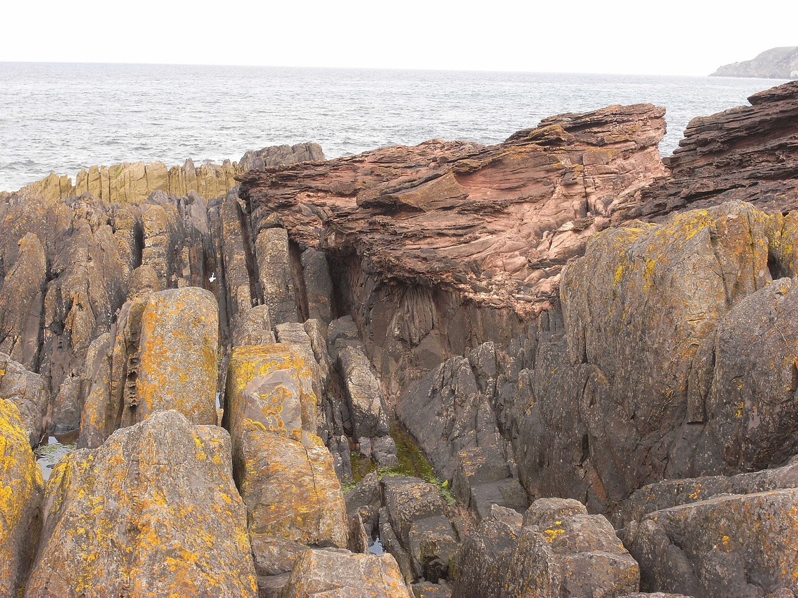
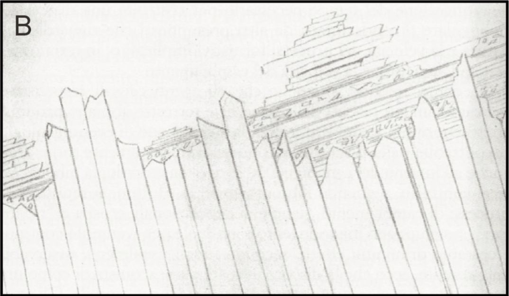
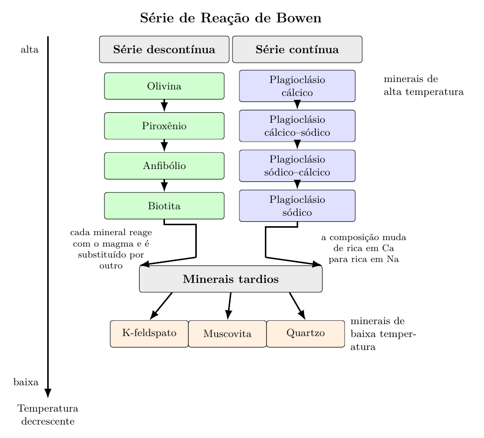
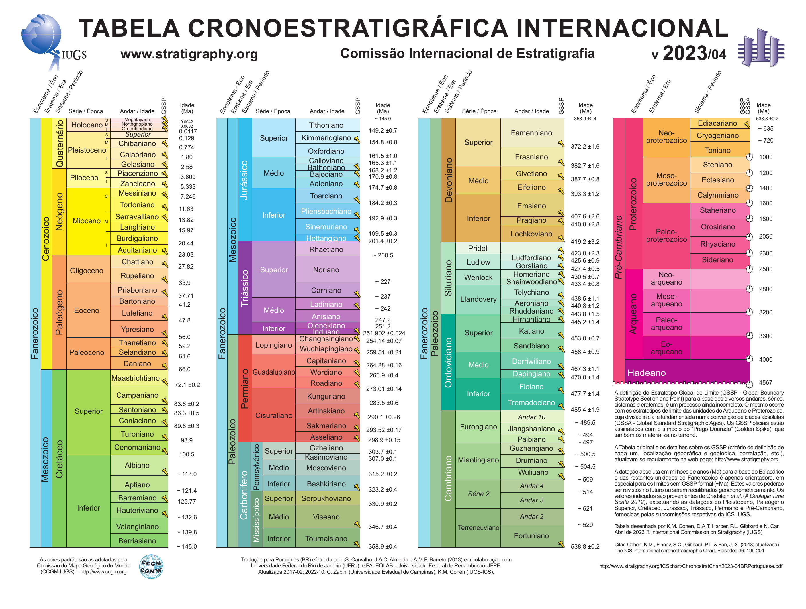
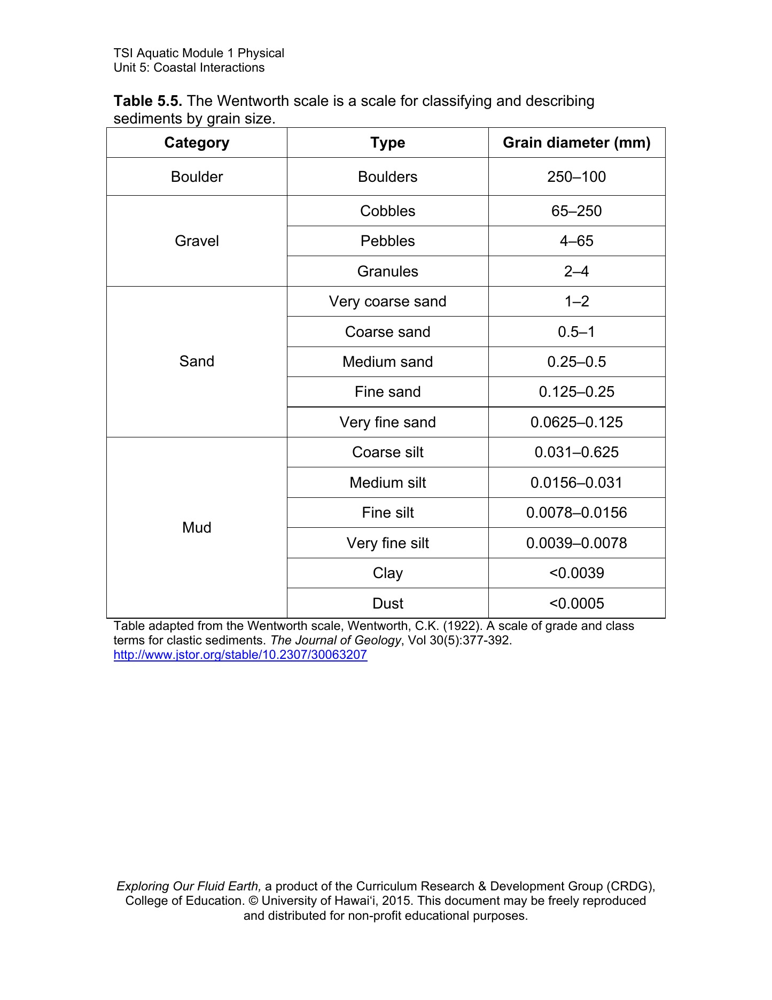

# Conversão integral das notas — arquivo de conferência

Esta cópia conserva a ordem original e trechos ainda não revisados. Use `Geologia_III_reorganizada.md` para estudar.

# Introdução

Trazendo aqui algumas definições dadas anteriormente temos:

Os dobramentos **sinclinais** são estruturas geológicas em que as camadas rochosas se curvam de modo côncavo para cima, formando uma dobra cuja parte central contém, em geral, as camadas mais recentes. Em um sinclinal, os flancos mergulham em direção ao eixo da dobra.

Os dobramentos **anticlinais** são estruturas geológicas em que as camadas rochosas se curvam de modo convexo para cima, formando uma dobra cuja parte central contém, em geral, as camadas mais antigas. Em um anticlinal, os flancos mergulham em sentido oposto ao eixo da dobra.

Uma definição que pode ser importante ser mencionada é

Os **diápiros** são estruturas geológicas formadas pela ascensão de materiais mais dúcteis e menos densos através de camadas rochosas superiores mais rígidas e mais densas. Essa ascensão ocorre em razão da diferença de densidade entre os materiais e da capacidade de deformação plástica da massa ascendente.

Os **diápiros de sal** são diápiros constituídos predominantemente por evaporitos, especialmente halita, podendo também incluir anidrita, gipsita e outros sais. Em profundidade, o sal comporta-se de maneira dúctil e, por ser menos denso que grande parte das rochas sedimentares que o recobrem, tende a migrar para níveis superiores, deformando as camadas encaixantes.

Os diápiros de sal ocorrem em **bacias sedimentares evaporíticas**, isto é, em bacias nas quais houve deposição de espessas camadas de sal em ambientes de intensa evaporação. Sua formação inicia-se com a deposição desses evaporitos, seguida pelo soterramento por sedimentos mais densos. Com o aumento da sobrecarga, o sal passa a fluir lentamente devido ao seu comportamento plástico e à diferença de densidade, podendo ascender e formar estruturas como domos e muralhas salinas. Essas estruturas são comuns em regiões como o Golfo do México, o Mar do Norte, o Oriente Médio e a margem continental brasileira, especialmente em áreas associadas ao pré-sal.

# Os pensadores e a origem da Geologia

## Nicolas Steno

Foi uma figura decisiva na formação do pensamento geológico moderno, mesmo atuando no século XVII, antes da consolidação formal da geologia como ciência. A partir do estudo de fósseis e camadas rochosas, Steno formulou princípios que se tornariam basilares para a estratigrafia, como os princípios da superposição, da horizontalidade original e da continuidade lateral. Ao defender que os fósseis eram restos de organismos outrora vivos e que os estratos registravam uma sequência temporal de deposição, ele contribuiu para transformar o estudo da Terra em uma investigação histórica, fundada na observação e na interpretação ordenada das rochas.

## William Smith

Teve papel fundamental no avanço da estratigrafia ao demonstrar que diferentes camadas sedimentares podem ser reconhecidas e correlacionadas por seus conjuntos fossilíferos característicos.

Engenheiro e agrimensor de formação prática, Smith observou, em canais, minas e cortes de terreno na Inglaterra, que determinados fósseis ocorriam sempre em certos estratos e em uma ordem recorrente. Essa percepção levou à formulação do princípio da sucessão faunística e permitiu a elaboração de seu célebre mapa geológico da Inglaterra e do País de Gales, publicado em 1815, marco essencial para a cartografia geológica moderna.

## Georges Cuvier

Destacou-se sobretudo por demonstrar, com base em estudos anatômicos e paleontológicos, que muitas espécies fósseis não possuíam equivalentes vivos, o que forneceu evidências robustas da extinção biológica. Em suas pesquisas sobre os fósseis da Bacia de Paris, Cuvier mostrou que a sucessão dos estratos correspondia também a uma sucessão de faunas, isto é, a mudanças reais na história da vida e da Terra. Embora sua interpretação estivesse associada ao catastrofismo, sua contribuição foi decisiva para consolidar o valor científico dos fósseis como documentos do passado geológico e biológico.

O catastrofismo constitui uma das primeiras abordagens interpretativas da história da Terra, associada sobretudo aos trabalhos de Georges Cuvier. Segundo essa perspectiva, as transformações geológicas e biológicas seria resultado de eventos abruptos e de grande magnitude, responsáveis por provocar extinções em larga escala e pela subsequente substituição de faunas. A análise dos fósseis da Bacia de Paris levou Cuvier a reconhecer a sucessão de diferentes assembléias de organismos, interpretadas como evidência de descontinuidades na história da vida. Embora o catastrofismo clássico tenha sido posteriormente contraposto pelo uniformitarismo, sua importância permanece no reconhecimento de que eventos de grande escala, como extinções em massa e crises ambientais, desempenham papel significativo na evolução geológica e biológica da Terra.

## Alexandre Brongniart

Teve grande importância no desenvolvimento da geologia histórica e da estratigrafia ao estudar, em colaboração com Cuvier, os terrenos sedimentares da Bacia de Paris. Seu trabalho ajudou a mostrar que camadas distintas podem ser identificadas e ordenadas a partir de seus fósseis característicos e de suas relações espaciais, contribuindo para o desenvolvimento do raciocínio geocronológico. Além disso, Brongniart observou a alternância de depósitos continentais e marinhos na região parisiense, o que reforçou a ideia de que a história da Terra é marcada por mudanças ambientais sucessivas, registradas nas rochas sedimentares.

## O desenvolvimento da bioestratigrafia

A bioestratigrafia desenvolveu-se a partir da observação de que os fósseis não se distribuem aleatoriamente nas rochas sedimentares, mas aparecem segundo uma ordem recorrente ao longo dos estratos. Nesse processo, William Smith e, de outro modo, Georges Cuvier e Alexandre Brongniart tiveram papel decisivo. Embora suas abordagens não tenham sido idênticas, ambas contribuíram para consolidar a ideia de que os fósseis podem ser utilizados para reconhecer, comparar e ordenar camadas sedimentares, fornecendo uma base fundamental para o desenvolvimento da geologia moderna.

No caso de William Smith, a metodologia nasceu do trabalho de campo em canais, minas, pedreiras e afloramentos na Inglaterra. Smith percebeu que certos fósseis apareciam sempre associados aos mesmos estratos e que essas associações se repetiam em diferentes localidades. A partir dessa constatação, passou a usar conjuntamente a litologia das camadas e o seu conteúdo fossilífero. O ponto central de sua contribuição foi o reconhecimento de que existe uma sucessão faunística regular, isto é, os fósseis surgem em uma ordem determinada ao longo da coluna estratigráfica. Com base nesse princípio, Smith conseguiu correlacionar estratos separados no espaço e elaborar seu célebre mapa geológico da Inglaterra e do País de Gales, publicado em 1815. Essa metodologia constituiu um dos fundamentos da bioestratigrafia, ao demonstrar que os fósseis podem servir como marcadores para a posição relativa das camadas no tempo geológico.

Georges Cuvier e Alexandre Brongniart, por sua vez, desenvolveram uma metodologia mais integrada, combinando paleontologia, estratigrafia e reconstrução ambiental. Em seus estudos sobre a Bacia de Paris, compararam afloramentos, organizaram a ordem de superposição dos estratos, mapearam sua extensão lateral e relacionaram cada unidade aos seus fósseis característicos. Um dos resultados mais importantes desse trabalho foi o reconhecimento da alternância entre depósitos marinhos e depósitos continentais ou de água doce, identificada tanto pela natureza das rochas quanto pelo conteúdo fossilífero. Desse modo, os estratos passaram a ser interpretados não apenas como camadas sucessivas, mas como registros de diferentes ambientes deposicionais e de transformações ocorridas ao longo do tempo.

A contribuição de Cuvier foi particularmente importante porque ele demonstrou, por meio da anatomia comparada e do estudo dos fósseis, que muitas espécies do passado não possuíam equivalentes vivos, evidenciando o fenômeno da extinção. Isso deu aos fósseis um valor histórico ainda maior, pois passaram a ser compreendidos como testemunhos de sucessivas faunas que habitaram a Terra em épocas distintas. Assim, enquanto Smith mostrou de maneira prática que os fósseis permitem correlacionar estratos em diferentes localidades, Cuvier e Brongniart mostraram que a sucessão fossilífera também permite reconstruir a história dos ambientes e das mudanças ocorridas em uma bacia sedimentar.

Esse conjunto de trabalhos foi essencial para a consolidação da geologia moderna. As camadas rochosas deixaram de ser vistas apenas como massas minerais superpostas e passaram a ser interpretadas como registros ordenados da história da Terra. A estratigrafia, associada ao estudo dos fósseis, ganhou assim um caráter histórico, permitindo reconhecer a sucessão temporal dos estratos, a mudança das faunas e a evolução dos ambientes deposicionais.

Quanto ao termo **Terciário**, é importante observar que ele não foi criado por Smith, nem por Cuvier e Brongniart. Sua introdução é atribuída a Giovanni Arduino, em 1760, no contexto de uma classificação que distinguia terrenos primários, secundários, terciários e quaternários. Posteriormente, os estudos estratigráficos e paleontológicos, especialmente os desenvolvidos na Bacia de Paris, conferiram maior precisão a esse conjunto de terrenos, mostrando que ele correspondia a uma sucessão sedimentar dotada de características fossilíferas próprias. Assim, embora Cuvier e Brongniart não tenham criado o termo, contribuíram de maneira decisiva para lhe dar conteúdo estratigráfico e paleontológico mais definido.

Mais tarde, essa tradição seria aprofundada por Charles Lyell, que subdividiu o antigo Terciário em unidades como Eoceno, Mioceno e Plioceno, com base principalmente nas características das faunas fósseis. Desse modo, a bioestratigrafia consolidou-se como um dos principais instrumentos da geologia histórica, permitindo ordenar os estratos a partir de seu conteúdo fossilífero e interpretar a longa evolução da Terra. Em síntese, pode-se dizer que Steno forneceu os princípios geométricos da estratigrafia, Smith demonstrou o valor dos fósseis para a correlação dos estratos, e Cuvier e Brongniart mostraram como a associação entre fósseis e camadas permite reconstruir a história geológica de uma bacia. É desse encadeamento intelectual que emerge a base da bioestratigrafia clássica.

[[zerfass2008foraminiferos](../Referencias.md#zerfass2008foraminiferos)]

## Do registro estratigráfico ao tempo geológico

O avanço da estratigrafia e da paleontologia, consolidado pelos trabalhos de Steno, Smith, Cuvier e Brongniart, permitiu reconhecer que as camadas rochosas registram uma sucessão ordenada de eventos ao longo do tempo. No entanto, a compreensão plena desse registro exigiu uma mudança conceitual mais profunda, relacionada à própria natureza do tempo geológico e aos processos responsáveis pela formação das rochas.

Nesse contexto, destaca-se a contribuição de James Hutton, que, ao observar processos naturais como a erosão, o transporte e a deposição de sedimentos, propôs que os mesmos mecanismos atuantes no presente foram também responsáveis pela formação das rochas no passado. Essa ideia implicava a existência de um tempo geológico extremamente longo, incompatível com interpretações baseadas em eventos únicos ou de curta duração.

Posteriormente, Charles Lyell sistematizou e difundiu esse modo de interpretação, consolidando o chamado uniformitarismo. Para Lyell, a Terra deveria ser compreendida a partir da ação contínua e gradual de processos naturais observáveis, o que conferiu à geologia um caráter mais rigoroso e metodológico. Dessa forma, o registro estratigráfico passou a ser interpretado não apenas como uma sucessão de camadas e fósseis, mas como o resultado de processos dinâmicos que atuam ao longo de extensas escalas de tempo.

Assim, enquanto a estratigrafia e a paleontologia forneceram os instrumentos para ordenar e correlacionar os estratos, as ideias de Hutton e Lyell ofereceram o arcabouço teórico necessário para interpretar a história da Terra em termos de processos contínuos e tempo profundo.

## Abraham Gottlieb Werner e o Netunismo

Foi um proto-geólogo sistematizador / naturalista descritivo.

- Classificação de rochas baseada em observação

- Defendia que todas as rochas se originaram de um oceano primordial e,

- Forte componente dogmático e pouco experimental

## James Hutton, (Uniformitarismo inicial)

Hutton é amplamente reconhecido como um dos fundadores da Geologia moderna. Ao interpretar corpos intrusivos que cortam as rochas encaixantes como posteriores a elas, contribuiu para a consolidação dos princípios de datação relativa. Nesse mesmo quadro conceitual insere-se o princípio das inclusões, segundo o qual fragmentos de rochas incorporados em uma formação são mais antigos que a rocha que os contém. Embora este último não tenha sido formulado diretamente por Hutton, ambos se baseiam em uma mesma lógica interpretativa, fundada nas relações geométricas entre as unidades geológicas.

- Introduz o conceito de tempo profundo.

- Propõe que processos atuais explicam o passado,

- Baseado em observação + inferência.

Conforme proposto por Hutton, os processos geológicos observáveis no presente são os mesmos que atuaram no passado, ideia posteriormente sintetizada por Lyell na máxima de que o presente é a chave do passado, base do uniformitarismo.

## Charles Lyell

Foi o sistematizador teórico e metodológico da teoria de Hutton. No século XIX, Charles Lyell consolidou e difundiu o uniformitarismo ao sistematizar a ideia de que os processos geológicos observáveis no presente são fundamentais para a interpretação do passado da Terra, princípio frequentemente sintetizado na máxima de que o presente é a chave do passado.

- Expande e sistematiza o uniformitarismo.

- Estrutura a geologia como ciência moderna,

- Forte influência metodológica (inclusive em Darwin).

Werner, Hutton e Lyell podem ser classificados como pensadores fundamentais da geologia, responsáveis pela construção dos primeiros modelos interpretativos sobre a evolução da Terra, embora representem abordagens distintas — desde o naturalismo descritivo (Werner) até o desenvolvimento e consolidação do uniformitarismo (Hutton e Lyell).

## Princípios em sedimentologia

**Princípio da Sobreposição**: Em uma sequência de rochas sedimentares não deformadas, as camadas mais antigas situam-se na base, enquanto as camadas mais jovens encontram-se progressivamente acima. Esse princípio permite estabelecer a ordem relativa de deposição dos estratos.

**Princípio das Relações de Corte (Interseção)**: Qualquer estrutura geológica que corta outra, como uma falha, fratura ou intrusão ígnea, é mais jovem do que a rocha ou estrutura que foi cortada. Esse princípio é fundamental para determinar a sequência de eventos geológicos.

**Princípio das Inclusões**: Fragmentos de rochas (clastos) contidos em uma formação são mais antigos do que a rocha que os engloba. Esse princípio é utilizado para estabelecer relações de idade relativa entre diferentes unidades geológicas.

## Discordâncias e lapso temporal

As discordâncias correspondem a superfícies de descontinuidade no registro geológico e indicam a existência de intervalos de tempo não representados por deposição contínua. Esses hiatos podem resultar de não deposição, erosão ou da combinação de ambos, de modo que a sucessão estratigráfica preservada passa a registrar não apenas os períodos em que houve sedimentação, mas também os trechos da história geológica que ficaram ausentes no registro. Assim, o conceito de discordância tem como eixo central o lapso temporal, isto é, o intervalo de tempo transcorrido entre duas fases distintas de formação das rochas.

Nesse contexto, James Hutton ocupa posição fundamental na consolidação da Geologia moderna. Em Siccar Point, na Escócia, ele interpretou uma discordância angular como evidência de uma sucessão de eventos que não poderia ser explicada por um tempo curto: deposição dos estratos mais antigos, litificação, deformação tectônica, soerguimento, erosão e posterior deposição de novos sedimentos. A importância dessa interpretação está no fato de que a superfície de discordância passou a ser compreendida não apenas como um contato entre rochas, mas como a expressão material de um hiato temporal muito extenso. Desse modo, as discordâncias tornaram-se evidências centrais da noção de tempo profundo e da dinâmica cíclica da Terra.

*Siccar Point*

A **discordância angular** ocorre quando estratos mais antigos foram inclinados, dobrados ou deformados e, após um intervalo de tempo acompanhado de erosão, passam a ser recobertos por camadas mais jovens depositadas em outra orientação. Nesse caso, o lapso temporal está associado não apenas à ausência de sedimentação contínua, mas também à atuação de processos tectônicos e erosivos entre os dois conjuntos de rochas.

*Siccar Point*

A **desconformidade** ocorre entre camadas sedimentares aproximadamente paralelas, separadas por uma superfície erosiva ou por um hiato de não deposição. Embora a geometria entre os estratos não revele deformação evidente, existe ainda assim um intervalo de tempo ausente no registro, reconhecido pela erosão da superfície ou pela diferença de idade entre as unidades superpostas.

A **não conformidade** ocorre quando rochas sedimentares repousam diretamente sobre rochas ígneas ou metamórficas mais antigas. Nesse caso, o lapso temporal tende a ser particularmente expressivo, pois envolve a formação das rochas cristalinas em profundidade, sua exumação por soerguimento e erosão, e somente depois o estabelecimento de uma nova fase de sedimentação. Por isso, a não conformidade evidencia de forma especialmente clara a amplitude do tempo geológico envolvido na construção de uma paisagem e de seu registro rochoso.

*Discordância angular em Siccar Point, Escócia, local clássico associado a James Hutton, onde estratos mais antigos deformados e erodidos são recobertos por camadas sedimentares mais jovens. A feição ilustra a noção de hiato estratigráfico e sua relação com o tempo geológico profundo.*

Assim, as discordâncias são fundamentais para a interpretação geológica, pois mostram que a história da Terra não é registrada apenas pelos estratos preservados, mas também pelos intervalos de tempo ausentes entre eles. Nesse sentido, a leitura proposta por Hutton foi decisiva ao demonstrar que uma superfície de discordância pode condensar uma longa sucessão de processos geológicos e, portanto, revelar a profundidade do tempo envolvido na evolução da crosta terrestre.

## Interações Ecológicas

**Interações ecológicas**: São as relações estabelecidas entre organismos de uma mesma espécie ou de espécies diferentes, bem como entre esses organismos e o ambiente em que vivem. Essas interações influenciam a distribuição, a abundância e a dinâmica das populações ao longo do tempo.

As interações ecológicas podem ser classificadas em dois grandes grupos:

- **Interações intraespecíficas**: ocorrem entre indivíduos da mesma espécie, podendo envolver cooperação (como sociedades e colônias) ou competição por recursos.

- **Interações interespecíficas**: ocorrem entre indivíduos de espécies diferentes, incluindo relações como predação, competição, mutualismo, comensalismo e parasitismo.

Essas interações constituem um dos fundamentos da ecologia, pois determinam o fluxo de energia, a ciclagem de nutrientes e a estrutura das comunidades biológicas. Em escala geológica, as interações ecológicas também se refletem no registro fossilífero, permitindo inferir relações entre organismos e ambientes do passado.

As interações ecológicas possuem relação direta com a geologia moderna, na medida em que os organismos não apenas habitam os ambientes geológicos, mas também os modificam e deixam registros de sua atividade. No registro fossilífero, essas interações se manifestam por meio de associações de organismos, estruturas biogênicas e padrões de sucessão faunística. Além disso, a atividade biológica influencia processos sedimentares, contribuindo para a formação de depósitos específicos, como recifes carbonáticos e sedimentos bioturbados. Dessa forma, a interpretação geológica contemporânea incorpora não apenas os aspectos físicos e químicos das rochas, mas também as relações ecológicas que condicionaram sua formação, permitindo uma reconstrução mais completa dos ambientes do passado.

Na geologia moderna, as interações ecológicas assumem especial importância no estudo das bacias sedimentares, uma vez que estas representam os principais sítios de deposição, preservação fossilífera e registro da evolução ambiental. Em uma bacia sedimentar, os organismos participam ativamente dos processos geológicos, influenciando a produção, retrabalhamento e modificação dos sedimentos. Estruturas como recifes, níveis ricos em matéria orgânica e feições de bioturbação mostram que a sedimentação não resulta apenas de processos físicos e químicos, mas também da ação dos seres vivos e de suas relações ecológicas. Assim, o estudo das bacias sedimentares na geologia contemporânea requer uma abordagem integrada, na qual a dinâmica deposicional, a paleoecologia e a sucessão estratigráfica sejam interpretadas de forma conjunta.

Assim, as bacias sedimentares constituem o espaço privilegiado em que a interação entre processos geológicos e ecológicos se torna registrada e preservada no tempo geológico.

# Rochas Sedimentares

| **ROCHAS SEDIMENTARES** |                             |               |
|:------------------------|:----------------------------|:--------------|
| Clásticas               |                             | Não clásticas |
| Vulcanoclásticas        |                             | Carbonatos    |
|                         | $\hookrightarrow$ Turfas    | Evaporitos    |
|                         | $\hookrightarrow$ Argilitos | Outros        |
| Terrígenas              |                             |               |
| Carbonáticas (CaCO$_3$) |                             |               |

Rochas sedimentares

## Esquemático de uma bacia de sedimentação

![Fonte: elaborado pelo autor com base em [ref: milhomem2023baciassedimentares].](../imagens/fonte_bacia_sedimentar.png)

*Fonte: elaborado pelo autor com base em [ref: milhomem2023baciassedimentares].*

Bacia sedimentar é uma depressão tectônica ou região da crosta em subsidência na qual ocorre acumulação prolongada de sedimentos, posteriormente preservados no registro geológico e, na maioria, transformados em rochas sedimentares por compactação e litificação. Diferentemente da simples bacia de sedimentação, que enfatiza o espaço de deposição, a bacia sedimentar corresponde à unidade geológica já caracterizada pelo preenchimento sedimentar.

Então a formação de rochas clásticas se inicia na fragmentação que ocorre nas regiões de soerguimento pela ação dos intemperismos, transportados pelos agentes de transporte e acumulação na bacia de sedimentação.

São formados:

1.  Evaporitos,

2.  Carbonatos,

    - Sulfatos,

    - Cloritos.

Outras rochas sedimentares

1.  Carvão,

2.  Ironstones

3.  Depósitos silicosos

## Rochas Sedimentares

Granulometria é a distribuição dos tamanhos dos grãos ou partículas que compõem um material. Uma de suas formas de determinação é o peneiramento, no qual a amostra é submetida a uma série de peneiras com aberturas de malha conhecidas, ficando retidas em cada peneira as partículas com dimensões superiores à respectiva abertura e inferiores à da peneira imediatamente anterior.

Em relação à granulometria podemos primariamente classificar os como:

1.  Grossos, – 2,0 mm

2.  Areia, e – 0,0625 mm

3.  Finos (Silte/argila) – 0,0039 mm

Rochas clásticas são rochas sedimentares detríticas constituídas por fragmentos de minerais, rochas ou restos preexistentes, gerados por intemperismo, erosão, transporte, deposição e posterior litificação. Sua classificação baseia-se, em geral, no tamanho, na composição e no grau de seleção dos clastos.

Rochas terrígenas são rochas sedimentares formadas a partir de sedimentos provenientes do retrabalhamento de áreas continentais emersas ou próximas ao continente. O termo enfatiza a proveniência do material detrítico, isto é, sua origem terrestre ou continental.

Rochas siliciclásticas são rochas sedimentares detríticas compostas predominantemente por clastos de minerais silicáticos e fragmentos líticos, como quartzo, feldspatos e fragmentos de outras rochas. O termo enfatiza a natureza composicional dos sedimentos, marcada pelo predomínio de silicatos.

As rochas siliciclásticas constituem, em geral, a principal categoria das rochas terrígenas, pois grande parte dos detritos oriundos do continente é composta por minerais silicáticos. Assim, embora os termos terrígena e siliciclástica frequentemente coincidam no uso corrente, não são rigorosamente sinônimos: o primeiro destaca a origem do material, enquanto o segundo destaca sua composição.

Podemos classificas rochas sedimentares como:

1.  Conglomerados,

2.  Arenitos, e

3.  Pelitos que, podem ser subdivididos em;

    1.  Argilitos,

    2.  Siltitos,

    3.  Lamitos, e

    4.  Folhelhos

## Rochas Siliciclásticas – Rochas Terrígenas

A partir de uma área fonte podem se originar:

$$\text{Rochas fonte} =
\left\{
\begin{array}{l}
\text{Rochas ígneas} \\
\text{Rochas metamórficas} \\
\text{Rochas sedimentares}
\end{array}
\right.$$

# Intemperismo

## Definição

O **intemperismo** é o conjunto de processos **físicos, químicos e biológicos** que provocam a **desagregação e/ou decomposição das rochas e dos minerais** quando estes ficam expostos às condições existentes na superfície ou próximo à superfície terrestre.

As rochas que se formam em profundidade encontram condições de **pressão, temperatura e composição química** diferentes daquelas existentes na superfície. Quando essas rochas são expostas à atmosfera, à água, aos organismos e às variações de temperatura, muitos de seus minerais deixam de estar em equilíbrio com o novo ambiente e passam por transformações.

De forma geral, o intemperismo pode produzir:

- fragmentos de rocha;

- grãos minerais;

- minerais secundários, como as argilas;

- íons dissolvidos na água;

- solos e mantos de alteração.

Portanto, o intemperismo constitui uma etapa fundamental do **ciclo das rochas** e também participa da formação dos **solos e dos sedimentos**, que posteriormente podem ser transportados e depositados.

É importante distinguir **intemperismo** de **erosão**:

- **Intemperismo:** alteração ou desagregação da rocha **no próprio local**;

- **Erosão:** remoção e transporte do material produzido pelo intemperismo.

Uma rocha pode, portanto, sofrer intemperismo sem que seus produtos sejam imediatamente transportados.

## Principais tipos de intemperismo

Tradicionalmente, o intemperismo é dividido em três grandes grupos:

1.  **intemperismo físico ou mecânico**;

2.  **intemperismo químico**;

3.  **intemperismo biológico**.

Na natureza, entretanto, esses processos normalmente atuam **simultaneamente** e podem intensificar uns aos outros.

## Intemperismo físico ou mecânico

O **intemperismo físico** corresponde à fragmentação da rocha em pedaços menores **sem alteração significativa da composição química dos minerais**.

A rocha original é quebrada, mas os minerais que a formavam permanecem, inicialmente, com praticamente a mesma composição química.

Por exemplo, um bloco de granito pode ser dividido em fragmentos progressivamente menores, mas esses fragmentos ainda podem conter quartzo, feldspato e mica.

A principal consequência do intemperismo físico é o **aumento da área superficial da rocha**. Isso aumenta a superfície de contato entre os minerais e:

- a água;

- o oxigênio;

- o dióxido de carbono;

- os organismos.

Consequentemente, o intemperismo físico pode acelerar o **intemperismo químico**.

### Alívio de pressão ou descompressão

Muitas rochas se formam em grandes profundidades, submetidas a pressões elevadas devido ao peso das rochas que estão acima delas.

Quando a erosão remove progressivamente esse material superior, a pressão sobre a rocha diminui. Essa redução de pressão permite uma pequena expansão da rocha.

Como consequência, podem surgir **fraturas aproximadamente paralelas à superfície**, formando estruturas semelhantes a grandes lâminas ou cascas.

Esse processo é frequentemente chamado de **esfoliação por descompressão** e pode ser observado, por exemplo, em grandes corpos graníticos.

### Variação de temperatura

As rochas podem sofrer aquecimento durante o dia e resfriamento durante a noite.

Quando aquecidos, os minerais tendem a se expandir; quando resfriados, tendem a se contrair.

Como diferentes minerais apresentam diferentes coeficientes de expansão térmica, ciclos repetidos de aquecimento e resfriamento podem gerar tensões dentro da rocha.

Ao longo de muitos ciclos, essas tensões podem contribuir para a formação e propagação de microfraturas.

Esse processo pode ser importante principalmente em ambientes submetidos a grandes variações térmicas. Entretanto, a simples variação diária de temperatura nem sempre é suficiente para explicar, isoladamente, uma intensa fragmentação das rochas, pois normalmente diversos mecanismos atuam simultaneamente.

### Congelamento da água em fraturas

A água pode penetrar em pequenas fraturas existentes nas rochas.

Quando a temperatura cai abaixo do ponto de congelamento, essa água congela. A transformação da água líquida em gelo provoca aumento de volume.

Esse aumento exerce pressão sobre as paredes da fratura.

Quando ocorrem repetidos ciclos de

$$\text{congelamento}
\rightarrow
\text{degelo}
\rightarrow
\text{congelamento},$$

a fratura pode aumentar progressivamente até provocar a ruptura da rocha.

Esse mecanismo é particularmente importante em regiões frias e montanhosas sujeitas a frequentes ciclos de congelamento e degelo.

### Cristalização de sais

Em ambientes onde existe água contendo sais dissolvidos, a água pode penetrar nos poros e fraturas das rochas.

Quando essa água evapora, os sais podem cristalizar.

O crescimento dos cristais dentro dos poros pode exercer pressão sobre os minerais e provocar a fragmentação da rocha.

Esse processo é chamado de **haloclastia** ou **intemperismo salino**.

Pode ser especialmente importante em:

- ambientes costeiros;

- regiões áridas;

- áreas submetidas à névoa salina;

- rochas muito porosas.

Em regiões costeiras, os aerossóis marinhos podem introduzir sais nas superfícies rochosas, contribuindo para sua desagregação.

### Ação mecânica de organismos

Raízes de plantas podem penetrar em pequenas fraturas.

Com o crescimento da raiz, aumenta a pressão exercida sobre as paredes da fratura, favorecendo a separação dos blocos.

Animais que escavam o solo também podem movimentar partículas, abrir canais e expor novos materiais à água e ao ar.

Nesse caso existe uma interação entre **intemperismo físico e biológico**.

## Intemperismo químico

O **intemperismo químico** envolve reações que modificam a **composição química e/ou a estrutura mineralógica da rocha**.

Diferentemente do intemperismo físico, no qual ocorre principalmente fragmentação, no intemperismo químico alguns minerais originais podem ser:

- dissolvidos;

- transformados;

- oxidados;

- hidratados;

- convertidos em novos minerais.

A água possui papel fundamental nesses processos.

Em muitos casos, a água funciona como:

- solvente;

- meio onde ocorrem as reações;

- agente de transporte dos íons produzidos.

O intemperismo químico tende a ser particularmente intenso em regiões **quentes e úmidas**, pois temperaturas elevadas aumentam a velocidade de muitas reações químicas e a abundância de água favorece processos como dissolução e hidrólise.

### Dissolução

A dissolução ocorre quando um mineral entra em contato com a água e seus componentes passam para a solução na forma de íons.

De maneira simplificada:

$$\text{mineral sólido} + \text{água}
\rightarrow
\text{íons dissolvidos}$$

Alguns minerais apresentam elevada solubilidade.

Um exemplo é a **halita**, formada por cloreto de sódio:

$$\mathrm{NaCl_{(s)}
\rightarrow
Na^+_{(aq)} + Cl^-_{(aq)}}$$

O mineral deixa de fazer parte da rocha e seus componentes passam para a água.

Esses íons podem posteriormente ser transportados por águas subterrâneas, rios e outros corpos d’água até alcançarem ambientes de deposição, incluindo os oceanos.

### Carbonatação

A água da chuva contém dióxido de carbono dissolvido.

O dióxido de carbono reage com a água, formando ácido carbônico:

$$\mathrm{CO_2 + H_2O
\rightleftharpoons
H_2CO_3}$$

Embora seja um ácido relativamente fraco, o ácido carbônico aumenta a capacidade da água de reagir com determinados minerais.

Esse processo é especialmente importante em rochas carbonáticas, como os **calcários**.

A calcita, principal mineral de muitos calcários, pode reagir na presença de água e dióxido de carbono:

$$\mathrm{CaCO_3 + CO_2 + H_2O
\rightarrow
Ca^{2+} + 2HCO_3^-}$$

Esse processo favorece a dissolução do calcário.

Ao longo de grandes intervalos de tempo, pode contribuir para a formação de relevo cárstico, caracterizado por feições como:

- cavernas;

- dolinas;

- condutos subterrâneos;

- sumidouros.

A precipitação posterior do carbonato de cálcio no interior de cavernas pode originar estruturas como estalactites e estalagmites.

### Hidrólise

A **hidrólise** é um dos processos mais importantes do intemperismo químico dos **silicatos**, que constituem grande parte da crosta terrestre.

Nesse processo, minerais reagem com água, íons $H^+$ e outras espécies presentes na solução.

Como resultado, minerais primários podem ser transformados em **minerais secundários**, especialmente argilominerais.

Um exemplo importante envolve os **feldspatos**.

De forma simplificada:

$$\text{feldspato}
+
\text{água}
+
H^+
\rightarrow
\text{argilomineral}
+
\text{íons dissolvidos}
+
\text{sílica}$$

O feldspato existente originalmente numa rocha magmática pode, portanto, ser progressivamente transformado em minerais de argila.

Esse processo possui grande importância para a formação e evolução dos solos.

### Oxidação

A **oxidação** envolve a perda de elétrons por determinados elementos químicos.

No intemperismo, um dos casos mais importantes envolve o **ferro**.

Minerais contendo ferro ferroso, $Fe^{2+}$, podem sofrer oxidação, formando ferro férrico, $Fe^{3+}$.

De maneira simplificada:

$$Fe^{2+}
\rightarrow
Fe^{3+}$$

Na presença de água e oxigênio podem ser formados óxidos e hidróxidos de ferro.

Esses produtos frequentemente apresentam cores:

- avermelhadas;

- amareladas;

- alaranjadas;

- marrons.

Por isso, solos fortemente intemperizados em regiões tropicais frequentemente apresentam colorações avermelhadas ou amareladas.

### Hidratação

Na **hidratação**, moléculas de água são incorporadas à estrutura de determinados minerais.

Essa incorporação pode provocar:

- aumento de volume;

- alteração da estrutura mineral;

- redução da resistência do material.

Um exemplo é a transformação da anidrita em gipsita:

$$\mathrm{CaSO_4 + 2H_2O
\rightarrow
CaSO_4\cdot 2H_2O}$$

Nesse caso, a entrada de água modifica a estrutura cristalina do mineral.

## Intemperismo biológico

O **intemperismo biológico** corresponde à participação dos seres vivos na alteração e desagregação das rochas.

Na prática, a atividade biológica pode provocar tanto efeitos físicos quanto químicos. Por isso, o intemperismo biológico não deve ser entendido como completamente separado dos demais tipos de intemperismo.

### Ação das raízes

As raízes das plantas podem penetrar em fraturas existentes nas rochas.

À medida que crescem, exercem pressão mecânica, aumentando essas fraturas e favorecendo a fragmentação.

Ao mesmo tempo, raízes e microrganismos associados ao solo podem modificar quimicamente o ambiente.

### Produção de ácidos orgânicos

A decomposição da matéria orgânica pode produzir diversos ácidos orgânicos.

Esses compostos podem:

- reduzir o pH da água;

- aumentar a dissolução de minerais;

- facilitar a liberação de determinados elementos químicos.

Dessa maneira, os organismos podem acelerar o intemperismo químico.

### Líquens

Os líquens são associações simbióticas que normalmente envolvem fungos e organismos fotossintetizantes.

Eles conseguem colonizar superfícies rochosas aparentemente pouco favoráveis à vida.

Sua presença pode favorecer a alteração das rochas principalmente pela retenção de umidade junto à superfície e pela produção de substâncias capazes de participar das reações químicas de alteração.

Ao longo do tempo, contribuem para a formação das primeiras camadas de material alterado sobre uma rocha exposta.

## Minerais e resistência ao intemperismo

Nem todos os minerais apresentam a mesma resistência ao intemperismo.

Isso ocorre porque muitos minerais se formaram sob condições de temperatura e pressão muito diferentes das existentes na superfície terrestre.

De maneira geral, minerais formados em condições de temperatura mais elevada tendem a apresentar menor estabilidade química nas condições superficiais.

Minerais como:

- olivina;

- piroxênio;

- anfibólio;

tendem a sofrer alteração química com relativa facilidade.

O **quartzo**, ao contrário, apresenta elevada resistência química nas condições superficiais.

Por isso, é extremamente comum encontrar grande quantidade de quartzo em:

- areias;

- praias;

- dunas;

- depósitos sedimentares;

- solos.

Essa resistência ajuda a explicar por que muitas areias mineralogicamente maduras apresentam composição predominantemente quartzosa.

## Fatores que controlam o intemperismo

A intensidade e o tipo de intemperismo dependem de diversos fatores, entre os quais se destacam:

- clima;

- composição mineralógica;

- estrutura da rocha;

- relevo;

- presença de água;

- atividade biológica;

- tempo de exposição.

### Clima

O clima é um dos fatores mais importantes no controle do intemperismo.

Em **climas quentes e úmidos**, existe elevada disponibilidade de água e as temperaturas mais altas favorecem a velocidade das reações químicas. Nessas condições, o intemperismo químico tende a ser intenso.

Em **climas frios**, processos associados aos ciclos de congelamento e degelo podem apresentar maior importância.

Em **climas áridos**, a menor disponibilidade de água limita muitas reações químicas. Entretanto, processos como cristalização de sais e variações térmicas podem apresentar maior importância relativa.

### Composição e estrutura da rocha

A composição mineralógica determina em grande parte a resistência da rocha.

Uma rocha contendo minerais altamente resistentes pode permanecer exposta durante longo período sem sofrer intensa alteração química.

Por outro lado, minerais instáveis nas condições superficiais podem ser rapidamente transformados.

A estrutura e a textura da rocha também influenciam o intemperismo.

Uma rocha com muitas fraturas, elevada porosidade ou elevada permeabilidade permite maior penetração de água e maior superfície disponível para reações.

### Relevo

A posição topográfica influencia a permanência dos materiais produzidos pelo intemperismo.

Em encostas muito inclinadas, os produtos de alteração podem ser removidos rapidamente pela gravidade e pela erosão.

Em terrenos de menor declividade, esses materiais podem permanecer por mais tempo sobre a rocha original, permitindo o desenvolvimento de mantos de alteração e solos mais espessos.

### Tempo

O tempo também é fundamental para o desenvolvimento do intemperismo.

Quanto maior o período de exposição da rocha às condições superficiais, maior tende a ser seu grau de alteração, desde que existam condições adequadas para que os processos ocorram.

Entretanto, essa relação não é simplesmente linear, pois a formação de solos, a drenagem e a remoção dos produtos de alteração modificam continuamente as condições em que o intemperismo ocorre.

## Intemperismo e formação do solo

O intemperismo é um dos processos fundamentais para a **pedogênese**, isto é, a formação e evolução dos solos.

A alteração das rochas produz:

- fragmentos minerais;

- partículas finas;

- argilominerais;

- elementos químicos dissolvidos.

Esses materiais passam a interagir com matéria orgânica, organismos, água e atmosfera.

De maneira simplificada:

$$\boxed{
\text{rocha}
\rightarrow
\text{intemperismo}
\rightarrow
\text{material alterado}
\rightarrow
\text{solo}
}$$

## Intemperismo, erosão, transporte e sedimentação

O intemperismo faz parte de uma sequência de processos fundamentais para a dinâmica superficial da Terra.

De maneira simplificada:

$$\boxed{
\text{rocha}
\xrightarrow{\text{intemperismo}}
\text{material alterado}
\xrightarrow{\text{erosão}}
\text{transporte}
\xrightarrow{\text{deposição}}
\text{sedimento}
}$$

Depois da deposição, os sedimentos podem sofrer processos de compactação, cimentação e outras transformações diagenéticas, podendo dar origem às **rochas sedimentares**.

## Intemperismo e sedimentos

O intemperismo possui grande importância para a sedimentologia.

O intemperismo físico tende a produzir fragmentos progressivamente menores, enquanto o intemperismo químico pode destruir determinados minerais e formar novos minerais, como as argilas.

Por isso, um sedimento não representa necessariamente apenas pequenos fragmentos da rocha original.

Durante o intemperismo ocorre também uma espécie de **seleção mineralógica**.

Minerais menos resistentes tendem a ser:

- dissolvidos;

- alterados;

- transformados em minerais secundários.

Minerais mais resistentes, como o quartzo, apresentam maior possibilidade de permanecer no sedimento.

Com sucessivos ciclos de

$$\text{intemperismo}
+
\text{erosão}
+
\text{transporte}
+
\text{deposição},$$

um sedimento pode tornar-se progressivamente mais **maduro mineralogicamente**.

## Intemperismo em ambientes costeiros

Nos ambientes costeiros, diversos processos de intemperismo podem atuar simultaneamente.

Entre eles destacam-se:

- ação da água;

- presença de sais;

- ciclos de umedecimento e secagem;

- atividade biológica;

- dissolução de minerais;

- oxidação;

- cristalização de sais.

A **haloclastia** pode ser especialmente relevante em superfícies rochosas submetidas à névoa e aos aerossóis marinhos.

A água contendo sais penetra nos poros e nas fraturas das rochas. Com a evaporação da água, pode ocorrer a cristalização dos sais.

Ciclos sucessivos de dissolução e cristalização podem favorecer a desagregação da superfície da rocha.

## Alteração esferoidal

Um processo observado em algumas rochas é o chamado **intemperismo esferoidal** ou **alteração esferoidal**.

Quando um bloco rochoso fraturado sofre intemperismo químico, suas diferentes regiões não são alteradas com a mesma velocidade.

Os cantos apresentam maior superfície exposta em relação ao volume, seguidos pelas arestas e pelas faces.

De maneira simplificada:

$$\text{cantos}
>
\text{arestas}
>
\text{faces}$$

em relação à intensidade da alteração.

Com o tempo, blocos inicialmente angulosos podem adquirir formas progressivamente mais arredondadas.

É importante não confundir esse processo com o arredondamento provocado pelo transporte sedimentar.

No intemperismo esferoidal, o arredondamento ocorre **no próprio local**, como resultado da alteração diferencial da rocha.

## Perfil de intemperismo

Quando o intemperismo atua durante longos períodos, pode desenvolver-se um **perfil de alteração** sobre a rocha.

De maneira simplificada, pode ocorrer a seguinte sequência vertical:

$$\begin{array}{c}
\text{solo} \\[4pt]
\downarrow \\[4pt]
\text{material fortemente alterado} \\[4pt]
\downarrow \\[4pt]
\text{rocha parcialmente alterada} \\[4pt]
\downarrow \\[4pt]
\text{rocha sã}
\end{array}$$

A transição entre essas zonas geralmente é gradual.

A espessura do perfil depende de fatores como:

- clima;

- tempo;

- relevo;

- tipo de rocha;

- drenagem.

Em regiões tropicais úmidas, os perfis de alteração podem atingir grandes espessuras.

## Síntese

Para fins didáticos, os três tipos principais de intemperismo podem ser resumidos da seguinte forma:

### Intemperismo físico

Produz principalmente a fragmentação da rocha:

$$\text{rocha}
\rightarrow
\text{fragmentos menores}$$

sem modificação química significativa dos minerais.

Entre seus principais mecanismos estão:

- descompressão;

- congelamento e degelo;

- cristalização de sais;

- variações térmicas;

- ação mecânica de organismos.

### Intemperismo químico

Produz alterações na composição ou na estrutura dos minerais:

$$\text{mineral original}
\rightarrow
\text{mineral secundário e/ou íons dissolvidos}$$

Entre seus principais processos estão:

- dissolução;

- hidrólise;

- carbonatação;

- oxidação;

- hidratação.

### Intemperismo biológico

Resulta da atividade dos organismos e pode provocar tanto efeitos físicos quanto efeitos químicos sobre as rochas.

## Importância geológica

Uma maneira de compreender o intemperismo é considerar que uma rocha exposta na superfície terrestre encontra condições ambientais muito diferentes daquelas em que muitos de seus minerais originalmente se formaram.

Alguns minerais permanecem relativamente estáveis. Outros são alterados, dissolvidos ou transformados em novos minerais.

Ao mesmo tempo, a rocha pode ser progressivamente fraturada e desagregada.

O resultado conjunto desses processos fornece grande parte do material que posteriormente será submetido a:

$$\boxed{
\text{erosão}
\rightarrow
\text{transporte}
\rightarrow
\text{deposição}
\rightarrow
\text{sedimentação}
}$$

Por isso, o intemperismo constitui uma ligação fundamental entre a **geologia das rochas**, a **geomorfologia**, a **pedologia** e a **sedimentologia**, além de exercer importante influência sobre os processos que ocorrem nos ambientes continentais, costeiros e marinhos.

# Transporte de Sedimentos

## Definição

O **transporte de sedimentos** corresponde ao deslocamento de partículas, fragmentos de rocha, minerais e materiais biogênicos desde a área-fonte até os locais onde serão posteriormente depositados. O transporte ocorre depois que o material é produzido ou disponibilizado pelo intemperismo e pela erosão e constitui uma etapa fundamental do ciclo sedimentar.

De maneira simplificada:

$$\boxed{
\text{intemperismo}
\rightarrow
\text{erosão}
\rightarrow
\text{transporte}
\rightarrow
\text{deposição}
\rightarrow
\text{sedimentação}
}$$

Durante o transporte, os sedimentos podem sofrer modificações importantes, como:

- fragmentação e abrasão;

- arredondamento dos grãos;

- seleção granulométrica;

- separação de minerais em função de densidade, tamanho e resistência;

- retrabalhamento sucessivo.

Assim, as características de um depósito sedimentar refletem não apenas a natureza da rocha-fonte, mas também os agentes, a distância, a duração e a energia envolvida no transporte.

## Principais agentes de transporte

Os principais agentes capazes de transportar sedimentos são:

1.  água;

2.  vento;

3.  gelo;

4.  gravidade.

A água constitui um dos principais agentes de transporte, especialmente nos sistemas fluviais, lacustres, estuarinos, deltaicos, costeiros e marinhos.

## Modos de transporte sedimentar

Os principais modos de transporte são:

- tração;

- saltação;

- suspensão;

- transporte em solução.

Um mesmo grão pode mudar de modo de transporte quando variam a velocidade, a turbulência e a energia do fluxo.

### Tração

A **tração** corresponde ao transporte de partículas junto ao fundo. Os grãos podem deslocar-se por rolamento, deslizamento ou arraste.

Esse mecanismo é importante para partículas relativamente grossas ou pesadas, como areia grossa, grânulos, seixos e cascalhos. Para que o movimento se inicie, a força exercida pelo fluido deve superar a resistência associada ao peso do grão, ao atrito com o fundo e ao encaixe entre as partículas.

### Saltação

Na **saltação**, as partículas deslocam-se por uma sequência de pequenos saltos sobre o substrato. O fluxo eleva temporariamente o grão, que percorre uma determinada distância e retorna ao fundo.

De maneira esquemática:

$$\text{repouso}
\rightarrow
\text{elevação}
\rightarrow
\text{deslocamento}
\rightarrow
\text{impacto}
\rightarrow
\text{novo salto}$$

A saltação é especialmente importante no transporte de areia e ocorre tanto em ambientes subaquosos quanto eólicos. Esse mecanismo participa da formação e da migração de marcas onduladas e dunas.

### Suspensão

Na **suspensão**, as partículas permanecem temporariamente mantidas dentro da coluna de fluido, principalmente pela turbulência.

Esse mecanismo é especialmente importante para materiais finos, como:

- argila;

- silte;

- areia muito fina.

Quanto menor a velocidade de queda da partícula, maior sua tendência a permanecer em suspensão. Por essa razão, sedimentos muito finos podem ser transportados por grandes distâncias.

### Transporte em solução

Parte dos produtos do intemperismo químico é transportada na forma de íons dissolvidos. Entre os principais componentes transportados em solução estão:

$$Ca^{2+}, \quad Na^+, \quad K^+, \quad Mg^{2+}$$

e

$$HCO_3^-, \quad Cl^-, \quad SO_4^{2-}.$$

Alterações posteriores das condições físico-químicas da água podem provocar a precipitação desses componentes, contribuindo para a formação de sedimentos químicos.

## Carga sedimentar

Em sistemas fluviais, a carga transportada pode ser dividida em três componentes principais.

### Carga de fundo

A **carga de fundo** é formada pelo material que permanece próximo ou em contato frequente com o leito e é transportado principalmente por tração e saltação.

### Carga em suspensão

A **carga em suspensão** corresponde às partículas mantidas na coluna d’água pela turbulência, principalmente silte, argila e parte da areia fina.

### Carga dissolvida

A **carga dissolvida** é constituída por íons e moléculas transportados em solução.

## Competência e capacidade de transporte

Dois conceitos importantes para compreender o comportamento de um fluxo são **competência** e **capacidade**.

A **competência** corresponde ao maior tamanho de partícula que um fluxo consegue transportar. Assim, de maneira geral:

$$\text{maior energia do fluxo}
\Rightarrow
\text{maior competência}$$

A **capacidade**, por sua vez, corresponde à quantidade total de sedimento que o fluxo consegue transportar.

Portanto:

- competência relaciona-se principalmente ao tamanho máximo dos grãos;

- capacidade relaciona-se principalmente à quantidade total de sedimento.

## Velocidade do fluxo e granulometria

A erosão, o transporte e a deposição dependem da interação entre:

- velocidade do fluxo;

- turbulência;

- tamanho e densidade dos grãos;

- forma das partículas;

- viscosidade e densidade do fluido;

- coesão do sedimento;

- características do fundo.

Correntes mais energéticas podem transportar partículas maiores. Entretanto, a relação entre tamanho do grão e facilidade de erosão não é linear. Partículas argilosas, apesar de muito pequenas, podem exigir velocidades relativamente elevadas para serem erodidas devido às forças de coesão entre os grãos.

Assim:

$$\text{grão pequeno}
\not\Rightarrow
\text{necessariamente fácil erosão}.$$

## Diagrama de Hjulström

A relação entre tamanho das partículas e velocidade da corrente é tradicionalmente representada pelo **diagrama de Hjulström**. O diagrama distingue três campos principais:

1.  erosão;

2.  transporte;

3.  deposição.

As areias apresentam valores relativamente baixos de velocidade crítica para o início do movimento. As argilas, apesar de muito finas, podem exigir velocidades mais elevadas para serem erodidas devido à coesão. Uma vez colocadas em suspensão, entretanto, podem continuar sendo transportadas mesmo quando a velocidade do fluxo diminui.

## Velocidade de queda

A **velocidade de queda** corresponde à velocidade com que uma partícula tende a se deslocar em direção ao fundo sob a ação da gravidade.

Ela depende de fatores como:

- tamanho;

- densidade;

- forma da partícula;

- densidade do fluido;

- viscosidade do fluido.

De forma geral:

$$\text{partículas maiores e mais densas}
\Rightarrow
\text{maior velocidade de queda}.$$

Quando a energia de um fluxo diminui, as partículas maiores normalmente tendem a ser depositadas antes das menores.

## Seleção granulométrica

Durante o transporte pode ocorrer **seleção granulométrica**, pois partículas de diferentes tamanhos e densidades respondem de maneiras distintas ao mesmo fluxo.

Um sedimento é considerado:

- **bem selecionado**, quando apresenta pequena variação granulométrica;

- **mal selecionado**, quando apresenta ampla variação dos tamanhos dos grãos.

O vento e correntes persistentes podem produzir depósitos relativamente bem selecionados. Geleiras e determinados fluxos gravitacionais, por outro lado, podem produzir depósitos muito mal selecionados.

## Abrasão, arredondamento e maturidade

Durante o transporte, os grãos podem colidir entre si, com o fundo e com obstáculos presentes no percurso. Essas colisões provocam **abrasão**, com desgaste progressivo de cantos e arestas.

De maneira geral:

$$\text{maior retrabalhamento}
\Rightarrow
\text{maior tendência ao arredondamento}.$$

O grau de arredondamento também depende da mineralogia, da dureza, do tamanho do grão e do mecanismo de transporte.

O retrabalhamento sucessivo pode aumentar a maturidade do sedimento. A **maturidade textural** relaciona-se principalmente ao grau de seleção, ao arredondamento dos grãos e à quantidade de matriz fina. A **maturidade mineralógica** relaciona-se à proporção de minerais resistentes. Minerais pouco estáveis tendem a ser alterados ou destruídos, enquanto minerais resistentes, como o quartzo, podem tornar-se proporcionalmente mais abundantes.

## Transporte pelo vento

O vento atua principalmente sobre sedimentos secos e pouco coesivos. O transporte eólico ocorre sobretudo por saltação, suspensão e arraste superficial.

Como o ar possui densidade muito menor que a água, sua competência para transportar partículas grossas é relativamente limitada. Os depósitos eólicos são geralmente dominados por areia e silte e podem apresentar boa seleção granulométrica.

## Transporte pelo gelo

As geleiras são capazes de transportar sedimentos com ampla variação granulométrica, desde argila e silte até grandes blocos de rocha.

O transporte glacial apresenta baixa eficiência de seleção, podendo produzir depósitos constituídos por partículas de tamanhos muito diferentes.

## Transporte por gravidade

A gravidade pode produzir deslocamento de sedimentos ao longo das encostas por processos como:

- queda de blocos;

- escorregamentos;

- deslizamentos;

- fluxos de detritos;

- fluxos de lama.

Os depósitos resultantes frequentemente apresentam baixa seleção e podem conter clastos relativamente angulosos.

## Fluxos gravitacionais subaquosos

Em ambientes submarinos também podem ocorrer movimentos gravitacionais de sedimentos. Entre os mais importantes estão as **correntes de turbidez**, formadas por misturas de água e sedimentos com densidade maior que a água circundante.

À medida que o fluxo perde energia, as partículas maiores tendem a se depositar antes das menores, podendo produzir uma gradação normal:

$$\text{base mais grossa}
\rightarrow
\text{topo mais fino}.$$

Os depósitos produzidos por correntes de turbidez são chamados de **turbiditos**.

## Transporte em ambientes costeiros

Nos ambientes costeiros, o transporte sedimentar resulta da interação entre:

- ondas;

- correntes;

- marés;

- descargas fluviais;

- vento.

As ondas podem colocar partículas do fundo em movimento ou suspensão, enquanto as correntes promovem seu deslocamento. O transporte longitudinal ao longo da costa exerce importante papel na evolução de praias, pontais e demais feições sedimentares costeiras.

## Floculação das argilas

As partículas de argila apresentam dimensões muito pequenas e podem permanecer em suspensão por longos períodos. Em ambientes estuarinos, a mistura entre água doce e água salgada pode favorecer a agregação das partículas finas.

Esse processo é denominado **floculação**. Os agregados, ou flocos, apresentam velocidade de queda maior do que as partículas individuais, favorecendo a deposição de sedimentos finos.

## Relação entre transporte e deposição

A deposição ocorre quando o agente de transporte deixa de possuir energia suficiente para manter determinada partícula em movimento.

De maneira simplificada, quando a energia diminui progressivamente, tende a ocorrer a seguinte sequência de deposição:

$$\text{cascalho}
\rightarrow
\text{areia}
\rightarrow
\text{silte}
\rightarrow
\text{argila}.$$

Essa sequência é uma simplificação, pois coesão, floculação, turbulência e características específicas do fluxo também influenciam a deposição.

# Estruturas Sedimentares

## Definição

As **estruturas sedimentares** são feições desenvolvidas durante ou após a deposição dos sedimentos e que podem permanecer preservadas no depósito ou na rocha resultante de sua litificação.

Essas estruturas constituem registros dos processos responsáveis pela formação do depósito e permitem interpretar aspectos como:

- direção e sentido das paleocorrentes;

- regime e energia do fluxo;

- mecanismos de transporte e deposição;

- exposição subaérea;

- processos químicos ocorridos durante ou após a deposição;

- presença e atividade de organismos;

- deformação de sedimentos ainda inconsolidados.

De acordo com sua origem, podem ser agrupadas em:

1.  estruturas físicas ou mecânicas;

2.  estruturas químicas;

3.  estruturas biogênicas.

## Estruturas físicas ou mecânicas

As **estruturas físicas** resultam principalmente da ação mecânica dos agentes de transporte, deposição ou deformação dos sedimentos, como correntes, ondas, marés, vento e gravidade.

### Estratificação

A **estratificação** corresponde à organização dos sedimentos em camadas ou estratos. Cada estrato pode representar um episódio de deposição ou um intervalo durante o qual determinadas condições sedimentares permaneceram relativamente constantes.

As superfícies que separam os estratos são denominadas **planos de estratificação**. Mudanças entre camadas podem refletir variações de granulometria, composição, cor, energia do ambiente e velocidade de sedimentação.

### Laminação

A **laminação** corresponde à organização do sedimento em camadas muito delgadas. As lâminas podem resultar de pequenas variações de granulometria, composição ou condições de fluxo.

Quando apresentam geometria aproximadamente horizontal e paralela, constituem a **laminação plano-paralela**.

### Estratificação cruzada

A **estratificação cruzada** ocorre quando conjuntos de lâminas encontram-se inclinados em relação ao plano principal de estratificação.

Sua formação está normalmente associada à migração de formas de leito, como marcas onduladas, dunas subaquosas, dunas eólicas e barras. A orientação das lâminas pode fornecer informações sobre a direção do paleofluxo.

### Marcas onduladas

As **marcas onduladas**, ou *ripple marks*, são pequenas ondulações formadas na superfície de sedimentos inconsolidados pela ação da água ou do vento.

As marcas produzidas por corrente são normalmente assimétricas e podem indicar o sentido predominante do fluxo. As produzidas pela ação oscilatória das ondas tendem a apresentar maior simetria.

### Estratificação gradacional

A **estratificação gradacional** ocorre quando há variação sistemática do tamanho dos grãos ao longo de uma camada.

Na gradação normal:

$$\text{base grossa}
\rightarrow
\text{topo fino}.$$

Esse padrão geralmente indica diminuição progressiva da energia do fluxo durante a deposição. Também pode ocorrer gradação inversa, na qual o tamanho dos grãos aumenta em direção ao topo.

### Marcas de sola

As **marcas de sola** são feições preservadas principalmente na base de camadas sedimentares. Podem ser formadas quando correntes erodem um substrato ainda inconsolidado e as depressões resultantes são posteriormente preenchidas por sedimento.

Algumas dessas estruturas permitem interpretar direção e sentido de paleocorrentes.

### Gretas de dessecação

As **gretas de dessecação** formam-se quando sedimentos finos, úmidos e coesivos são expostos ao ar e perdem água. A retração do material produz uma rede de fraturas frequentemente poligonais.

Sua presença indica exposição subaérea temporária e pode ocorrer em planícies de maré, margens de lagos, planícies de inundação e outras áreas sujeitas a alternância entre inundação e secagem.

### Estruturas de carga e deformações sinsedimentares

As **estruturas de carga** podem desenvolver-se quando uma camada mais densa é depositada sobre outra menos densa e ainda pouco consolidada. A camada superior pode afundar parcialmente no sedimento inferior.

Sedimentos saturados em água também podem sofrer deformações antes da litificação em consequência de escorregamentos, sobrecarga, liquefação, escape de fluidos ou instabilidade gravitacional.

Podem resultar:

- dobras convolutas;

- laminações deformadas;

- estruturas de escape de fluidos;

- escorregamentos sinsedimentares.

## Estruturas químicas

As **estruturas químicas** resultam principalmente de processos de dissolução, precipitação, recristalização ou substituição mineral.

Podem formar-se durante a deposição ou durante a diagênese e são controladas por fatores como:

- concentração de íons;

- salinidade;

- pH;

- condições de oxidação e redução;

- circulação de fluidos;

- evaporação.

### Cristais e moldes de evaporitos

Em ambientes sujeitos à intensa evaporação, a concentração de sais dissolvidos pode alcançar a saturação e provocar a precipitação de minerais como gipsita, anidrita e halita.

Os cristais podem posteriormente ser dissolvidos, deixando moldes que podem ser preenchidos por outros minerais ou por sedimento. Quando a forma original é preservada após a substituição mineral, forma-se um **pseudomorfo**.

### Concreções

As **concreções** são corpos formados pela precipitação localizada de minerais nos espaços porosos de um sedimento ou rocha sedimentar.

Podem crescer ao redor de um núcleo, como um fóssil, fragmento mineral, matéria orgânica ou irregularidade do sedimento. Podem ser compostas, por exemplo, por calcita, sílica, óxidos de ferro ou sulfetos.

### Nódulos

Os **nódulos** são concentrações minerais localizadas dentro de uma rocha sedimentar e podem apresentar composição diferente da matriz que os envolve. Exemplos incluem nódulos de sílex, fosfato e materiais carbonáticos.

### Estruturas de dissolução

A circulação de fluidos pode promover dissolução seletiva de minerais, originando cavidades, superfícies irregulares e porosidade secundária. Essas cavidades podem ser posteriormente preenchidas por outros minerais.

### Estilólitos

Os **estilólitos** são superfícies irregulares, geralmente serrilhadas, formadas principalmente por dissolução sob pressão.

São particularmente comuns em rochas carbonáticas e estão associados a processos diagenéticos relacionados ao soterramento.

## Estruturas biogênicas

As **estruturas biogênicas** são produzidas direta ou indiretamente pela atividade dos organismos.

Podem registrar atividades de deslocamento, alimentação, escavação, habitação, repouso, perfuração e construção. Muitas dessas estruturas são estudadas pela **icnologia**.

### Bioturbação

A **bioturbação** corresponde ao retrabalhamento do sedimento pela atividade dos organismos.

Os organismos podem escavar galerias, revolver o substrato, ingerir partículas, deslocar materiais e misturar diferentes camadas. Uma bioturbação intensa pode destruir parcial ou completamente estruturas sedimentares anteriormente existentes.

### Icnofósseis

Os **icnofósseis** são registros preservados da atividade de organismos, em vez de partes do próprio corpo.

Entre os exemplos encontram-se:

- pegadas;

- pistas;

- rastros;

- galerias;

- escavações;

- marcas de repouso;

- perfurações.

Os icnofósseis possuem grande importância paleoambiental porque registram a relação entre os organismos e o substrato.

### Escavações, galerias e perfurações

Organismos que vivem no interior do sedimento podem produzir galerias horizontais, verticais, inclinadas ou ramificadas.

As **perfurações** diferem das escavações porque são produzidas em substratos relativamente duros, como rochas, conchas, fragmentos carbonáticos ou superfícies consolidadas.

### Pegadas, pistas e rastros

O deslocamento de organismos sobre superfícies sedimentares pode produzir marcas posteriormente soterradas e preservadas.

Essas estruturas podem fornecer informações sobre a direção do movimento, o comportamento dos organismos e as características do substrato.

### Estromatólitos

Os **estromatólitos** são estruturas organossedimentares laminadas associadas principalmente à atividade de comunidades microbianas.

Tapetes microbianos podem aprisionar partículas, ligar sedimentos e favorecer a precipitação mineral. A repetição desses processos produz estruturas laminadas de crescimento progressivo.

### Recifes e construções biogênicas

Alguns organismos participam diretamente da construção de corpos sedimentares. Corais, algas calcárias, esponjas e outros organismos podem formar recifes e outras construções carbonáticas.

Essas estruturas podem controlar localmente a circulação da água, a deposição de sedimentos, a distribuição dos organismos e o desenvolvimento de diferentes fácies sedimentares.

## Estruturas primárias e secundárias

As estruturas sedimentares também podem ser classificadas conforme o momento de sua formação.

As **estruturas primárias** desenvolvem-se durante ou imediatamente após a deposição. Entre os exemplos estão:

- estratificação;

- laminação;

- estratificação cruzada;

- marcas onduladas;

- gradação granulométrica;

- marcas de sola.

As **estruturas secundárias** formam-se posteriormente, geralmente durante deformações precoces ou processos diagenéticos. Entre elas estão:

- estruturas de carga;

- estruturas de escape de fluidos;

- concreções;

- nódulos;

- estilólitos;

- estruturas de dissolução e substituição.

## Importância para a interpretação paleoambiental

As estruturas sedimentares constituem registros dos processos que atuavam no ambiente durante a formação dos depósitos.

Por exemplo:

- estratificação cruzada pode indicar direção de paleocorrente;

- marcas onduladas assimétricas podem indicar o sentido do fluxo;

- marcas onduladas simétricas podem indicar ação de ondas;

- gretas de dessecação indicam exposição subaérea;

- gradação normal pode indicar redução progressiva da energia de um fluxo;

- evaporitos e seus moldes podem indicar forte evaporação;

- bioturbação registra atividade de organismos no substrato;

- estromatólitos registram interação entre atividade microbiana e sedimentação.

A interpretação de uma estrutura isolada deve ser realizada com cautela. A reconstrução do ambiente deposicional torna-se mais confiável quando são analisadas conjuntamente a granulometria, a composição mineralógica, as estruturas sedimentares, os fósseis, a geometria dos corpos sedimentares e as relações estratigráficas.

De maneira geral:

$$\boxed{
\text{intemperismo}
\rightarrow
\text{erosão}
\rightarrow
\text{transporte}
\rightarrow
\text{deposição}
\rightarrow
\text{estruturas sedimentares}
\rightarrow
\text{diagênese}
}$$

# Diagênese

**Diagênese** é o conjunto de processos físicos, químicos e biológicos que atuam sobre os sedimentos após sua deposição e durante sua litificação, em condições de temperatura e pressão relativamente baixas, promovendo transformações como compactação, cimentação, dissolução, recristalização e substituição mineral, até o limite em que se iniciam os processos metamórficos.

Sobre a diagênese podem ser destacados, de forma simplificada, os seguintes processos:

$$\text{Diagênese envolve} =
\left\{
\begin{array}{l}
\text{cimentação} \\
\text{compactação} \\
\text{dissolução dos grãos}
\end{array}
\right.$$

*Esquema simplificado da série de reação de Bowen.*

Nota: a série de Bowman invertida é a série de Goldich.

## Principais cores dos Minerais

| **Cor**        | **Provável Causa**            |
|:---------------|:------------------------------|
| Vermelho       | Oxidação                      |
| Amarelo/marrom | Enxofre ou Hidróxido          |
| Verde          | Reduzido                      |
| Cinza          | Menor concentração de Carbono |
| Preto          | Carbono + Matéria Orgânica    |
| Sarapintado    | Redução de íons               |
| Branco         | Eliminação de íons            |

Cores dos minerais

# Movimentos gravitacionais de sedimentos

Os movimentos gravitacionais consistem no deslocamento de solo, sedimentos ou rochas encosta abaixo sob a ação da gravidade. Ocorrem tanto em encostas continentais quanto em ambientes subaquosos, como taludes continentais e margens de lagos. O movimento começa quando as forças que tendem a deslocar o material superam a resistência que o mantém estável. Entre os fatores que podem favorecer a instabilidade estão a inclinação da encosta, a acumulação de sedimentos, a presença de água e os abalos sísmicos [[usgs2004landslide](../Referencias.md#usgs2004landslide) — referência pendente; [hampton1996submarine](../Referencias.md#hampton1996submarine) — referência pendente].

A massa deslocada pode conservar parte de sua estrutura original ou sofrer intensa deformação e desagregação. Por isso, convém distinguir os *deslizamentos*, nos quais o movimento ocorre sobre uma superfície de ruptura, dos *fluxos*, nos quais há movimento interno significativo entre as partes do material [[usgs2004landslide](../Referencias.md#usgs2004landslide) — referência pendente; [iverson2003gravity](../Referencias.md#iverson2003gravity) — referência pendente].

## Deslizamentos translacionais

No deslizamento translacional, a massa desloca-se sobre uma superfície de ruptura aproximadamente plana. Pode mover-se como um bloco relativamente coeso, preservando parte das camadas ou estruturas que possuía antes da ruptura. Ocorre em encostas emersas e também no fundo de corpos d’água. Mesmo quando o conjunto permanece reconhecível, podem aparecer fraturas e deformações locais [[usgs2004landslide](../Referencias.md#usgs2004landslide) — referência pendente; [hampton1996submarine](../Referencias.md#hampton1996submarine) — referência pendente].

## Escorregamentos rotacionais

No escorregamento rotacional, ou *slump*, a superfície de ruptura é curva e a massa sofre rotação durante o deslocamento. Camadas e blocos podem ficar inclinados em relação à sua posição original. Em sedimentos pouco consolidados, o movimento também pode produzir dobras e outras formas de deformação interna [[usgs2004landslide](../Referencias.md#usgs2004landslide) — referência pendente; [hampton1996submarine](../Referencias.md#hampton1996submarine) — referência pendente].

A deformação plástica ou dúctil descreve a mudança de forma do material sem ruptura completa de sua continuidade. Ela pode estar presente em um *slump*, sobretudo em sedimentos ainda não litificados, mas não define sozinha o escorregamento rotacional: a característica principal deste é o movimento sobre uma superfície de ruptura curva, acompanhado de rotação.

## Da ruptura ao fluxo

Durante o deslocamento, um deslizamento ou *slump* pode perder coesão. Quando suas partes passam a se mover umas em relação às outras, o material pode evoluir para um fluxo de detritos. Esse tipo de fluxo pode ocorrer em terra ou sob a água. Já as correntes de turbidez são fluxos subaquosos nos quais sedimentos ficam suspensos em uma corrente mais densa que a água ao redor. Um mesmo episódio de instabilidade pode, portanto, começar como deslizamento e mudar de comportamento ao longo da encosta [[hampton1996submarine](../Referencias.md#hampton1996submarine) — referência pendente; [iverson2003gravity](../Referencias.md#iverson2003gravity) — referência pendente].

# Conglomerados e outras rochas sedimentares grossas

## Terminologia fundamental

As rochas sedimentares clásticas são descritas, entre outros critérios, pelo tamanho, pela forma e pela composição de seus grãos. Na fração mais grossa, os fragmentos com diâmetro superior a 2 mm recebem o nome de *clastos* de tamanho cascalho. A rocha que os contém também pode apresentar partículas menores, chamadas *matriz*, e material precipitado posteriormente entre os grãos, chamado *cimento*. Matriz e cimento, portanto, não são sinônimos: a primeira é uma fração sedimentar; o segundo se forma durante a diagênese [[mit2007siliciclastic](../Referencias.md#mit2007siliciclastic) — referência pendente; [uspconglomerado](../Referencias.md#uspconglomerado) — referência pendente].

### Ruditos

*Rudito* é um termo abrangente para rochas sedimentares constituídas por uma fração grossa, de tamanho cascalho. Nesse sentido, conglomerados e brechas pertencem ao grupo dos ruditos. O termo informa a granulometria geral, mas, sozinho, não especifica se os clastos são arredondados, qual é sua composição ou como a rocha foi depositada [[folk1970detrital](../Referencias.md#folk1970detrital) — referência pendente; [kgsclassificacao](../Referencias.md#kgsclassificacao) — referência pendente].

### Conglomerados e brechas

O *conglomerado* apresenta clastos grossos predominantemente arredondados ou subarredondados. Quando predominam fragmentos angulosos, emprega-se *brecha*. O arredondamento costuma aumentar com o desgaste durante o transporte, mas sua interpretação depende também da resistência dos fragmentos e do processo sedimentar. Assim, a forma dos clastos fornece uma pista sobre a história da rocha, sem determinar, por si só, uma distância de transporte [[uspconglomerado](../Referencias.md#uspconglomerado) — referência pendente; [kgsclassificacao](../Referencias.md#kgsclassificacao) — referência pendente].

### Diamictitos

*Diamictito* designa uma rocha litificada muito mal selecionada, na qual fragmentos de tamanhos variados ocorrem em uma matriz mais fina. É um termo sobretudo *descritivo*: reconhecer um diamictito não basta para afirmar que sua origem foi glacial. Depósitos produzidos por fluxos gravitacionais de detritos, por exemplo, também podem apresentar clastos dispersos em matriz abundante [[mit2007siliciclastic](../Referencias.md#mit2007siliciclastic) — referência pendente].

### Tilitos

*Tilito* é o *till* glacial litificado. Ao contrário de “diamictito”, o nome implica uma interpretação genética: o sedimento foi depositado diretamente pela geleira. A má seleção granulométrica, isoladamente, não estabelece essa origem. A interpretação deve considerar o conjunto de evidências, como clastos facetados ou estriados, superfícies de abrasão glacial e as relações com as camadas vizinhas [[kgsclassificacao](../Referencias.md#kgsclassificacao) — referência pendente; [trosdtorf2005glacial](../Referencias.md#trosdtorf2005glacial) — referência pendente].

Em resumo, *rudito* destaca a granulometria; *conglomerado* e *brecha* distinguem principalmente o arredondamento dos clastos; *diamictito* descreve uma mistura muito mal selecionada; e *tilito* identifica uma interpretação glacial específica.

## Classificação pela procedência dos clastos

A procedência diz respeito ao lugar de onde vieram os fragmentos grossos em relação ao ambiente em que a rocha se acumulou.

### Conglomerados intraformacionais

São formados por clastos derivados de sedimentos da própria área de deposição, frequentemente arrancados e redepositados pouco tempo depois de sua acumulação inicial. Um exemplo é a erosão de uma camada de lama ainda pouco consolidada por uma corrente mais forte: os fragmentos dessa lama são transportados e incorporados a uma nova camada. Clastos arrancados de camadas carbonáticas recentes podem formar um conglomerado intraformacional carbonático. A semelhança entre os clastos e as camadas próximas, assim como sinais de erosão e redeposição local, ajuda a reconhecer essa origem [[mit2007siliciclastic](../Referencias.md#mit2007siliciclastic) — referência pendente].

### Conglomerados extraformacionais

Contêm clastos provenientes de rochas preexistentes de uma área fonte externa ao local de deposição. Um rio, por exemplo, pode transportar fragmentos de granito, quartzito e outras rochas das áreas elevadas até uma bacia sedimentar. Para interpretar a procedência, comparam-se as litologias dos clastos com as rochas expostas na região e com a sucessão sedimentar que os contém [[mit2007siliciclastic](../Referencias.md#mit2007siliciclastic) — referência pendente].

Essa classificação responde à pergunta *“de onde vieram os clastos?”*. Ela não responde, necessariamente, quantos tipos diferentes de clastos existem na rocha.

## Classificação pela variedade dos clastos

Nesta classificação, observa-se a composição dos fragmentos que formam o arcabouço grosso, especialmente suas litologias. O critério deve ser aplicado aos *clastos*, e não à soma de clastos, matriz e cimento.

### Conglomerados monomíticos

Apresentam clastos de essencialmente uma única litologia. Um conglomerado cujos seixos são quase todos de quartzito, por exemplo, pode ser descrito como monomítico. A expressão não significa que cada seixo seja composto de um único mineral: *quartzito* designa aqui o tipo de rocha de origem dos clastos.

### Conglomerados oligomíticos

Possuem baixa diversidade de tipos de clastos. Em algumas classificações sedimentológicas, o termo é empregado para conglomerados dominados por poucos componentes resistentes, como quartzo de veio, quartzito e sílex [[mit2007siliciclastic](../Referencias.md#mit2007siliciclastic) — referência pendente]. Nem todos os autores separam *oligomítico* e *monomítico* da mesma maneira; por isso, uma descrição de campo deve registrar quais litologias foram efetivamente observadas.

### Conglomerados polimíticos

Reúnem vários tipos de rocha entre os clastos. Um conjunto de seixos de granito, basalto, quartzito e arenito, por exemplo, é polimítico. A diversidade pode refletir a erosão de diferentes unidades geológicas na área fonte, mas a reconstituição dessa área exige observar também o contexto regional e as demais características do depósito [[kgsclassificacao](../Referencias.md#kgsclassificacao) — referência pendente].

É possível, portanto, descrever uma rocha como *extraformacional e polimítica*: o primeiro termo informa a procedência, e o segundo informa a diversidade litológica dos clastos.

## Classificação pela relação entre matriz e arcabouço

O *arcabouço* é formado pelos clastos grossos. A *matriz* é o material sedimentar mais fino presente entre eles. Uma pergunta útil na descrição é: *os clastos grossos se tocam e sustentam uns aos outros, ou parecem dispersos em uma massa de material fino?*

### Ortoconglomerados

São conglomerados em que os clastos grossos constituem um arcabouço em contato, com relativamente pouca matriz. Numa classificação apresentada nas notas de Geologia Sedimentar do MIT, a matriz ocupa menos de aproximadamente 15 % do volume da rocha [[mit2007siliciclastic](../Referencias.md#mit2007siliciclastic) — referência pendente]. A observação do contato entre os clastos ajuda a descrever sua textura, enquanto a proporção de matriz explicita o limite adotado nessa classificação.

### Paraconglomerados

Apresentam matriz mais abundante. Frequentemente os clastos grossos ficam separados uns dos outros e parecem “flutuar” na matriz, que então sustenta o depósito. Na mesma classificação, o limite indicado é superior a aproximadamente 15 % de matriz [[mit2007siliciclastic](../Referencias.md#mit2007siliciclastic) — referência pendente]. Como diferentes materiais didáticos dão ênfase ora à proporção, ora ao suporte dos clastos, convém registrar as duas observações: *percentual aproximado de matriz* e *tipo de suporte*. Um paraconglomerado muito mal selecionado pode também ser descrito como diamictito, desde que o termo represente adequadamente sua textura.

A relação entre arcabouço e matriz pode ajudar a investigar o processo de deposição. Um depósito sustentado por matriz, por exemplo, pode resultar de um fluxo gravitacional de detritos em ambiente continental ou subaquoso. Contudo, a textura isolada não prova esse mecanismo: estruturas sedimentares, geometria das camadas e associação com outras fácies também precisam ser examinadas [[mit2007siliciclastic](../Referencias.md#mit2007siliciclastic) — referência pendente].

## Como combinar as classificações

Os critérios anteriores descrevem aspectos diferentes da mesma rocha e podem ser usados em conjunto. Considere uma amostra com seixos arredondados de granito, basalto e quartzito, transportados de uma área fonte externa e dispersos em uma matriz arenosa abundante. Uma descrição possível seria: *conglomerado extraformacional, polimítico e sustentado por matriz*. Se a rocha atender ao critério textural adotado para paraconglomerados, esse nome poderá ser acrescentado.

Ao descrever uma amostra real, é recomendável registrar primeiro as características diretamente observáveis — tamanho, forma e litologia dos clastos, seleção, matriz e tipo de suporte — e depois apresentar as interpretações sobre procedência e processo de deposição.

**PENDENTE: arquivo não enviado: formas_de_leito_e_estruturas.tex.**

*Escala granulométrica de Wentworth.*
