# Geologia III — caderno reorganizado

**José Mauro Xavier Elsas — Oceanografia / UERJ**  
**Versão 2 — 9 de outubro de 2026**

Esta versão incorpora os complementos das 23 páginas do caderno manuscrito, sem repetir páginas ou capítulos já contemplados. Teoria e laboratório continuam separados. Os conteúdos novos de ambientes deposicionais, carbonáticas e estruturas foram desenvolvidos com apoio das fontes indicadas; trechos cortados, valores sem contexto e referências incompletas permanecem em `Pendencias.md`. A revisão científica integral dos materiais anteriores ainda não está concluída.

Os diagramas do **triângulo** e do **prisma** pertencem ao **laboratório**, conforme indicação do autor. A série de Bowen foi retirada da seção de diagênese e colocada junto de minerais e magmatismo. O glossário completo permanece em `Glossario_Geologia.md` para consulta alfabética.

**Referências:** as chaves bibliográficas remetem a `Referencias.md`, que reúne as bibliografias recuperadas dos arquivos enviados. As chaves sem entrada bibliográfica continuam marcadas como pendentes. Os avisos de figura ou arquivo pendente indicam material citado, mas não fornecido. Consulte `Pendencias.md` para as dúvidas e `Mapa_da_reorganizacao.md` para a origem dos capítulos.

Para visualizar as imagens, extrair o ZIP mantendo a pasta `imagens` junto deste arquivo. O original do caderno está em `originais/Caderno_manuscrito_documento09.pdf`; a comparação página por página está em `Comparacao_caderno_Geologia_III.md`.

## Sequência de leitura

- [1. História da Geologia e construção do conhecimento](#teoria-1)
- [2. Minerais, magmatismo e metamorfismo](#teoria-2)
- [3. Ciclo das rochas e formação dos sedimentos](#teoria-3)
- [4. Intemperismo](#teoria-4)
- [5. Erosão e transporte de sedimentos](#teoria-5)
- [6. Bacias, deposição, ambientes sedimentares e fácies](#teoria-6)
- [7. Diagênese e litificação](#teoria-7)
- [8. Rochas sedimentares: composição, origem e grupos principais](#teoria-8)
- [9. Estruturas sedimentares e atividade biológica](#teoria-9)
- [10. Estratigrafia, correlação e tempo geológico](#teoria-10)
- [11. Deformação, tectônica e sismos — fundamentos de apoio](#teoria-11)
- [12. Guia de estudos e revisão](#teoria-12)

**Laboratório**

- [L1. Roteiro de descrição de amostras e afloramentos](#laboratorio-1)
- [L2. Granulometria, seleção e escala de Wentworth](#laboratorio-2)
- [L3. Conglomerados, brechas e outras rochas grossas](#laboratorio-3)
- [L4. Arenitos: composição Q–F–L e teor de matriz — prisma](#laboratorio-4)
- [L5. Pelitos e maturidade sedimentar](#laboratorio-5)
- [L6. Identificação mineral: cor, traço e propriedades associadas](#laboratorio-6)
- [L7. Reconhecimento de estruturas sedimentares](#laboratorio-7)
- [L8. Descrição e classificação de rochas carbonáticas](#laboratorio-8)

## Parte I — Teoria

### 1. História da Geologia e construção do conhecimento

#### Nicolas Steno

Foi uma figura decisiva na formação do pensamento geológico moderno, mesmo atuando no século XVII, antes da consolidação formal da geologia como ciência. A partir do estudo de fósseis e camadas rochosas, Steno formulou princípios que se tornariam basilares para a estratigrafia, como os princípios da superposição, da horizontalidade original e da continuidade lateral. Ao defender que os fósseis eram restos de organismos outrora vivos e que os estratos registravam uma sequência temporal de deposição, ele contribuiu para transformar o estudo da Terra em uma investigação histórica, fundada na observação e na interpretação ordenada das rochas.

#### William Smith

Teve papel fundamental no avanço da estratigrafia ao demonstrar que diferentes camadas sedimentares podem ser reconhecidas e correlacionadas por seus conjuntos fossilíferos característicos.

Engenheiro e agrimensor de formação prática, Smith observou, em canais, minas e cortes de terreno na Inglaterra, que determinados fósseis ocorriam sempre em certos estratos e em uma ordem recorrente. Essa percepção levou à formulação do princípio da sucessão faunística e permitiu a elaboração de seu célebre mapa geológico da Inglaterra e do País de Gales, publicado em 1815, marco essencial para a cartografia geológica moderna.

#### Georges Cuvier

Destacou-se sobretudo por demonstrar, com base em estudos anatômicos e paleontológicos, que muitas espécies fósseis não possuíam equivalentes vivos, o que forneceu evidências robustas da extinção biológica. Em suas pesquisas sobre os fósseis da Bacia de Paris, Cuvier mostrou que a sucessão dos estratos correspondia também a uma sucessão de faunas, isto é, a mudanças reais na história da vida e da Terra. Embora sua interpretação estivesse associada ao catastrofismo, sua contribuição foi decisiva para consolidar o valor científico dos fósseis como documentos do passado geológico e biológico.

O catastrofismo constitui uma das primeiras abordagens interpretativas da história da Terra, associada sobretudo aos trabalhos de Georges Cuvier. Segundo essa perspectiva, as transformações geológicas e biológicas seria resultado de eventos abruptos e de grande magnitude, responsáveis por provocar extinções em larga escala e pela subsequente substituição de faunas. A análise dos fósseis da Bacia de Paris levou Cuvier a reconhecer a sucessão de diferentes assembléias de organismos, interpretadas como evidência de descontinuidades na história da vida. Embora o catastrofismo clássico tenha sido posteriormente contraposto pelo uniformitarismo, sua importância permanece no reconhecimento de que eventos de grande escala, como extinções em massa e crises ambientais, desempenham papel significativo na evolução geológica e biológica da Terra.

#### Alexandre Brongniart

Teve grande importância no desenvolvimento da geologia histórica e da estratigrafia ao estudar, em colaboração com Cuvier, os terrenos sedimentares da Bacia de Paris. Seu trabalho ajudou a mostrar que camadas distintas podem ser identificadas e ordenadas a partir de seus fósseis característicos e de suas relações espaciais, contribuindo para o desenvolvimento do raciocínio geocronológico. Além disso, Brongniart observou a alternância de depósitos continentais e marinhos na região parisiense, o que reforçou a ideia de que a história da Terra é marcada por mudanças ambientais sucessivas, registradas nas rochas sedimentares.

#### O desenvolvimento da bioestratigrafia

A bioestratigrafia desenvolveu-se a partir da observação de que os fósseis não se distribuem aleatoriamente nas rochas sedimentares, mas aparecem segundo uma ordem recorrente ao longo dos estratos. Nesse processo, William Smith e, de outro modo, Georges Cuvier e Alexandre Brongniart tiveram papel decisivo. Embora suas abordagens não tenham sido idênticas, ambas contribuíram para consolidar a ideia de que os fósseis podem ser utilizados para reconhecer, comparar e ordenar camadas sedimentares, fornecendo uma base fundamental para o desenvolvimento da geologia moderna.

No caso de William Smith, a metodologia nasceu do trabalho de campo em canais, minas, pedreiras e afloramentos na Inglaterra. Smith percebeu que certos fósseis apareciam sempre associados aos mesmos estratos e que essas associações se repetiam em diferentes localidades. A partir dessa constatação, passou a usar conjuntamente a litologia das camadas e o seu conteúdo fossilífero. O ponto central de sua contribuição foi o reconhecimento de que existe uma sucessão faunística regular, isto é, os fósseis surgem em uma ordem determinada ao longo da coluna estratigráfica. Com base nesse princípio, Smith conseguiu correlacionar estratos separados no espaço e elaborar seu célebre mapa geológico da Inglaterra e do País de Gales, publicado em 1815. Essa metodologia constituiu um dos fundamentos da bioestratigrafia, ao demonstrar que os fósseis podem servir como marcadores para a posição relativa das camadas no tempo geológico.

Georges Cuvier e Alexandre Brongniart, por sua vez, desenvolveram uma metodologia mais integrada, combinando paleontologia, estratigrafia e reconstrução ambiental. Em seus estudos sobre a Bacia de Paris, compararam afloramentos, organizaram a ordem de superposição dos estratos, mapearam sua extensão lateral e relacionaram cada unidade aos seus fósseis característicos. Um dos resultados mais importantes desse trabalho foi o reconhecimento da alternância entre depósitos marinhos e depósitos continentais ou de água doce, identificada tanto pela natureza das rochas quanto pelo conteúdo fossilífero. Desse modo, os estratos passaram a ser interpretados não apenas como camadas sucessivas, mas como registros de diferentes ambientes deposicionais e de transformações ocorridas ao longo do tempo.

A contribuição de Cuvier foi particularmente importante porque ele demonstrou, por meio da anatomia comparada e do estudo dos fósseis, que muitas espécies do passado não possuíam equivalentes vivos, evidenciando o fenômeno da extinção. Isso deu aos fósseis um valor histórico ainda maior, pois passaram a ser compreendidos como testemunhos de sucessivas faunas que habitaram a Terra em épocas distintas. Assim, enquanto Smith mostrou de maneira prática que os fósseis permitem correlacionar estratos em diferentes localidades, Cuvier e Brongniart mostraram que a sucessão fossilífera também permite reconstruir a história dos ambientes e das mudanças ocorridas em uma bacia sedimentar.

Esse conjunto de trabalhos foi essencial para a consolidação da geologia moderna. As camadas rochosas deixaram de ser vistas apenas como massas minerais superpostas e passaram a ser interpretadas como registros ordenados da história da Terra. A estratigrafia, associada ao estudo dos fósseis, ganhou assim um caráter histórico, permitindo reconhecer a sucessão temporal dos estratos, a mudança das faunas e a evolução dos ambientes deposicionais.

Quanto ao termo **Terciário**, é importante observar que ele não foi criado por Smith, nem por Cuvier e Brongniart. Sua introdução é atribuída a Giovanni Arduino, em 1760, no contexto de uma classificação que distinguia terrenos primários, secundários, terciários e quaternários. Posteriormente, os estudos estratigráficos e paleontológicos, especialmente os desenvolvidos na Bacia de Paris, conferiram maior precisão a esse conjunto de terrenos, mostrando que ele correspondia a uma sucessão sedimentar dotada de características fossilíferas próprias. Assim, embora Cuvier e Brongniart não tenham criado o termo, contribuíram de maneira decisiva para lhe dar conteúdo estratigráfico e paleontológico mais definido.

Mais tarde, essa tradição seria aprofundada por Charles Lyell, que subdividiu o antigo Terciário em unidades como Eoceno, Mioceno e Plioceno, com base principalmente nas características das faunas fósseis. Desse modo, a bioestratigrafia consolidou-se como um dos principais instrumentos da geologia histórica, permitindo ordenar os estratos a partir de seu conteúdo fossilífero e interpretar a longa evolução da Terra. Em síntese, pode-se dizer que Steno forneceu os princípios geométricos da estratigrafia, Smith demonstrou o valor dos fósseis para a correlação dos estratos, e Cuvier e Brongniart mostraram como a associação entre fósseis e camadas permite reconstruir a história geológica de uma bacia. É desse encadeamento intelectual que emerge a base da bioestratigrafia clássica.

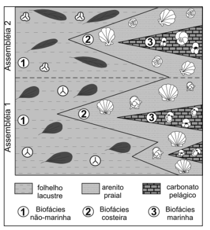

[[zerfass2008foraminiferos](Referencias.md#zerfass2008foraminiferos)]

#### Do registro estratigráfico ao tempo geológico

O avanço da estratigrafia e da paleontologia, consolidado pelos trabalhos de Steno, Smith, Cuvier e Brongniart, permitiu reconhecer que as camadas rochosas registram uma sucessão ordenada de eventos ao longo do tempo. No entanto, a compreensão plena desse registro exigiu uma mudança conceitual mais profunda, relacionada à própria natureza do tempo geológico e aos processos responsáveis pela formação das rochas.

Nesse contexto, destaca-se a contribuição de James Hutton, que, ao observar processos naturais como a erosão, o transporte e a deposição de sedimentos, propôs que os mesmos mecanismos atuantes no presente foram também responsáveis pela formação das rochas no passado. Essa ideia implicava a existência de um tempo geológico extremamente longo, incompatível com interpretações baseadas em eventos únicos ou de curta duração.

Posteriormente, Charles Lyell sistematizou e difundiu esse modo de interpretação, consolidando o chamado uniformitarismo. Para Lyell, a Terra deveria ser compreendida a partir da ação contínua e gradual de processos naturais observáveis, o que conferiu à geologia um caráter mais rigoroso e metodológico. Dessa forma, o registro estratigráfico passou a ser interpretado não apenas como uma sucessão de camadas e fósseis, mas como o resultado de processos dinâmicos que atuam ao longo de extensas escalas de tempo.

Assim, enquanto a estratigrafia e a paleontologia forneceram os instrumentos para ordenar e correlacionar os estratos, as ideias de Hutton e Lyell ofereceram o arcabouço teórico necessário para interpretar a história da Terra em termos de processos contínuos e tempo profundo.

#### Abraham Gottlieb Werner e o Netunismo

Foi um proto-geólogo sistematizador / naturalista descritivo.

- Classificação de rochas baseada em observação

- Defendia que todas as rochas se originaram de um oceano primordial e,

- Forte componente dogmático e pouco experimental

#### James Hutton, (Uniformitarismo inicial)

Hutton é amplamente reconhecido como um dos fundadores da Geologia moderna. Ao interpretar corpos intrusivos que cortam as rochas encaixantes como posteriores a elas, contribuiu para a consolidação dos princípios de datação relativa. Nesse mesmo quadro conceitual insere-se o princípio das inclusões, segundo o qual fragmentos de rochas incorporados em uma formação são mais antigos que a rocha que os contém. Embora este último não tenha sido formulado diretamente por Hutton, ambos se baseiam em uma mesma lógica interpretativa, fundada nas relações geométricas entre as unidades geológicas.

- Introduz o conceito de tempo profundo.

- Propõe que processos atuais explicam o passado,

- Baseado em observação + inferência.

Conforme proposto por Hutton, os processos geológicos observáveis no presente são os mesmos que atuaram no passado, ideia posteriormente sintetizada por Lyell na máxima de que o presente é a chave do passado, base do uniformitarismo.

#### Charles Lyell

Foi o sistematizador teórico e metodológico da teoria de Hutton. No século XIX, Charles Lyell consolidou e difundiu o uniformitarismo ao sistematizar a ideia de que os processos geológicos observáveis no presente são fundamentais para a interpretação do passado da Terra, princípio frequentemente sintetizado na máxima de que o presente é a chave do passado.

- Expande e sistematiza o uniformitarismo.

- Estrutura a geologia como ciência moderna,

- Forte influência metodológica (inclusive em Darwin).

Werner, Hutton e Lyell podem ser classificados como pensadores fundamentais da geologia, responsáveis pela construção dos primeiros modelos interpretativos sobre a evolução da Terra, embora representem abordagens distintas — desde o naturalismo descritivo (Werner) até o desenvolvimento e consolidação do uniformitarismo (Hutton e Lyell).

### 2. Minerais, magmatismo e metamorfismo

#### Minerais e sólidos amorfos

**Mineral** é uma substância sólida natural, geralmente inorgânica, com composição química característica e estrutura interna ordenada. Pequenas variações de composição podem ocorrer dentro de limites definidos para cada espécie mineral.

A organização regular dos átomos constitui a **estrutura cristalina**. Um mineral não precisa apresentar faces externas perfeitas para ser cristalino: mesmo um grão de forma irregular pode possuir ordenação atômica interna.

**Cristal** é um corpo no qual os constituintes estão organizados segundo uma estrutura ordenada. Quando o crescimento ocorre sem impedimentos, essa organização interna pode produzir faces planas e formas geométricas características.

**Sólido amorfo** é um sólido que não apresenta ordenação atômica de longo alcance. Vidros vulcânicos, por exemplo, formam-se quando a lava esfria tão rapidamente que os átomos não conseguem organizar-se em uma estrutura cristalina completa.

Materiais naturais amorfos ou pouco ordenados são frequentemente chamados de **mineraloides**. A opala é um exemplo clássico. A obsidiana, embora seja natural e sólida, é um vidro vulcânico e é classificada como rocha, não como uma espécie mineral.

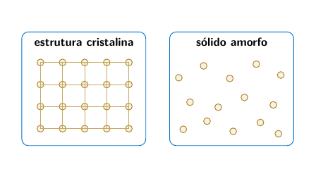

Representação esquemática: no cristal existe ordem de longo alcance; no sólido amorfo, a disposição não se repete regularmente.

**Relação entre os termos:** mineral é definido, entre outros critérios, por sua estrutura interna ordenada; sólidos naturais amorfos são normalmente tratados como mineraloides ou como constituintes de rochas.

*Ver também:* cristal, estrutura cristalina, mineraloide, opala, obsidiana, rocha, composição química.

#### Silício, sílica e silicatos

**Silício**, símbolo químico Si, é um elemento químico. Na natureza, normalmente ocorre combinado com oxigênio e outros elementos, e não como substância elementar isolada.

**Sílica**, de fórmula química $\mathrm{SiO_2}$, é um composto de silício e oxigênio. O quartzo é a forma mineral mais comum de sílica, embora existam outras formas naturais.

**Silicato** não designa um único mineral. É o nome de uma grande classe de minerais cuja estrutura contém silício e oxigênio, organizados fundamentalmente em tetraedros $\mathrm{SiO_4}$. Entre os minerais silicáticos mais importantes estão feldspatos, micas, olivinas, piroxênios, anfibólios e minerais de argila.

**Rocha silicática** ou **rocha silicatada** é constituída predominantemente por minerais silicáticos. Granito, basalto, gabro e gnaisse são exemplos. A expressão **rocha rica em sílica** refere-se ao teor de $\mathrm{SiO_2}$, enquanto **rocha silicosa** costuma indicar material formado principalmente por sílica, como o sílex.

**Relação entre os termos:** silício é o elemento químico; sílica é o composto $\mathrm{SiO_2}$; silicatos são uma classe de minerais; rochas silicáticas são agregados constituídos predominantemente por minerais silicáticos.

*Ver também:* quartzo, feldspato, mineral, rocha ígnea, composição química.

#### Magma e lava

**Magma** é material rochoso parcial ou totalmente fundido existente no interior da Terra. Pode conter uma fase líquida, cristais já formados e gases dissolvidos. Sua composição, temperatura, teor de voláteis e história de resfriamento influenciam os minerais e as rochas que serão produzidos.

**Lava** é o magma que alcança a superfície durante uma erupção. Ao extravasar, perde parte dos gases, resfria rapidamente e pode formar derrames, domos, lavas almofadadas ou depósitos fragmentares, conforme a composição e o ambiente eruptivo.

O magma não é uma camada líquida contínua sob a crosta. Ele é gerado localmente por **fusão parcial**, favorecida principalmente por:

- aumento de temperatura;

- diminuição de pressão, chamada fusão por descompressão;

- entrada de água ou outros voláteis, que reduzem a temperatura de fusão;

- transferência de calor por magmas mais quentes.

**Cristalização fracionada** ocorre quando minerais se formam e são separados progressivamente do líquido magmático, modificando a composição do magma restante. Esse processo está relacionado à série de reação de Bowen.

**Relação entre os termos:** magma é o material fundido em profundidade; lava é o magma extravasado na superfície; rocha ígnea é o produto consolidado do resfriamento e da cristalização.

*Ver também:* fusão parcial, vulcanismo, cristalização, série de Bowen, rocha ígnea, voláteis.

#### Rochas ígneas

**Rocha ígnea** é formada pelo resfriamento e pela solidificação de magma ou lava. Sua classificação introdutória considera principalmente o local de cristalização, a textura e a composição mineralógica ou química.

**Quanto ao local de formação**

- **intrusiva ou plutônica**: cristaliza em profundidade, geralmente com resfriamento lento e cristais visíveis; granito, diorito e gabro são exemplos;

- **extrusiva ou vulcânica**: solidifica na superfície ou próximo dela, geralmente com resfriamento rápido; riolito, andesito e basalto são exemplos;

- **subvulcânica ou hipabissal**: cristaliza em níveis rasos, em diques, soleiras e pequenos corpos intrusivos.

**Texturas principais**

- **fanerítica**: cristais visíveis a olho nu;

- **afanítica**: cristais muito pequenos, geralmente não individualizados a olho nu;

- **porfirítica**: cristais maiores, chamados fenocristais, envolvidos por uma matriz mais fina;

- **vítrea**: ausência ou escassez de cristais devido ao resfriamento muito rápido;

- **vesicular**: presença de cavidades deixadas por bolhas de gás;

- **piroclástica**: formada pela consolidação de fragmentos produzidos em erupções explosivas.

Quanto à composição, as rochas podem ser descritas, de modo simplificado, como **félsicas**, **intermediárias**, **máficas** ou **ultramáficas**. Esses termos refletem diferenças na mineralogia, no teor de sílica e na proporção de minerais claros e escuros.

| **Composição** | **Plutônica** | **Vulcânica**      | **Minerais comuns**     |
|:---------------|:--------------|:-------------------|:------------------------|
| Félsica        | granito       | riolito            | quartzo, feldspatos     |
| Intermediária  | diorito       | andesito           | plagioclásio, anfibólio |
| Máfica         | gabro         | basalto            | piroxênio, plagioclásio |
| Ultramáfica    | peridotito    | rara na superfície | olivina, piroxênio      |

**Relação entre os termos:** rochas plutônicas e vulcânicas podem ter composição semelhante, mas apresentam texturas diferentes porque cristalizam em condições distintas de resfriamento.

*Ver também:* magma, lava, textura, série de Bowen, granito, basalto, vulcanismo, intrusão.

#### Série de reação de Bowen

A **série de reação de Bowen** é um modelo que representa a sequência geral de cristalização dos principais minerais silicáticos durante o resfriamento de um magma, especialmente de composição basáltica. Foi desenvolvida a partir dos estudos experimentais de Norman L. Bowen no início do século XX.

O modelo possui dois ramos principais:

- **série descontínua**: com a diminuição da temperatura, minerais ferromagnesianos apresentam a sequência geral olivina, piroxênio, anfibólio e biotita. Cada mineral possui um intervalo de estabilidade e pode reagir com o líquido magmático remanescente;

- **série contínua**: o plagioclásio permanece como o mesmo grupo mineral, mas sua composição evolui gradualmente de termos ricos em cálcio para termos ricos em sódio.

Em temperaturas mais baixas cristalizam, de modo geral, feldspato potássico, muscovita e quartzo.

Esquema simplificado. A sequência real depende da composição do magma, da pressão, da presença de voláteis e da possibilidade de reação entre cristais e líquido.

A série não deve ser entendida como uma regra rígida para todos os magmas. A cristalização fracionada, a mistura de magmas, a assimilação de rochas encaixantes e as condições de pressão e água podem modificar a associação mineral formada.

**Relação entre os termos:** minerais que cristalizam em temperaturas mais altas tendem a ser menos estáveis nas condições da superfície; a série de Bowen também ajuda a compreender tendências de diferenciação magmática e intemperismo.

*Ver também:* magma, cristalização, rocha ígnea, olivina, piroxênio, anfibólio, feldspato, quartzo.

A relação com a estabilidade de Goldich está desenvolvida no capítulo 4, a partir do texto recuperado no ZIP unificado.

#### Rochas metamórficas e metamorfismo

**Metamorfismo** é o conjunto de transformações mineralógicas, químicas e texturais que afetam uma rocha no estado sólido em resposta a mudanças de temperatura, pressão, tensão e circulação de fluidos. A rocha original é chamada **protólito**.

O metamorfismo não implica fusão completa. Quando a rocha funde em proporção significativa, inicia-se a formação de magma e o processo passa ao domínio ígneo.

**Tipos introdutórios**

- **metamorfismo regional**: afeta grandes áreas e está associado a soterramento, compressão e formação de cadeias montanhosas;

- **metamorfismo de contato**: ocorre junto a corpos magmáticos, com predomínio do aquecimento;

- **metamorfismo hidrotermal**: resulta da circulação de fluidos quentes que alteram a composição mineralógica;

- **metamorfismo dinâmico**: concentra-se em zonas de falha e cisalhamento.

**Foliação** é a orientação planar de minerais ou a segregação de bandas composicionais produzida pela deformação e recristalização. Ardósia, filito, xisto e gnaisse representam uma sequência didática de aumento de grau metamórfico, embora não sejam etapas obrigatórias para todo protólito.

Rochas **não foliadas**, como mármore e quartzito, podem formar-se quando o protólito é composto principalmente por um único mineral ou quando a tensão dirigida não produz orientação mineral evidente.

**Relação entre os termos:** o protólito fornece a composição inicial; pressão, temperatura, tensão e fluidos controlam as transformações; a rocha metamórfica é o produto recristalizado no estado sólido.

*Ver também:* protólito, foliação, recristalização, grau metamórfico, mármore, quartzito, xisto, gnaisse.

### 3. Ciclo das rochas e formação dos sedimentos

#### Ciclo das rochas

**Ciclo das rochas** é um modelo que relaciona a formação, a transformação e a destruição das rochas por processos internos e externos da Terra. Ele não representa uma sequência única e obrigatória; uma rocha pode seguir diferentes trajetórias conforme as condições geológicas.

- o resfriamento e a cristalização do magma formam **rochas ígneas**;

- o intemperismo, a erosão, o transporte, a deposição e a litificação produzem **rochas sedimentares**;

- o aumento de pressão, temperatura e circulação de fluidos transforma rochas preexistentes em **rochas metamórficas**;

- a fusão parcial pode gerar novo magma;

- soerguimento e erosão podem expor qualquer tipo de rocha à superfície e reiniciar processos sedimentares.

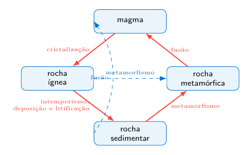

**Relação entre os termos:** o ciclo das rochas integra processos superficiais, como intemperismo e sedimentação, e processos internos, como magmatismo, metamorfismo, deformação e tectônica de placas.

*Ver também:* magma, litificação, metamorfismo, intemperismo, tectônica de placas, rocha ígnea, rocha sedimentar.

#### Da rocha-fonte ao sedimento

**Sedimento** é o material particulado ou precipitado que pode ser transportado, depositado e acumulado na superfície terrestre ou no fundo de corpos d’água. Sua origem pode ser clástica, química ou biogênica.

A formação de uma rocha sedimentar pode ser compreendida como uma sequência de processos relacionados:

- **intemperismo**: desagregação e alteração das rochas no local em que se encontram. Pode ser físico, químico ou biológico;

- **erosão**: remoção e mobilização dos materiais produzidos ou enfraquecidos pelo intemperismo;

- **transporte**: deslocamento dos sedimentos pela água, pelo vento, pelo gelo ou pela gravidade;

- **deposição**: acumulação do material quando o agente de transporte perde capacidade de carregá-lo ou quando ocorre precipitação química ou produção biogênica;

- **sedimentação**: processo de deposição e acumulação de sedimentos em determinado ambiente;

- **soterramento**: recobrimento progressivo dos sedimentos por novas camadas;

- **diagênese**: conjunto de transformações físicas, químicas e biológicas que ocorrem após a deposição, em condições anteriores ao metamorfismo;

- **litificação**: transformação do sedimento inconsolidado em rocha sedimentar. Nas rochas clásticas, ocorre principalmente por compactação e cimentação.

Durante o transporte, os grãos podem sofrer abrasão, tornar-se mais arredondados e ser separados conforme tamanho, forma ou densidade. Esse processo de separação é chamado **seleção sedimentar**. A intensidade dessas modificações depende da distância percorrida, do agente de transporte, da energia do ambiente e da resistência dos minerais.

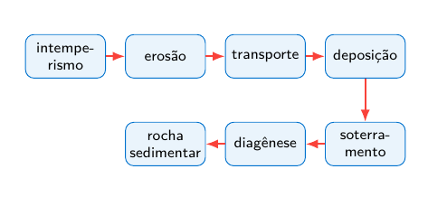

Exemplos de relações entre sedimentos e rochas sedimentares clásticas:

- areia $\rightarrow$ arenito;

- silte $\rightarrow$ siltito;

- lama rica em argila $\rightarrow$ argilito ou, quando apresenta fissilidade, folhelho;

- cascalho com fragmentos arredondados $\rightarrow$ conglomerado;

- cascalho com fragmentos angulosos $\rightarrow$ brecha sedimentar.

**Relação entre os termos:** o intemperismo produz ou altera materiais; a erosão os remove; o transporte os desloca; a deposição os acumula; o soterramento e a diagênese podem transformá-los em rochas sedimentares.

*Ver também:* sedimento, intemperismo, erosão, transporte, deposição, soterramento, diagênese, compactação, cimentação, litificação.

#### Controles do sistema sedimentar e seus domínios

Os principais controles do sistema sedimentar incluem:

- **tectônica**: produz soerguimento, subsidência, relevo e espaço de acomodação;

- **clima**: controla a disponibilidade de água, a temperatura e a intensidade do intemperismo físico e químico;

- **relevo**: influencia a energia potencial, as taxas de erosão e as rotas de transporte;

- **nível de base**: condiciona a erosão, o armazenamento e a deposição;

- **organismos**: modificam substratos, produzem sedimento e deixam estruturas biogênicas;

- **tempo**: determina quanto os processos podem alterar, selecionar e preservar os materiais.

#### Área-fonte, rota de transporte e bacia

Uma análise sedimentológica completa procura relacionar três domínios:

1.  a **área-fonte**, onde as rochas são expostas e intemperizadas;

2.  a **rota de transporte**, pela qual partículas e solutos são deslocados;

3.  a **bacia de sedimentação**, onde ocorre deposição e preservação.

Essa abordagem permite compreender por que a composição, a granulometria, o arredondamento, a seleção e as estruturas sedimentares registram tanto as propriedades da área-fonte quanto a história do transporte e as condições do ambiente deposicional [[nichols2009](Referencias.md#nichols2009)].

### 4. Intemperismo

#### Definição

O **intemperismo** é o conjunto de processos **físicos, químicos e biológicos** que provocam a **desagregação e/ou decomposição das rochas e dos minerais** quando estes ficam expostos às condições existentes na superfície ou próximo à superfície terrestre.

As rochas que se formam em profundidade encontram condições de **pressão, temperatura e composição química** diferentes daquelas existentes na superfície. Quando essas rochas são expostas à atmosfera, à água, aos organismos e às variações de temperatura, muitos de seus minerais deixam de estar em equilíbrio com o novo ambiente e passam por transformações.

De forma geral, o intemperismo pode produzir:

- fragmentos de rocha;

- grãos minerais;

- minerais secundários, como as argilas;

- íons dissolvidos na água;

- solos e mantos de alteração.

Portanto, o intemperismo constitui uma etapa fundamental do **ciclo das rochas** e também participa da formação dos **solos e dos sedimentos**, que posteriormente podem ser transportados e depositados.

É importante distinguir **intemperismo** de **erosão**:

- **Intemperismo:** alteração ou desagregação da rocha **no próprio local**;

- **Erosão:** remoção e transporte do material produzido pelo intemperismo.

Uma rocha pode, portanto, sofrer intemperismo sem que seus produtos sejam imediatamente transportados.

#### Principais tipos de intemperismo

Tradicionalmente, o intemperismo é dividido em três grandes grupos:

1.  **intemperismo físico ou mecânico**;

2.  **intemperismo químico**;

3.  **intemperismo biológico**.

Na natureza, entretanto, esses processos normalmente atuam **simultaneamente** e podem intensificar uns aos outros.

#### Intemperismo físico ou mecânico

O **intemperismo físico** corresponde à fragmentação da rocha em pedaços menores **sem alteração significativa da composição química dos minerais**.

A rocha original é quebrada, mas os minerais que a formavam permanecem, inicialmente, com praticamente a mesma composição química.

Por exemplo, um bloco de granito pode ser dividido em fragmentos progressivamente menores, mas esses fragmentos ainda podem conter quartzo, feldspato e mica.

A principal consequência do intemperismo físico é o **aumento da área superficial da rocha**. Isso aumenta a superfície de contato entre os minerais e:

- a água;

- o oxigênio;

- o dióxido de carbono;

- os organismos.

Consequentemente, o intemperismo físico pode acelerar o **intemperismo químico**.

##### Alívio de pressão ou descompressão

Muitas rochas se formam em grandes profundidades, submetidas a pressões elevadas devido ao peso das rochas que estão acima delas.

Quando a erosão remove progressivamente esse material superior, a pressão sobre a rocha diminui. Essa redução de pressão permite uma pequena expansão da rocha.

Como consequência, podem surgir **fraturas aproximadamente paralelas à superfície**, formando estruturas semelhantes a grandes lâminas ou cascas.

Esse processo é frequentemente chamado de **esfoliação por descompressão** e pode ser observado, por exemplo, em grandes corpos graníticos.

##### Variação de temperatura

As rochas podem sofrer aquecimento durante o dia e resfriamento durante a noite.

Quando aquecidos, os minerais tendem a se expandir; quando resfriados, tendem a se contrair.

Como diferentes minerais apresentam diferentes coeficientes de expansão térmica, ciclos repetidos de aquecimento e resfriamento podem gerar tensões dentro da rocha.

Ao longo de muitos ciclos, essas tensões podem contribuir para a formação e propagação de microfraturas.

Esse processo pode ser importante principalmente em ambientes submetidos a grandes variações térmicas. Entretanto, a simples variação diária de temperatura nem sempre é suficiente para explicar, isoladamente, uma intensa fragmentação das rochas, pois normalmente diversos mecanismos atuam simultaneamente.

##### Congelamento da água em fraturas

A água pode penetrar em pequenas fraturas existentes nas rochas.

Quando a temperatura cai abaixo do ponto de congelamento, essa água congela. A transformação da água líquida em gelo provoca aumento de volume.

Esse aumento exerce pressão sobre as paredes da fratura.

Quando ocorrem repetidos ciclos de

$$\text{congelamento}
\rightarrow
\text{degelo}
\rightarrow
\text{congelamento},$$

a fratura pode aumentar progressivamente até provocar a ruptura da rocha.

Esse mecanismo é particularmente importante em regiões frias e montanhosas sujeitas a frequentes ciclos de congelamento e degelo.

##### Cristalização de sais

Em ambientes onde existe água contendo sais dissolvidos, a água pode penetrar nos poros e fraturas das rochas.

Quando essa água evapora, os sais podem cristalizar.

O crescimento dos cristais dentro dos poros pode exercer pressão sobre os minerais e provocar a fragmentação da rocha.

Esse processo é chamado de **haloclastia** ou **intemperismo salino**.

Pode ser especialmente importante em:

- ambientes costeiros;

- regiões áridas;

- áreas submetidas à névoa salina;

- rochas muito porosas.

Em regiões costeiras, os aerossóis marinhos podem introduzir sais nas superfícies rochosas, contribuindo para sua desagregação.

##### Ação mecânica de organismos

Raízes de plantas podem penetrar em pequenas fraturas.

Com o crescimento da raiz, aumenta a pressão exercida sobre as paredes da fratura, favorecendo a separação dos blocos.

Animais que escavam o solo também podem movimentar partículas, abrir canais e expor novos materiais à água e ao ar.

Nesse caso existe uma interação entre **intemperismo físico e biológico**.

#### Intemperismo químico

O **intemperismo químico** envolve reações que modificam a **composição química e/ou a estrutura mineralógica da rocha**.

Diferentemente do intemperismo físico, no qual ocorre principalmente fragmentação, no intemperismo químico alguns minerais originais podem ser:

- dissolvidos;

- transformados;

- oxidados;

- hidratados;

- convertidos em novos minerais.

A água possui papel fundamental nesses processos.

Em muitos casos, a água funciona como:

- solvente;

- meio onde ocorrem as reações;

- agente de transporte dos íons produzidos.

O intemperismo químico tende a ser particularmente intenso em regiões **quentes e úmidas**, pois temperaturas elevadas aumentam a velocidade de muitas reações químicas e a abundância de água favorece processos como dissolução e hidrólise.

##### Dissolução

A dissolução ocorre quando um mineral entra em contato com a água e seus componentes passam para a solução na forma de íons.

De maneira simplificada:

$$\text{mineral sólido} + \text{água}
\rightarrow
\text{íons dissolvidos}$$

Alguns minerais apresentam elevada solubilidade.

Um exemplo é a **halita**, formada por cloreto de sódio:

$$\mathrm{NaCl_{(s)}
\rightarrow
Na^+_{(aq)} + Cl^-_{(aq)}}$$

O mineral deixa de fazer parte da rocha e seus componentes passam para a água.

Esses íons podem posteriormente ser transportados por águas subterrâneas, rios e outros corpos d’água até alcançarem ambientes de deposição, incluindo os oceanos.

##### Carbonatação

A água da chuva contém dióxido de carbono dissolvido.

O dióxido de carbono reage com a água, formando ácido carbônico:

$$\mathrm{CO_2 + H_2O
\rightleftharpoons
H_2CO_3}$$

Embora seja um ácido relativamente fraco, o ácido carbônico aumenta a capacidade da água de reagir com determinados minerais.

Esse processo é especialmente importante em rochas carbonáticas, como os **calcários**.

A calcita, principal mineral de muitos calcários, pode reagir na presença de água e dióxido de carbono:

$$\mathrm{CaCO_3 + CO_2 + H_2O
\rightarrow
Ca^{2+} + 2HCO_3^-}$$

Esse processo favorece a dissolução do calcário.

Ao longo de grandes intervalos de tempo, pode contribuir para a formação de relevo cárstico, caracterizado por feições como:

- cavernas;

- dolinas;

- condutos subterrâneos;

- sumidouros.

A precipitação posterior do carbonato de cálcio no interior de cavernas pode originar estruturas como estalactites e estalagmites.

##### Hidrólise

A **hidrólise** é um dos processos mais importantes do intemperismo químico dos **silicatos**, que constituem grande parte da crosta terrestre.

Nesse processo, minerais reagem com água, íons $H^+$ e outras espécies presentes na solução.

Como resultado, minerais primários podem ser transformados em **minerais secundários**, especialmente argilominerais.

Um exemplo importante envolve os **feldspatos**.

De forma simplificada:

$$\text{feldspato}
+
\text{água}
+
H^+
\rightarrow
\text{argilomineral}
+
\text{íons dissolvidos}
+
\text{sílica}$$

Um exemplo balanceado é a alteração do feldspato potássico para caulinita:

$$\mathrm{
2\,KAlSi_3O_8 + 2\,H_2CO_3 + 9\,H_2O
\rightarrow
Al_2Si_2O_5(OH)_4 + 4\,H_4SiO_4 + 2\,K^+ + 2\,HCO_3^-
}$$

Nessa reação, a caulinita é um mineral secundário; potássio, bicarbonato e sílica dissolvida podem ser removidos pela água.

O feldspato existente originalmente numa rocha magmática pode, portanto, ser progressivamente transformado em minerais de argila.

Esse processo possui grande importância para a formação e evolução dos solos.

##### Imagem enviada e conferência da reação

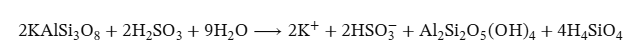

*Imagem original enviada pelo autor. Atenção: nela aparecem $H_2SO_3$ e $HSO_3^-$, espécies de enxofre. Portanto, ela não representa o exemplo com ácido carbônico apresentado acima, que utiliza $H_2CO_3$ e $HCO_3^-$. Para estudar esse exemplo, usar a equação digitada. A imagem foi preservada para conferência, sem alterar o original.*

A alteração envolve três destinos dos componentes da rocha: minerais primários resistentes permanecem no resíduo; parte dos elementos passa à solução; outra parte integra minerais secundários, como a caulinita. Isso liga o intemperismo à geração de sedimentos e à carga dissolvida dos rios. Fonte de apoio: [produção de sedimentos — MIT](Referencias.md#mit2004intemperismo).

##### Oxidação

A **oxidação** envolve a perda de elétrons por determinados elementos químicos.

No intemperismo, um dos casos mais importantes envolve o **ferro**.

Minerais contendo ferro ferroso, $Fe^{2+}$, podem sofrer oxidação, formando ferro férrico, $Fe^{3+}$.

De maneira simplificada:

$$Fe^{2+}
\rightarrow
Fe^{3+}$$

Na presença de água e oxigênio podem ser formados óxidos e hidróxidos de ferro.

Esses produtos frequentemente apresentam cores:

- avermelhadas;

- amareladas;

- alaranjadas;

- marrons.

Por isso, solos fortemente intemperizados em regiões tropicais frequentemente apresentam colorações avermelhadas ou amareladas.

##### Hidratação

Na **hidratação**, moléculas de água são incorporadas à estrutura de determinados minerais.

Essa incorporação pode provocar:

- aumento de volume;

- alteração da estrutura mineral;

- redução da resistência do material.

Um exemplo é a transformação da anidrita em gipsita:

$$\mathrm{CaSO_4 + 2H_2O
\rightarrow
CaSO_4\cdot 2H_2O}$$

Nesse caso, a entrada de água modifica a estrutura cristalina do mineral.

#### Intemperismo biológico

O **intemperismo biológico** corresponde à participação dos seres vivos na alteração e desagregação das rochas.

Na prática, a atividade biológica pode provocar tanto efeitos físicos quanto químicos. Por isso, o intemperismo biológico não deve ser entendido como completamente separado dos demais tipos de intemperismo.

##### Ação das raízes

As raízes das plantas podem penetrar em fraturas existentes nas rochas.

À medida que crescem, exercem pressão mecânica, aumentando essas fraturas e favorecendo a fragmentação.

Ao mesmo tempo, raízes e microrganismos associados ao solo podem modificar quimicamente o ambiente.

##### Produção de ácidos orgânicos

A decomposição da matéria orgânica pode produzir diversos ácidos orgânicos.

Esses compostos podem:

- reduzir o pH da água;

- aumentar a dissolução de minerais;

- facilitar a liberação de determinados elementos químicos.

Dessa maneira, os organismos podem acelerar o intemperismo químico.

##### Líquens

Os líquens são associações simbióticas que normalmente envolvem fungos e organismos fotossintetizantes.

Eles conseguem colonizar superfícies rochosas aparentemente pouco favoráveis à vida.

Sua presença pode favorecer a alteração das rochas principalmente pela retenção de umidade junto à superfície e pela produção de substâncias capazes de participar das reações químicas de alteração.

Ao longo do tempo, contribuem para a formação das primeiras camadas de material alterado sobre uma rocha exposta.

#### Minerais e resistência ao intemperismo

Nem todos os minerais apresentam a mesma resistência ao intemperismo.

Isso ocorre porque muitos minerais se formaram sob condições de temperatura e pressão muito diferentes das existentes na superfície terrestre.

De maneira geral, minerais formados em condições de temperatura mais elevada tendem a apresentar menor estabilidade química nas condições superficiais.

Minerais como:

- olivina;

- piroxênio;

- anfibólio;

tendem a sofrer alteração química com relativa facilidade.

O **quartzo**, ao contrário, apresenta elevada resistência química nas condições superficiais.

Por isso, é extremamente comum encontrar grande quantidade de quartzo em:

- areias;

- praias;

- dunas;

- depósitos sedimentares;

- solos.

Essa resistência ajuda a explicar por que muitas areias mineralogicamente maduras apresentam composição predominantemente quartzosa.

#### Relação entre as séries de Bowen e Goldich

A série de reação de Bowen descreve, de forma simplificada, a ordem de cristalização dos principais minerais silicáticos a partir de um magma em resfriamento.

Goldich observou que a suscetibilidade dos minerais ígneos ao intemperismo apresenta uma relação aproximadamente inversa com essa ordem de cristalização: minerais formados em temperaturas mais elevadas, como olivina e piroxênio, tendem a ser menos estáveis nas condições superficiais, enquanto o quartzo está entre os mais resistentes [[goldich1938](Referencias.md#goldich1938)]. Essa relação é uma tendência geral, não uma regra absoluta, pois fraturamento, clima, pH, drenagem e tempo também controlam as taxas de alteração.

#### Fatores que controlam o intemperismo

A intensidade e o tipo de intemperismo dependem de diversos fatores, entre os quais se destacam:

- clima;

- composição mineralógica;

- estrutura da rocha;

- relevo;

- presença de água;

- atividade biológica;

- tempo de exposição.

##### Clima

O clima é um dos fatores mais importantes no controle do intemperismo.

Em **climas quentes e úmidos**, existe elevada disponibilidade de água e as temperaturas mais altas favorecem a velocidade das reações químicas. Nessas condições, o intemperismo químico tende a ser intenso.

Em **climas frios**, processos associados aos ciclos de congelamento e degelo podem apresentar maior importância.

Em **climas áridos**, a menor disponibilidade de água limita muitas reações químicas. Entretanto, processos como cristalização de sais e variações térmicas podem apresentar maior importância relativa.

##### Composição e estrutura da rocha

A composição mineralógica determina em grande parte a resistência da rocha.

Uma rocha contendo minerais altamente resistentes pode permanecer exposta durante longo período sem sofrer intensa alteração química.

Por outro lado, minerais instáveis nas condições superficiais podem ser rapidamente transformados.

A estrutura e a textura da rocha também influenciam o intemperismo.

Uma rocha com muitas fraturas, elevada porosidade ou elevada permeabilidade permite maior penetração de água e maior superfície disponível para reações.

##### Relevo

A posição topográfica influencia a permanência dos materiais produzidos pelo intemperismo.

Em encostas muito inclinadas, os produtos de alteração podem ser removidos rapidamente pela gravidade e pela erosão.

Em terrenos de menor declividade, esses materiais podem permanecer por mais tempo sobre a rocha original, permitindo o desenvolvimento de mantos de alteração e solos mais espessos.

##### Tempo

O tempo também é fundamental para o desenvolvimento do intemperismo.

Quanto maior o período de exposição da rocha às condições superficiais, maior tende a ser seu grau de alteração, desde que existam condições adequadas para que os processos ocorram.

Entretanto, essa relação não é simplesmente linear, pois a formação de solos, a drenagem e a remoção dos produtos de alteração modificam continuamente as condições em que o intemperismo ocorre.

#### Intemperismo e formação do solo

O intemperismo é um dos processos fundamentais para a **pedogênese**, isto é, a formação e evolução dos solos.

A alteração das rochas produz:

- fragmentos minerais;

- partículas finas;

- argilominerais;

- elementos químicos dissolvidos.

Esses materiais passam a interagir com matéria orgânica, organismos, água e atmosfera.

De maneira simplificada:

$$\boxed{
\text{rocha}
\rightarrow
\text{intemperismo}
\rightarrow
\text{material alterado}
\rightarrow
\text{solo}
}$$

#### Intemperismo, erosão, transporte e sedimentação

O intemperismo faz parte de uma sequência de processos fundamentais para a dinâmica superficial da Terra.

De maneira simplificada:

$$\boxed{
\text{rocha}
\xrightarrow{\text{intemperismo}}
\text{material alterado}
\xrightarrow{\text{erosão}}
\text{transporte}
\xrightarrow{\text{deposição}}
\text{sedimento}
}$$

Depois da deposição, os sedimentos podem sofrer processos de compactação, cimentação e outras transformações diagenéticas, podendo dar origem às **rochas sedimentares**.

#### Intemperismo e sedimentos

O intemperismo possui grande importância para a sedimentologia.

O intemperismo físico tende a produzir fragmentos progressivamente menores, enquanto o intemperismo químico pode destruir determinados minerais e formar novos minerais, como as argilas.

Por isso, um sedimento não representa necessariamente apenas pequenos fragmentos da rocha original.

Durante o intemperismo ocorre também uma espécie de **seleção mineralógica**.

Minerais menos resistentes tendem a ser:

- dissolvidos;

- alterados;

- transformados em minerais secundários.

Minerais mais resistentes, como o quartzo, apresentam maior possibilidade de permanecer no sedimento.

Com sucessivos ciclos de

$$\text{intemperismo}
+
\text{erosão}
+
\text{transporte}
+
\text{deposição},$$

um sedimento pode tornar-se progressivamente mais **maduro mineralogicamente**.

#### Intemperismo em ambientes costeiros

Nos ambientes costeiros, diversos processos de intemperismo podem atuar simultaneamente.

Entre eles destacam-se:

- ação da água;

- presença de sais;

- ciclos de umedecimento e secagem;

- atividade biológica;

- dissolução de minerais;

- oxidação;

- cristalização de sais.

A **haloclastia** pode ser especialmente relevante em superfícies rochosas submetidas à névoa e aos aerossóis marinhos.

A água contendo sais penetra nos poros e nas fraturas das rochas. Com a evaporação da água, pode ocorrer a cristalização dos sais.

Ciclos sucessivos de dissolução e cristalização podem favorecer a desagregação da superfície da rocha.

#### Alteração esferoidal

Um processo observado em algumas rochas é o chamado **intemperismo esferoidal** ou **alteração esferoidal**.

Quando um bloco rochoso fraturado sofre intemperismo químico, suas diferentes regiões não são alteradas com a mesma velocidade.

Os cantos apresentam maior superfície exposta em relação ao volume, seguidos pelas arestas e pelas faces.

De maneira simplificada:

$$\text{cantos}
>
\text{arestas}
>
\text{faces}$$

em relação à intensidade da alteração.

Com o tempo, blocos inicialmente angulosos podem adquirir formas progressivamente mais arredondadas.

É importante não confundir esse processo com o arredondamento provocado pelo transporte sedimentar.

No intemperismo esferoidal, o arredondamento ocorre **no próprio local**, como resultado da alteração diferencial da rocha.

#### Perfil de intemperismo

Quando o intemperismo atua durante longos períodos, pode desenvolver-se um **perfil de alteração** sobre a rocha.

De maneira simplificada, pode ocorrer a seguinte sequência vertical:

$$\begin{array}{c}
\text{solo} \\[4pt]
\downarrow \\[4pt]
\text{material fortemente alterado} \\[4pt]
\downarrow \\[4pt]
\text{rocha parcialmente alterada} \\[4pt]
\downarrow \\[4pt]
\text{rocha sã}
\end{array}$$

A transição entre essas zonas geralmente é gradual.

A espessura do perfil depende de fatores como:

- clima;

- tempo;

- relevo;

- tipo de rocha;

- drenagem.

Em regiões tropicais úmidas, os perfis de alteração podem atingir grandes espessuras.

#### Síntese

Para fins didáticos, os três tipos principais de intemperismo podem ser resumidos da seguinte forma:

##### Intemperismo físico

Produz principalmente a fragmentação da rocha:

$$\text{rocha}
\rightarrow
\text{fragmentos menores}$$

sem modificação química significativa dos minerais.

Entre seus principais mecanismos estão:

- descompressão;

- congelamento e degelo;

- cristalização de sais;

- variações térmicas;

- ação mecânica de organismos.

##### Intemperismo químico

Produz alterações na composição ou na estrutura dos minerais:

$$\text{mineral original}
\rightarrow
\text{mineral secundário e/ou íons dissolvidos}$$

Entre seus principais processos estão:

- dissolução;

- hidrólise;

- carbonatação;

- oxidação;

- hidratação.

##### Intemperismo biológico

Resulta da atividade dos organismos e pode provocar tanto efeitos físicos quanto efeitos químicos sobre as rochas.

#### Importância geológica

Uma maneira de compreender o intemperismo é considerar que uma rocha exposta na superfície terrestre encontra condições ambientais muito diferentes daquelas em que muitos de seus minerais originalmente se formaram.

Alguns minerais permanecem relativamente estáveis. Outros são alterados, dissolvidos ou transformados em novos minerais.

Ao mesmo tempo, a rocha pode ser progressivamente fraturada e desagregada.

O resultado conjunto desses processos fornece grande parte do material que posteriormente será submetido a:

$$\boxed{
\text{erosão}
\rightarrow
\text{transporte}
\rightarrow
\text{deposição}
\rightarrow
\text{sedimentação}
}$$

Por isso, o intemperismo constitui uma ligação fundamental entre a **geologia das rochas**, a **geomorfologia**, a **pedologia** e a **sedimentologia**, além de exercer importante influência sobre os processos que ocorrem nos ambientes continentais, costeiros e marinhos.

### 5. Erosão e transporte de sedimentos

#### Definição

O **transporte de sedimentos** corresponde ao deslocamento de partículas, fragmentos de rocha, minerais e materiais biogênicos desde a área-fonte até os locais onde serão posteriormente depositados. O transporte ocorre depois que o material é produzido ou disponibilizado pelo intemperismo e pela erosão e constitui uma etapa fundamental do ciclo sedimentar.

De maneira simplificada:

$$\boxed{
\text{intemperismo}
\rightarrow
\text{erosão}
\rightarrow
\text{transporte}
\rightarrow
\text{deposição}
\rightarrow
\text{sedimentação}
}$$

Durante o transporte, os sedimentos podem sofrer modificações importantes, como:

- fragmentação e abrasão;

- arredondamento dos grãos;

- seleção granulométrica;

- separação de minerais em função de densidade, tamanho e resistência;

- retrabalhamento sucessivo.

Assim, as características de um depósito sedimentar refletem não apenas a natureza da rocha-fonte, mas também os agentes, a distância, a duração e a energia envolvida no transporte.

#### Principais agentes de transporte

Os principais agentes capazes de transportar sedimentos são:

1.  água;

2.  vento;

3.  gelo;

4.  gravidade.

A água constitui um dos principais agentes de transporte, especialmente nos sistemas fluviais, lacustres, estuarinos, deltaicos, costeiros e marinhos.

#### Modos de transporte sedimentar

Os principais modos de transporte são:

- tração;

- saltação;

- suspensão;

- transporte em solução.

Um mesmo grão pode mudar de modo de transporte quando variam a velocidade, a turbulência e a energia do fluxo.

##### Tração

A **tração** corresponde ao transporte de partículas junto ao fundo. Os grãos podem deslocar-se por rolamento, deslizamento ou arraste.

Esse mecanismo é importante para partículas relativamente grossas ou pesadas, como areia grossa, grânulos, seixos e cascalhos. Para que o movimento se inicie, a força exercida pelo fluido deve superar a resistência associada ao peso do grão, ao atrito com o fundo e ao encaixe entre as partículas.

##### Saltação

Na **saltação**, as partículas deslocam-se por uma sequência de pequenos saltos sobre o substrato. O fluxo eleva temporariamente o grão, que percorre uma determinada distância e retorna ao fundo.

De maneira esquemática:

$$\text{repouso}
\rightarrow
\text{elevação}
\rightarrow
\text{deslocamento}
\rightarrow
\text{impacto}
\rightarrow
\text{novo salto}$$

A saltação é especialmente importante no transporte de areia e ocorre tanto em ambientes subaquosos quanto eólicos. Esse mecanismo participa da formação e da migração de marcas onduladas e dunas.

##### Suspensão

Na **suspensão**, as partículas permanecem temporariamente mantidas dentro da coluna de fluido, principalmente pela turbulência.

Esse mecanismo é especialmente importante para materiais finos, como:

- argila;

- silte;

- areia muito fina.

Quanto menor a velocidade de queda da partícula, maior sua tendência a permanecer em suspensão. Por essa razão, sedimentos muito finos podem ser transportados por grandes distâncias.

##### Transporte em solução

Parte dos produtos do intemperismo químico é transportada na forma de íons dissolvidos. Entre os principais componentes transportados em solução estão:

$$Ca^{2+}, \quad Na^+, \quad K^+, \quad Mg^{2+}$$

e

$$HCO_3^-, \quad Cl^-, \quad SO_4^{2-}.$$

Alterações posteriores das condições físico-químicas da água podem provocar a precipitação desses componentes, contribuindo para a formação de sedimentos químicos.

#### Carga sedimentar

Em sistemas fluviais, a carga transportada pode ser dividida em três componentes principais.

##### Carga de fundo

A **carga de fundo** é formada pelo material que permanece próximo ou em contato frequente com o leito e é transportado principalmente por tração e saltação.

##### Carga em suspensão

A **carga em suspensão** corresponde às partículas mantidas na coluna d’água pela turbulência, principalmente silte, argila e parte da areia fina.

##### Carga dissolvida

A **carga dissolvida** é constituída por íons e moléculas transportados em solução.

#### Competência e capacidade de transporte

Dois conceitos importantes para compreender o comportamento de um fluxo são **competência** e **capacidade**.

A **competência** corresponde ao maior tamanho de partícula que um fluxo consegue transportar. Assim, de maneira geral:

$$\text{maior energia do fluxo}
\Rightarrow
\text{maior competência}$$

A **capacidade**, por sua vez, corresponde à quantidade total de sedimento que o fluxo consegue transportar.

Portanto:

- competência relaciona-se principalmente ao tamanho máximo dos grãos;

- capacidade relaciona-se principalmente à quantidade total de sedimento.

#### Velocidade do fluxo e granulometria

A erosão, o transporte e a deposição dependem da interação entre:

- velocidade do fluxo;

- turbulência;

- tamanho e densidade dos grãos;

- forma das partículas;

- viscosidade e densidade do fluido;

- coesão do sedimento;

- características do fundo.

Correntes mais energéticas podem transportar partículas maiores. Entretanto, a relação entre tamanho do grão e facilidade de erosão não é linear. Partículas argilosas, apesar de muito pequenas, podem exigir velocidades relativamente elevadas para serem erodidas devido às forças de coesão entre os grãos.

Assim:

$$\text{grão pequeno}
\not\Rightarrow
\text{necessariamente fácil erosão}.$$

#### Número de Froude e regimes de fluxo

Em canais abertos, o número de Froude compara a velocidade média do fluxo com a velocidade de propagação de ondas gravitacionais rasas:

$$\mathrm{Fr}=\frac{U}{\sqrt{gD}},$$

em que $U$ é a velocidade média, $g$ é a aceleração da gravidade e $D$ é uma profundidade característica do fluxo.

- $\mathrm{Fr}<1$: fluxo **subcrítico**, no qual perturbações podem se propagar para montante;

- $\mathrm{Fr}=1$: condição **crítica**;

- $\mathrm{Fr}>1$: fluxo **supercrítico**, no qual a velocidade do fluxo supera a das ondas rasas.

Em leitos arenosos, o regime inferior inclui comumente ripples, dunas e leito plano inferior. Com o aumento da velocidade e do transporte em suspensão, podem surgir leito plano superior, antidunas e outras formas relacionadas ao regime superior. A forma efetivamente produzida depende também da granulometria, da profundidade e da carga sedimentar [[harms1975](Referencias.md#harms1975); [nichols2009](Referencias.md#nichols2009)].

#### Diagrama de Hjulström

A relação entre tamanho das partículas e velocidade da corrente é tradicionalmente representada pelo **diagrama de Hjulström**. O diagrama distingue três campos principais:

1.  erosão;

2.  transporte;

3.  deposição.

As areias apresentam valores relativamente baixos de velocidade crítica para o início do movimento. As argilas, apesar de muito finas, podem exigir velocidades mais elevadas para serem erodidas devido à coesão. Uma vez colocadas em suspensão, entretanto, podem continuar sendo transportadas mesmo quando a velocidade do fluxo diminui.

#### Velocidade de queda

A **velocidade de queda** corresponde à velocidade com que uma partícula tende a se deslocar em direção ao fundo sob a ação da gravidade.

Ela depende de fatores como:

- tamanho;

- densidade;

- forma da partícula;

- densidade do fluido;

- viscosidade do fluido.

De forma geral:

$$\text{partículas maiores e mais densas}
\Rightarrow
\text{maior velocidade de queda}.$$

Quando a energia de um fluxo diminui, as partículas maiores normalmente tendem a ser depositadas antes das menores.

#### Seleção granulométrica

Durante o transporte pode ocorrer **seleção granulométrica**, pois partículas de diferentes tamanhos e densidades respondem de maneiras distintas ao mesmo fluxo.

Um sedimento é considerado:

- **bem selecionado**, quando apresenta pequena variação granulométrica;

- **mal selecionado**, quando apresenta ampla variação dos tamanhos dos grãos.

O vento e correntes persistentes podem produzir depósitos relativamente bem selecionados. Geleiras e determinados fluxos gravitacionais, por outro lado, podem produzir depósitos muito mal selecionados.

#### Abrasão, arredondamento e maturidade

Durante o transporte, os grãos podem colidir entre si, com o fundo e com obstáculos presentes no percurso. Essas colisões provocam **abrasão**, com desgaste progressivo de cantos e arestas.

De maneira geral:

$$\text{maior retrabalhamento}
\Rightarrow
\text{maior tendência ao arredondamento}.$$

O grau de arredondamento também depende da mineralogia, da dureza, do tamanho do grão e do mecanismo de transporte.

O retrabalhamento sucessivo pode aumentar a maturidade do sedimento. A **maturidade textural** relaciona-se principalmente ao grau de seleção, ao arredondamento dos grãos e à quantidade de matriz fina. A **maturidade mineralógica** relaciona-se à proporção de minerais resistentes. Minerais pouco estáveis tendem a ser alterados ou destruídos, enquanto minerais resistentes, como o quartzo, podem tornar-se proporcionalmente mais abundantes.

#### Transporte pelo vento

O vento atua principalmente sobre sedimentos secos e pouco coesivos. O transporte eólico ocorre sobretudo por saltação, suspensão e arraste superficial.

Como o ar possui densidade muito menor que a água, sua competência para transportar partículas grossas é relativamente limitada. Os depósitos eólicos são geralmente dominados por areia e silte e podem apresentar boa seleção granulométrica.

#### Transporte pelo gelo

As geleiras são capazes de transportar sedimentos com ampla variação granulométrica, desde argila e silte até grandes blocos de rocha.

O transporte glacial apresenta baixa eficiência de seleção, podendo produzir depósitos constituídos por partículas de tamanhos muito diferentes.

#### Transporte por gravidade — visão geral

A gravidade pode produzir deslocamento de sedimentos ao longo das encostas por processos como:

- queda de blocos;

- escorregamentos;

- deslizamentos;

- fluxos de detritos;

- fluxos de lama.

Os depósitos resultantes frequentemente apresentam baixa seleção e podem conter clastos relativamente angulosos.

#### Fluxos gravitacionais subaquosos

Em ambientes submarinos também podem ocorrer movimentos gravitacionais de sedimentos. Entre os mais importantes estão as **correntes de turbidez**, formadas por misturas de água e sedimentos com densidade maior que a água circundante.

À medida que o fluxo perde energia, as partículas maiores tendem a se depositar antes das menores, podendo produzir uma gradação normal:

$$\text{base mais grossa}
\rightarrow
\text{topo mais fino}.$$

Os depósitos produzidos por correntes de turbidez são chamados de **turbiditos**.

#### Transporte em ambientes costeiros

Nos ambientes costeiros, o transporte sedimentar resulta da interação entre:

- ondas;

- correntes;

- marés;

- descargas fluviais;

- vento.

As ondas podem colocar partículas do fundo em movimento ou suspensão, enquanto as correntes promovem seu deslocamento. O transporte longitudinal ao longo da costa exerce importante papel na evolução de praias, pontais e demais feições sedimentares costeiras.

#### Floculação das argilas

As partículas de argila apresentam dimensões muito pequenas e podem permanecer em suspensão por longos períodos. Em ambientes estuarinos, a mistura entre água doce e água salgada pode favorecer a agregação das partículas finas.

Esse processo é denominado **floculação**. Os agregados, ou flocos, apresentam velocidade de queda maior do que as partículas individuais, favorecendo a deposição de sedimentos finos.

#### Relação entre transporte e deposição

A deposição ocorre quando o agente de transporte deixa de possuir energia suficiente para manter determinada partícula em movimento.

De maneira simplificada, quando a energia diminui progressivamente, tende a ocorrer a seguinte sequência de deposição:

$$\text{cascalho}
\rightarrow
\text{areia}
\rightarrow
\text{silte}
\rightarrow
\text{argila}.$$

Essa sequência é uma simplificação, pois coesão, floculação, turbulência e características específicas do fluxo também influenciam a deposição.

#### Movimentos gravitacionais — desenvolvimento

Os movimentos gravitacionais consistem no deslocamento de solo, sedimentos ou rochas encosta abaixo sob a ação da gravidade. Ocorrem tanto em encostas continentais quanto em ambientes subaquosos, como taludes continentais e margens de lagos. O movimento começa quando as forças que tendem a deslocar o material superam a resistência que o mantém estável. Entre os fatores que podem favorecer a instabilidade estão a inclinação da encosta, a acumulação de sedimentos, a presença de água e os abalos sísmicos [[usgs2004landslide](Referencias.md#usgs2004landslide) — referência pendente; [hampton1996submarine](Referencias.md#hampton1996submarine) — referência pendente].

A massa deslocada pode conservar parte de sua estrutura original ou sofrer intensa deformação e desagregação. Por isso, convém distinguir os *deslizamentos*, nos quais o movimento ocorre sobre uma superfície de ruptura, dos *fluxos*, nos quais há movimento interno significativo entre as partes do material [[usgs2004landslide](Referencias.md#usgs2004landslide) — referência pendente; [iverson2003gravity](Referencias.md#iverson2003gravity) — referência pendente].

#### Deslizamentos translacionais

No deslizamento translacional, a massa desloca-se sobre uma superfície de ruptura aproximadamente plana. Pode mover-se como um bloco relativamente coeso, preservando parte das camadas ou estruturas que possuía antes da ruptura. Ocorre em encostas emersas e também no fundo de corpos d’água. Mesmo quando o conjunto permanece reconhecível, podem aparecer fraturas e deformações locais [[usgs2004landslide](Referencias.md#usgs2004landslide) — referência pendente; [hampton1996submarine](Referencias.md#hampton1996submarine) — referência pendente].

#### Escorregamentos rotacionais

No escorregamento rotacional, ou *slump*, a superfície de ruptura é curva e a massa sofre rotação durante o deslocamento. Camadas e blocos podem ficar inclinados em relação à sua posição original. Em sedimentos pouco consolidados, o movimento também pode produzir dobras e outras formas de deformação interna [[usgs2004landslide](Referencias.md#usgs2004landslide) — referência pendente; [hampton1996submarine](Referencias.md#hampton1996submarine) — referência pendente].

A deformação plástica ou dúctil descreve a mudança de forma do material sem ruptura completa de sua continuidade. Ela pode estar presente em um *slump*, sobretudo em sedimentos ainda não litificados, mas não define sozinha o escorregamento rotacional: a característica principal deste é o movimento sobre uma superfície de ruptura curva, acompanhado de rotação.

#### Da ruptura ao fluxo

Durante o deslocamento, um deslizamento ou *slump* pode perder coesão. Quando suas partes passam a se mover umas em relação às outras, o material pode evoluir para um fluxo de detritos. Esse tipo de fluxo pode ocorrer em terra ou sob a água. Já as correntes de turbidez são fluxos subaquosos nos quais sedimentos ficam suspensos em uma corrente mais densa que a água ao redor. Um mesmo episódio de instabilidade pode, portanto, começar como deslizamento e mudar de comportamento ao longo da encosta [[hampton1996submarine](Referencias.md#hampton1996submarine) — referência pendente; [iverson2003gravity](Referencias.md#iverson2003gravity) — referência pendente].

#### Diagrama de Hjulström — imagem enviada

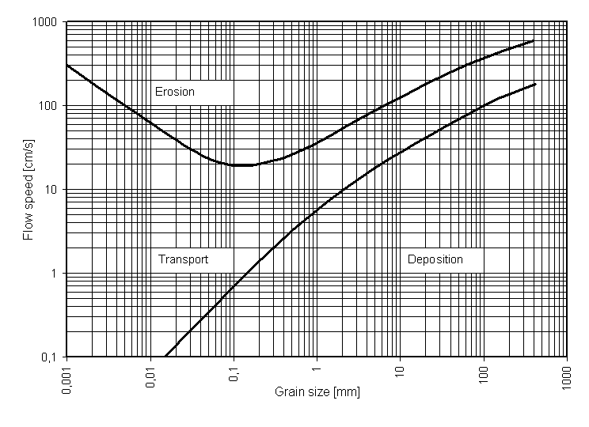

A imagem foi enviada sem indicação de autoria/licença. As legendas estão em inglês; a explicação dos campos está na seção Diagrama de Hjulström.

### 6. Bacias, deposição, ambientes sedimentares e fácies

#### Bacia sedimentar

**Bacia sedimentar** é uma região da crosta terrestre na qual a subsidência cria **espaço de acomodação** para a acumulação de sedimentos durante determinado intervalo de tempo geológico. Com o soterramento progressivo, esses sedimentos podem sofrer diagênese e transformar-se em rochas sedimentares.

Uma bacia não precisa corresponder, atualmente, a uma depressão visível no relevo. O termo descreve principalmente uma região de acumulação e preservação de sedimentos cuja origem e evolução estão relacionadas à dinâmica da crosta.

Entre os elementos usados para descrever uma bacia sedimentar estão:

- **subsidência**: movimento de rebaixamento da crosta ou do fundo da bacia;

- **espaço de acomodação**: volume disponível para receber e preservar sedimentos;

- **área-fonte**: região de onde provêm os materiais sedimentares;

- **aporte sedimentar**: quantidade e tipo de sedimento fornecido à bacia;

- **borda da bacia**: setor periférico, geralmente mais próximo das áreas-fonte;

- **depocentro**: região em que se concentra a maior espessura de sedimentos;

- **preenchimento sedimentar**: conjunto de camadas acumuladas ao longo da evolução da bacia.

A formação e a geometria das bacias dependem do contexto tectônico. Entre os tipos mais comuns estão as **bacias de rifte**, associadas à distensão da crosta; as **bacias de margem passiva**, desenvolvidas após a abertura de oceanos; as **bacias intracratônicas**, situadas no interior de continentes; e as **bacias de antepaís**, formadas próximas a cadeias de montanhas em desenvolvimento.

Esquema simplificado de uma bacia sedimentar: as camadas tendem a apresentar maior espessura próximo ao depocentro.

**Relação entre os termos:** a subsidência cria espaço de acomodação; o aporte sedimentar preenche esse espaço; o soterramento favorece a preservação dos sedimentos e sua transformação em rochas sedimentares.

*Ver também:* subsidência, sedimento, estrato, área-fonte, depocentro, diagênese, tectônica.

#### Deposição, acomodação e preenchimento

**Deposição** é a retirada de partículas ou substâncias do meio transportador e seu acúmulo em determinado local. **Sedimentação** é o processo mais amplo de formação e acumulação de sedimentos, incluindo componentes detríticos, químicos e biogênicos.

A deposição de partículas ocorre quando o agente transportador perde competência ou capacidade, quando há mudança na geometria do fluxo ou quando as partículas encontram uma barreira. Substâncias dissolvidas podem precipitar em resposta a evaporação, mudanças de temperatura, pH, estado de oxidação ou atividade biológica.

#### Espaço de acomodação

O **espaço de acomodação** é o volume disponível para que sedimentos se acumulem e sejam preservados. Ele pode ser produzido por subsidência tectônica, variação do nível de base, compactação ou mudanças na topografia. Quando a taxa de criação de acomodação e o suprimento sedimentar variam, modificam-se a geometria e o empilhamento dos depósitos.

#### Bacia de sedimentação e bacia sedimentar

Uma **bacia de sedimentação** é uma área em que ocorre acumulação de sedimentos. Uma **bacia sedimentar** é uma região subsidente da crosta que recebeu e preservou um preenchimento sedimentar ao longo do tempo geológico. Portanto, nem todo local de deposição temporária constitui, no sentido tectonoestratigráfico, uma bacia sedimentar.

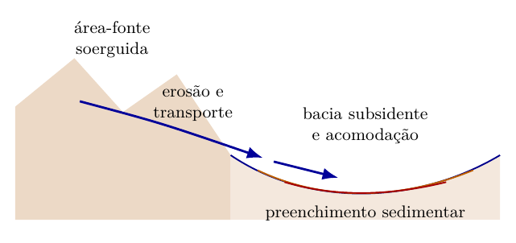

*Fonte: elaborado pelo autor com base em [Nichols (2009)](Referencias.md#nichols2009).*

#### Soerguimento e subsidência

O **soerguimento** favorece a exposição de rochas, o desenvolvimento do relevo e a erosão da área-fonte. A **subsidência** cria ou amplia espaço de acomodação e pode favorecer a preservação dos depósitos. Os dois processos podem ocorrer em regiões distintas de um mesmo sistema sedimentar e variar ao longo do tempo.

#### Produtos da sedimentação

Uma bacia pode receber sedimentos siliciclásticos e vulcanoclásticos, produzir carbonatos e matéria orgânica ou registrar precipitação química. Evaporitos incluem, entre outros, sulfatos, como gipsita e anidrita, e cloretos, como halita. Carvões, depósitos silicosos e formações ferríferas representam outros produtos sedimentares que dependem de condições ambientais e geoquímicas específicas [[nichols2009](Referencias.md#nichols2009)].

#### Ambiente sedimentar e fácies

**Ambiente sedimentar** é o conjunto de condições físicas, químicas e biológicas sob as quais ocorre a produção, o transporte e a deposição de sedimentos. Cada ambiente apresenta combinações características de energia, profundidade, salinidade, relevo, organismos, agentes de transporte e disponibilidade de material.

Ao nível introdutório, os ambientes podem ser organizados em três grandes grupos:

- **continentais**: rios, leques aluviais, lagos, desertos, geleiras e encostas;

- **transicionais**: deltas, estuários, praias, planícies de maré, lagunas e sistemas costeiros;

- **marinhos**: plataforma continental, talude, sopé continental, planícies abissais e ambientes recifais.

**Fácies sedimentar** é um corpo de sedimento ou rocha reconhecido por um conjunto de características, como composição, granulometria, estruturas sedimentares, fósseis, geometria e cor. Essas características permitem interpretar o processo e o ambiente em que o material foi depositado.

Uma mesma bacia pode conter várias fácies lateralmente associadas. A mudança vertical de fácies também pode registrar migração de ambientes, variações do nível do mar, alterações no aporte sedimentar ou movimentos tectônicos.

**Relação entre os termos:** ambiente sedimentar é o conjunto de condições e processos de deposição; fácies é o conjunto de características preservadas no sedimento ou na rocha que permite interpretar esse ambiente.

*Ver também:* bacia sedimentar, deposição, estrutura sedimentar, granulometria, transgressão, regressão, estratigrafia.

#### Associações e sucessões de fácies

#### Códigos de litofácies

Os códigos de litofácies combinam uma letra maiúscula que indica a classe granulométrica com letras minúsculas que representam estruturas ou características. Em esquemas derivados de Miall, por exemplo, *G* indica cascalho, *S* indica areia e *F* indica sedimentos finos. O significado completo de cada código deve ser declarado no trabalho, porque há adaptações entre autores e ambientes [[miall1978](Referencias.md#miall1978); [nichols2009](Referencias.md#nichols2009)].

#### Associação de fácies

Uma fácies isolada raramente define um ambiente deposicional de maneira inequívoca. Uma **associação de fácies** reúne fácies que ocorrem repetidamente juntas e que podem ser relacionadas por processos sedimentares compatíveis. A interpretação ganha força quando considera:

- a sucessão vertical das fácies;

- as relações laterais;

- a geometria dos corpos;

- as superfícies erosivas ou de reativação;

- a direção das paleocorrentes;

- os fósseis e icnofósseis;

- o contexto estratigráfico regional.

#### Sucessão de fácies

Uma **sucessão de fácies** é a ordem vertical ou lateral em que diferentes fácies aparecem. Tendências granodecrescentes podem registrar diminuição da energia do fluxo, como em certos preenchimentos de canal. Tendências granocrescentes podem acompanhar a progradação de sistemas deposicionais. Essas interpretações, entretanto, dependem da geometria, das superfícies limitantes e do ambiente analisado.

#### Ambientes continentais, transicionais e marinhos

Em escala ampla, os ambientes deposicionais podem ser agrupados em:

- **continentais**: fluviais, lacustres, eólicos, glaciais e leques aluviais;

- **transicionais**: deltas, estuários, planícies de maré e sistemas costeiros;

- **marinhos**: plataforma, talude, bacia profunda, recifes e outros sistemas oceânicos.

Estratificação espinha de peixe, superfícies de reativação e alternância de laminações de areia e lama podem indicar reversão periódica de correntes, comum em ambientes de maré. Camadas com estratificação cruzada hummocky são associadas a fluxos combinados gerados por tempestades em ambientes marinhos rasos. Nenhuma dessas feições deve ser usada isoladamente como diagnóstico definitivo [[harms1975](Referencias.md#harms1975); [nichols2009](Referencias.md#nichols2009)].

#### Ambientes deposicionais — desenvolvimento a partir do caderno

Um ambiente deposicional é reconhecido pelo conjunto de processos que atuam em determinada área. Um **sistema deposicional** reúne ambientes e depósitos conectados, como canal, barras e planície de inundação de um sistema fluvial. Esses termos podem descrever sistemas atuais ou reconstruídos no registro geológico; a distinção não depende apenas de o ambiente ainda existir.

A sequência **fácies → associação de fácies → modelo deposicional** organiza a interpretação: primeiro descrevemos a rocha, depois reconhecemos feições recorrentes em conjunto e, por fim, propomos uma distribuição de processos e ambientes. Um modelo é uma hipótese a confrontar com o registro, não um nome que uma única amostra comprova. Base: caderno, páginas 14–19, e Nichols (2009), capítulos 5–15.

##### Leques aluviais

Leques aluviais são corpos de sedimentos que se espalham quando um fluxo sai de uma área confinada e íngreme para uma área mais aberta. A redução do confinamento e as mudanças de declive favorecem a deposição. Podem acumular depósitos de correntes, enxurradas e fluxos de detritos; por isso, nem todo leque é composto exclusivamente por conglomerado maciço.

Na descrição, observar granulometria, seleção, suporte dos clastos, estratificação e geometria. A tectônica pode criar relevo e espaço para sua acumulação, mas “leque aluvial” não comprova sozinho tectonismo ativo. Os termos orto/paraconglomerado são descritores da rocha e não nomes de ambiente.

##### Sistemas fluviais

Rios transportam sedimentos como carga de fundo e em suspensão. O sistema inclui canais, barras, margens e áreas de inundação. Em canais, cascalho e areia podem formar estratificação cruzada; fora deles, silte e argila podem acumular-se durante cheias e por decantação.

Um preenchimento de canal pode apresentar base erosiva e tendência granodecrescente, com material grosso na base e mais fino no topo. Essa tendência precisa ser reconhecida em uma sucessão, com sua geometria e superfícies limitantes; ela não é regra obrigatória de todo depósito fluvial.

**Avulsão** é a mudança do curso para uma nova posição na planície. Não é sinônimo de migração lateral gradual de um meandro. O registro pode conservar canais abandonados, novos canais e alternância de fácies de canal e planície.

##### Ambientes áridos: dunas, playas e sabkhas

No deserto, o vento pode transportar e selecionar areia, formando dunas e estratificação cruzada. Também ocorrem depósitos de correntes efêmeras e de lagos: um depósito desértico não é necessariamente eólico.

Uma **playa** é uma área baixa, frequentemente em bacia fechada, sujeita a inundação temporária e secagem. Pode acumular lama, gretas e evaporitos, conforme o balanço hídrico e a composição da água. **Sabkhas** são planícies salinas onde a evaporação de águas superficiais ou subterrâneas favorece a formação de sais. Há sabkhas costeiras e continentais; as costeiras podem apresentar evaporitos crescendo dentro dos sedimentos da zona supramaré.

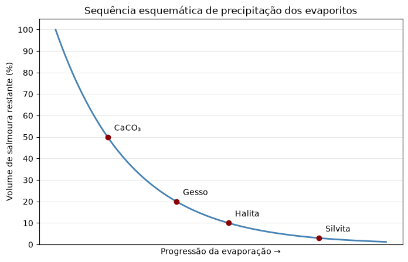

*Figura esquemática preservada do envio anterior. Os pontos e percentuais ilustram uma sequência, sem calibração experimental identificada. Não usar 50%, 20%, 10% e os demais valores como limiares universais de precipitação. A composição da salmoura e as condições físico-químicas controlam quais minerais precipitam e quando.*

##### Sistemas glaciais e fluvioglaciais

O gelo pode transportar uma mistura muito ampla de tamanhos de partículas. O **till** é depositado diretamente pela ação glacial e pode ser muito mal selecionado. Depósitos de **outwash** são produzidos por correntes de água de degelo; apresentam, frequentemente, areia e cascalho estratificados e retrabalhados em canais. Logo, “origem glacial” não significa que todo depósito tenha a mesma textura.

Em contextos glaciolacustres e glaciomarinhos, pode haver decantação de finos e queda de detritos liberados por gelo flutuante. A interpretação exige associação de evidências: granulometria isolada, estria ou clasto disperso não resolvem sozinhos o ambiente. Ver [outwash — USGS](Referencias.md#usgsoutwash) e Nichols (2009), capítulo 7.

##### Deltas

Um delta desenvolve-se quando o aporte sedimentar de um rio produz acumulação e avanço do depósito em sua desembocadura. Pode ser descrito por planície deltaica, frente deltaica e prodelta, com distribuição de canais, barras e sedimentos finos.

| Influência predominante | Processos e feições que ajudam a interpretar |
|---|---|
| Fluvial | Aporte pelos distributários e deposição próxima às desembocaduras; canais e barras de desembocadura |
| Ondas | Retrabalhamento do sedimento e redistribuição ao longo da costa; praias, cordões e contornos costeiros mais regularizados |
| Marés | Correntes de enchente/vazante retrabalham canais e barras; feições alongadas e alternâncias de areia/lama podem ocorrer |

As influências se combinam e variam no tempo. A classificação por dominância não implica exclusividade de um agente. As referências manuscritas a Galloway e Pritchard foram mantidas nas pendências até a identificação das obras; a explicação aqui usa Nichols (2009), capítulo 12.

##### Estuários, lagunas, barreiras e planícies de maré

**Estuários** são sistemas costeiros com conexão ao mar e influência de água doce, nos quais ondas, marés e descarga fluvial interagem. Podem apresentar canais e bancos arenosos, áreas lamosas e forte variação espacial de salinidade e energia. Não se deve definir estuário apenas como “transgressão marinha”.

Uma **laguna costeira** é um corpo de água separado do mar por uma barreira, mas com conexão permanente ou intermitente. A barreira pode conter cordões arenosos e passagens por onde ocorre troca de água e sedimentos. Não é preciso haver uma ilha individual para que exista uma laguna.

Nas **planícies de maré**, exposição e inundação periódicas, correntes e decantação podem gerar estruturas heterolíticas e bioturbação. As definições de flaser, wavy e lenticular ficam no capítulo 9; no laboratório, registrar seu padrão sem repetir toda a explicação.

##### Perfil litorâneo e ação das ondas

| Zona | Posição e processos de referência |
|---|---|
| Backshore — pós-praia | Acima da área de ação habitual do espraiamento; pode ser atingida em eventos mais energéticos |
| Foreshore — face de praia | Espraiamento e refluxo; posição variável com marés e ondas |
| Shoreface — antepraia | Porção submersa onde ondas de tempo bom retrabalham frequentemente o fundo |
| Offshore transition | Entre as bases de ação das ondas de tempo bom e de tempestade |
| Offshore | Abaixo da base de ação das ondas de tempestade, no modelo de plataforma considerado |

Essas divisões são operacionais: não correspondem a profundidades fixas em todos os litorais. Energia das ondas e declive modificam sua posição. O croqui manuscrito da página 19 encontra-se no [PDF original](originais/Caderno_manuscrito_documento09.pdf#page=19). Base: Nichols (2009), capítulos 11, 13 e 14.

### 7. Diagênese e litificação

**Diagênese** é o conjunto de processos físicos, químicos e biológicos que atuam sobre os sedimentos após sua deposição e durante sua litificação, em condições de temperatura e pressão relativamente baixas, promovendo transformações como compactação, cimentação, dissolução, recristalização e substituição mineral, até o limite em que se iniciam os processos metamórficos.

Sobre a diagênese podem ser destacados, de forma simplificada, os seguintes processos:

$$\text{Diagênese envolve} =
\left\{
\begin{array}{l}
\text{cimentação} \\
\text{compactação} \\
\text{dissolução dos grãos}
\end{array}
\right.$$

#### Litificação, compactação e cimentação

**Litificação** é a transformação de um sedimento inconsolidado em rocha sedimentar consolidada. O processo ocorre durante o soterramento e integra a **diagênese**, mas os dois termos não são sinônimos: a diagênese inclui também outras alterações físicas, químicas e biológicas posteriores à deposição.

Nas rochas sedimentares clásticas, os mecanismos mais importantes são:

- **compactação**: redução do volume dos poros e aproximação dos grãos devido ao peso das camadas superiores;

- **desidratação**: expulsão de parte da água existente nos poros, especialmente em sedimentos finos;

- **cimentação**: precipitação de minerais nos espaços entre os grãos, unindo-os. Sílica, calcita e óxidos de ferro são exemplos de cimentos;

- **recristalização**: reorganização ou crescimento de cristais durante a diagênese, comum em algumas rochas carbonáticas e químicas.

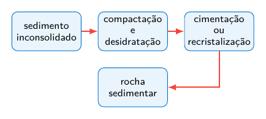

Exemplos: areia litificada forma arenito; cascalho arredondado forma conglomerado; lama pode formar argilito, siltito, lamito ou folhelho, conforme a granulometria, a composição e a estrutura da rocha.

**Relação entre os termos:** litificação é o resultado da consolidação do sedimento; compactação e cimentação são mecanismos importantes desse processo; diagênese é o conjunto mais amplo de transformações após a deposição.

*Ver também:* diagênese, soterramento, compactação, cimentação, porosidade, sedimento, rocha sedimentar.

#### Processos diagenéticos, porosidade e permeabilidade

#### Compactação

A compactação reduz o volume de poros por rearranjo, deformação ou fraturamento dos grãos. Em sedimentos lamosos, a expulsão de água intersticial pode produzir grande redução de volume. A compactação química pode ocorrer nos contatos submetidos a maior tensão, favorecendo dissolução por pressão.

#### Cimentação

A cimentação resulta da precipitação de minerais nos poros. Cimentos comuns incluem sílica, calcita, dolomita e óxidos ou hidróxidos de ferro. O cimento une os grãos e reduz a porosidade, embora dissoluções posteriores possam gerar porosidade secundária.

#### Dissolução, recristalização e substituição

Durante a diagênese, grãos ou cimentos instáveis podem ser dissolvidos. A **recristalização** altera o tamanho ou a forma dos cristais sem necessariamente mudar a composição mineral. Na **substituição**, um mineral é dissolvido enquanto outro precipita em seu lugar, podendo preservar parcialmente a forma original.

#### Porosidade e permeabilidade

A **porosidade** é a proporção de espaços vazios em relação ao volume total da rocha. A **permeabilidade** expressa a facilidade com que um fluido atravessa uma rede de poros conectados. Uma rocha pode apresentar porosidade elevada e baixa permeabilidade quando os poros são muito pequenos ou pouco conectados.

#### Limite com o metamorfismo

Não existe uma fronteira única e universal entre diagênese e metamorfismo. A distinção é feita a partir da associação mineral, da temperatura, da pressão e do contexto geológico. Por isso, a diagênese deve ser entendida como uma evolução progressiva, e não como uma etapa instantânea [[nichols2009](Referencias.md#nichols2009)].

### 8. Rochas sedimentares: composição, origem e grupos principais

#### Critérios de classificação e organização didática

Gary Nichols é autor de uma obra didática amplamente utilizada em sedimentologia e estratigrafia. No contexto das aulas, a expressão **classificação de Nichols** pode ser usada para indicar a organização dos materiais sedimentares apresentada em seu livro.

Não se trata de um código formal universal com regras exclusivas ou de uma classificação mineralógica denominada oficialmente em homenagem ao autor. Trata-se de uma estrutura didática que separa os sedimentos e as rochas sedimentares principalmente segundo sua origem e natureza.

- **sedimentos clásticos terrígenos**: fragmentos derivados do intemperismo e da erosão de áreas continentais ou de rochas preexistentes. São organizados principalmente em cascalho, areia e lama;

- **sedimentos biogênicos**: produzidos pela acumulação de partes de organismos ou pela atividade biológica, como muitos carbonatos, carvões e depósitos silicosos biogênicos;

- **sedimentos químicos**: formados pela precipitação de substâncias dissolvidas, como evaporitos e parte dos carbonatos, fosfatos e depósitos ferríferos;

- **sedimentos vulcanogênicos**: materiais originados direta ou indiretamente da atividade vulcânica, incluindo cinzas, lapilli e fragmentos retrabalhados.

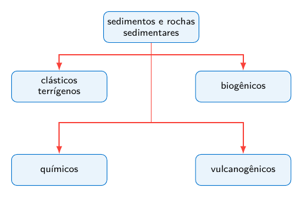

Essa divisão é útil para o estudo introdutório, mas algumas rochas possuem origem mista. Um calcário, por exemplo, pode conter componentes biogênicos, precipitados químicos e material clástico. A classificação final deve considerar textura, composição, estruturas sedimentares e processo de formação.

**Relação entre os termos:** a organização apresentada por Nichols separa grandes grupos pela origem dos materiais, mas a identificação de uma rocha exige também observar sua textura, composição e história deposicional.

*Ver também:* sedimento clástico, biogênico, químico, vulcanogênico, granulometria, rocha sedimentar.

#### Clásticas, terrígenas e siliciclásticas

Rochas clásticas são rochas sedimentares detríticas constituídas por fragmentos de minerais, rochas ou restos preexistentes, gerados por intemperismo, erosão, transporte, deposição e posterior litificação. Sua classificação baseia-se, em geral, no tamanho, na composição e no grau de seleção dos clastos.

Rochas terrígenas são rochas sedimentares formadas a partir de sedimentos provenientes do retrabalhamento de áreas continentais emersas ou próximas ao continente. O termo enfatiza a proveniência do material detrítico, isto é, sua origem terrestre ou continental.

Rochas siliciclásticas são rochas sedimentares detríticas compostas predominantemente por clastos de minerais silicáticos e fragmentos líticos, como quartzo, feldspatos e fragmentos de outras rochas. O termo enfatiza a natureza composicional dos sedimentos, marcada pelo predomínio de silicatos.

#### Tipos principais de rochas sedimentares

**Rocha sedimentar** é uma rocha formada pela acumulação de sedimentos e por sua posterior litificação, ou pela precipitação e consolidação de materiais químicos ou biogênicos. As classificações variam conforme o critério adotado, mas no nível introdutório podem ser reconhecidos quatro grandes conjuntos.

**1. Rochas clásticas ou detríticas**

São constituídas por fragmentos, chamados **clastos**, provenientes de minerais, rochas ou materiais preexistentes. Nas rochas siliciclásticas, a classificação básica utiliza principalmente o tamanho dos grãos:

- **conglomerado**: formado predominantemente por clastos maiores que 2 mm e arredondados;

- **brecha sedimentar**: formada predominantemente por clastos maiores que 2 mm e angulosos;

- **arenito**: formado principalmente por grãos de areia, entre aproximadamente 0.0625 mm e 2 mm;

- **siltito**: constituído principalmente por grãos do tamanho silte, entre aproximadamente 0.0039 mm e 0.0625 mm;

- **argilito**: rocha muito fina, rica em partículas do tamanho argila;

- **lamito**: rocha composta por proporções variáveis de silte e argila;

- **folhelho**: rocha fina que apresenta **fissilidade**, isto é, tendência a dividir-se em lâminas aproximadamente paralelas à estratificação.

**2. Rochas químicas**

Formam-se principalmente pela precipitação de substâncias dissolvidas na água. Incluem os **evaporitos**, como sal-gema e gipsita, além de parte dos calcários, dolomitos, sílex, fosforitos e formações ferríferas sedimentares.

**3. Rochas biogênicas ou bioquímicas**

Resultam da acumulação de restos de organismos ou da precipitação favorecida pela atividade biológica. Incluem calcários bioclásticos, giz, diatomito, radiolarito e carvão. A distinção entre químico e biogênico pode ser gradual, especialmente nas rochas carbonáticas e silicosas.

**4. Rochas e depósitos vulcanoclásticos**

São formados por fragmentos produzidos por atividade vulcânica ou pelo retrabalhamento desses materiais. Cinzas consolidadas podem formar **tufo**; fragmentos maiores podem originar tufos de lapilli e brechas vulcanoclásticas. Dependendo do processo de formação, esses materiais também são estudados no contexto das rochas ígneas.

**Relação entre os termos:** a classificação das rochas clásticas começa pela granulometria dos clastos; rochas químicas e biogênicas são reconhecidas principalmente pela composição e pelo processo de formação; materiais vulcanoclásticos dependem da origem e do retrabalhamento dos fragmentos vulcânicos.

*Ver também:* litificação, granulometria, conglomerado, brecha, arenito, siltito, argilito, folhelho, calcário, evaporito, carvão, tufo.

#### Materiais vulcanoclásticos

**Clasto** é um fragmento de mineral, rocha, fóssil ou material consolidado incorporado a um sedimento ou a uma rocha fragmentar. Os clastos podem ser produzidos por intemperismo e erosão, por ruptura tectônica, por atividade vulcânica ou por outros processos de fragmentação.

Na descrição de um clasto observam-se principalmente:

- **composição**: mineral ou rocha de que o fragmento é constituído;

- **granulometria**: tamanho do fragmento;

- **arredondamento**: grau de suavização das arestas e dos vértices;

- **esfericidade**: semelhança da forma do clasto com uma esfera;

- **seleção**: uniformidade dos tamanhos presentes no depósito;

- **matriz e cimento**: materiais finos ou precipitados que ocupam os espaços entre os clastos.

**Clasto terrígeno** é produzido pela desagregação e erosão de rochas preexistentes na superfície. Após removido, pode ser transportado por água, vento, gelo ou gravidade e depositado em outro local. Areia quartzosa, fragmentos de feldspato e seixos de rocha são exemplos.

**Epiclasto** é um fragmento gerado pelo intemperismo e pela erosão de uma rocha previamente consolidada. Quando a rocha de origem é vulcânica, o epiclasto conserva composição vulcânica, embora tenha sido produzido e transportado por processos superficiais. Por isso, alguns esquemas amplos incluem esses materiais entre os vulcanoclásticos retrabalhados.

**Vulcanoclástico** é um termo amplo para partículas, depósitos e rochas fragmentares de origem vulcânica ou diretamente associados à atividade vulcânica. Esse conjunto pode incluir materiais formados durante a erupção, fragmentos produzidos pelo movimento e resfriamento de lavas e depósitos vulcânicos posteriormente retrabalhados.

**Piroclasto** é o fragmento produzido diretamente pela fragmentação explosiva do magma ou de rochas durante uma erupção. O depósito é chamado **piroclástico**; quando consolidado, forma uma rocha piroclástica.

A classificação granulométrica introdutória dos piroclastos utiliza:

| **Piroclasto**  | **Tamanho**     | **Observação**                                                        |
|:----------------|:----------------|:----------------------------------------------------------------------|
| Cinza vulcânica | menor que 2 mm  | pode consolidar-se como tufo                                          |
| Lapilli         | 2 mm a 64 mm    | fragmentos de tamanho intermediário                                   |
| Bloco ou bomba  | maior que 64 mm | bloco é ejetado sólido; bomba, ainda plástica ou parcialmente fundida |

Esquema simplificado: piroclástico é uma categoria definida pela fragmentação eruptiva; vulcanoclástico é um termo mais abrangente.

Um material vulcânico pode ser removido e novamente depositado por correntes, ondas, vento ou movimentos de massa. Nesse caso, sua composição continua vulcânica, mas a textura e as estruturas sedimentares podem registrar o retrabalhamento. Por isso, a classificação deve considerar simultaneamente a origem do fragmento e o processo responsável por sua deposição.

**Relação entre os termos:** clasto é qualquer fragmento constituinte de um depósito ou rocha fragmentar; vulcanoclástico descreve o conjunto de materiais fragmentares ligados ao vulcanismo; piroclástico identifica os fragmentos produzidos diretamente por uma erupção explosiva.

*Ver também:* granulometria, escala de Wentworth, conglomerado, brecha, arenito, cinza vulcânica, lapilli, tufo, sedimentação.

#### Rochas biogênicas

**Rocha biogênica** é uma rocha sedimentar cuja formação depende principalmente da produção, acumulação ou transformação de materiais originados por organismos. Esses materiais podem ser conchas, esqueletos, carapaças microscópicas, estruturas construídas por organismos ou matéria orgânica vegetal.

A denominação **bioquímica** é usada quando a atividade dos organismos favorece a precipitação ou a concentração de uma substância mineral. Os limites entre rocha biogênica, bioquímica e química nem sempre são rígidos, pois um mesmo depósito pode reunir restos de organismos, precipitação mineral e material detrítico.

**Principais conjuntos**

- **rochas carbonáticas biogênicas**: formadas por componentes de carbonato de cálcio produzidos por moluscos, corais, algas calcárias, foraminíferos, cocolitóforos e outros organismos;

- **rochas silicosas biogênicas**: originadas pela acumulação de estruturas microscópicas de sílica, como frústulas de diatomáceas e esqueletos de radiolários;

- **rochas de origem orgânica**: formadas pela acumulação e transformação de matéria orgânica, especialmente restos vegetais.

**Exemplos importantes**

- **calcário bioclástico**: calcário constituído predominantemente por fragmentos reconhecíveis de conchas, esqueletos ou outros componentes biológicos;

- **coquina**: calcário muito rico em conchas ou fragmentos de conchas, geralmente com pouco material fino;

- **giz**: calcário muito fino formado principalmente pela acumulação de placas calcárias microscópicas, especialmente cocólitos;

- **calcário recifal**: corpo carbonático construído ou estabilizado pela atividade de organismos recifais;

- **diatomito**: rocha leve e porosa formada principalmente por frústulas silicosas de diatomáceas;

- **radiolarito**: rocha silicosa rica em esqueletos de radiolários;

- **carvão**: rocha rica em carbono formada pela acumulação, soterramento e transformação de matéria vegetal.

Nem todo calcário é exclusivamente biogênico. Carbonatos também podem precipitar diretamente da água ou conter proporções importantes de lama carbonática e sedimentos terrígenos. A origem deve ser reconhecida pela composição, pela textura, pelos fósseis, pelas estruturas sedimentares e pelo contexto deposicional.

**Relação entre os termos:** organismos produzem ou concentram materiais minerais e orgânicos; esses materiais acumulam-se como sedimento; o soterramento e a diagênese podem transformá-los em rochas biogênicas.

*Ver também:* rocha sedimentar, calcário, bioclasto, fóssil, carbonato, diatomácea, radiolário, carvão, diagênese.

A aplicação dos critérios de granulometria, composição e suporte às amostras está na Parte II — Laboratório.

#### Rochas carbonáticas — origem, componentes e textura

Carbonáticas são rochas sedimentares ricas em minerais carbonáticos. **Calcário** e **dolomito** são nomes de rocha; **calcita**, **aragonita** e **dolomita** são nomes de minerais. A produção de componentes, seu transporte e as mudanças diagenéticas devem ser analisados separadamente. Esta seção desenvolve as páginas 21–23 do caderno com apoio de Nichols (2009), capítulo 3.

##### Origem dos componentes

O material carbonático pode resultar de precipitação a partir da água, produção de esqueletos e carapaças, atividade microbiana e fragmentação/retrabalhamento de material já formado. Assim, uma rocha de composição carbonática pode apresentar grãos transportados e estruturas produzidas por correntes.

Ambientes de produção carbonática podem coexistir com aporte siliciclástico. Esse aporte pode diluir o material carbonático e afetar as condições de vida dos organismos; deltas e estuários não são, entretanto, universalmente incapazes de acumular carbonatos. A interpretação depende de aporte, turbidez, energia, química da água e comunidade biológica.

##### Mineralogia principal

| Mineral | Composição de referência | Observação |
|---|---|---|
| Calcita | $CaCO_3$ | Pode conter magnésio; é comum nos calcários |
| Aragonita | $CaCO_3$ | Mesmo composto da calcita, com estrutura cristalina diferente; pode ser modificada durante a diagênese |
| Dolomita | $CaMg(CO_3)_2$ | Principal mineral dos dolomitos; pode formar-se por substituição diagenética |
| Siderita | $FeCO_3$ | Carbonato de ferro |
| Ankerita | Carbonato duplo de Ca e componentes como Fe/Mg/Mn | Distinguir o nome mineral da descrição genérica “dolomita ferrosa” |

A mineralogia pode mudar após a deposição. Portanto, a composição atual de uma amostra nem sempre conserva a composição original de seus grãos. Para os minerais acessórios e os limites composicionais detalhados, consultar a referência específica. Apoio mineralógico: [Southard, carbonáticas](Referencias.md#mit2007carbonaticas).

##### Grãos carbonáticos

| Componente | Característica descritiva | Interpretação a investigar |
|---|---|---|
| Bioclasto | Parte de esqueleto, concha ou carapaça; pode conservar estrutura interna | Produção biológica, fragmentação e possível transporte |
| Ooide | Grão revestido, geralmente menor que 2 mm, com núcleo e camadas aproximadamente concêntricas | Crescimento do revestimento e retrabalhamento; não deduzir um ambiente apenas do nome |
| Pisoide | Grão revestido maior que 2 mm | O tamanho não demonstra sozinho origem em caverna |
| Oncoide/oncolito | Revestimento geralmente irregular, relacionado à acreção microbiana | Crescimento associado a comunidades microbianas e movimentação do grão |
| Peloide | Grão micrítico sem estrutura interna diagnóstica evidente | Origem variável; o termo evita presumir mecanismo específico |
| Pellet fecal | Grão cuja origem fecal é identificada | Atividade de organismos; nem todo peloide deve receber esse nome |
| Intraclasto | Fragmento de sedimento carbonático previamente depositado e retrabalhado no próprio sistema | Erosão/redeposição local e grau de consolidação |

Os termos ooide/pisoide referem-se ao grão; calcário oolítico/pisolítico descreve a rocha que os contém. Da mesma forma, um **calcário oncolítico** contém oncoides. Não chamar toda a rocha simplesmente pelo nome do grão. Base: Nichols (2009), seções 3.1.3–3.1.5.

##### Matriz micrítica, cimento e poros

**Micrita** é material carbonático muito fino, que pode constituir a matriz entre grãos ou predominar na rocha. A expressão “lama carbonática” indica essa fração fina, sem significar que ela seja composta por argilominerais. Granulometria fina e mineralogia são critérios distintos.

**Cimento esparítico** é material cristalino que preenche poros e liga os componentes. Nem todo cristal grande de calcita é necessariamente um cimento: a recristalização pode modificar a textura. Registrar, portanto, posição, forma e relação com grãos e vazios, em vez de identificar cimento apenas pela cor ou pelo tamanho.

Na descrição, distinguir **grãos**, **matriz**, **cimento** e **porosidade**. A diagênese pode reduzir a porosidade por cimentação ou gerar vazios por dissolução; os fundamentos desses processos estão no capítulo 7.

##### Carbonatos microbianos

O capítulo 9 apresenta os estromatólitos como estruturas laminadas ligadas à atividade microbiana. Aqui importa sua participação na produção e retenção de material carbonático. **Microbialito** é um termo mais abrangente; não exige que a estrutura tenha laminação estromatolítica. Distinguir o corpo construído no lugar dos grãos móveis revestidos, como oncoides.

##### Composição e textura na classificação

Folk organiza a descrição dos calcários pela combinação dos tipos de grãos com o material intersticial. Dunham enfatiza a textura deposicional, o suporte dos grãos e a presença de lama. São critérios diferentes, que podem se complementar. A aplicação e os exemplos ficam em [L8](#laboratorio-8); não aplicar o prisma Q–F–L dos arenitos aos carbonatos. Apoio: Nichols (2009), seção 3.1.6, e [Southard](Referencias.md#mit2007carbonaticas).

### 9. Estruturas sedimentares e atividade biológica

#### Definição

As **estruturas sedimentares** são feições desenvolvidas durante ou após a deposição dos sedimentos e que podem permanecer preservadas no depósito ou na rocha resultante de sua litificação.

Essas estruturas constituem registros dos processos responsáveis pela formação do depósito e permitem interpretar aspectos como:

- direção e sentido das paleocorrentes;

- regime e energia do fluxo;

- mecanismos de transporte e deposição;

- exposição subaérea;

- processos químicos ocorridos durante ou após a deposição;

- presença e atividade de organismos;

- deformação de sedimentos ainda inconsolidados.

De acordo com sua origem, podem ser agrupadas em:

1.  estruturas físicas ou mecânicas;

2.  estruturas químicas;

3.  estruturas biogênicas.

#### Estruturas físicas ou mecânicas

As **estruturas físicas** resultam principalmente da ação mecânica dos agentes de transporte, deposição ou deformação dos sedimentos, como correntes, ondas, marés, vento e gravidade.

##### Estratificação

A **estratificação** corresponde à organização dos sedimentos em camadas ou estratos. Cada estrato pode representar um episódio de deposição ou um intervalo durante o qual determinadas condições sedimentares permaneceram relativamente constantes.

As superfícies que separam os estratos são denominadas **planos de estratificação**. Mudanças entre camadas podem refletir variações de granulometria, composição, cor, energia do ambiente e velocidade de sedimentação.

##### Laminação

A **laminação** corresponde à organização do sedimento em camadas muito delgadas. As lâminas podem resultar de pequenas variações de granulometria, composição ou condições de fluxo.

Quando apresentam geometria aproximadamente horizontal e paralela, constituem a **laminação plano-paralela**.

##### Estratificação cruzada

A **estratificação cruzada** ocorre quando conjuntos de lâminas encontram-se inclinados em relação ao plano principal de estratificação.

Sua formação está normalmente associada à migração de formas de leito, como marcas onduladas, dunas subaquosas, dunas eólicas e barras. A orientação das lâminas pode fornecer informações sobre a direção do paleofluxo.

##### Marcas onduladas

As **marcas onduladas**, ou *ripple marks*, são pequenas ondulações formadas na superfície de sedimentos inconsolidados pela ação da água ou do vento.

As marcas produzidas por corrente são normalmente assimétricas e podem indicar o sentido predominante do fluxo. As produzidas pela ação oscilatória das ondas tendem a apresentar maior simetria.

##### Acamamentos flaser, ondulado e lenticular

Quando areia e lama se alternam sob variações periódicas da energia, podem formar-se três padrões principais:

- **flaser**: lâminas descontínuas de lama preservadas entre ripples predominantemente arenosos;

- **ondulado** (*wavy*): proporções semelhantes de areia e lama formam camadas lateralmente contínuas e onduladas;

- **lenticular**: lentes isoladas de areia ficam envolvidas por lama.

Esses padrões são comuns em depósitos submetidos à alternância entre correntes capazes de transportar areia e períodos de baixa energia que permitem a decantação de lama [[nichols2009](Referencias.md#nichols2009)].

##### Estratificação cruzada hummocky e swaley

A estratificação cruzada *hummocky* apresenta laminações suavemente curvas, com elevações e depressões de baixo ângulo. É associada principalmente a fluxos combinados produzidos por ondas e correntes durante tempestades em ambientes marinhos rasos. A variante *swaley* é dominada por depressões erosivas e tende a ocorrer em condições de maior retrabalhamento. A interpretação deve considerar a associação de fácies e não apenas uma geometria isolada [[harms1975](Referencias.md#harms1975); [nichols2009](Referencias.md#nichols2009)].

##### Estratificação gradacional

A **estratificação gradacional** ocorre quando há variação sistemática do tamanho dos grãos ao longo de uma camada.

Na gradação normal:

$$\text{base grossa}
\rightarrow
\text{topo fino}.$$

Esse padrão geralmente indica diminuição progressiva da energia do fluxo durante a deposição. Também pode ocorrer gradação inversa, na qual o tamanho dos grãos aumenta em direção ao topo.

##### Marcas de sola

As **marcas de sola** são feições preservadas principalmente na base de camadas sedimentares. Podem ser formadas quando correntes erodem um substrato ainda inconsolidado e as depressões resultantes são posteriormente preenchidas por sedimento.

Algumas dessas estruturas permitem interpretar direção e sentido de paleocorrentes.

##### Gretas de dessecação

As **gretas de dessecação** formam-se quando sedimentos finos, úmidos e coesivos são expostos ao ar e perdem água. A retração do material produz uma rede de fraturas frequentemente poligonais.

Sua presença indica exposição subaérea temporária e pode ocorrer em planícies de maré, margens de lagos, planícies de inundação e outras áreas sujeitas a alternância entre inundação e secagem.

##### Estruturas de carga e deformações sinsedimentares

As **estruturas de carga** podem desenvolver-se quando uma camada mais densa é depositada sobre outra menos densa e ainda pouco consolidada. A camada superior pode afundar parcialmente no sedimento inferior.

Sedimentos saturados em água também podem sofrer deformações antes da litificação em consequência de escorregamentos, sobrecarga, liquefação, escape de fluidos ou instabilidade gravitacional.

Podem resultar:

- dobras convolutas;

- laminações deformadas;

- estruturas de escape de fluidos;

- escorregamentos sinsedimentares.

##### Formas de leito e estruturas preservadas

Uma duna ou ripple é uma **forma de leito**. A estratificação cruzada preservada na rocha é um registro produzido por sua migração e deposição. No caso simples de uma forma assimétrica migrante, a face **stoss** fica a montante e a face **lee**, a jusante. Grãos transportados pela face stoss podem acumular-se na lee, formando lâminas inclinadas.

**Superfícies de reativação** truncam lâminas anteriores e marcam interrupções ou mudanças no desenvolvimento da forma de leito. Correntes reversas podem produzi-las, mas a superfície, isoladamente, não prova reversão de maré. Estratificação cruzada tabular e acanalada descreve a geometria dos conjuntos, não apenas o tamanho dos grãos. Base: caderno, páginas 11, 14 e 20; Nichols (2009), capítulo 4.

##### Escape de fluidos: dish e pillar

Sedimentos saturados podem perder água e reorganizar-se antes da consolidação. **Dish structures** apresentam lâminas finas, sub-horizontais a côncavas para cima; **pillars** são zonas aproximadamente verticais que podem atravessar ou interromper a laminação. São descritores associados ao escape de fluidos, não provas automáticas de ambiente ou de terremoto. Apoio: [Lowe e LoPiccolo (1974)](Referencias.md#lowelopiccolo1974) e [Lowe (1975)](Referencias.md#lowe1975).

##### Carga, chama, convoluta e slump

**Estruturas de chama** são projeções de sedimento mais fino para a camada sobrejacente, frequentemente associadas a instabilidades de carga. **Estratificação convoluta** descreve lâminas dobradas ou contorcidas dentro de uma camada; **slump** envolve deformação associada ao deslocamento gravitacional de sedimento inconsolidado. Os termos não são intercambiáveis: primeiro registrar geometria, camadas afetadas e superfícies limitantes, depois investigar o mecanismo. Base: caderno, páginas 11–12/20, e Nichols (2009), capítulos 4 e 18.

##### Gretas subaquosas e sinérese

O caderno menciona **gretas de sinérese**. A interpretação clássica envolve contração do sedimento em condições subaquosas, distinguindo-as das gretas de dessecação. Contudo, há mecanismos diferentes e exemplos reinterpretados. A presença de gretas não deve ser usada, sozinha, para inferir mudança de salinidade ou exposição ao ar. No laboratório, descrever forma, preenchimento e relação com as camadas. Apoio: [McMahon, Hood e McIlroy (2016)](Referencias.md#mcmahon2016).

##### Marcas de sola e marcas de objetos

As marcas de sola podem registrar erosão por fluxo ou ação de objetos sobre o fundo. Marcas de escavação e marcas de arraste não oferecem necessariamente a mesma informação: uma feição alongada pode indicar orientação, enquanto seu sentido depende de assimetria e preservação. O caderno usa “turboglifos”; conservar o termo junto da descrição concreta da marca, sem chamar toda marca de objeto de turbidito. Base: Nichols (2009), seção 4.7.

#### Estruturas químicas

As **estruturas químicas** resultam principalmente de processos de dissolução, precipitação, recristalização ou substituição mineral.

Podem formar-se durante a deposição ou durante a diagênese e são controladas por fatores como:

- concentração de íons;

- salinidade;

- pH;

- condições de oxidação e redução;

- circulação de fluidos;

- evaporação.

##### Cristais e moldes de evaporitos

Em ambientes sujeitos à intensa evaporação, a concentração de sais dissolvidos pode alcançar a saturação e provocar a precipitação de minerais como gipsita, anidrita e halita.

Os cristais podem posteriormente ser dissolvidos, deixando moldes que podem ser preenchidos por outros minerais ou por sedimento. Quando a forma original é preservada após a substituição mineral, forma-se um **pseudomorfo**.

##### Concreções

As **concreções** são corpos formados pela precipitação localizada de minerais nos espaços porosos de um sedimento ou rocha sedimentar.

Podem crescer ao redor de um núcleo, como um fóssil, fragmento mineral, matéria orgânica ou irregularidade do sedimento. Podem ser compostas, por exemplo, por calcita, sílica, óxidos de ferro ou sulfetos.

##### Nódulos

Os **nódulos** são concentrações minerais localizadas dentro de uma rocha sedimentar e podem apresentar composição diferente da matriz que os envolve. Exemplos incluem nódulos de sílex, fosfato e materiais carbonáticos.

##### Estruturas de dissolução

A circulação de fluidos pode promover dissolução seletiva de minerais, originando cavidades, superfícies irregulares e porosidade secundária. Essas cavidades podem ser posteriormente preenchidas por outros minerais.

##### Estilólitos

Os **estilólitos** são superfícies irregulares, geralmente serrilhadas, formadas principalmente por dissolução sob pressão.

São particularmente comuns em rochas carbonáticas e estão associados a processos diagenéticos relacionados ao soterramento.

#### Estruturas biogênicas

As **estruturas biogênicas** são produzidas direta ou indiretamente pela atividade dos organismos.

Podem registrar atividades de deslocamento, alimentação, escavação, habitação, repouso, perfuração e construção. Muitas dessas estruturas são estudadas pela **icnologia**.

##### Bioturbação

A **bioturbação** corresponde ao retrabalhamento do sedimento pela atividade dos organismos.

Os organismos podem escavar galerias, revolver o substrato, ingerir partículas, deslocar materiais e misturar diferentes camadas. Uma bioturbação intensa pode destruir parcial ou completamente estruturas sedimentares anteriormente existentes.

##### Icnofósseis

Os **icnofósseis** são registros preservados da atividade de organismos, em vez de partes do próprio corpo.

Entre os exemplos encontram-se:

- pegadas;

- pistas;

- rastros;

- galerias;

- escavações;

- marcas de repouso;

- perfurações.

Os icnofósseis possuem grande importância paleoambiental porque registram a relação entre os organismos e o substrato.

##### Escavações, galerias e perfurações

Organismos que vivem no interior do sedimento podem produzir galerias horizontais, verticais, inclinadas ou ramificadas.

As **perfurações** diferem das escavações porque são produzidas em substratos relativamente duros, como rochas, conchas, fragmentos carbonáticos ou superfícies consolidadas.

##### Pegadas, pistas e rastros

O deslocamento de organismos sobre superfícies sedimentares pode produzir marcas posteriormente soterradas e preservadas.

Essas estruturas podem fornecer informações sobre a direção do movimento, o comportamento dos organismos e as características do substrato.

##### Estromatólitos

Os **estromatólitos** são estruturas organossedimentares laminadas associadas principalmente à atividade de comunidades microbianas.

Tapetes microbianos podem aprisionar partículas, ligar sedimentos e favorecer a precipitação mineral. A repetição desses processos produz estruturas laminadas de crescimento progressivo.

##### Recifes e construções biogênicas

Alguns organismos participam diretamente da construção de corpos sedimentares. Corais, algas calcárias, esponjas e outros organismos podem formar recifes e outras construções carbonáticas.

Essas estruturas podem controlar localmente a circulação da água, a deposição de sedimentos, a distribuição dos organismos e o desenvolvimento de diferentes fácies sedimentares.

#### Estruturas primárias e secundárias

As estruturas sedimentares também podem ser classificadas conforme o momento de sua formação.

As **estruturas primárias** desenvolvem-se durante ou imediatamente após a deposição. Entre os exemplos estão:

- estratificação;

- laminação;

- estratificação cruzada;

- marcas onduladas;

- gradação granulométrica;

- marcas de sola.

As **estruturas secundárias** formam-se posteriormente, geralmente durante deformações precoces ou processos diagenéticos. Entre elas estão:

- estruturas de carga;

- estruturas de escape de fluidos;

- concreções;

- nódulos;

- estilólitos;

- estruturas de dissolução e substituição.

#### Importância para a interpretação paleoambiental

As estruturas sedimentares constituem registros dos processos que atuavam no ambiente durante a formação dos depósitos.

Por exemplo:

- estratificação cruzada pode indicar direção de paleocorrente;

- marcas onduladas assimétricas podem indicar o sentido do fluxo;

- marcas onduladas simétricas podem indicar ação de ondas;

- gretas de dessecação indicam exposição subaérea;

- gradação normal pode indicar redução progressiva da energia de um fluxo;

- evaporitos e seus moldes podem indicar forte evaporação;

- bioturbação registra atividade de organismos no substrato;

- estromatólitos registram interação entre atividade microbiana e sedimentação.

A interpretação de uma estrutura isolada deve ser realizada com cautela. A reconstrução do ambiente deposicional torna-se mais confiável quando são analisadas conjuntamente a granulometria, a composição mineralógica, as estruturas sedimentares, os fósseis, a geometria dos corpos sedimentares e as relações estratigráficas.

De maneira geral:

$$\boxed{
\text{intemperismo}
\rightarrow
\text{erosão}
\rightarrow
\text{transporte}
\rightarrow
\text{deposição}
\rightarrow
\text{estruturas sedimentares}
\rightarrow
\text{diagênese}
}$$

#### Participação dos organismos e interações ecológicas

**Interações ecológicas**: São as relações estabelecidas entre organismos de uma mesma espécie ou de espécies diferentes, bem como entre esses organismos e o ambiente em que vivem. Essas interações influenciam a distribuição, a abundância e a dinâmica das populações ao longo do tempo.

As interações ecológicas podem ser classificadas em dois grandes grupos:

- **Interações intraespecíficas**: ocorrem entre indivíduos da mesma espécie, podendo envolver cooperação (como sociedades e colônias) ou competição por recursos.

- **Interações interespecíficas**: ocorrem entre indivíduos de espécies diferentes, incluindo relações como predação, competição, mutualismo, comensalismo e parasitismo.

Essas interações constituem um dos fundamentos da ecologia, pois determinam o fluxo de energia, a ciclagem de nutrientes e a estrutura das comunidades biológicas. Em escala geológica, as interações ecológicas também se refletem no registro fossilífero, permitindo inferir relações entre organismos e ambientes do passado.

As interações ecológicas possuem relação direta com a geologia moderna, na medida em que os organismos não apenas habitam os ambientes geológicos, mas também os modificam e deixam registros de sua atividade. No registro fossilífero, essas interações se manifestam por meio de associações de organismos, estruturas biogênicas e padrões de sucessão faunística. Além disso, a atividade biológica influencia processos sedimentares, contribuindo para a formação de depósitos específicos, como recifes carbonáticos e sedimentos bioturbados. Dessa forma, a interpretação geológica contemporânea incorpora não apenas os aspectos físicos e químicos das rochas, mas também as relações ecológicas que condicionaram sua formação, permitindo uma reconstrução mais completa dos ambientes do passado.

Na geologia moderna, as interações ecológicas assumem especial importância no estudo das bacias sedimentares, uma vez que estas representam os principais sítios de deposição, preservação fossilífera e registro da evolução ambiental. Em uma bacia sedimentar, os organismos participam ativamente dos processos geológicos, influenciando a produção, retrabalhamento e modificação dos sedimentos. Estruturas como recifes, níveis ricos em matéria orgânica e feições de bioturbação mostram que a sedimentação não resulta apenas de processos físicos e químicos, mas também da ação dos seres vivos e de suas relações ecológicas. Assim, o estudo das bacias sedimentares na geologia contemporânea requer uma abordagem integrada, na qual a dinâmica deposicional, a paleoecologia e a sucessão estratigráfica sejam interpretadas de forma conjunta.

Assim, as bacias sedimentares constituem o espaço privilegiado em que a interação entre processos geológicos e ecológicos se torna registrada e preservada no tempo geológico.

> **Fonte ainda ausente:** `formas_de_leito_e_estruturas.tex` não foi recuperado. Esta versão incorpora os complementos legíveis do caderno, mas não afirma reproduzir integralmente aquele arquivo.

### 10. Estratigrafia, correlação e tempo geológico

#### Registro estratigráfico e tempo geológico

**Tempo geológico** é o intervalo de existência e evolução da Terra, organizado em uma escala cronológica de éons, eras, períodos, épocas e idades. Essa escala é uma construção científica baseada na correlação de rochas, fósseis, eventos geológicos e idades numéricas.

**Registro estratigráfico** é o conjunto de camadas, superfícies, estruturas, fósseis e relações geológicas preservadas nas rochas. Ele constitui a evidência física a partir da qual parte da história da Terra é reconstruída.

O tempo transcorre continuamente, mas seu registro nas rochas é incompleto. Em determinado local podem ocorrer intervalos sem deposição, erosão de camadas já formadas, deformação, metamorfismo ou destruição do material. Um intervalo de tempo não representado por sedimentos ou rochas é chamado de **hiato**. Quando o hiato é marcado por uma superfície que separa unidades de idades diferentes, pode formar uma **discordância**.

A posição relativa das camadas é interpretada por princípios como superposição, relações de corte e sucessão faunística. A escala é calibrada numericamente por métodos radiométricos e por outros marcadores temporais. A correlação permite relacionar registros preservados em diferentes regiões, compensando parcialmente as lacunas locais.

**Relação entre os termos:** tempo geológico é a dimensão cronológica; registro estratigráfico é a parcela física desse tempo que ficou preservada nas rochas.

*Ver também:* estratigrafia, camada, correlação, idade relativa, idade numérica, hiato, discordância, sucessão faunística.

#### Princípios de idade relativa

**Princípio da Sobreposição**: Em uma sequência de rochas sedimentares não deformadas, as camadas mais antigas situam-se na base, enquanto as camadas mais jovens encontram-se progressivamente acima. Esse princípio permite estabelecer a ordem relativa de deposição dos estratos.

**Princípio das Relações de Corte (Interseção)**: Qualquer estrutura geológica que corta outra, como uma falha, fratura ou intrusão ígnea, é mais jovem do que a rocha ou estrutura que foi cortada. Esse princípio é fundamental para determinar a sequência de eventos geológicos.

**Princípio das Inclusões**: Fragmentos de rochas (clastos) contidos em uma formação são mais antigos do que a rocha que os engloba. Esse princípio é utilizado para estabelecer relações de idade relativa entre diferentes unidades geológicas.

#### Discordâncias e lapso temporal

As discordâncias correspondem a superfícies de descontinuidade no registro geológico e indicam a existência de intervalos de tempo não representados por deposição contínua. Esses hiatos podem resultar de não deposição, erosão ou da combinação de ambos, de modo que a sucessão estratigráfica preservada passa a registrar não apenas os períodos em que houve sedimentação, mas também os trechos da história geológica que ficaram ausentes no registro. Assim, o conceito de discordância tem como eixo central o lapso temporal, isto é, o intervalo de tempo transcorrido entre duas fases distintas de formação das rochas.

Nesse contexto, James Hutton ocupa posição fundamental na consolidação da Geologia moderna. Em Siccar Point, na Escócia, ele interpretou uma discordância angular como evidência de uma sucessão de eventos que não poderia ser explicada por um tempo curto: deposição dos estratos mais antigos, litificação, deformação tectônica, soerguimento, erosão e posterior deposição de novos sedimentos. A importância dessa interpretação está no fato de que a superfície de discordância passou a ser compreendida não apenas como um contato entre rochas, mas como a expressão material de um hiato temporal muito extenso. Desse modo, as discordâncias tornaram-se evidências centrais da noção de tempo profundo e da dinâmica cíclica da Terra.

*Siccar Point*

A **discordância angular** ocorre quando estratos mais antigos foram inclinados, dobrados ou deformados e, após um intervalo de tempo acompanhado de erosão, passam a ser recobertos por camadas mais jovens depositadas em outra orientação. Nesse caso, o lapso temporal está associado não apenas à ausência de sedimentação contínua, mas também à atuação de processos tectônicos e erosivos entre os dois conjuntos de rochas.

*Siccar Point*

A **desconformidade** ocorre entre camadas sedimentares aproximadamente paralelas, separadas por uma superfície erosiva ou por um hiato de não deposição. Embora a geometria entre os estratos não revele deformação evidente, existe ainda assim um intervalo de tempo ausente no registro, reconhecido pela erosão da superfície ou pela diferença de idade entre as unidades superpostas.

A **não conformidade** ocorre quando rochas sedimentares repousam diretamente sobre rochas ígneas ou metamórficas mais antigas. Nesse caso, o lapso temporal tende a ser particularmente expressivo, pois envolve a formação das rochas cristalinas em profundidade, sua exumação por soerguimento e erosão, e somente depois o estabelecimento de uma nova fase de sedimentação. Por isso, a não conformidade evidencia de forma especialmente clara a amplitude do tempo geológico envolvido na construção de uma paisagem e de seu registro rochoso.

*Discordância angular em Siccar Point, Escócia, local clássico associado a James Hutton, onde estratos mais antigos deformados e erodidos são recobertos por camadas sedimentares mais jovens. A feição ilustra a noção de hiato estratigráfico e sua relação com o tempo geológico profundo.*

Assim, as discordâncias são fundamentais para a interpretação geológica, pois mostram que a história da Terra não é registrada apenas pelos estratos preservados, mas também pelos intervalos de tempo ausentes entre eles. Nesse sentido, a leitura proposta por Hutton foi decisiva ao demonstrar que uma superfície de discordância pode condensar uma longa sucessão de processos geológicos e, portanto, revelar a profundidade do tempo envolvido na evolução da crosta terrestre.

#### Tipos de discordância — complemento do glossário

**Discordância** é uma superfície que separa conjuntos de rochas de idades diferentes e representa um intervalo de tempo não registrado pela sedimentação contínua. Esse intervalo, chamado **hiato**, pode resultar de não deposição, erosão ou da combinação dos dois processos.

Uma discordância não é apenas uma linha entre camadas. Ela registra uma sequência de acontecimentos, que pode incluir deposição, litificação, deformação, soerguimento, erosão, subsidência e nova sedimentação.

**Tipos principais**

- **discordância angular**: as camadas inferiores foram inclinadas ou dobradas e erodidas antes da deposição de camadas mais jovens com orientação diferente;

- **discordância erosiva** ou **desconformidade**: camadas sedimentares aproximadamente paralelas são separadas por uma superfície de erosão;

- **paraconformidade**: as camadas acima e abaixo são aproximadamente paralelas e não há relevo erosivo evidente; o hiato é reconhecido por fósseis, idades ou ausência de parte da sucessão;

- **não conformidade** ou **inconformidade**: rochas sedimentares recobrem uma superfície erodida formada por rochas ígneas ou metamórficas mais antigas.

A terminologia pode variar entre livros e traduções. Por isso, a identificação do tipo deve sempre ser acompanhada pela descrição da geometria e das rochas que estão acima e abaixo da superfície.

Esquemas simplificados dos principais tipos de discordância. A linha vermelha representa a superfície associada ao hiato.

**Relação entre os termos:** uma discordância representa tempo geológico ausente do registro local; sua geometria permite reconstruir os acontecimentos ocorridos antes da retomada da sedimentação.

*Ver também:* hiato, erosão, estrato, idade relativa, superposição, Hutton, correlação estratigráfica.

#### Carta cronoestratigráfica enviada — edição 2023/04

### 11. Deformação, tectônica e sismos — fundamentos de apoio

#### Dobras

**Dobra** é uma curvatura ou flexão de camadas, foliações ou outras superfícies geológicas produzida por deformação. As dobras são comuns em rochas submetidas a esforços compressivos, mas também podem resultar de cisalhamento, fluxo gravitacional ou movimentação do sal.

**Partes de uma dobra**

- **flancos**: porções laterais da dobra;

- **charneira**: região de maior curvatura;

- **eixo da dobra**: linha que acompanha a charneira ao longo da estrutura;

- **plano axial**: plano que contém as linhas de charneira e divide a dobra de forma aproximada;

- **núcleo**: região central da estrutura dobrada.

**Anticlinal** é uma dobra convexa para cima na qual, quando a sequência não está invertida, as camadas mais antigas ocupam o núcleo. **Sinclinal** é uma dobra côncava para cima na qual as camadas mais jovens ocupam o núcleo.

Os termos anticlinal e sinclinal dependem da idade relativa das camadas. Quando essa informação não é conhecida, podem ser usados os termos puramente geométricos **antiforme** e **sinforme**.

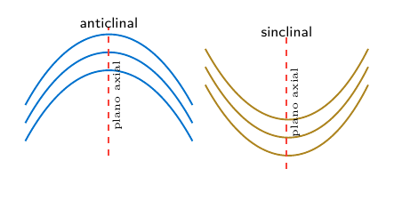

**Relação entre os termos:** anticlinal e sinclinal incluem informação sobre a idade das camadas; antiforme e sinforme descrevem somente a geometria da dobra.

*Ver também:* deformação, compressão, falha, camada, foliação, orogênese, estrutura geológica.

#### Falha

Falha é uma fratura ou zona de fraturas na qual ocorreu deslocamento relativo entre blocos rochosos. Quando existe fratura sem deslocamento perceptível, emprega-se geralmente o termo **junta** ou **diáclase**, conforme o contexto.

**Plano de falha** é a superfície ao longo da qual ocorre o deslocamento. Quando esse plano é inclinado, distinguem-se:

- **bloco do teto**, também chamado **capa**: bloco situado acima do plano de falha;

- **bloco do muro**, também chamado **lapa**: bloco situado abaixo do plano de falha.

Esses nomes descrevem a posição dos blocos em relação ao plano de falha, não a altitude atual do relevo. Portanto, *teto* não significa necessariamente a parte topograficamente mais alta.

**Rejeito** é a medida do deslocamento relativo. **Estrias de falha** são marcas produzidas pelo atrito e podem indicar a direção do movimento. A zona de falha também pode apresentar rocha triturada, como **brecha de falha**, ou material muito fino, conhecido como **gouge de falha**.

**Tipos principais**

- **Falha normal**: o bloco do teto desce em relação ao bloco do muro. Está associada principalmente a esforços distensivos. Nesse caso, o teto corresponde ao bloco relativamente rebaixado e o muro ao bloco relativamente elevado.

- **Falha reversa**: o bloco do teto sobe em relação ao bloco do muro. Está associada principalmente a esforços compressivos. Quando apresenta baixo ângulo de mergulho, pode ser chamada de **falha de empurrão** ou **cavalgamento**.

- **Falha transcorrente**: o deslocamento predominante é horizontal e paralelo à direção da falha. Pode ser **dextral** ou **direita**, quando o bloco oposto aparenta mover-se para a direita, e **sinistral** ou **esquerda**, quando aparenta mover-se para a esquerda.

- **Falha oblíqua**: combina componentes de deslocamento vertical e horizontal.

Esquema de uma falha normal: o bloco do teto desce em relação ao bloco do muro.

**Como reconhecer uma falha**

Entre os indícios estão o deslocamento de camadas, a repetição ou ausência de partes de uma sequência estratigráfica, a presença de estrias e superfícies polidas, rochas trituradas, escarpas lineares, drenagens deslocadas e contatos abruptos entre unidades geológicas. Nenhum indício isolado é necessariamente conclusivo; a interpretação deve considerar o conjunto das evidências.

**Relação entre os termos:** normal e reversa são classificadas pelo movimento do bloco do teto em relação ao muro; dextral e sinistral são classificadas pelo deslocamento horizontal aparente do bloco situado do outro lado da falha.

*Ver também:* fratura, junta, diáclase, deformação, tensão, compressão, distensão, cisalhamento.

#### Diapiro de sal

**Diapiro de sal** é um corpo de material salino que ascende e deforma as camadas sedimentares sobrejacentes. O processo ocorre porque os evaporitos, especialmente os constituídos por halita, podem apresentar comportamento dúctil ao longo do tempo geológico e fluir quando submetidos ao soterramento e a diferenças de pressão.

A ascensão do sal pode ser favorecida pela diferença de densidade entre o material salino e as rochas sedimentares mais compactadas, pela sobrecarga desigual dos sedimentos e por esforços tectônicos. Esse movimento é parte da chamada **tectônica salina** ou **halocinese**.

Termos associados:

- **evaporito**: rocha sedimentar formada pela precipitação de sais dissolvidos, geralmente em ambientes de forte evaporação;

- **halita**: mineral de composição $\mathrm{NaCl}$, principal constituinte do sal-gema;

- **camada salina**: nível evaporítico originalmente depositado entre outras camadas sedimentares;

- **domo salino**: estrutura aproximadamente dômica produzida pela ascensão do sal e pela deformação das camadas superiores;

- **parede de sal**: corpo salino alongado, com grande desenvolvimento vertical;

- **falhas associadas**: fraturas e deslocamentos que podem surgir nas camadas deformadas ao redor do corpo salino.

Esquema simplificado da ascensão de um diapiro a partir de uma camada salina soterrada.

O crescimento do diapiro pode dobrar, fraturar ou deslocar as camadas vizinhas. Essas estruturas podem influenciar a circulação de fluidos e formar armadilhas estruturais, mas a presença de um diapiro não implica, por si só, a existência de petróleo ou gás.

**Relação entre os termos:** evaporitos formam a camada salina; o fluxo e a ascensão do sal produzem o diapiro; a deformação das camadas ao redor integra a tectônica salina.

*Ver também:* evaporito, halita, sal-gema, domo salino, tectônica salina, deformação, bacia sedimentar.

#### Tectônica de placas

**Tectônica de placas** é o modelo segundo o qual a litosfera terrestre está dividida em placas rígidas que se deslocam sobre uma região mecanicamente mais dúctil do manto superior. O movimento das placas explica a distribuição global de dorsais oceânicas, fossas, cadeias de montanhas, vulcões e grande parte dos sismos.

**Litosfera** compreende a crosta e a parte superior rígida do manto. Abaixo dela encontra-se a **astenosfera**, região do manto superior que se deforma lentamente e permite o movimento relativo das placas.

**Limites principais**

- **divergente**: as placas se afastam; formam-se riftes continentais e dorsais mesoceânicas, com geração de nova litosfera oceânica;

- **convergente**: as placas se aproximam; pode ocorrer subducção de litosfera oceânica ou colisão continental;

- **transformante**: as placas deslizam lateralmente uma em relação à outra, sem criação ou destruição significativa de litosfera.

**Subducção** é o mergulho de uma placa litosférica, geralmente oceânica, sob outra placa. Está associada a fossas oceânicas, arcos vulcânicos, deformação e sismos que podem ocorrer a grandes profundidades.

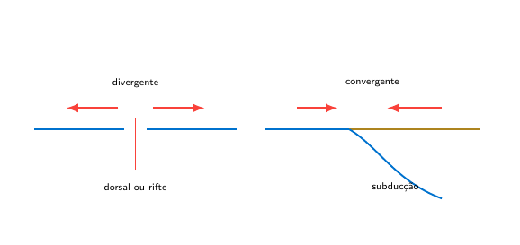

O movimento das placas é da ordem de centímetros por ano, mas sua atuação acumulada ao longo de milhões de anos produz grandes deslocamentos e reorganiza continentes e oceanos.

**Relação entre os termos:** a deriva continental descreveu o deslocamento dos continentes; a tectônica de placas forneceu o mecanismo global que integra expansão do fundo oceânico, subducção, sismos, vulcanismo e formação de montanhas.

*Ver também:* litosfera, astenosfera, dorsal mesoceânica, subducção, fossa oceânica, rifte, falha transformante, Wegener.

#### Wegener, Alfred

**Alfred Wegener (1880–1930)**

Meteorologista e geofísico alemão que formulou a hipótese da **deriva continental**. Wegener propôs que os continentes atuais estiveram reunidos em um grande continente, posteriormente fragmentado, e que os blocos continentais se deslocaram ao longo do tempo geológico.

Entre as evidências discutidas estavam:

- semelhança entre os contornos de margens continentais;

- continuidade de estruturas geológicas e cadeias de montanhas em continentes hoje separados;

- ocorrência dos mesmos fósseis terrestres ou de água doce em diferentes continentes;

- registros paleoclimáticos incompatíveis com as posições geográficas atuais, como depósitos glaciais em regiões hoje tropicais.

A hipótese enfrentou forte resistência porque Wegener não apresentou um mecanismo físico satisfatório para o deslocamento dos continentes. Décadas depois, dados do fundo oceânico, do paleomagnetismo e da sismologia contribuíram para o desenvolvimento da tectônica de placas, que explicou o movimento das placas litosféricas.

**Relação entre os termos:** Wegener reuniu evidências da mobilidade continental; a tectônica de placas, desenvolvida posteriormente, explicou essa mobilidade por meio do movimento integrado da litosfera oceânica e continental.

*Ver também:* deriva continental, Pangeia, tectônica de placas, expansão do fundo oceânico, paleomagnetismo.

#### Sismos e sismologia

**Sismo**, **terremoto** ou **abalo sísmico** é a vibração do terreno produzida pela liberação súbita de energia no interior da Terra. A causa mais comum é a ruptura ou o deslocamento rápido ao longo de uma falha, quando a tensão acumulada nas rochas supera sua resistência.

Também podem ocorrer sismos associados à atividade vulcânica, ao colapso de cavidades, a grandes movimentos de massa ou a atividades humanas. Entretanto, os sismos tectônicos são os mais importantes para o estudo da dinâmica das placas e das grandes estruturas da crosta.

**Sismologia** é o ramo da Geofísica que estuda os sismos, a propagação das ondas sísmicas e a estrutura interna da Terra. As ondas registradas permitem localizar a fonte do sismo, estimar sua magnitude e investigar as propriedades dos materiais atravessados.

**Partes e registros de um sismo**

- **hipocentro** ou **foco**: ponto no interior da Terra onde se inicia a ruptura e a liberação de energia;

- **epicentro**: ponto da superfície situado verticalmente acima do hipocentro;

- **sismômetro**: sensor que detecta e mede o movimento do terreno;

- **sismógrafo**: conjunto instrumental usado para detectar e registrar os movimentos sísmicos;

- **sismograma**: registro produzido pelo instrumento, no qual aparecem as chegadas das diferentes ondas.

Relação geométrica entre hipocentro, epicentro, falha e propagação das ondas.

**Ondas sísmicas principais**

- **ondas P**: ondas de compressão e dilatação; são as mais rápidas e propagam-se por sólidos, líquidos e gases;

- **ondas S**: ondas de cisalhamento; são mais lentas que as ondas P e não se propagam em líquidos;

- **ondas superficiais**: propagam-se próximas à superfície e frequentemente produzem movimentos de grande amplitude e muitos dos danos observados.

**Magnitude** é uma medida instrumental do tamanho do sismo e relaciona-se à energia liberada. Para sismos importantes, utiliza-se amplamente a magnitude de momento, indicada por $M_w$. A expressão “escala Richter” refere-se originalmente a uma escala de magnitude local e não designa todas as medidas modernas de magnitude.

**Intensidade sísmica** descreve os efeitos e danos observados em determinado lugar. Portanto, um mesmo sismo possui uma magnitude, mas pode apresentar diferentes intensidades conforme a distância ao epicentro, a profundidade do foco, o tipo de terreno e a vulnerabilidade das construções.

Um sismo submarino pode gerar um **tsunami** quando provoca deslocamento significativo e rápido do fundo marinho e da coluna d’água. Nem todo sismo oceânico produz tsunami: o mecanismo da falha, a profundidade e a deformação vertical do fundo são fatores decisivos.

**Relação entre os termos:** a ruptura começa no hipocentro; o epicentro é sua projeção na superfície; a energia propaga-se por ondas sísmicas; o sismômetro registra o movimento; magnitude mede o tamanho do evento e intensidade descreve seus efeitos locais.

*Ver também:* falha, placas tectônicas, ondas P, ondas S, epicentro, hipocentro, magnitude, intensidade, tsunami, Geofísica.

#### Falhas lístricas, grábens e falhas de crescimento

Falhas lístricas possuem superfície curva, geralmente com diminuição do mergulho em profundidade. Em bacias extensionais, falhas normais podem delimitar grábens e semigrábens. Quando o deslocamento ocorre simultaneamente à deposição e produz variação sistemática da espessura dos estratos, usa-se o termo **falha de crescimento** [[fossen2016](Referencias.md#fossen2016)].

#### Exemplo: Bacia do Recôncavo

A Bacia do Recôncavo integra o sistema rifte Recôncavo–Tucano–Jatobá, desenvolvido durante a ruptura continental relacionada à abertura do Atlântico Sul. Seu arcabouço apresenta blocos assimétricos controlados predominantemente por falhas normais. A Falha de Salvador limita a bacia a leste, enquanto a Falha de Maragogipe integra seu limite ocidental. O preenchimento registra sistemas continentais, especialmente lacustres, fluviais e deltaicos [[anp_reconcavo](Referencias.md#anp_reconcavo); [magnavita2005](Referencias.md#magnavita2005)].

Esse exemplo mostra a relação entre:

$$\begin{gathered}
\text{extensão crustal}
\rightarrow
\text{falhamento normal}
\rightarrow
\text{subsidência}
\\[-0.2em]
\rightarrow
\text{criação de acomodação}
\rightarrow
\text{preenchimento sedimentar}.
\end{gathered}$$

#### Exemplo: estruturas do estado do Rio de Janeiro

O mapa geológico estadual registra estruturas de diferentes naturezas e idades, incluindo falhas, zonas de cisalhamento e lineamentos que afetam o embasamento e as coberturas sedimentares. Sua interpretação exige distinguir estruturas antigas do Cinturão Ribeira de reativações posteriores relacionadas à evolução da margem continental e do relevo do Sudeste. Assim, uma direção cartográfica semelhante não prova, por si só, que duas falhas tenham a mesma idade ou cinemática [[heilbron2016](Referencias.md#heilbron2016); [fossen2016](Referencias.md#fossen2016)].

### 12. Guia de estudos e revisão

#### Como estudar esta matéria

Em vez de memorizar listas isoladas, acompanhe o caminho do material sedimentar:

$$\boxed{
\begin{gathered}
\text{rocha-fonte}
\rightarrow
\text{intemperismo}
\rightarrow
\text{erosão e transporte}
\\
\rightarrow
\text{deposição}
\rightarrow
\text{diagênese}
\rightarrow
\text{rocha sedimentar}
\end{gathered}
}$$

Para cada etapa, procure responder: *qual é o processo, qual é o agente, qual produto é gerado e que evidência fica preservada?*

#### Resumo dos processos

| **Etapa**        | Processo principal                                  | Produto ou registro                        |
|:-----------------|:----------------------------------------------------|:-------------------------------------------|
| **Intemperismo** | Desagregação e decomposição da rocha                | Clastos, argilominerais e íons dissolvidos |
| **Erosão**       | Remoção do material da área-fonte                   | Disponibilização de sedimento              |
| **Transporte**   | Tração, saltação, suspensão e solução               | Seleção, abrasão e orientação              |
| **Deposição**    | Perda de competência/capacidade ou precipitação     | Camadas e formas de leito                  |
| **Diagênese**    | Compactação, cimentação e reações pós-deposicionais | Litificação e modificação dos poros        |

Relações fundamentais do sistema sedimentar.

#### Distinções que não devem ser confundidas

| **Par**                                    | Primeiro conceito                      | Segundo conceito                          |
|:-------------------------------------------|:---------------------------------------|:------------------------------------------|
| **Intemperismo/erosão**                    | Altera a rocha no local                | Remove o material                         |
| **Competência/capacidade**                 | Maior tamanho transportável            | Quantidade total transportável            |
| **Arredondamento/esfericidade**            | Curvatura de arestas e vértices        | Aproximação da forma a uma esfera         |
| **Matriz/cimento**                         | Material detrítico fino                | Precipitado diagenético                   |
| **Porosidade/permeabilidade**              | Volume de vazios                       | Conectividade para o fluxo                |
| **Bacia de sedimentação/bacia sedimentar** | Local atual de deposição               | Unidade geológica subsidente e preenchida |
| **Fácies/ambiente**                        | Conjunto observável de características | Interpretação genética                    |

Conceitos próximos, mas diferentes.

#### Perguntas de revisão

1.  Qual é a diferença entre intemperismo físico e químico?

2.  Por que a água é importante no intemperismo químico?

3.  Que relação geral existe entre as séries de Bowen e Goldich?

4.  Diferencie erosão, transporte e deposição.

5.  Diferencie competência e capacidade de um fluxo.

6.  Quais são os quatro modos fundamentais de transporte sedimentar?

7.  Por que argilas exigem maior velocidade para serem erodidas do que alguns grãos de areia?

8.  O que significam $\mathrm{Fr}<1$ e $\mathrm{Fr}>1$?

9.  Diferencie seleção, arredondamento e esfericidade.

10. Quais são os limites fundamentais de cascalho, areia, silte e argila?

11. Diferencie conglomerado clasto-suportado e matriz-suportado.

12. Qual é a diferença entre arenita e wacke?

13. O que representam os polos Q, F e L?

14. Diferencie matriz e cimento.

15. Quais processos fazem parte da diagênese?

16. Como distinguir ripple de corrente e ripple de onda?

17. O que uma estratificação espinha de peixe pode indicar?

18. Por que fácies e ambiente deposicional não são sinônimos?

19. Como soerguimento e subsidência participam do sistema sedimentar?

20. O que uma discordância representa no registro geológico?

#### Respostas resumidas

1.  O físico desagrega sem mudança mineralógica dominante; o químico transforma ou dissolve minerais.

2.  Ela atua como solvente, reagente e meio de transporte de íons.

3.  Minerais que cristalizam em temperaturas mais altas tendem a ser menos estáveis na superfície.

4.  Erosão remove, transporte desloca e deposição acumula.

5.  Competência refere-se ao tamanho máximo; capacidade, à quantidade total.

6.  Tração, saltação, suspensão e solução.

7.  Devido à coesão eletroquímica entre partículas finas.

8.  Fluxo subcrítico e supercrítico, respectivamente.

9.  Dispersão de tamanhos; curvatura das arestas; forma global.

10. 2 mm, 0.0625 mm e 0.0039 mm.

11. No primeiro os clastos se tocam; no segundo ficam dispersos na matriz.

12. A diferença principal é a proporção de matriz fina.

13. Quartzo, feldspatos e fragmentos líticos.

14. Matriz é detrítica; cimento é precipitado durante a diagênese.

15. Compactação, cimentação, dissolução, recristalização e substituição.

16. O de corrente tende a ser assimétrico; o de onda tende a ser simétrico.

17. Reversão periódica das correntes, comum em sistemas de maré.

18. Fácies é descrição; ambiente é interpretação.

19. Soerguimento favorece exposição e erosão; subsidência cria acomodação.

20. Um intervalo de não deposição e/ou erosão, isto é, tempo ausente.

## Parte II — Laboratório

### L1. Roteiro de descrição de amostras e afloramentos

Na descrição de uma amostra, registrar primeiro o que é diretamente observável e depois a interpretação. Separar, por exemplo, “clastos angulosos, mal selecionados e dispersos em matriz” de uma hipótese sobre o agente de transporte.

O roteiro abaixo é uma proposta de organização deste caderno. Não representa uma ficha oficial fornecida pelo professor nem um registro de ensaio já realizado.

| Campo | Registro |
| --- | --- |
| Identificação | Código da amostra, data e procedência, se conhecida |
| Estado e superfície | Consolidada ou inconsolidada; superfície fresca ou alterada |
| Composição | Minerais, litologias dos clastos, fósseis ou bioclastos observados |
| Granulometria | Tamanhos presentes e fração predominante |
| Textura | Seleção, arredondamento, esfericidade, matriz, cimento e suporte |
| Estruturas | Estratificação, laminação, gradação, marcas, deformações ou bioturbação |
| Nome descritivo | Nome sustentado pelos critérios observados |
| Interpretação | Hipóteses sobre origem, transporte e deposição, com suas evidências |
| Dúvidas | Características não determinadas e verificações necessárias |

#### Observação em afloramento

**Afloramento** é uma exposição de rocha ou de sedimento consolidado na superfície terrestre, permitindo sua observação direta. Pode ser natural, como em falésias, margens de rios, encostas e leitos rochosos, ou artificial, como em cortes de estrada, pedreiras, túneis e escavações.

Grande parte do substrato rochoso encontra-se coberta por solo, vegetação, depósitos recentes ou água. Por isso, os afloramentos funcionam como “janelas” que permitem reconhecer as unidades geológicas e interpretar sua distribuição em subsuperfície.

Em um afloramento podem ser descritos:

- tipo, composição e textura da rocha;

- espessura, geometria e orientação das camadas;

- contatos entre unidades;

- dobras, falhas, juntas e fraturas;

- fósseis e estruturas sedimentares;

- intensidade e produtos do intemperismo.

A interpretação deve considerar que um afloramento mostra apenas uma parte da unidade geológica. A continuidade das camadas entre exposições separadas é estabelecida por correlação de campo, mapas, perfis, sondagens e métodos geofísicos.

**Relação entre os termos:** afloramento é a porção observável de uma unidade geológica; formação ou corpo rochoso é a unidade tridimensional que pode continuar além da área exposta.

*Ver também:* camada, contato geológico, formação, perfil geológico, trabalho de campo, intemperismo.

#### Sequência de descrição recuperada do guia anterior

Siga sempre a mesma sequência:

1.  determine a classe granulométrica dominante;

2.  estime a distribuição das frações cascalho, areia e lama;

3.  descreva o grau de seleção;

4.  descreva arredondamento e esfericidade separadamente;

5.  reconheça arcabouço, matriz, cimento e poros;

6.  identifique quartzo, feldspatos e fragmentos líticos;

7.  observe cor, estruturas e fósseis;

8.  atribua o nome da rocha;

9.  somente depois proponha processos e ambiente deposicional.

### L2. Granulometria, seleção e escala de Wentworth

#### Tamanho, seleção e forma

**Granulometria** é o estudo e a medição do tamanho das partículas que constituem um sedimento ou uma rocha sedimentar clástica. A distribuição dos tamanhos dos grãos ajuda a descrever o material e a interpretar os processos de transporte, seleção e deposição.

Os limites entre cascalho, areia, silte e argila são definidos por escalas granulométricas. Em sedimentologia, a escala de Udden–Wentworth é uma das mais utilizadas.

**Características relacionadas, mas diferentes**

- **tamanho do grão**: dimensão da partícula, expressa geralmente em milímetros ou micrômetros;

- **seleção granulométrica**: grau de uniformidade dos tamanhos. Um sedimento bem selecionado apresenta pequena variação; um sedimento mal selecionado reúne partículas de tamanhos muito diferentes;

- **arredondamento**: grau de suavização das arestas e dos vértices dos grãos;

- **esfericidade**: proximidade da forma do grão em relação a uma esfera.

Arredondamento e esfericidade descrevem a forma, não o tamanho, e portanto não são medidas granulométricas propriamente ditas.

A análise pode ser feita por **peneiramento** nas frações mais grossas. Para partículas muito finas, podem ser empregados métodos baseados na velocidade de sedimentação, pipetagem, hidrômetro ou difração a laser. Os resultados são normalmente apresentados como porcentagens por classe, histogramas ou curvas granulométricas acumuladas.

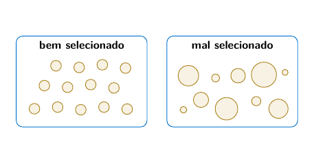

A seleção descreve a dispersão dos tamanhos presentes na amostra.

**Relação entre os termos:** granulometria descreve o tamanho e sua distribuição; seleção indica a uniformidade dos tamanhos; arredondamento e esfericidade descrevem a forma dos grãos.

*Ver também:* escala de Wentworth, cascalho, areia, silte, argila, seleção, transporte sedimentar.

#### Escala de Wentworth

A **escala de Wentworth**, também chamada de **escala de Udden–Wentworth**, classifica e descreve sedimentos clásticos segundo o diâmetro das partículas. Seus limites seguem, em grande parte, uma progressão por fatores de dois, permitindo separar classes granulométricas de forma padronizada.

| **Classe**                   | **Diâmetro aproximado**                 |
|:-----------------------------|:----------------------------------------|
| Matacão ou bloco (*boulder*) | $\geq$ 256 mm                           |
| Calhau (*cobble*)            | 64 mm a $<$256 mm               |
| Seixo (*pebble*)             | 4 mm a $<$64 mm                 |
| Grânulo (*granule*)          | 2 mm a $<$4 mm                  |
| Areia muito grossa           | 1 mm a $<$2 mm                  |
| Areia grossa                 | 0.5 mm a $<$1 mm                |
| Areia média                  | 0.25 mm a $<$0.5 mm             |
| Areia fina                   | 0.125 mm a $<$0.25 mm           |
| Areia muito fina             | 0.0625 mm a $<$0.125 mm         |
| Silte                        | aprox. 0.0039 mm a $<$0.0625 mm |
| Argila                       | $<$0.0039 mm                    |

De forma agrupada:

- **cascalho**: partículas com diâmetro igual ou superior a aproximadamente 2 mm;

- **areia**: de aproximadamente 0.0625 mm a menos de 2 mm;

- **silte**: de aproximadamente 0.0039 mm a menos de 0.0625 mm;

- **argila**: partículas menores que aproximadamente 0.0039 mm.

Os equivalentes em português podem variar entre autores e áreas profissionais. Por isso, em descrições técnicas, os limites numéricos devem acompanhar a nomenclatura. A escala descreve o tamanho: não determina por si só a composição mineral, a origem ou o ambiente de deposição.

**Relação entre os termos:** a escala de Wentworth fornece nomes padronizados para faixas de tamanho; granulometria mede a distribuição dessas faixas em uma amostra.

*Ver também:* granulometria, cascalho, areia, silte, argila, seleção, rocha sedimentar clástica.

#### Escala phi

Na escala phi, usada em sedimentologia, o tamanho é expresso por

$$\phi=-\log_2 d,$$

em que $d$ é o diâmetro da partícula em milímetros. Assim, valores maiores de $\phi$ representam partículas menores.

#### Arredondamento e esfericidade — escala de Powers

**Arredondamento** e **esfericidade** descrevem propriedades diferentes:

- o **arredondamento** avalia a curvatura das arestas e dos vértices;

- a **esfericidade** avalia quanto a forma geral do grão se aproxima de uma esfera.

Um grão pode, portanto, ser bem arredondado e apresentar baixa esfericidade. A escala visual de Powers distingue seis classes de arredondamento: muito angular, angular, subangular, subarredondado, arredondado e bem arredondado [[powers1953](Referencias.md#powers1953)].

#### Arcabouço, matriz, cimento e poros

Na descrição textural de uma rocha siliciclástica devem ser reconhecidos:

- **arcabouço**: conjunto dos grãos que formam a estrutura principal;

- **matriz**: material detrítico mais fino depositado entre os grãos;

- **cimento**: mineral precipitado durante a diagênese;

- **poros**: espaços vazios que podem armazenar fluidos.

Matriz e cimento não são sinônimos: a matriz é deposicional ou sinsedimentar, enquanto o cimento se forma por precipitação diagenética.

#### Exemplo de descrição textural

Uma amostra composta por aproximadamente 80% de areia fina, 10% de areia média e 10% de grânulos apresenta predomínio de areia fina, mas contém uma fração grossa relevante. A presença simultânea dessas classes sugere seleção baixa a moderada. A descrição deve ser completada com arredondamento, esfericidade, tipo de suporte, proporção de matriz e composição mineralógica, por exemplo, predomínio de quartzo e feldspato.

#### Figura original de Wentworth — pendência

A figura enviada apresenta valores diferentes do quadro do glossário em algumas classes. Ela foi preservada em `Pendencias.md` para conferência. Use o quadro numérico desta seção como convenção de trabalho até a revisão.

### L3. Conglomerados, brechas e outras rochas grossas

#### Terminologia fundamental

As rochas sedimentares clásticas são descritas, entre outros critérios, pelo tamanho, pela forma e pela composição de seus grãos. Na fração mais grossa, os fragmentos com diâmetro superior a 2 mm recebem o nome de *clastos* de tamanho cascalho. A rocha que os contém também pode apresentar partículas menores, chamadas *matriz*, e material precipitado posteriormente entre os grãos, chamado *cimento*. Matriz e cimento, portanto, não são sinônimos: a primeira é uma fração sedimentar; o segundo se forma durante a diagênese [[mit2007siliciclastic](Referencias.md#mit2007siliciclastic) — referência pendente; [uspconglomerado](Referencias.md#uspconglomerado) — referência pendente].

##### Ruditos

*Rudito* é um termo abrangente para rochas sedimentares constituídas por uma fração grossa, de tamanho cascalho. Nesse sentido, conglomerados e brechas pertencem ao grupo dos ruditos. O termo informa a granulometria geral, mas, sozinho, não especifica se os clastos são arredondados, qual é sua composição ou como a rocha foi depositada [[folk1970detrital](Referencias.md#folk1970detrital) — referência pendente; [kgsclassificacao](Referencias.md#kgsclassificacao) — referência pendente].

##### Conglomerados e brechas

O *conglomerado* apresenta clastos grossos predominantemente arredondados ou subarredondados. Quando predominam fragmentos angulosos, emprega-se *brecha*. O arredondamento costuma aumentar com o desgaste durante o transporte, mas sua interpretação depende também da resistência dos fragmentos e do processo sedimentar. Assim, a forma dos clastos fornece uma pista sobre a história da rocha, sem determinar, por si só, uma distância de transporte [[uspconglomerado](Referencias.md#uspconglomerado) — referência pendente; [kgsclassificacao](Referencias.md#kgsclassificacao) — referência pendente].

##### Diamictitos

*Diamictito* designa uma rocha litificada muito mal selecionada, na qual fragmentos de tamanhos variados ocorrem em uma matriz mais fina. É um termo sobretudo *descritivo*: reconhecer um diamictito não basta para afirmar que sua origem foi glacial. Depósitos produzidos por fluxos gravitacionais de detritos, por exemplo, também podem apresentar clastos dispersos em matriz abundante [[mit2007siliciclastic](Referencias.md#mit2007siliciclastic) — referência pendente].

##### Tilitos

*Tilito* é o *till* glacial litificado. Ao contrário de “diamictito”, o nome implica uma interpretação genética: o sedimento foi depositado diretamente pela geleira. A má seleção granulométrica, isoladamente, não estabelece essa origem. A interpretação deve considerar o conjunto de evidências, como clastos facetados ou estriados, superfícies de abrasão glacial e as relações com as camadas vizinhas [[kgsclassificacao](Referencias.md#kgsclassificacao) — referência pendente; [trosdtorf2005glacial](Referencias.md#trosdtorf2005glacial) — referência pendente].

Em resumo, *rudito* destaca a granulometria; *conglomerado* e *brecha* distinguem principalmente o arredondamento dos clastos; *diamictito* descreve uma mistura muito mal selecionada; e *tilito* identifica uma interpretação glacial específica.

#### Classificação pela procedência dos clastos

A procedência diz respeito ao lugar de onde vieram os fragmentos grossos em relação ao ambiente em que a rocha se acumulou.

##### Conglomerados intraformacionais

São formados por clastos derivados de sedimentos da própria área de deposição, frequentemente arrancados e redepositados pouco tempo depois de sua acumulação inicial. Um exemplo é a erosão de uma camada de lama ainda pouco consolidada por uma corrente mais forte: os fragmentos dessa lama são transportados e incorporados a uma nova camada. Clastos arrancados de camadas carbonáticas recentes podem formar um conglomerado intraformacional carbonático. A semelhança entre os clastos e as camadas próximas, assim como sinais de erosão e redeposição local, ajuda a reconhecer essa origem [[mit2007siliciclastic](Referencias.md#mit2007siliciclastic) — referência pendente].

##### Conglomerados extraformacionais

Contêm clastos provenientes de rochas preexistentes de uma área fonte externa ao local de deposição. Um rio, por exemplo, pode transportar fragmentos de granito, quartzito e outras rochas das áreas elevadas até uma bacia sedimentar. Para interpretar a procedência, comparam-se as litologias dos clastos com as rochas expostas na região e com a sucessão sedimentar que os contém [[mit2007siliciclastic](Referencias.md#mit2007siliciclastic) — referência pendente].

Essa classificação responde à pergunta *“de onde vieram os clastos?”*. Ela não responde, necessariamente, quantos tipos diferentes de clastos existem na rocha.

#### Classificação pela variedade dos clastos

Nesta classificação, observa-se a composição dos fragmentos que formam o arcabouço grosso, especialmente suas litologias. O critério deve ser aplicado aos *clastos*, e não à soma de clastos, matriz e cimento.

##### Conglomerados monomíticos

Apresentam clastos de essencialmente uma única litologia. Um conglomerado cujos seixos são quase todos de quartzito, por exemplo, pode ser descrito como monomítico. A expressão não significa que cada seixo seja composto de um único mineral: *quartzito* designa aqui o tipo de rocha de origem dos clastos.

##### Conglomerados oligomíticos

Possuem baixa diversidade de tipos de clastos. Em algumas classificações sedimentológicas, o termo é empregado para conglomerados dominados por poucos componentes resistentes, como quartzo de veio, quartzito e sílex [[mit2007siliciclastic](Referencias.md#mit2007siliciclastic) — referência pendente]. Nem todos os autores separam *oligomítico* e *monomítico* da mesma maneira; por isso, uma descrição de campo deve registrar quais litologias foram efetivamente observadas.

##### Conglomerados polimíticos

Reúnem vários tipos de rocha entre os clastos. Um conjunto de seixos de granito, basalto, quartzito e arenito, por exemplo, é polimítico. A diversidade pode refletir a erosão de diferentes unidades geológicas na área fonte, mas a reconstituição dessa área exige observar também o contexto regional e as demais características do depósito [[kgsclassificacao](Referencias.md#kgsclassificacao) — referência pendente].

É possível, portanto, descrever uma rocha como *extraformacional e polimítica*: o primeiro termo informa a procedência, e o segundo informa a diversidade litológica dos clastos.

#### Classificação pela relação entre matriz e arcabouço

O *arcabouço* é formado pelos clastos grossos. A *matriz* é o material sedimentar mais fino presente entre eles. Uma pergunta útil na descrição é: *os clastos grossos se tocam e sustentam uns aos outros, ou parecem dispersos em uma massa de material fino?*

##### Ortoconglomerados

São conglomerados em que os clastos grossos constituem um arcabouço em contato, com relativamente pouca matriz. Numa classificação apresentada nas notas de Geologia Sedimentar do MIT, a matriz ocupa menos de aproximadamente 15 % do volume da rocha [[mit2007siliciclastic](Referencias.md#mit2007siliciclastic) — referência pendente]. A observação do contato entre os clastos ajuda a descrever sua textura, enquanto a proporção de matriz explicita o limite adotado nessa classificação.

##### Paraconglomerados

Apresentam matriz mais abundante. Frequentemente os clastos grossos ficam separados uns dos outros e parecem “flutuar” na matriz, que então sustenta o depósito. Na mesma classificação, o limite indicado é superior a aproximadamente 15 % de matriz [[mit2007siliciclastic](Referencias.md#mit2007siliciclastic) — referência pendente]. Como diferentes materiais didáticos dão ênfase ora à proporção, ora ao suporte dos clastos, convém registrar as duas observações: *percentual aproximado de matriz* e *tipo de suporte*. Um paraconglomerado muito mal selecionado pode também ser descrito como diamictito, desde que o termo represente adequadamente sua textura.

A relação entre arcabouço e matriz pode ajudar a investigar o processo de deposição. Um depósito sustentado por matriz, por exemplo, pode resultar de um fluxo gravitacional de detritos em ambiente continental ou subaquoso. Contudo, a textura isolada não prova esse mecanismo: estruturas sedimentares, geometria das camadas e associação com outras fácies também precisam ser examinadas [[mit2007siliciclastic](Referencias.md#mit2007siliciclastic) — referência pendente].

#### Como combinar as classificações

Os critérios anteriores descrevem aspectos diferentes da mesma rocha e podem ser usados em conjunto. Considere uma amostra com seixos arredondados de granito, basalto e quartzito, transportados de uma área fonte externa e dispersos em uma matriz arenosa abundante. Uma descrição possível seria: *conglomerado extraformacional, polimítico e sustentado por matriz*. Se a rocha atender ao critério textural adotado para paraconglomerados, esse nome poderá ser acrescentado.

Ao descrever uma amostra real, é recomendável registrar primeiro as características diretamente observáveis — tamanho, forma e litologia dos clastos, seleção, matriz e tipo de suporte — e depois apresentar as interpretações sobre procedência e processo de deposição.

#### Misturas de cascalho, areia e lama — diagrama triangular

Nos conglomerados **clasto-suportados**, os clastos grossos se tocam e formam a estrutura resistente da rocha. Nos conglomerados **matriz-suportados**, os clastos ficam dispersos em uma matriz mais fina. Os termos *ortoconglomerado* e *paraconglomerado* são usados, respectivamente, para esses dois arranjos, embora a descrição direta do tipo de suporte seja mais clara [[nichols2009](Referencias.md#nichols2009)].

Uma denominação textural mais completa considera as proporções relativas de cascalho, areia e lama. Assim, podem ocorrer termos como conglomerado arenoso, conglomerado lamoso, arenito conglomerático e pelito conglomerático. O nome deve indicar primeiro a fração subordinada e, por último, a fração dominante.

O diagrama da Figura triangular permite determinar essa denominação a partir das porcentagens de cascalho, areia e lama.

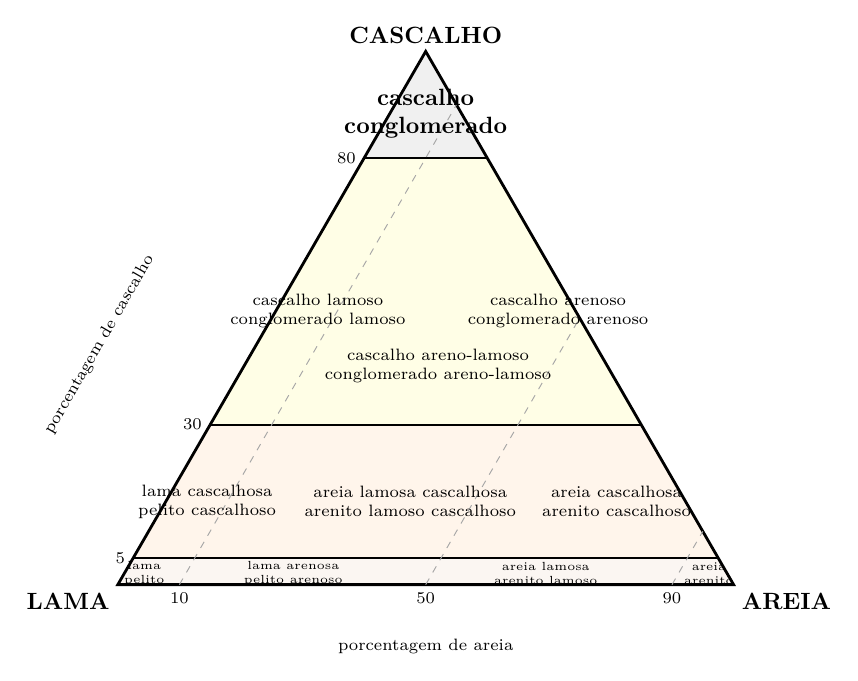 *Diagrama triangular de cascalho, areia e lama. Fonte indicada no original: Nichols (2009), chave nichols2009.*

> **Limites de classificação a conferir com o material de aula:** no triângulo fornecido, as faixas de cascalho são 5%, 30% e 80%. Os limites e os nomes dos campos foram preservados do código enviado; a correspondência com a figura publicada ainda precisa ser verificada. A seção detalhada distingue teor de matriz de tipo de suporte; a versão curta do ZIP associa diretamente orto/paraconglomerado ao suporte.

#### Imbricação

Clastos alongados ou achatados podem apresentar orientação preferencial, denominada **imbricação**. Quando interpretada juntamente com a geometria do depósito e outras estruturas, essa orientação pode fornecer a direção da paleocorrente.

#### Exercícios do caderno — cascalho, areia e lama

Usar o triângulo desta seção. Os percentuais foram transcritos da página 5; “fração grossa” foi interpretada como cascalho para esta aplicação, e essa equivalência deve ser conferida com o enunciado de aula.

| Exercício | Areia | Lama | Fração grossa |
|---|---:|---:|---:|
| I | 90% | 0% por diferença | 10% |
| II | 60% | 30% | 10% |
| III | 10% | 75% | 15% |

Para cada caso: conferir a soma de 100%; localizar o ponto; ler o campo e registrar o nome conforme o diagrama adotado. Explicar qual fração domina e quais são subordinadas. O gabarito nominal permanece pendente porque a lista manuscrita de campos não está inteiramente clara.

#### Feições dos clastos — complemento da descrição

Além de seleção, arredondamento e esfericidade, registrar **facetas, cavidades, achatamento e estrias**. Desenhar a feição e indicar em quantos clastos ela ocorre. Essas observações podem ajudar a investigar transporte e alteração, mas não devem ser transformadas diretamente em um diagnóstico de origem glacial ou eólica. A página 10 do caderno é a fonte deste acréscimo.

### L4. Arenitos: composição Q–F–L e teor de matriz — prisma

A classificação petrográfica dos arenitos utiliza a composição dos grãos do arcabouço e a proporção de matriz. Os três polos composicionais usuais são:

- **Q**: quartzo;

- **F**: feldspatos;

- **L**: fragmentos líticos.

No esquema adotado por Nichols, baseado em classificações clássicas, uma rocha com menos de aproximadamente 15% de matriz é uma **arenita**; entre aproximadamente 15% e 75% de matriz, é uma **wacke**. A composição Q–F–L permite subdividir as arenitas em quartzoarenitos, subarcóseos, arcóseos, sublitoarenitos e litoarenitos; as wackes podem ser quartzosas, feldspáticas ou líticas [[dott1964](Referencias.md#dott1964); [nichols2009](Referencias.md#nichols2009)].

A Figura prismático reúne os dois critérios em um único esquema tridimensional: a posição ao longo do prisma representa o teor de matriz, enquanto cada face triangular representa as proporções normalizadas de Q, F e L.

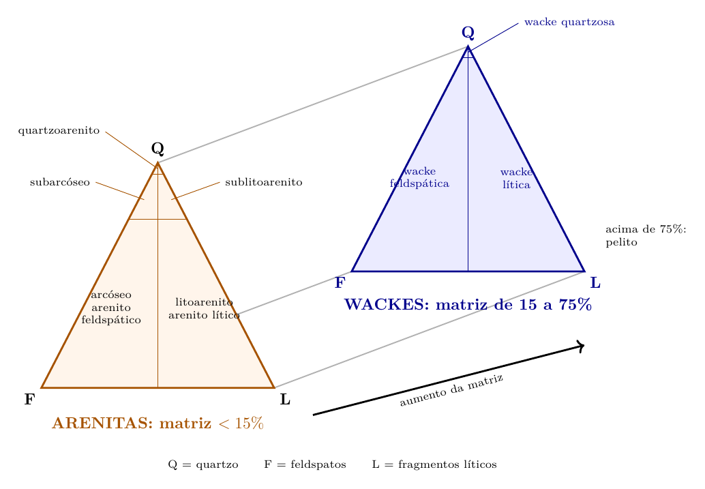 *Prisma de classificação Q–F–L e proporção de matriz. Fonte indicada no original: Pettijohn, conforme Nichols (2009), chave nichols2009.*

> **Diagrama esquemático:** os campos e os limites foram mantidos do código enviado; os rótulos foram reposicionados para facilitar a leitura. Conferir com a figura usada pelo professor antes de aplicar a classificação a casos próximos dos limites.

### L5. Pelitos e maturidade sedimentar

#### Pelitos

O termo **pelito** abrange rochas siliciclásticas de granulação fina. Conforme a fração dominante e a fissilidade, podem ser usados os termos:

- **siltito**: predomínio de partículas do tamanho silte;

- **argilito**: predomínio da fração argila, sem fissilidade marcante;

- **lamito**: mistura de silte e argila;

- **folhelho**: rocha fina com fissilidade, isto é, tendência a se separar em lâminas aproximadamente paralelas à estratificação.

#### Maturidade textural e composicional

A **maturidade textural** é avaliada principalmente pela quantidade de matriz, pelo grau de seleção e pelo arredondamento. A **maturidade composicional** expressa a proporção de componentes estáveis, sobretudo quartzo, em relação a componentes menos estáveis, como feldspatos e determinados fragmentos líticos. As duas maturidades são relacionadas à história sedimentar, mas não devem ser tratadas como sinônimos.

### L6. Identificação mineral: cor, traço e propriedades associadas

**Cor** é a aparência produzida pela interação da luz com o mineral. Ela pode resultar dos elementos essenciais de sua composição, de pequenas impurezas, de defeitos na estrutura cristalina ou de alterações superficiais.

Alguns minerais apresentam cor relativamente característica. Outros, como quartzo, calcita e fluorita, podem ocorrer em várias cores. Por isso, a cor deve ser usada em conjunto com propriedades como brilho, dureza, clivagem, hábito, densidade, magnetismo e traço.

**Traço** é a cor do pó produzido quando o mineral é esfregado sobre uma placa de porcelana não vitrificada. Em muitos minerais metálicos, o traço é mais constante e diagnóstico que a cor externa. A hematita, por exemplo, pode parecer cinza-metálica ou avermelhada, mas apresenta traço vermelho a castanho-avermelhado; a magnetita apresenta traço preto.

**Cores frequentemente observadas**

| **Cor comum**                    | **Exemplos e observações**                                                             |
|:---------------------------------|:---------------------------------------------------------------------------------------|
| Incolor ou branca                | quartzo, calcita, feldspatos e gipsita podem apresentar essas cores                    |
| Cinza ou prateada                | galena, grafita e muscovita apresentam tons cinzentos ou prateados                     |
| Preta ou verde-escura            | magnetita, biotita, anfibólios e alguns piroxênios                                     |
| Vermelha ou castanho-avermelhada | hematita e variedades de coríndon; óxidos de ferro podem colorir outros minerais       |
| Amarela ou amarelo-latão         | enxofre nativo, ouro e pirita, esta última com aspecto metálico                        |
| Verde                            | olivina, malaquita, clorita e algumas variedades de outros minerais                    |
| Azul                             | azurita e sodalita; quartzo e outros minerais também podem apresentar variedades azuis |
| Violeta                          | ametista, variedade violeta de quartzo                                                 |

Os exemplos indicam cores frequentes, não regras absolutas. Superfícies alteradas também podem mascarar a cor original; quando possível, a observação deve ser feita em uma superfície fresca.

**Relação entre os termos:** cor é a aparência da superfície; traço é a cor do pó. A identificação segura depende da combinação de várias propriedades físicas.

*Ver também:* mineral, traço, brilho, dureza, clivagem, hematita, magnetita, quartzo.

> A antiga tabela que associa cores diretamente a causas foi separada em `Pendencias.md`. Ela precisa ser contextualizada antes de voltar ao material de estudo.

### L7. Reconhecimento de estruturas sedimentares

**Estruturas sedimentares** são feições produzidas durante ou logo após a deposição dos sedimentos. Elas registram condições de fluxo, direção de transporte, variações de energia, exposição subaérea, ação de organismos e deformações ocorridas antes da litificação completa.

Entre as estruturas mais comuns estão:

- **estratificação**: organização do depósito em camadas;

- **laminação**: divisão em lâminas muito finas;

- **estratificação cruzada**: conjuntos de lâminas inclinadas formados pela migração de dunas, ripples ou barras;

- **marcas onduladas**: cristas e depressões produzidas pela ação de correntes ou ondas;

- **gradação**: variação vertical sistemática do tamanho dos grãos, frequentemente do mais grosso na base para o mais fino no topo;

- **gretas de dessecação**: fraturas poligonais geradas pela retração de lama exposta e ressecada;

- **bioturbação**: perturbação do sedimento pela atividade de organismos.

Algumas estruturas permitem reconhecer o **topo e a base** de uma camada, informação importante quando as rochas foram inclinadas ou dobradas. Outras podem indicar paleocorrentes e ajudar a reconstruir o ambiente deposicional.

**Relação entre os termos:** a textura descreve os constituintes e sua organização; a estrutura sedimentar registra formas e arranjos produzidos principalmente durante ou logo após a deposição.

*Ver também:* camada, laminação, paleocorrente, ambiente sedimentar, fácies, deposição, bioturbação.

Para cada estrutura, registrar forma, dimensões, posição na camada e relação com as estruturas vizinhas. A explicação dos processos está no capítulo 9 da teoria. Ainda faltam as fotografias das amostras e as notas manuscritas das práticas.

#### Quadro de estruturas e interpretações possíveis

| **Estrutura**                  | Interpretação possível                                  |
|:-------------------------------|:--------------------------------------------------------|
| **Estratificação cruzada**     | Migração de formas de leito e paleocorrente             |
| **Ripple assimétrico**         | Corrente predominantemente unidirecional                |
| **Ripple simétrico**           | Movimento oscilatório por ondas                         |
| **Gradação normal**            | Redução da energia durante a deposição                  |
| **Gretas de dessecação**       | Exposição subaérea e perda de água                      |
| **Marcas de sola**             | Erosão do substrato e possível sentido de fluxo         |
| **Flaser/wavy/lenticular**     | Alternância de transporte de areia e decantação de lama |
| **Hummocky/swaley**            | Fluxo combinado relacionado a tempestades               |
| **Imbricação**                 | Orientação de clastos e possível paleocorrente          |
| **Bioturbação**                | Atividade de organismos no substrato                    |
| **Estruturas de carga/escape** | Instabilidade e movimentação de sedimento saturado      |

Estruturas e informações que podem fornecer.

Uma estrutura isolada raramente determina um ambiente. A interpretação deve combinar litologia, granulometria, geometria, contatos, paleocorrentes, fósseis e associação de fácies.

### L8. Descrição e classificação de rochas carbonáticas

Consultar a definição dos componentes no capítulo 8. O objetivo aqui é reconhecer observáveis e aplicar critérios de classificação. Alguns componentes exigem lupa ou lâmina petrográfica; registrar “não determinado” quando a escala de observação não permite distingui-los.

#### Sequência de descrição

| Etapa | Registro |
|---|---|
| Identificação | Código da amostra, local/procedência e método de observação |
| Aspecto | Cor em superfície fresca, alteração, estruturas e fissuras |
| Grãos | Tipos, tamanho, forma, preservação interna e proporções estimadas |
| Matriz | Presença e proporção de material carbonático fino |
| Suporte | Grãos em contato ou dispersos na matriz |
| Cimento/poros | Distribuição, forma, preenchimento e relação com os componentes |
| Modificações | Recristalização, substituição, dissolução ou outros indícios |
| Classificação | Nome e critério usado; indicar limites de observação |
| Interpretação | Hipótese de deposição e evidências a favor, separada da descrição |

#### Classificação de Folk — aplicação inicial

Folk combina o tipo de grão e o material intersticial. A tabela abaixo apresenta exemplos de nomenclatura, não o diagrama completo com todos os seus limiares:

| Grão predominante | Com matriz micrítica | Com cimento esparítico |
|---|---|---|
| Bioclastos | Biomicrito | Bioesparito |
| Ooides | Oomicrito | Ooesparito |
| Peloides | Pelmicrito | Pelesparito |
| Intraclastos | Intramicrito | Intraesparito |

Para composições mistas, descrever todos os componentes relevantes e consultar a versão da classificação adotada pelo professor. Se não for possível distinguir matriz de cimento ou reconhecer os grãos, não forçar o nome. A menção a Folk (1959) vem da página 23; os exemplos foram desenvolvidos com apoio das notas de [Southard](Referencias.md#mit2007carbonaticas).

#### Dunham — textura deposicional

| Nome | Critério básico |
|---|---|
| Mudstone carbonático | Suportado por lama; menos de 10% de grãos |
| Wackestone | Suportado por lama; mais de 10% de grãos |
| Packstone | Suportado por grãos, com lama |
| Grainstone | Suportado por grãos, sem lama |
| Boundstone | Componentes ligados durante a deposição por atividade de organismos |

*Quadro didático baseado em Nichols (2009), seção 3.1.6. Uma amostra no limite de 10% exige informar a estimativa e a convenção usada. Se a textura original estiver obliterada, descrever a textura cristalina preservada e não inferir o suporte deposicional.*

**Mudstone carbonático** pertence a uma classificação de calcários; a palavra *mudstone* também aparece na nomenclatura de rochas siliciclásticas finas. **Wackestone** carbonático e **wacke** siliciclástica também não são o mesmo nome. Explicitar o contexto evita confusão com L4/L5.

#### Exemplo e exercício

**Exemplo editorial:** uma amostra mostra abundantes bioclastos em contato e lama carbonática entre eles. Pela textura, pode ser descrita como packstone bioclástico, desde que as observações representem a textura deposicional. A natureza dos fósseis, sua preservação e a associação de fácies serão usadas depois para investigar o ambiente.

**Exercício editorial:** uma amostra apresenta ooides em contato, ausência de lama e cristais de calcita preenchendo os espaços entre grãos. Qual é o nome pelo critério textural de Dunham? Que termo da tabela de Folk descreve a combinação de grãos e cimento?

**Resposta:** grainstone oolítico; ooesparito, no exemplo simplificado de Folk. A classificação descreve composição/textura e, sozinha, não comprova um ambiente particular.

## Exercícios anteriores e material de consulta

O exercício do ciclo das rochas e as apresentações de falhas regionais estão em [Exercicios_anteriores.md](Exercicios_anteriores.md). São registros de trabalhos anteriores, preservados com as pendências próprias. Os livros e outros materiais do ZIP estão identificados em [Inventario_das_fontes.md](Inventario_das_fontes.md).
